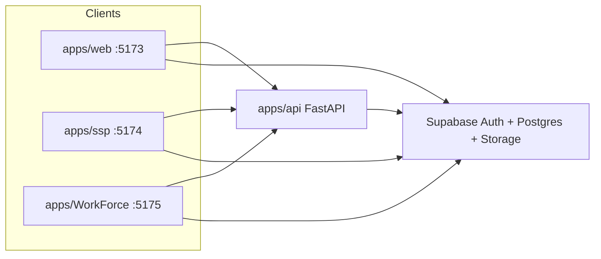
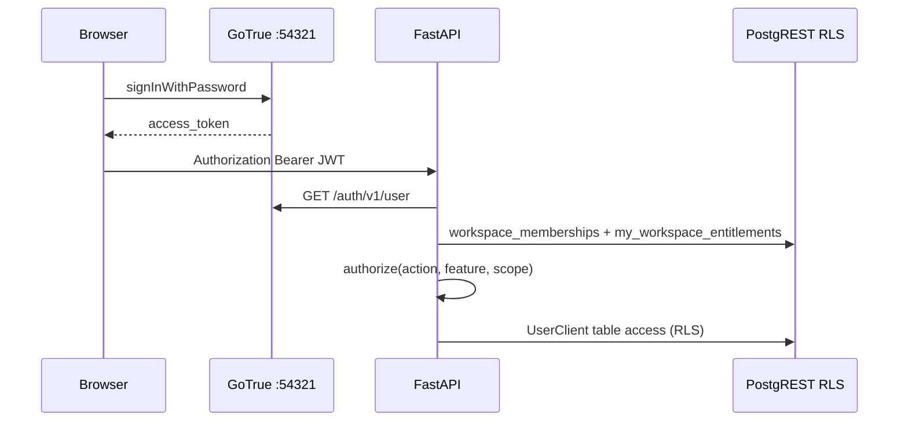
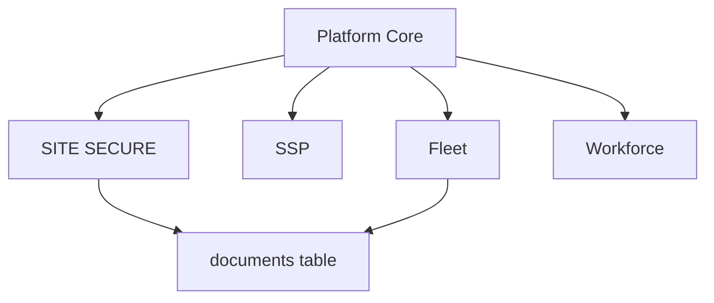

# AEGIS SPECTRA — MASTER AUDIT

**Canonical project-status document.** This file is the single authoritative reference for the current Aegis Spectra ecosystem. Historical packs remain evidence; they are not competing masters.

| Field | Value |
|-------|-------|
| Document | `AEGIS_MASTER_AUDIT.md` |
| Status | Canonical |
| Audit date | 2026-10-24 (Asia/Jerusalem) |
| Last verified | 2026-10-24 static repository inspection; 2026-10-23 local C5 runtime for SSP unit-login and plan-seat enforcement |
| Supersedes as SoT | `SITE_SECURE_CURRENT_STATE_AUDIT.txt` (2026-08-29), `Docs/PRODUCT_STATUS_UNIFIED.md` (2026-09-13), and `Docs/engineering-audit-2026-10-02/` **as the living status document**. Those files remain citable evidence. |

---

## Table of contents

1. [Document Control](#1-document-control)
2. [Executive Summary](#2-executive-summary)
3. [Product and Platform Overview](#3-product-and-platform-overview)
4. [Complete Repository and Architecture Map](#4-complete-repository-and-architecture-map)
5. [Master Feature Inventory](#5-master-feature-inventory)
6. [SITE SECURE Detailed Assessment](#6-site-secure-detailed-assessment)
7. [SSP Detailed Assessment](#7-ssp-detailed-assessment)
8. [Fleet Management Detailed Assessment](#8-fleet-management-detailed-assessment)
9. [Workforce Detailed Assessment](#9-workforce-detailed-assessment)
10. [Billing & Plans Assessment](#10-billing--plans-assessment)
11. [Database and Data Integrity](#11-database-and-data-integrity)
12. [Security Assessment](#12-security-assessment)
13. [UI/UX and Design-System Assessment](#13-uiux-and-design-system-assessment)
14. [Testing and Operational Readiness](#14-testing-and-operational-readiness)
15. [Master Issues and Missing Features Register](#15-master-issues-and-missing-features-register)
16. [Prioritized Product Roadmap](#16-prioritized-product-roadmap)
17. [Next Sprint](#17-next-sprint)
18. [Definition of Production Readiness](#18-definition-of-production-readiness)
19. [Decisions Required from the Founder](#19-decisions-required-from-the-founder)
20. [Current Status and Next Action](#20-current-status-and-next-action)

---

## 1. Document Control

### 1.1 Title and purpose

This document describes the **actual repository** so the founder and a new senior engineer can operate without repeating the audit: what exists, what works, what is partial or mocked, how data flows, which risks matter first, and how to know a phase is done.

It does **not** describe the intended future product as if it were shipped.

### 1.2 Repository and git

| Item | Value | Evidence |
|------|-------|----------|
| Workspace | `SiteSecureV1` (also reachable as `C:\ssv1` junction) | Working tree |
| Remote | `https://github.com/aegisspectra-afk/SiteSecure.git` | `git remote -v` |
| Branch | `feat/quote-cpq-phase-ab` tracking `origin/feat/quote-cpq-phase-ab` | `git status -sb` |
| HEAD | `22aac6a32851681cbc40d0d0ac8f267b52d43440` | `git rev-parse HEAD` |
| HEAD subject | `feat: ship Workforce Stage 3 with SSP, Fleet, and platform product surfaces` | `git log -1` |
| HEAD date | 2026-10-20 17:48:31 +0300 | `git log -1` |
| HEAD author | aegisspectra-afk / aegisspectra@gmail.com | `git log -1` |

Earlier pack `Docs/engineering-audit-2026-10-02/` was taken at HEAD `23a8121f802ec71b27f100f938b595cb6c1e24e4` (2026-10-01 CCTV designer). **This master describes the later HEAD plus the dirty working tree.**

### 1.3 Working-tree status at audit time

`git status` on 2026-10-24 showed a **large dirty tree**. Categories:

| Category | Examples | Implication |
|----------|----------|-------------|
| Uncommitted product code | SSP users/offices/unit-login, Workforce Stage 4b/L1/L2, web `/unit`, `/app/ssp/unit-codes` | Live local product is ahead of HEAD |
| Uncommitted migrations | `20261021120000` … `20261023140000_ssp_unit_login.sql` | Local DB may have schema HEAD does not |
| Modified tracked files | `apps/api/app/main.py`, SSP/Workforce routers, `packages/api-client`, nav, login | Same |
| Untracked Docs / QA artifacts | Many `Docs/*-REPORT.md` and screenshot folders | Evidence, not product |
| Untracked archives / images | zip files, `avatar_*.png`, `tmp/` | Not product SoT |
| Git pack warnings | `error: non-monotonic index .git/objects/pack/._pack-*.idx` | Tooling hazard (AUDIT-007 still true) |

**Do not treat HEAD as the full product.** Founding-beta SSP and unit-login exist primarily in the working tree.

### 1.4 Scope

**In scope:** `apps/web`, `apps/api`, `apps/ssp`, `apps/WorkForce`, `packages/*`, `supabase/migrations`, deploy/config (`vercel.json`, `render.yaml`), authz catalog, tests as files, existing audit/QA docs.

**Out of scope for this pass:** cloud schema equality, Production/Staging E2E, secret values, dependency CVE scan, implementing fixes.

### 1.5 Evidence methodology

| Label | Meaning |
|-------|---------|
| **Verified** | Observed in this engagement (source read, or local C5 runtime on 2026-10-23) |
| **Statically inferred** | Present in code/migrations/docs; behavior not re-executed here |
| **Unverified** | Requires live host, full suite, or remote schema proof |

**Status vocabulary (features):**

| Status | Meaning |
|--------|---------|
| IMPLEMENTED AND VERIFIED | Code exists and this engagement observed it working (or an executed suite in this engagement) |
| IMPLEMENTED BUT NOT VERIFIED | FE + API + schema wired; tests may exist; not re-run here |
| PARTIALLY IMPLEMENTED | Material path missing (no delete, no detail route, FE ahead of API) |
| UI ONLY / MOCK DATA | Screen exists without a complete write API, or shows deferred/empty product copy |
| BACKEND ONLY / NOT EXPOSED | Code or table exists; no mounted router or no UI |
| PLACEHOLDER / ENTITLEMENT STUB | Catalog permission or settings row only |
| NOT IMPLEMENTED | No meaningful product path |
| BLOCKED / DEPENDENCY MISSING | Code exists but is unwired or skipped |

`IMPLEMENTED AND VERIFIED` is **not** assigned merely because a route file or unit test file exists.

### 1.6 Known unverified areas

- Production and Staging hosts, remote migration apply order, and schema equality to `supabase/migrations`.
- Full pytest / vitest / WorkForce suites (not executed as a batch in this documentation task).
- Live RLS isolation against a disposable remote (SQL file exists: `supabase/tests/rls_isolation.sql`).
- Compiled Vercel bundle contents (service-role leak via mis-set env: not inspected).
- Fleet HTTP/RLS, quote public-token expiry, Storage ACL vs document RBAC.
- Whether cloud Supabase has `20261023*` SSP unit-login objects (**must not**; local-only by comment).

### 1.7 Prior evidence used (not replaced)

- `Docs/engineering-audit-2026-10-02/` (AUDIT-001…015, SEC-001…010)
- `Docs/architecture/PRODUCT_BOUNDARIES.md` (2026-10-19) — **partially stale** vs current `main.py`
- `Docs/architecture/WORKFORCE-INTELLIGENCE-INTEGRATION.md` — **stale** (Stage 1 only)
- `SITE_SECURE_CURRENT_STATE_AUDIT.txt` — **stale counts**
- `README.md` — **stale scaffold narrative**
- Local C5 notes from 2026-10-23: API `127.0.0.1:8001`, Vite `localhost:5173`, Auth `127.0.0.1:54321`

---

## 2. Executive Summary

### 2.1 Maturity (defined, not scored)

**Method:** a product area is *founding-beta capable* only if (a) FE+API+DB+authz exist, (b) a human can complete a primary workflow, and (c) isolation is fail-closed in code. It is *production-ready* only if Section 18 gates pass.

| Area | Maturity | Basis |
|------|----------|--------|
| Platform Core (auth, workspace, entitlements, admin) | Founding-beta capable; not production-certified | Wired; local session observed; no CI; no provider billing |
| SITE SECURE (CRM + quotes/CPQ) | Deepest product; founding-beta capable | Large surface + tests; golden path historically certified 2026-09-30, **not re-run** |
| SSP | Founding-beta locally in working tree | Forms/offices/users/assignments/patrols coded; unit-login verified locally 2026-10-23; cloud schema **unverified / must not have local-only migration** |
| Fleet | Implemented, thinly tested | Vehicles/km/assignments/reports coded; almost no HTTP/RLS tests |
| Workforce | Scheduling core implemented in `apps/WorkForce` | Clock, availability, reports, publish/swaps **not implemented** |
| Billing | Process/admin only | New workspace gets `subscriptions.status = 'active'` with **no Stripe** |

### 2.2 Strongest existing capabilities

1. Multi-tenant workspace + JWT + `authorize()` + RLS helpers (`0007_auth_helpers.sql`).
2. SITE SECURE commercial loop: customer → site → catalog → quote/CPQ/CCTV → public token PDF/approve → project.
3. Hebrew-first RTL shell, dark-mode tokens, AppShell, settings hub.
4. SSP digital forms, office/unit model, GoTrue Admin user provision, site assignments, patrols/checkpoints/events (working tree + HEAD SSP foundation).
5. Operational unit-login (rotating hashed codes, scoped session, no minted JWT) **verified on Local Supabase 2026-10-23**.
6. Workforce week board with conflict validation in `apps/WorkForce`.
7. Platform Admin surfaces and product entitlement overrides.

### 2.3 Biggest gaps

1. **No payment provider.** Workspaces look “active” without checkout.
2. **Unwired routers** still: `ipam.py`, `connections.py`, `customer_portal.py` (`AUDIT-001`).
3. **SITE SECURE holes:** notes/activities unused, installations not a module, jobs not in primary nav, quote “send” is a link not email. Warranty GET/PATCH and contact PATCH/DELETE landed locally 2026-10-24.
4. **SSP:** no attachments, signatures, submission approval, or exports; several nav items are explicit stubs (`SSP_UNIMPLEMENTED_NAV`).
5. **Fleet:** missing HTTP/RLS tests; vehicle documents list-only.
6. **Workforce:** no clock/attendance, availability, notifications, reports, publish/approve/swaps.
7. **No GitHub Actions.** Quality is local + Vercel build discipline.
8. **Working tree ≠ HEAD.** Risk of losing or mis-deploying SSP/unit-login/Workforce additions.
9. **Dual SoT:** catalog `features` vs `0050` capabilities; `seats_*` vs `max_members`/`max_technicians`.
10. **`database.ts` drift** vs later migrations.

### 2.4 Security and reliability concerns

Highest: privileged `ServiceClient` after FastAPI checks on public token paths; in-process rate limits; Storage ACL historically coarser than document RBAC (suspected, not re-proven); local env files on disk; git pack AppleDouble indexes; FE calling unwired INF/portal APIs.

### 2.5 Readiness for real customers

**Not production-ready for paying customers.**

Suitable for: founder-operated founding beta, local/demo workspaces, and carefully gated early-access **if** tenants are created by the team, backups are manual, and optional products (SSP/Fleet/Workforce) are enabled deliberately.

Not suitable for: self-serve paid signup, unattended multi-tenant production, or claiming PCI/billing completeness.

**Production-ready today:** no module, including Site Secure quotes. Historical Sep-30 E2E is documentation, not a current certificate.

---

## 3. Product and Platform Overview

Aegis Spectra is the **ecosystem name**. SITE SECURE is the original installation/service SaaS. Later products mount on the same platform (Auth, workspaces, entitlements, one FastAPI).



### 3.1 Aegis Spectra Platform (Core)

**Intended:** identity, tenancy, memberships, invitations, entitlements, Platform Home, Platform Admin.

**Verified ownership:** `profiles`, `workspaces`, `workspace_memberships`, invitations, `plans` / `subscriptions` / `workspace_feature_overrides`, `GET /api/v1/platform/home`, `/admin`, `PUT /api/v1/me/active-workspace`.

**Boundary:** does not own CRM rows, quote lines, SSP form bodies, or fleet telemetry.

### 3.2 SITE SECURE

**Intended:** CRM, sites, catalog, quotes/CPQ, projects, jobs, service for security installers.

**Verified:** those domains have mounted routers and `/app/*` routes (except jobs, which are routed but not primary-nav).

**Not a Site Secure module:** SSP, Fleet, Workforce (separate entitlements). Search and dashboard remain Site Secure surfaces (`PRODUCT_BOUNDARIES.md`).

### 3.3 SSP (Security Service / patrol operations)

**Intended:** digital forms, offices/units, officers, assignments, patrols, checkpoints, events, field device and unit-code access.

**Verified implementation (code + local C5 for unit-login):** forms, versions, site assignments, offices, Auth-Admin users, activation codes, patrols, events, unit sessions.

**Not implemented:** attachments, wet/drawn signatures, submission approval, outbound email/Push, live GPS, distress, advanced reports.

### 3.4 Fleet Management

**Intended:** vehicles, km, maintenance, assignments, departments, reports.

**Verified in code:** those tables and `/app/fleet/*` + `fleet.py` / `fleet_ops.py` / `fleet_reports.py`.

**Boundary:** no CRM `customer_id` FKs in FleetMaster migration. Documents physically shared (`documents` table, `entity_type=vehicle`).

### 3.5 Workforce

**Intended:** employees, sites/positions, week scheduling, conflicts, later attendance and payroll-grade reports.

**Verified:** `apps/WorkForce` is the product UI; `apps/web/src/routes/app/workforce/*` redirects via `WorkforceLegacyRedirect.tsx`. API `workforce.py` + `apps/api/app/workforce/*`.

**Workforce sites/employees are not CRM sites/customers.**

### 3.6 Billing & Plans

**Intended later:** paid plans, checkout, invoices.

**Verified now:** catalog plans `solo` / `business` / `enterprise` (UI labels Free / Pro / Enterprise), usage meters, seat enforcement, demo plan picker at `/app/platform-path/plans` using `writeDemoPlanKey`. **No Stripe SDK, no checkout route, no webhook functions.**

New workspaces insert `subscriptions.status = 'active'` (`20261020190000_workforce_member_role_and_provision.sql`, `workspaces.create_workspace`). That is **admin/process activation**, not payment.

Solo optional products default **off**: `SOLO_DEFAULT_DISABLED = {fleet, ssp, workforce}` in `apps/api/app/product_entitlements.py`. Local G1 workspace used in C5 had SSP enabled via override — that is an exception, not the Solo default.

---

## 4. Complete Repository and Architecture Map

### 4.1 Repository structure

```
SiteSecureV1/
  apps/web              React 19 + Vite 6 + TanStack Router/Query (platform + SITE SECURE + SSP/Fleet mounts)
  apps/api              FastAPI (Python ≥3.12)
  apps/ssp              Standalone SSP Vite app (port 5174)
  apps/WorkForce        Standalone Workforce Vite app (port 5175)
  packages/authz        catalog.json + TS can()
  packages/api-client   createApiClient
  packages/ui           design-system components
  packages/design-system
  packages/types        database.ts only (no package.json)
  supabase/migrations   108 SQL files (00xx + 2026xxxxxxxx)
  supabase/migration-history
  deploy/Dockerfile.api
  scripts/vercel-build.mjs
  Docs/                 audits, QA, architecture
```

Root `package.json` workspaces: `apps/web`, `apps/ssp`, `apps/WorkForce`, `packages/*`. API is **not** an npm workspace.

`apps/mobile`: **not present**. `.env.example` still mentions Expo keys.

### 4.2 Entry points

| Layer | Entry | Evidence |
|-------|-------|----------|
| Web | `apps/web` Vite; routes from `apps/web/src/routeTree.gen.ts` | Statically inferred |
| API | `create_app()` in `apps/api/app/main.py`; `app = create_app()` | Verified |
| Local C5 API | `apps/api/scripts/_run_c5_local_api.py` → `127.0.0.1:8001` | Verified 2026-10-23 |
| Local C5 web | `apps/api/scripts/_run_c5_local_web.py` → `localhost:5173` proxy `/api` → 8001 | Verified 2026-10-23 |
| SSP standalone | `npm run ssp:dev` port 5174 | package.json |
| Workforce standalone | `npm run workforce:dev` port 5175 | package.json |
| Default API (non-C5) | port 8000 in `.env.example` / CORS defaults | Statically inferred |

### 4.3 Frameworks and dependencies (declared)

| Layer | Stack |
|-------|--------|
| Web | React 19, Vite 6, TanStack Router, TanStack Query, Zod |
| API | FastAPI ≥0.115, Pydantic v2, httpx, fpdf2, openpyxl |
| Auth/DB | Supabase GoTrue + PostgREST + Storage |
| Authz | `packages/authz/catalog.json` |

Exact lockfile versions were not re-diffed in this pass.

### 4.4 Database and storage

Postgres via Supabase. Tenant key is `workspace_id`. Auth users live in GoTrue `auth.users`; business identity in `public.profiles`. Storage buckets historically `documents`, `photos`, `signatures`, `exports` (`0023_storage.sql`). Live bucket ACL: **unverified**.

### 4.5 Authentication and authorization flow



Public paths **do not** use a user JWT: quote share token; SSP assignment token; site device token (`X-SSP-Device-Token`); unit token (`X-SSP-Unit-Token`). FastAPI validates hashes, then `ServiceClient` performs DB writes. This is the existing operational-session pattern — **not** a hand-minted user JWT.

Frontend `can()` is UX only. Security boundary is API `require()` + RLS.

### 4.6 Workspace and tenant model

- Tenant = `workspaces` row. Ownership is a membership role, not `owner_id` (`0004_workspaces.sql`).
- `workspace_memberships.role_key` (+ optional `workspace_role_key`).
- Active workspace: API sorts `last_workspace_id`; UI still often reads `session.memberships[0]` after hydrate.
- Switcher exists: `WorkspaceSwitcher`, `PUT /api/v1/me/active-workspace` (AUDIT-009 **partially stale**).
- Product enablement: Platform Admin overrides; members cannot self-enable locked/optional products.

### 4.7 Module dependencies



Shared: Auth, memberships, entitlements, audit_logs, documents table, profiles.

SSP does not import Fleet routers. Workforce employees are a separate directory.

### 4.8 API and data flows (mounted)

From `create_app()` in `apps/api/app/main.py` (working tree):

health, auth, platform_home, workspaces, workspace_settings, workspace_products, feedback, telemetry, admin, team, customers, sites, systems, search, jobs, ops_modules, quotes, quote_cpq, system_designs, catalog, catalog_import, cctv, public_quotes, documents, dashboard, fleet, fleet_ops, fleet_reports, ssp_forms, ssp_ops, ssp_org, ssp_sites, ssp_users, ssp_site_activation, ssp_unit_codes, public_ssp, public_ssp_site, public_ssp_unit, workforce.

**On disk, not mounted:** `apps/api/app/routers/ipam.py`, `connections.py`, `customer_portal.py`.

### 4.9 Deployment and environments

| Target | Config | Status |
|--------|--------|--------|
| Web / SSP / WorkForce | `vercel.json` + `scripts/vercel-build.mjs`; `SITESECURE_VERCEL_APP` = web \| ssp \| workforce | Statically inferred |
| API | `render.yaml` Docker `deploy/Dockerfile.api`, health `/health` | Statically inferred |
| Auth/DB | Hosted Supabase **or** local `127.0.0.1:54321` | Local C5 verified 2026-10-23 |
| CI | No `.github/workflows` | Verified absence |

**Conflict:** developer `.env` / `apps/web/.env.local` may still point at cloud `:8000` / `*.supabase.co` while C5 uses `.env.c5.local`. Mixing them caused real 400 login failures in this project’s local work. **Do not treat cloud `.env` as the C5 target.**

---

## 5. Master Feature Inventory

Columns: Module · Feature · Frontend · Backend/API · Database · Authorization · Tests · Status · Evidence · Missing Work.

Statuses follow Section 1.5. “Tests exist” ≠ verified in this pass unless noted.

| Module | Feature | Frontend | Backend/API | Database | Authorization | Tests | Status | Evidence | Missing Work |
|--------|---------|----------|-------------|----------|---------------|-------|--------|----------|--------------|
| Platform | Email/password login | `login.tsx`, `LoginForm.tsx` | GoTrue + `GET /auth/session` | `auth.users`, `profiles` | JWT | `apps/web/tests/auth.test.tsx` | IMPLEMENTED AND VERIFIED | Local C5 2026-10-23 (`ilya.kerner@g1-group.com`); `signInWithPassword` | Cloud password ≠ local Auth if not provisioned locally |
| Platform | Register / verify / reset | `register.tsx`, `verify-email`, forgot/reset | GoTrue | Auth | Public + JWT | web auth tests | IMPLEMENTED BUT NOT VERIFIED | Routes + vercel noindex list | Live email delivery |
| Platform | Workspace create/join | onboarding, `/platform` | `workspaces.py`, RPC `create_workspace` | `workspaces`, memberships, subscriptions | authenticated | API workspace tests | IMPLEMENTED BUT NOT VERIFIED | `0004`, `20261020190000` | Remote apply |
| Platform | Entitlements | settings/products | `my_workspace_entitlements`, overrides | `0008`, `0041`, `0050` | feature map | usage/quota tests | IMPLEMENTED BUT NOT VERIFIED | Dual SoT catalog vs capabilities | Unify SoT |
| Platform | Platform Admin | `/admin/*` | `admin.py` | `platform_admin_*` | `is_platform_admin` | beta QA docs | IMPLEMENTED BUT NOT VERIFIED | `admin/route.tsx` | Live admin cert |
| Platform | Workspace switcher | `WorkspaceSwitcher` | `PUT /me/active-workspace` | `profiles.last_workspace_id` | membership | — | PARTIALLY IMPLEMENTED | Switcher exists; many screens still `memberships[0]` | Finish AUDIT-009 |
| SITE SECURE | Customers | `customers/*` | `customers.py` CRUD | `0010_customers.sql` | `crm.*` | web + `test_domain_api.py` | IMPLEMENTED BUT NOT VERIFIED | routers + routes | Notes/activities APIs |
| SITE SECURE | Contacts | `CustomerProfile.tsx` | list/create/PATCH/DELETE | `customer_contacts` | `crm.view` / `crm.edit` / `crm.delete` | `test_customer_contacts.py` | IMPLEMENTED BUT NOT VERIFIED | T2-2 landed 2026-10-24 (local) | Live profile cert |
| SITE SECURE | Leads | `leads/*` | `ops_modules.py` | `0014`, `0033` | `leads.*` | `test_leads.py` | IMPLEMENTED BUT NOT VERIFIED | | |
| SITE SECURE | Sites | `sites/*` | `sites.py` | `0011_sites.sql` | `sites.*` | site dossier tests | IMPLEMENTED BUT NOT VERIFIED | | IPAM unwired |
| SITE SECURE | Equipment/assets | site dossier, asset routes | `systems.py` list/create/patch | `20260928095836_*` | `systems.*` | INF1 tests | PARTIALLY IMPLEMENTED | no DELETE; plan→installed not mounted | Mount `create_installed_assets_from_plan` |
| SITE SECURE | Catalog | `catalog.tsx` | `catalog.py`, `catalog_import.py` | `0015` + import RPCs | `catalog.*` | import tests | IMPLEMENTED BUT NOT VERIFIED | categories GET-only | Category write |
| SITE SECURE | Quotes / CPQ | `quotes/*`, `QuoteBuilder.tsx` | `quotes.py`, `quote_cpq.py` | `0016`, CPQ migrations | `quotes.*` | large quote test set | IMPLEMENTED BUT NOT VERIFIED | Sep-30 cert historical | Re-run E2E; email send |
| SITE SECURE | Public quote | `q/$token`, `public/quotes` | `public_quotes.py` | quote tokens | share token | quote public tests | IMPLEMENTED BUT NOT VERIFIED | | Token ops live |
| SITE SECURE | CCTV designer | quote builder | `cctv.py`, `system_designs.py` | `0054`–`0056` | `quotes.edit` | cctv tests | IMPLEMENTED BUT NOT VERIFIED | | Non-CCTV builders are stubs |
| SITE SECURE | Projects | `projects/*` | `ops_modules.py` | `0017`, planned items | `projects.*` | project-from-quote tests | IMPLEMENTED BUT NOT VERIFIED | | |
| SITE SECURE | Jobs / field | `jobs/*`, `FieldJob.tsx` | `jobs.py` lifecycle | `0017`, `0051` | `jobs.*` | `test_job_lifecycle.py` | IMPLEMENTED BUT NOT VERIFIED | **not in `appNav()`** | Nav + delete |
| SITE SECURE | Service calls | `service/index.tsx` | `ops_modules` list/create/patch/create-job | `0018` | `service.*` | — | PARTIALLY IMPLEMENTED | no `$callId` route | Detail route |
| SITE SECURE | Installations module | — | job `kind=installation` | job_kind enum | jobs | — | NOT IMPLEMENTED | `app-nav.ts` comment | Product decision |
| SITE SECURE | Tasks / “Calendar” | `tasks/index.tsx` | `ops_modules` tasks | `0020_tasks_ops.sql` | `calendar.*` | — | PARTIALLY IMPLEMENTED | list, not a scheduler | True calendar |
| SITE SECURE | Dashboard / Today | `dashboard.tsx`, `today.tsx` | `dashboard.py` | aggregates | `dashboard.view` | dashboard tests | IMPLEMENTED BUT NOT VERIFIED | API-backed | |
| SITE SECURE | Documents | embedded | `documents.py` upload/url | `0013` | `documents.*` | durability tests | IMPLEMENTED BUT NOT VERIFIED | no delete | Delete + ACL proof |
| SITE SECURE | Photos | kind=photo filters | same documents API | `document_kind` | documents | — | PARTIALLY IMPLEMENTED | no photos product | |
| SITE SECURE | Warranties | `warranties/*` | list + create only | `0019` | `warranties.*` | FE tests | PARTIALLY IMPLEMENTED | no GET/PATCH router | Add GET/PATCH |
| SITE SECURE | Knowledge | `knowledge/index.tsx` | list/create/patch | ops | `knowledge.*` | — | PARTIALLY IMPLEMENTED | no article route | |
| SITE SECURE | Search | `CommandPalette.tsx` | `search.py` | multi-entity | per-entity | — | IMPLEMENTED BUT NOT VERIFIED | | |
| SITE SECURE | Customer portal | `portal/*` | `customer_portal.py` **unmounted** | `20260926213103_*` | portal | `test_customer_portal.py` | BLOCKED / DEPENDENCY MISSING | `main.py` omit | Mount or hide FE |
| SITE SECURE | IPAM / topology | site network panels | `ipam.py`, `connections.py` **unmounted** | `20260928103052_*` | systems | INF1b/c tests | BLOCKED / DEPENDENCY MISSING | AUDIT-001 | Mount or hide FE |
| SITE SECURE | Inventory / finance / reports / AI | settings entitlement rows | none | catalog features | entitlement | — | PLACEHOLDER / ENTITLEMENT STUB | `catalog.json` | Do not sell as shipped |
| SITE SECURE | Maps / GPS | Google search URLs | — | — | — | — | NOT IMPLEMENTED | `address.ts` | |
| SITE SECURE | Notifications settings | `settings/notifications.tsx` | no list router | `0021_notifications.sql` | — | — | PLACEHOLDER / ENTITLEMENT STUB | future copy | |
| SSP | Form builder + publish | `ssp/forms*` | `ssp_forms.py` | `20261019140000_*` | `ssp.forms.*` + product role | `test_ssp_forms_schema.py` | IMPLEMENTED BUT NOT VERIFIED | C5 acceptance exists, not run this doc pass | Live archive E2E |
| SSP | Field types / validation | `SspFormFields.tsx` | `forms_schema.py` | jsonb snapshot | same | schema tests | IMPLEMENTED BUT NOT VERIFIED | no file/signature types | Attachments |
| SSP | Submissions | submissions + my-forms | submit endpoints | `ssp_form_submissions` status=`submitted` only | `ssp.submissions.*` | assignment tests | IMPLEMENTED BUT NOT VERIFIED | | Review workflow |
| SSP | Submission approval | — | — | CHECK submitted only | — | — | NOT IMPLEMENTED | migration CHECK | |
| SSP | Attachments / signatures | — | — | — | — | — | NOT IMPLEMENTED | field types list | |
| SSP | Site assignments | `assignments.tsx` | `ssp_sites.py` | `20261020120000_*` | ssp.forms / sites | `test_ssp_sites_and_form_assignments.py` | IMPLEMENTED BUT NOT VERIFIED | | |
| SSP | Offices / org | `offices.tsx`, `organization.tsx` | `ssp_org.py`, sites kind | org + sites | product role | org tests | IMPLEMENTED BUT NOT VERIFIED | | |
| SSP | User provision | `users.index.tsx` | `ssp_users.py`, `provision.py` | profiles + memberships + `ssp_memberships` | `ssp.members.*` | `test_ssp_provision.py`; local 409 seat | IMPLEMENTED AND VERIFIED | GoTrue Admin path; 409 `PLAN_LIMIT_REACHED` observed | Seat UX clarity |
| SSP | Unit-code login | `LoginForm` unit mode, `/unit`, `unit-codes.tsx` | `ssp_unit_codes.py`, `public_ssp_unit.py` | `20261023140000_ssp_unit_login.sql` | manager issue; hashed redeem | `test_ssp_unit_login.py` **21 passed**; `test_ssp_unit_login_c5.py` **1 passed**; browser 2026-10-23; `ssp-unit-login-copy.test.ts` 2026-10-24 | IMPLEMENTED AND VERIFIED | Local 54321/8001/5173 only; **uncommitted**. Login/office copy now names unit-login vs device activation; hashing/redeem unchanged | Commit; do not apply to cloud |
| SSP | Device activation | ssp `/activate`, enrollments | `ssp_site_activation.py`, `public_ssp_site.py` | activation tables | hashed codes | activation tests; live writes skipped | IMPLEMENTED BUT NOT VERIFIED | C5 write skips in gate | Unskip live proofs |
| SSP | Patrols / checkpoints / scans | patrols, checkpoints, scan | `ssp_ops.py` | ops + C2 migrations | ssp ops grants | ops tests | IMPLEMENTED BUT NOT VERIFIED | | Auto-schedule |
| SSP | Events / alerts | `events*` | events API | `ssp_events` | ssp | ops tests | IMPLEMENTED BUT NOT VERIFIED | alerts derived | |
| SSP | Reports / export | `reports.tsx` | dashboard counts only | — | view | — | UI ONLY / MOCK DATA | `sspReportsDeferred` | Export API |
| SSP | Messages / Push / email / GPS / distress | messages, mobility copy | — | — | — | `ssp-nav.test.ts` | PLACEHOLDER / ENTITLEMENT STUB | `SSP_UNIMPLEMENTED_NAV` | |
| Fleet | Vehicles | `fleet/vehicles*` | `fleet.py` | `20261006120000_fleetmaster.sql` | `fleet.*` | `test_fleetmaster.py` helpers only | IMPLEMENTED BUT NOT VERIFIED | no HTTP/RLS tests | Add HTTP tests |
| Fleet | Mileage + validation | `mileage.tsx` | POST mileage | `fleet_mileage_logs` | fleet.edit | helper tests | IMPLEMENTED BUT NOT VERIFIED | no decrease/negative | HTTP proof |
| Fleet | Assignments / maintenance / schedules / depts | fleet pages | `fleet_ops.py` | fleet_* | fleet | helpers | IMPLEMENTED BUT NOT VERIFIED | | |
| Fleet | Reports CSV | fleet reports UI | `fleet_reports.py` | queries | `fleet.reports` | — | IMPLEMENTED BUT NOT VERIFIED | | |
| Fleet | Vehicle documents | list on vehicle | shared `documents.py` | `entity_type=vehicle` | `documents.*` not `fleet.documents` | — | PARTIALLY IMPLEMENTED | upload not on Fleet UI | Bind upload |
| Fleet | Seed-demo | — | `POST /fleet/seed-demo` | — | fleet | — | BACKEND ONLY / NOT EXPOSED | | |
| Workforce | Employees + provision | WorkForce EmployeesPage | `workforce.py`, `provision.py` | `workforce_employees` | workforce.* | provision + RLS tests | IMPLEMENTED BUT NOT VERIFIED | isolated RLS file exists | Run isolated suite |
| Workforce | Week schedule + conflicts | `SchedulesPage.tsx` | shifts/slots/validate | `workforce_shifts*` | schedules.* | engine + stage3/4b | IMPLEMENTED BUT NOT VERIFIED | | Publish/approve |
| Workforce | My shifts | portal | `GET /workforce/me/shifts` | same | `workforce.portal.view` | `test_workforce_me_shifts.py` | IMPLEMENTED BUT NOT VERIFIED | | |
| Workforce | Time-off | list UI | list+create API | absences | — | — | PARTIALLY IMPLEMENTED | no approve UI | |
| Workforce | Positions | list | GET only | positions | — | — | PARTIALLY IMPLEMENTED | copy: no create | |
| Workforce | Availability | — | — | — | — | — | NOT IMPLEMENTED | dashboard copy | |
| Workforce | Clock / attendance | — | `clock.py` TZ helpers only | — | — | — | NOT IMPLEMENTED | | |
| Workforce | Notifications | — | — | — | — | — | NOT IMPLEMENTED | | |
| Workforce | Reports / optimize / swaps / publish | ReportsPage blocked | permissions only | — | catalog stubs | nav.test no /optimize | PLACEHOLDER / ENTITLEMENT STUB | | |
| Workforce | Rule catalog / legal instruments | — | API + migrations | L1/L2 SQL | service | `test_workforce_l1_catalog.py` | BACKEND ONLY / NOT EXPOSED | | UI |
| Billing | Plan catalog + usage | dashboard, settings, `platform-path/plans` | `usage.py`, `GET …/usage` | `0008`, `0038` | plan limits | quota tests | IMPLEMENTED BUT NOT VERIFIED | demo `writeDemoPlanKey` | Professional pricing page |
| Billing | Checkout / Stripe / invoices | — | — | `provider_ref` unused | — | — | NOT IMPLEMENTED | AUDIT-006 | Phase 7 only |
| Billing | Seat enforcement | users/invite/SSP create | `evaluate_seat_limit` | occupancy | 409 PLAN_LIMIT | `test_limits.py`; **409 observed 2026-10-23/24** | IMPLEMENTED AND VERIFIED | Free `seats_field=3`; 4th officer blocked | Clearer UI details |

---

## 6. SITE SECURE Detailed Assessment

**Do not mark implemented because a route exists.** The following is code-backed.

### 6.1 CRM and customers

CRUD is mounted (`customers.py`). Assigned-scope filter exists. `customer_notes` and `customer_activities` tables have **no router**. Profile activity is **derived** in `apps/web/src/lib/customer-profile.ts` (`buildCustomerActivity`).

**Defects:** contact PATCH/DELETE landed locally 2026-10-24 (T2-2). Notes/activities still have no router.

### 6.2 Sites and equipment

Site CRUD + dossier + assets. `installation_status` is a **site field**, not an installations product. `create_installed_assets_from_plan` is unit-tested and **not called from any router**. Sep-30 cert documented installed-assets 404 — **needs re-verify**.

IPAM / topology routers remain **unmounted**. Live `AssetDetail` no longer calls them (T0-2b, 2026-10-24): equipment `ip`/`mac` only; connections section hidden. Orphan `SiteNetworkPanel` / `SiteTopologyPanel` / `AssetConnectionsSection` still exist on disk and are not composed on live routes.

### 6.3 Jobs, service, installations, scheduling

Jobs have a full dispatch lifecycle (`en_route`, `arrived`, `start`, `complete`, assign, checklist) but **no sidebar item**. Service is a single index page (create + select + spawn job); no `$callId`. Installations are `job_kind` + checklist seed only. “Calendar” nav is the **tasks list**.

### 6.4 Quotations, catalog, documents

Deepest module. Send mints a **public URL**; no SMTP in `quotes.py`. Non-CCTV system builders documented as UI stubs (`Docs/QUOTE-BUILDER-CAPABILITY-AUDIT.md`). Catalog category write is GET-only. Documents: upload/list/signed URL; **no delete**. Photos reuse document kinds.

### 6.5 Dashboards and reporting

`GET /dashboard` is live-shaped, not mock G1 fixtures. Analytics page reuses dashboard and is **not in `appNav()`**. Product Reports (`reports.view`) has **no reports router**.

### 6.6 Settings and onboarding

Most settings panels have APIs. Notifications is an explicit future panel. Appearance redirects to profile. Onboarding creates/joins a workspace (Platform-owned).

### 6.7 Known workflow holes

Customer 360 persistence; catalog import → quote → email; CCTV apply live E2E; quote version compare after historical 404; quote → project → installation job → installed assets; service → field job → auto-close; warranty studio GET/PATCH; portal; IPAM; multi-membership correctness.

---

## 7. SSP Detailed Assessment

Two UIs share one API: embedded `/app/ssp/*` and standalone `apps/ssp`. Public tablet: `/ssp/$token`. Unit identity: `/unit`.

### 7.1 Implemented in code

Forms (draft/publish/archive), definition schema, officer and site-assignment submit, offices/ops_centers, org units, GoTrue Admin provision (`provision_ssp_user` — **not** PostgREST insert into `auth.users`), site assignments, activation codes + device sessions, patrols/stops/runs/scans, checkpoints + print, events, dashboard `data_mode` (`live` \| `empty` \| `unavailable` — honest empty, not mock G1).

### 7.2 Unit-login (working tree; verified locally)

| Item | Fact |
|------|------|
| Migration | `supabase/migrations/20261023140000_ssp_unit_login.sql` — comment: local only |
| Issue/display/revoke | JWT manager, `ssp_unit_codes.py` |
| Redeem | `ssp_redeem_unit_login_code` SECURITY DEFINER, `FOR UPDATE`, hash only |
| Session | `X-SSP-Unit-Token`, 8h, site-scoped, no admin |
| Tests executed 2026-10-23 | `test_ssp_unit_login.py` 21 passed; `test_ssp_unit_login_c5.py` 1 passed |
| Browser 2026-10-23 | Code `XC8F-ER26` for שפלה 3 → `/unit`; `/app/ssp/users` redirected to `/unit`; reuse showed «קוד היחידה אינו תקף» |
| UX 2026-10-24 | Login unit mode helper: issued from `/app/ssp/unit-codes`, 10 minutes, single-use, not a device code. Office “עוד” keeps device activation on `/app/ssp/sites` and adds unit-login on `/app/ssp/unit-codes`. No redeem/hash change. |

**Not verified:** cloud apply (must not happen); Redis-shared rate limit; 8h expiry wall-clock.

### 7.3 Placeholders (explicit)

`SSP_UNIMPLEMENTED_NAV` in `apps/web/src/lib/ssp-nav.ts`: Push, outbound email, realtime location, automatic task scheduling, attendance reporting, distress, advanced analytics.

No SSP file/photo/signature field types. Submission status cannot be approved/rejected. No SSP export endpoints.

### 7.4 Authz conflict

Ops actions live in `apps/api/app/ssp/product_authz.py` and are **not all** in `packages/authz/catalog.json`. Settings RBAC cannot grant every SSP ops action through the standard role editor.

### 7.5 Seat collision with Site Secure plans

Creating a fourth `patrol_officer` on Free hits `PLAN_LIMIT_REACHED` (`seats_field` = 3; officers map to `technician`). Observed Hebrew message: «הגעתם למגבלת התוכנית הנוכחית». Unit-code login **does not** consume a seat.

---

## 8. Fleet Management Detailed Assessment

Fleet is `/app/fleet/*` only (no standalone app). Gate: feature `fleet` (Solo default off).

**Present:** vehicles CRUD/archive; mileage with monotonic validation; history logs; assignments start/end; maintenance; departments + memberships; schedules; equipment on vehicle; import parse/preview/commit; CSV reports (`fleet.reports`).

**Missing / unverified:** HTTP and RLS tests (only `test_fleetmaster.py` helpers); Fleet UI document upload; `fleet.documents` permission unused by `documents.py`; seed-demo not exposed in UI.

**Do not claim** live km fraud-resistance or tenant isolation without HTTP/RLS execution.

---

## 9. Workforce Detailed Assessment

**Product UI:** `apps/WorkForce`. **Web `/app/workforce`:** redirect + session handoff (`workforce-app-url.ts`, `auth-handoff.ts`).

**Working in code:** employee directory + Auth Admin provision; disable rules; week board; slots; assignments; validate/coverage/materialize; conflict engine (overlap, rest, cap, qualifications, absences); my-shifts portal; policy GET/PUT (UI read-only); L1 rule catalog + L2 shift engine **API-only**.

**Incomplete:** positions list-only; time-off list-only; no availability table; `clock.py` is timezone helpers, not punch; no notifications; reports page blocked; optimize/approve/publish/swaps are catalog keys without routes (`apps/WorkForce/src/lib/nav.test.ts` asserts `/optimize` absent).

`Docs/architecture/WORKFORCE-INTELLIGENCE-INTEGRATION.md` describing Stage 1 only is **stale**.

---

## 10. Billing & Plans Assessment

### 10.1 What exists

- Plans in `packages/authz/catalog.json`: `solo` (Free), `business` (Pro), `enterprise`.
- DB `plans`, `plan_features`, `plan_limits`, `subscriptions`.
- Usage: `apps/api/app/authz/usage.py`, `GET /api/v1/workspaces/{id}/usage`.
- Seat checks on invite and SSP user create.
- UI: settings products (read-only entitlements), dashboard usage rings, `/app/platform-path/plans` comparison picker (`writeDemoPlanKey` is session-only and labeled comparison-only). Settings/system and platform-path show **process-active / not billed** (`BillingHonestyNote`). Quota errors no longer say “upgrade”.

### 10.2 What does not exist

No Stripe, checkout session, customer portal billing, invoices, dunning, webhooks (`supabase/functions` has README only). `subscriptions.provider_ref` is unused in app source.

### 10.3 Minimum professional UI-only work (Phase 6)

A public pricing page that lists the three catalog plans, Hebrew/English limits from `catalog.json` (operator/field seats, storage, quote/client quotas), and an in-app subscription overview that reads **real** `plan_key` + usage — **without** fake “Pay now”. Do not imply checkout.

Payment provider integration is **Phase 7, deferred**.

---

## 11. Database and Data Integrity

### 11.1 Shape

108 files in `supabase/migrations/`. Dual numbering: `0001`–`0056` then `202608*` / `202609*` / `202610*`. Lexicographic apply is `00xx` then timestamps.

Oct 2 count (87 migrations / 76 tables) is **stale**. Exact live table count: **unverified**.

`packages/types/src/database.ts` lagged migrations in Oct 2 (51 vs 76 CREATE TABLE) and is **worse now** after Fleet/SSP/Workforce (AUDIT-002).

### 11.2 Tenant isolation

Helpers in `0007_auth_helpers.sql` (`auth_is_member`, etc.), FORCE RLS on core tables. Later 202610* files generally enable RLS. Completeness vs every new table: **unverified**.

### 11.3 Conflicting sources of truth

| Conflict | Evidence |
|----------|----------|
| catalog `features` vs `0050_v3_capabilities_registry.sql` | AUDIT-005 |
| `seats_operator`/`seats_field` vs `max_members`/`max_technicians` | `catalog.json` vs `limits.py` (fallback when max_members unset) |
| PRODUCT_BOUNDARIES SSP routers vs `main.py` | Doc lists forms+public_ssp only |
| README “apps not scaffolded” vs tree | `README.md` |
| SITE-SECURE-CONTEXT Stripe/checkout | Not in current `apps/` |
| Two `0048_*` | Resolved in `migrations/`; twin in `migration-history/` (AUDIT-003 mostly stale) |

### 11.4 Integrity issues (static)

- Unused `customer_notes` / `customer_activities`.
- `create_installed_assets_from_plan` orphan.
- Warranty FE/API mismatch.
- Unit-login `display_code` stored service_role-only for kiosk redisplay; cleared on redeem/revoke.
- Deletion: customers/sites have delete; jobs/documents often do not. Cascade rules vary by migration — **runtime unverified**.

### 11.5 Backup and recovery

Scripts exist under `apps/api/scripts/durability/` (`logical_backup.py`, `logical_restore.py`, `gate10b_drill.py`). Vault paths gitignored. **No executed drill in this pass.**

Local C5 applied `20261023140000_ssp_unit_login.sql` to `127.0.0.1:54322` only (2026-10-23). Cloud apply of that file is **forbidden by its header**.

---

## 12. Security Assessment

Never reproduce secret values. `.env.example` is names-only (verified). Filled local env files exist on disk and are gitignored (presence verified; values not read).

| ID | Finding | Severity | Evidence | Confirmed or Suspected | Impact | Remediation | Regression Test |
|----|---------|----------|----------|------------------------|--------|-------------|-----------------|
| SEC-001 | INF/portal routers unwired; live asset page no longer calls IPAM/connections | High | `main.py` vs `ipam.py`, `connections.py`, `customer_portal.py`; T0-2b `AssetDetail` | Confirmed static | Portal FE still unwired; orphan IPAM panels unused | Remaining: hide portal + unused panels, or mount after review | Live asset page: no unmounted IPAM/connection calls |
| SEC-002 | `ServiceClient` after FastAPI checks on public/unit/device paths | Medium | `supabase_service.py`, `public_*.py` | Confirmed pattern | Bug in check = RLS bypass | Keep fail-closed; never pass unit token as JWT | Token reuse/expiry tests |
| SEC-003 | In-process HTTP and code-guess limiters | Medium | `main.py` burst; `public_ssp.py`; `public_ssp_unit.py` | Confirmed | Weak multi-instance | Shared store (approved design) | 429 after N fails; ignore `X-Forwarded-For` |
| SEC-004 | `founding_technician` still in `seat_buckets` | Medium | `catalog.json`; retirement migration `20260908210000_*` | Confirmed | Seat/role drift | Remove from catalog | Seat tests |
| SEC-005 | Dual entitlement registries | Medium | catalog + `0050` | **Fixed 2026-10-24 (local):** authorize + product toggles consume 0041 `my_workspace_entitlements` (admin recomputes the same COALESCE). Catalog is metadata; `0050` unused for access | Wrong feature on/off | Single effective path | T1-2: 37/37 focused entitlement tests |
| SEC-006 | `database.ts` ≠ migrations | Medium | Oct 2 delta; later tables | Confirmed stale types | Client/type bugs | Regenerate types | Typecheck |
| SEC-007 | Local env files in workspace | Medium | `.env`, `.env.c5.local`, app `.env*` exist | Confirmed presence | Sync/backup leak | Secret store; never commit | gitignore check |
| SEC-008 | CORS `allow_methods/headers=["*"]` with credentials | Low–Med | `create_app` | Confirmed | Wider than needed | Tighten methods | CORS test |
| SEC-009 | Storage ACL vs document RBAC | Medium | `0023_storage.sql`; prior SEC-004 | Suspected | Over-broad signed URLs | Bucket policies + expiry | Storage isolation test |
| SEC-010 | No GitHub Actions | Medium (ops) | no `.github/workflows` | Confirmed | Regressions ship | CI on PR | Pipeline green |
| SEC-011 | Subscriptions marked `active` without payment | High (product/security of trust) | `create_workspace` SQL/API | Confirmed | Fake paid state | Document + Phase 7 | No Stripe objects |
| SEC-012 | Public quote/SSP tokens | Info / by design | public routers | Confirmed | Token = capability | Entropy, TTL, revoke | Replay tests |
| SEC-013 | Unit `display_code` on server | Low | unit-login migration | Confirmed (service_role only) | Kiosk redisplay vs hash-only ideal | Accept or encrypt | Manager-only GET |
| SEC-014 | AppleDouble git pack indexes | Low | `git` stderr `._pack-*.idx` | Confirmed | Broken git ops | Clean pack | `git status` clean |
| SEC-015 | Service-role in browser | — | Vite clients use anon; WorkForce `production-env.ts` rejects `service_role` | Confirmed absent in source | N/A if env stays correct | Keep out of Vercel web | Bundle grep |
| SEC-016 | `UserClient` rejects service-role as user JWT | Positive control | `supabase_user.py` | Confirmed | Blocks confused-deputy login | Keep | Auth test |

IDOR: path `workspace_id` + membership + `reject_spoofed_workspace` (`identity.py`). Live cross-tenant tests exist (`test_tenant_isolation.py`, marker `live`) — **not executed this pass**.

Audit logs: `0022_audit.sql` + `write_audit` (`apps/api/app/audit.py`). Unit actions set `actor_user_id` null and `metadata.identity=unit` (no plaintext code).

---

## 13. UI/UX and Design-System Assessment

**Governance:** `Docs/design/SITE-SECURE-UI-DESIGN-RULES.md` (dark mode mandatory, RTL, tokens, one accent). Checklist: `Docs/design/SITE-SECURE-UI-REVIEW-CHECKLIST.md`.

### 13.1 What is consistent

Hebrew-first RTL AppShell; dark/light tokens; ModuleKit empty/error/loading; settings hub; Platform Home as picker; SSP `data_mode` honesty; login dual-path (password vs unit) after 2026-10-23 work.

### 13.2 Functional UX defects (not visual nits)

| Issue | Evidence |
|-------|----------|
| Jobs and analytics exist but are off primary nav | `app-nav.ts` |
| Calendar label ≠ calendar | tasks list |
| Service has no detail route | `service/index.tsx` |
| Warranty studio calls missing APIs | FE vs `ops_modules.py` |
| Portal FE without mounted API; orphan IPAM panels unused | AUDIT-001; T0-2b hid live asset IPAM/connections |
| Notifications settings dead | future copy |
| Plan limit 409 generic copy | `MESSAGES["PLAN_LIMIT_REACHED"]` vs seats |
| `memberships[0]` after switcher | many `/app` screens |
| Dual SSP / Workforce apps can confuse operators | three Vite ports |
| Stale api-client until Vite cache clear | 2026-10-23 `issueSspUnitLoginCode is not a function` |

### 13.3 Visual / a11y

Many visual QA folders under `Docs/*-qa/` (beta admin, landing, quotes, dashboard). Those are **historical screenshots**, not a current a11y audit. Responsive and WCAG completeness: **unverified** as a suite.

Dead controls vs mock data: SSP reports deferred; Workforce reports blocked; messages/mobility copy-only.

---

## 14. Testing and Operational Readiness

### 14.1 Suites (existence)

| Suite | Location | Runner | This pass |
|-------|----------|--------|-----------|
| API | `apps/api/tests/test_*.py` (~107 files) | pytest; markers `live`, `c5_local`, `c5_write` | Only unit-login tests executed (2026-10-23) |
| Web | `apps/web/tests` (~112) + some src tests | vitest | Not run this doc pass |
| UI package | `packages/ui` | vitest | Not run |
| WorkForce | `apps/WorkForce/**/*.test.ts*` | vitest | Not run |
| SQL RLS | `supabase/tests/rls_isolation.sql` | SQL | Not run |

**Executed and observed (2026-10-23):**

- `python -m pytest tests/test_ssp_unit_login.py tests/test_ssp_c5_local_gate.py` → **21 passed, 3 skipped**
- `python -m pytest tests/test_ssp_unit_login_c5.py` → **1 passed**
- Browser: unit-code issue/redeem/reuse/admin-deny as Section 7.2

Do **not** inherit “all tests green” from other dates.

### 14.2 CI/CD, monitoring, backups

- CI: **none** (AUDIT-011).
- Deploy: Vercel (web/ssp/workforce) + Render (API). Live health **unverified** this pass.
- Monitoring: API request logs + `X-Request-Id`; `@vercel/analytics`. No Sentry/OTel in app source.
- Backups: durability scripts present; execution **unverified**.

### 14.3 Local C5 (observed)

Frontend + Auth + API on loopback 5173 / 54321 / 8001. Mixing cloud `.env` with local Auth produced `invalid_credentials` (400). That is an **environment** defect, not an Auth design defect.

---

## 15. Master Issues and Missing Features Register

Duplicate Oct-2 IDs are mapped, not cloned.

| ID | Severity | Summary | Evidence | Dependencies | Recommended action | Acceptance criteria |
|----|----------|---------|----------|--------------|-------------------|---------------------|
| SEC-001 | High | Unwired IPAM/connections/portal | `main.py` | D-002; T0-2b landed | Hide remaining portal FE / orphan panels, or mount after review | Live asset page does not call unmounted IPAM/connections |
| SEC-011 | High | Active subscription without payment | `create_workspace` + settings/plans UI | D-001 | Document; block fake “paid” UX | **UX honesty landed 2026-10-24.** UI labels process-active / not billed. DB `subscriptions.status='active'` unchanged. No Stripe. |
| SEC-003 | Medium | Process-local rate limit | `main.py`, public SSP | OPS-001 | Shared limiter when scaling | 429 shared across workers |
| SEC-004 | Medium | founding_technician in catalog | `catalog.json` | — | Remove bucket entry | Catalog roles = DB roles |
| SEC-005 | Medium | Dual entitlements | catalog + `0050` | T1-2 landed 2026-10-24 | One effective RPC path (`my_workspace_entitlements` / 0041 formula) | 37/37 focused tests; catalog no longer grants access |
| SEC-006 | Medium | Types drift | `database.ts` | — | Regenerate | Typecheck vs migrations |
| SEC-007 | Medium | Local env files | disk + gitignore | — | Secret hygiene | No secrets in git |
| SEC-009 | Medium | Storage ACL (suspected) | `0023` + prior audit | — | Prove or tighten | Cross-tenant storage test |
| SEC-010 | Medium | No CI | no workflows | — | Add PR CI | lint + unit tests on PR |
| DATA-001 | Medium | Unused customer notes/activities | `0010` vs routers | — | API or drop from claims | No dead tables in “implemented” list |
| DATA-002 | Medium | Dual migration numbering | `supabase/migrations` | OPS-002 | Linearize going forward | One applied history |
| DATA-003 | High (ops) | Working tree schema ahead of HEAD | git status | Sprint commit | Commit or discard deliberately | HEAD matches intended local schema |
| DATA-004 | Medium | Installed-assets helper unmounted | `installed_assets_from_plan.py` | SITE-003 | Mount or remove FE expectation | Quote→assets path or hidden |
| ARCH-001 | High | Dirty tree vs deploy | git | DATA-003 | Integrate WT | CI on one branch |
| ARCH-002 | Medium | Stale boundary/README docs | PRODUCT_BOUNDARIES, README | — | Update after this master | Docs match `main.py` |
| ARCH-003 | Medium | Three frontends + one API | apps/web, ssp, WorkForce | D-003 | Document operator model | Runbook |
| SITE-001 | Medium | Warranty FE without GET/PATCH | warranties routes vs `ops_modules.py` | — | Add endpoints or slim UI | Studio loads/saves |
| SITE-002 | Medium | Contacts PATCH/DELETE | `customers.py` | T2-2 landed 2026-10-24 | Profile edit/delete wired | Studio save/delete; 404/403 tests |
| SITE-003 | Medium | Jobs off nav; no installations module | `app-nav.ts` | D-004 | Nav or hide | User can open jobs from IA |
| SITE-004 | Medium | Service no detail | `service/index.tsx` | — | `$callId` | Deep link works |
| SITE-005 | Medium | Quote send ≠ email | `send_quote` | T2-3 landed 2026-10-24 | Honest “copy link” | No “email sent” lie |
| SITE-006 | Low | Calendar is tasks | nav label | D-004 | Rename or build calendar | Label matches UI |
| SSP-001 | Medium | No attachments/signatures/approvals | forms_schema types | D-005 | Scope v1 or implement | Spec vs types match |
| SSP-002 | Low | Reports deferred | `reports.tsx` | — | Keep honest or add export | No fake charts |
| SSP-003 | Medium | Ops grants not in catalog | `product_authz.py` | — | Add catalog keys | Settings can express grants |
| SSP-004 | Info | Unit-login uncommitted | git `??` files | DATA-003 | Commit local-only migration with caution | Tests stay green; cloud not applied |
| FLEET-001 | Medium | No Fleet HTTP/RLS tests | only `test_fleetmaster.py` | — | Add TestClient + RLS | Isolation test |
| FLEET-002 | Low | Vehicle docs list-only | fleet UI | documents API | Upload on vehicle | File appears |
| WF-001 | Medium | No clock/attendance | `clock.py` helpers | D-006 | Implement or remove copy | No “attendance” claim |
| WF-002 | Medium | Reports/optimize/swaps stubs | catalog + ReportsPage | D-006 | Hide unused perms | Nav test |
| WF-003 | Low | Web workforce is redirect only | `WorkforceLegacyRedirect` | ARCH-003 | Keep + document | Handoff test |
| UX-001 | Medium | Generic plan-limit message | `errors.py` MESSAGES | T4-1 landed 2026-10-24 | Use `_RESOURCE_MESSAGES` | Hebrew names seat type |
| UX-002 | Medium | memberships[0] | planned SS shell surfaces | T1-1 landed 2026-10-24 | `activeMembership()` prefers `last_workspace_id` | Resolver + surface tests |
| UX-003 | Low | Vite dep cache stale client | 2026-10-23 | — | Document hard refresh | Unit-codes works after pull |
| OPS-001 | Medium | No CI / weak monitoring | no workflows | SEC-010 | CI + health checks | Pipeline |
| OPS-002 | Medium | Cloud vs local env mix | C5 vs `.env` | — | Runbook | C5 gate tests |
| OPS-003 | Medium | Backups unverified | durability scripts | — | Run drill | Restore proof |
| BILL-001 | High | No payments | AUDIT-006 | D-001 | Phase 6 UI only, then 7 | See §10 |
| BILL-002 | Medium | Demo plan key vs real plan | `writeDemoPlanKey` | — | Don’t persist demo as billing | Usage shows DB plan |

---

## 16. Prioritized Product Roadmap

No rewrite is justified by current evidence. Work is completion, wiring, and honesty.

### Phase 0 — Critical security and data integrity

| Task ID | Priority | Problem / rationale | Dependencies | Expected files | Scope | Acceptance | Tests | Done when |
|---------|----------|---------------------|--------------|----------------|-------|------------|-------|-----------|
| T0-1 | P0 | Dirty tree can lose SSP/unit-login/Workforce | — | git | Inventory + decide commit sets | Founder-approved commit plan; no cloud apply of `20261023140000_*` | unit-login tests | Plan written; secrets excluded |
| T0-2 | P0 | Unwired routers | D-002 | `main.py`, portal/IPAM FE | Mount **or** disable FE | Zero client calls to unmounted paths | contract tests | **T0-2b landed 2026-10-24:** live `AssetDetail` uses equipment IP/MAC only; connections hidden. Portal + unused IPAM panels remain. Routers not mounted. |
| T0-3 | P0 | Fake paid state | D-001 | plans UI, `create_workspace` copy | Honest “active / not billed” | No checkout CTA | UI test | **Landed 2026-10-24 (local WT): process-active labels, no checkout, quota copy no longer says “upgrade”. Schema status still `active`. SEC-011 accepted as UX honesty; payment remains Phase 7.** |
| T0-4 | P1 | Types + catalog drift | — | `database.ts`, `catalog.json` | Regenerate; drop founding_technician bucket | Typecheck; seat tests | pytest limits | SEC-004/006 |
| T0-5 | P1 | Storage ACL proof | — | storage policies | Confirm or tighten | Cross-tenant deny | storage test | SEC-009 confirmed or fixed |

### Phase 1 — Platform foundation

| Task ID | Priority | Problem | Deps | Files | Scope | Acceptance | Tests | Done |
|---------|----------|---------|------|-------|-------|------------|-------|------|
| T1-1 | P1 | memberships[0] | — | `active-membership.ts`, app route/dashboard, AppShell, Can, SettingsShell | Use active workspace | Valid `last_workspace_id` selects matching membership; stale/missing falls back to `[0]` without persist; single-workspace unchanged | `active-membership.test.ts` 6/6; `active-membership-surfaces.test.tsx` (Can/settings/dashboard/nav) | UX-002 landed 2026-10-24 (local). Remaining `/app` screens still read `memberships[0]`. No browser e2e switch. |
| T1-2 | P1 | Dual entitlements | — | `product_entitlements.py`, admin/workspace products, entitlement tests | One SoT | Matrix | **37/37** `test_product_entitlements` 16, `test_entitlements_effective` 8, `test_entitlements_fail_closed` 7, `test_admin_workspace_products` 6 | **SEC-005 landed 2026-10-24 (local):** member authz uses `my_workspace_entitlements`; admin uses same 0041 formula + subscription status. Catalog metadata only. No live two-workspace override against DB. |
| T1-3 | P1 | README / PRODUCT_BOUNDARIES stale | ARCH-002 | those docs | Align to `main.py` | Review | — | Docs match |
| T1-4 | P2 | CI | OPS-001 | `.github/workflows` | lint + unit | Green PR | CI | SEC-010 |

### Phase 2 — Highest-priority product workflow

**Chosen workflow:** SITE SECURE quote revenue loop (already deepest). Close holes that break trust.

| Task ID | Priority | Problem | Deps | Files | Scope | Acceptance | Tests | Done |
|---------|----------|---------|------|-------|-------|------------|-------|------|
| T2-1 | P1 | Warranty studio broken | SITE-001 | `ops_modules.py`, client | GET/PATCH | Studio save | API+FE | SITE-001 |
| T2-2 | P1 | Contacts incomplete | SITE-002 | `customers.py`, client | PATCH/DELETE | Profile edit | API | **Landed 2026-10-24 (local):** PATCH `crm.edit`; DELETE `crm.delete` after row+workspace check. |
| T2-3 | P1 | Quote send honesty | SITE-005 | quotes UI | Link vs email | Copy never says emailed | UI | **Landed 2026-10-24 (local):** send success is copy-link; no email-sent animation/copy. |
| T2-4 | P2 | Re-run Sep-30 golden path | local/staging | cert docs | Customer→quote→PDF→approve→project | Report dated | e2e | Cert current |

### Phase 3 — Remaining modules

| Task ID | Priority | Problem | Deps | Scope | Acceptance | Tests | Done |
|---------|----------|---------|------|-------|------------|-------|------|
| T3-1 | P1 | Commit unit-login as intended local feature | T0-1, SSP-004 | Keep cloud-apply ban | Tests green; kiosk+redeem | existing C5 | SSP-004 |
| T3-2 | P2 | Fleet HTTP/RLS | FLEET-001 | Isolation | Cross-tenant deny | new tests | FLEET-001 |
| T3-3 | P2 | Jobs in IA | D-004 | Nav or hide | Discoverable | nav test | SITE-003 |
| T3-4 | P2 | Service detail | SITE-004 | `$callId` | Deep link | FE | SITE-004 |
| T3-5 | P3 | Workforce hide stubs | WF-002 | Remove dead nav/copy | No optimize | nav.test | WF-002 |
| T3-6 | P3 | SSP attachments/approvals | D-005 | Only if founder yes | Spec match | schema | SSP-001 |

### Phase 4 — UX/UI, a11y, responsive

| Task ID | Priority | Problem | Scope | Acceptance | Tests | Done |
|---------|----------|---------|-------|------------|-------|------|
| T4-1 | P2 | Plan-limit copy | Use technician/member messages | Hebrew names quota | UI | **Landed 2026-10-24 (local):** seat 409 names field/office/technician/member quota + current/limit. |
| T4-2 | P2 | Checklist pass on core SS + SSP login | `SITE-SECURE-UI-REVIEW-CHECKLIST.md` | Signed checklist | visual QA | |
| T4-3 | P3 | Calendar naming | Rename or build | Label true | nav | SITE-006 |

### Phase 5 — Testing, monitoring, backups, production readiness

| Task ID | Priority | Problem | Scope | Acceptance | Tests | Done |
|---------|----------|---------|-------|------------|-------|------|
| T5-1 | P1 | CI | See T1-4 | Green main | CI | |
| T5-2 | P1 | Backup drill | durability scripts | Restore documented | drill log | OPS-003 |
| T5-3 | P2 | Health + log alerts | Render/Vercel | On-call can see 5xx | — | |
| T5-4 | P2 | Unskip C5 write proofs | local JWT | Skips removed with env | c5_write | |

### Phase 6 — Billing UI only

| Task ID | Priority | Problem | Scope | Acceptance | Tests | Done |
|---------|----------|---------|-------|------------|-------|------|
| T6-1 | P2 | No professional pricing | Public + in-app overview from catalog + usage | No pay button | UI | BILL-001 Phase 6 |
| T6-2 | P2 | Demo plan key | Stop treating demo as subscription | Usage = DB | UI | BILL-002 |

### Phase 7 — Payments (explicitly deferred)

| Task ID | Priority | Problem | Scope | Acceptance | Tests | Done |
|---------|----------|---------|-------|------------|-------|------|
| T7-1 | Deferred | No Stripe | Provider + webhooks + `provider_ref` | Paid ≠ process-active | webhook tests | Founder D-001 |

---

## 17. Next Sprint

Ordered by risk, dependency, customer impact, and cost.

| # | Task | Why this order |
|---|------|----------------|
| 1 | **T0-1 — Working-tree commit plan** | Everything else is built on files that are not on HEAD. Losing them is the highest operational risk. |
| 2 | **T0-3 — Honest billing state** | **Done 2026-10-24 (local, uncommitted):** process-active labels; no checkout CTA; quota copy honest. DB status still `active`. |
| 3 | **T0-2 — Unwired routers** | **T0-2b done 2026-10-24 (local):** live asset page no longer calls unmounted IPAM/connections. Remaining: portal FE + unused orphan panels. |
| 4 | **T2-1 — Warranty GET/PATCH** | Small, user-visible break in a shipped SITE SECURE screen. |
| 5 | **T2-3 — Quote send honesty** | **Done 2026-10-24 (local):** send mints a link; UI no longer implies email. |
| 6 | **T4-1 — Plan-limit message** | **Done 2026-10-24 (local):** SSP/invite seat 409 names the quota; unrelated 409 unchanged. |
| 7 | **T1-1 — Active workspace id** | **Done 2026-10-24 (local):** planned SS shell/route/settings surfaces use `activeMembership()`. Remaining screens still `memberships[0]`. |
| 8 | **T3-1 — Land unit-login without cloud migrate** | Feature is verified locally; must not leak to hosted DB. |
| 9 | **T1-4 — Minimal CI** | Protects the commit stream from T0-1 onward. |
| 10 | **T2-2 — Contact PATCH/DELETE** | **Done 2026-10-24 (local):** profile can edit/delete contacts. |

**First task first:** T0-1. Uncommitted SSP, unit-login, Workforce L1/L2, and migrations mean Production deploy from HEAD **will not include** the locally verified unit-login path, and a reset would drop it.

---

## 18. Definition of Production Readiness

A phase is complete only when **all** of its acceptance criteria are met **and** the following gates hold. Writing code is not enough.

### Security

- No service-role in browser bundles or Vercel web env.
- Public tokens hashed, TTL, single-use where specified.
- `authorize()` + RLS on tenant tables; live isolation test green.
- Rate limits documented; shared limiter before horizontal scale.

### Tenant isolation

- User A cannot read/write workspace B (executed `live` or isolated DB test).
- Unit/device sessions cannot hit admin or other sites.
- Storage objects not listable cross-tenant.

### Core business workflows

- Documented golden path executed on the intended environment within 30 days: invite/onboard → customer → site → quote → PDF → public approve → project.
- SSP (if sold): create office, provision or unit-code, assign form, submit, manager sees submission.
- Failures show honest Hebrew errors (including seat limits).

### Automated testing

- PR CI: lint + unit (API + web) required.
- Quota, authz, and isolation tests in CI (non-secret fixtures).
- C5 write tests run on a labeled local job, not against cloud.

### UI/UX

- Checklist pass on login, dashboard, quote builder, SSP unit-codes, Workforce week board.
- No primary nav item that 404s or is entitlement-stub-only without copy.

### Operational recovery

- Dated backup restore drill.
- Health checks on API and web.
- Runbook: local C5 vs cloud env (`OPS-002`).

### Customer onboarding

- Invitation + onboarding works on the target Auth project.
- Solo defaults documented (SSP/Fleet/Workforce off unless override).

### Documentation

- This file updated when status materially changes.
- README and PRODUCT_BOUNDARIES match `main.py`.

---

## 19. Decisions Required from the Founder

Only unresolved decisions that change implementation. Do not re-ask what the repo already answers.

| ID | Decision | Why it blocks work |
|----|----------|-------------------|
| D-001 | When (if ever) to take payment, and which provider | Phases 6 vs 7; how to label `subscriptions.status` |
| D-002 | Ship customer portal + IPAM now, or delete/hide the UI | T0-2 |
| D-003 | One operator console vs three apps (web / ssp / WorkForce) | Support, deploy, SSO handoff |
| D-004 | Are field jobs and a real calendar first-class IA, or stay secondary? | SITE-003/006 |
| D-005 | SSP v1: forms+codes+patrols only, or attachments/approvals/exports in scope? | SSP-001 |
| D-006 | Workforce v1: schedule-only, or clock + reports this year? | WF-001/002 |
| D-007 | Which git branch is production, and should `feat/quote-cpq-phase-ab` be renamed? | T0-1 deploy risk |
| D-008 | May local-only migrations (`20261023140000_ssp_unit_login.sql`) ever be applied to hosted Supabase? | Default: **no** until a dedicated cloud migration review |

Already answered by the repo: no Stripe today; Solo disables fleet/ssp/workforce by default; unit-login must not mint JWTs; service-role must not enter the browser.

---

## 20. Current Status and Next Action

### Verified today (2026-10-24)

- Repository is a Hebrew-first multi-tenant FastAPI + Vite + Supabase monorepo on branch `feat/quote-cpq-phase-ab` at HEAD `22aac6a3…`, with a **large uncommitted working tree**.
- Platform auth, SITE SECURE CRM/quotes, SSP forms/ops, Fleet, and Workforce scheduling exist as **wired code**, not empty folders.
- Local C5 (2026-10-23): health 200; unit-login issue/redeem/reuse/admin-deny; plan seat 409 on a fourth field user; GoTrue Admin provision path.
- No Stripe in application source. No GitHub Actions. Three routers remain unwired.

### Remains unknown

- Production/Staging schema and health.
- Full automated suite results.
- Storage ACL live behavior.
- Whether remote has any 20261021–20261023 migrations.
- Multi-membership correctness in everyday UI.

### Highest-priority unresolved risks

1. Working tree ≠ HEAD (loss / wrong deploy).
2. “Active” subscription without payment — **UX now labels process-active / not billed**; DB status unchanged; no provider.
3. Portal FE still unwired; live asset IPAM/connections calls removed (T0-2b).
4. Local/cloud env mix.
5. No CI or verified backup restore.

### Next recommended task

Remaining **T0-2** (portal FE + unused IPAM panels). T0-2b landed locally 2026-10-24: live `AssetDetail` does not call unmounted `/ipam` or `/connections`. T0-1 commit plan is written; founder deferred Git. T0-3 honesty copy landed locally 2026-10-24.

**Acceptance remaining for T0-2:**

1. Founder D-002 still open for portal (and whether to delete unused IPAM panel files).
2. Zero client calls to unmounted customer-portal paths; unused IPAM components stay off live routes.
3. Tests match `main.py` mounts.
4. No cloud deploy or schema change; do not mount `ipam.py` / `connections.py` unless decided.

### Standing instruction

Future implementation work **must update `AEGIS_MASTER_AUDIT.md`** when a status, issue, or phase gate materially changes. Do not create a second master audit.

---

## Appendix A — Evidence index

| Source | Role |
|--------|------|
| `apps/api/app/main.py` `create_app` | Mounted routers |
| `packages/authz/catalog.json` | Plans, seats, features |
| `apps/api/app/product_entitlements.py` | Solo defaults |
| `apps/api/app/ssp/provision.py` | GoTrue Admin users |
| `supabase/migrations/20261023140000_ssp_unit_login.sql` | Unit-login schema (local) |
| `Docs/engineering-audit-2026-10-02/` | Oct 2 numbered findings |
| `Docs/architecture/PRODUCT_BOUNDARIES.md` | Boundaries (partially stale) |
| `Docs/design/SITE-SECURE-UI-DESIGN-RULES.md` | UI rules |
| This engagement 2026-10-23 C5 | Unit-login + seat 409 |

## Appendix B — Checks not completed

- Full pytest/vitest/WorkForce batch
- Production/Staging HTTP
- Remote `supabase db` dump vs migrations
- Bundle inspection for leaked keys
- Accessibility automated scan
- Dependency CVE scan

---

*End of canonical master audit. Update in place; do not fork.*
