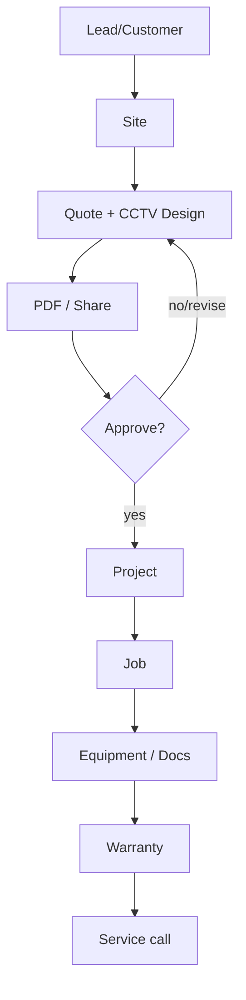
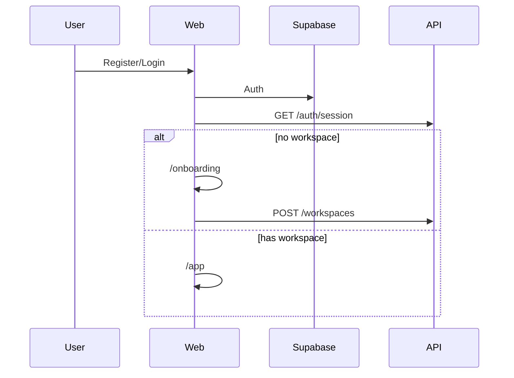

# BUSINESS FLOWS — SITE SECURE

**Date:** 2026-10-02 · Static mapping. Runtime E2E: NOT RUN in this audit.

## 1. Canonical commercial → field loop (requested)

| # | Step | Implemented? | Evidence | Status |
|---|------|--------------|----------|--------|
| 1 | Customer contacts business | Outside system | — | N/A |
| 2 | Open customer or lead | Yes | customers + leads routes/API | IMPLEMENTED — NOT FULLY VERIFIED |
| 3 | Site visit / survey | Partial | sites create/edit; no dedicated survey module | PARTIAL |
| 4 | CCTV system design | Yes | system_designs + CCTV UI/API | IMPLEMENTED — NOT FULLY VERIFIED |
| 5 | Equipment selection | Yes | catalog + designer components | same |
| 6 | Quantities & pricing | Yes | quote items, recalculate, margin override | same |
| 7 | Build quote | Yes | QuoteBuilder | same |
| 8 | Generate PDF | Yes | quote PDF endpoints + preview | same |
| 9 | Send quote | Partial | send/share + mailto/wa style clients historically | PARTIAL (no full ESP proven) |
| 10 | Customer approval | Yes | public quote approve/reject | IMPLEMENTED — NOT FULLY VERIFIED |
| 11 | Open project | Yes | projects/from-quote | same |
| 12 | Open field job | Yes | jobs API/UI | same |
| 13 | Installation | Partial | job lifecycle start/complete | PARTIAL depth |
| 14 | Site documentation | Partial | documents + site dossier | PARTIAL |
| 15 | Register equipment | Partial | equipment + planned→installed paths | PARTIAL |
| 16 | Warranty | Partial | warranties module | PARTIAL |
| 17 | Service & maintenance | Partial | service_calls list; contracts table schema-ahead | PARTIAL |

**Do not present the full loop as VERIFIED WORKING end-to-end.**

## 2. Auth / onboarding flow

## 3. Quote send → public approve

1. User edits quote in `QuoteBuilder`.
2. API mutate quote/items/sections (mounted routers).
3. Send/share creates public token access.
4. Recipient opens `/q/{token}` or public route.
5. `public_quotes` approve/reject/PDF.
6. Optional project creation from quote.

## 4. Team invite

Invite create (seat checks) → peek → accept RPC → membership. Web: `/invite/$token`.

## 5. Customer portal (intended vs mounted)

FE portal routes exist; API `customer_portal` **not included** in `main.py` → flow **broken or incomplete at HTTP layer** until wired (AUDIT-001).

## 6. Platform admin beta ops

`/admin` → organizations, invitations, users archive, feature flags, feedback — API `admin` router mounted.
