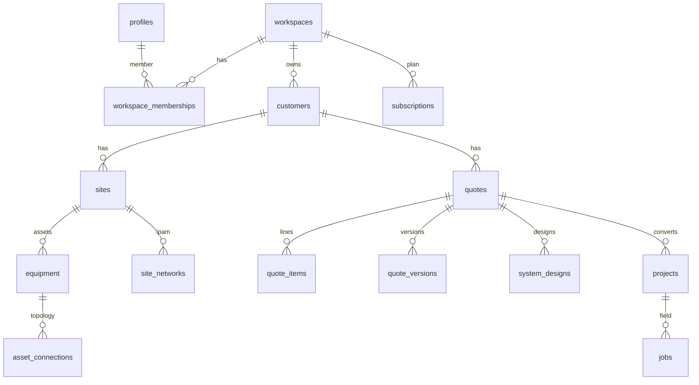

# DATABASE DOCUMENTATION — SITE SECURE

**Sources:** `supabase/migrations/*.sql` (87 files), `packages/types/src/database.ts`, `supabase/seed/0001_dev.sql`, `supabase/tests/rls_isolation.sql`  
**Live DB inspection:** NOT PERFORMED (read-only remote schema not queried in this pass)  
**As of:** 2026-10-02

## 1. Summary counts

| Metric | Count | Source |
|--------|------:|--------|
| Migration SQL files | 87 | filesystem (excl. `._*`) |
| Distinct `CREATE TABLE` names in migrations | 76 | regex extract → `_tables_from_migrations.json` |
| Tables in `database.ts` | 51 | `_tables.json` |
| Tables in migrations but missing from `database.ts` | 25 | see §3 |
| RPCs listed in `database.ts` Functions | 19 | `_rpcs.json` (incomplete vs later migrations) |
| Enums in `database.ts` | 60 | `_enums.json` |

## 2. Tenant model

- Primary tenant entity: `workspaces`.
- Membership: `workspace_memberships` (role keys).
- Business rows carry `workspace_id`.
- Auth helpers / RLS policies in early migrations (`0007_auth_helpers.sql`, per-table policies thereafter).
- Entitlements: `plans`, `plan_features`, `plan_limits`, `subscriptions`, `workspace_feature_overrides`, RPCs (`0028`, `0041`).
- Capabilities registry later: `capabilities`, `plan_capabilities` (`0050_v3_capabilities_registry.sql`).

## 3. Drift: migrations vs TypeScript types (AUDIT-002)

Present in migrations `CREATE TABLE` but **absent** from `packages/types/src/database.ts`:

accounting_documents, archive, asset_connections, beta_participants, capabilities, customer_portal_access, customer_portal_invite, feature_flags, feedback_reports, generated_documents, pdf_document_templates, plan_capabilities, platform_admin_events, portal_login_events, project_planned_items, quote_package_items, quote_packages, quote_public_access, quote_sections, site_ip_addresses, site_networks, site_vlans, system_design_components, system_designs, workspace_roles

**Impact:** FE/TS consumers using generated types may miss newer tables; runtime still uses untyped/partial access via API.

## 4. Table catalog (from migrations CREATE TABLE)

Business meaning is inferred from names + surrounding migrations; column-level detail for all 76 tables is **not fully expanded in this pass** (see prior `Docs/PRODUCT_STATUS_UNIFIED.md` and individual migration files for column definitions). For authoritative columns, open the creating migration.

### Core identity / tenancy
workspaces, workspace_memberships, workspace_settings, workspace_counters, workspace_feature_overrides, workspace_roles, profiles, invitations, roles, permissions, role_permissions, features, plans, plan_features, plan_limits, plan_capabilities, capabilities, subscriptions

### CRM / sales
customers, customer_contacts, customer_notes, customer_activities, leads, quotes, quote_items, quote_sections, quote_versions, quote_events, quote_templates, quote_template_items, quote_packages, quote_package_items, quote_public_access, product_categories, products

### Delivery / field
projects, project_planned_items, jobs, job_checklist_items, checklist_templates, checklist_template_items, assignments, after_action_reports, service_calls, service_contracts, warranties, tasks

### Sites / assets / network
sites, site_zones, site_timeline_events, site_readiness, systems, equipment, site_vlans, site_networks, site_ip_addresses, asset_connections, system_designs, system_design_components

### Docs / portal / platform
documents, generated_documents, pdf_document_templates, accounting_documents, notifications, notification_preferences, knowledge_articles, audit_logs, idempotency_keys, customer_portal_access, customer_portal_invite, portal_login_events, feature_flags, feedback_reports, beta_participants, platform_admin_events, archive

## 5. Migration history (ordered file list)

Numeric early chain `0001`–`0056`, then timestamped `20260816…` through `20260930210000…`.

**Notable collision:** two files share prefix `0048_`:
- `0048_technician_seed_grants_nonempty.sql`
- `0048_v3_plan_labels_free_pro_enterprise.sql`  
Also `0049_technician_seed_grants_nonempty.sql` (related). **Risk:** apply-order ambiguity depending on Supabase migrator lexicographic sort — document as AUDIT-003. Live apply state: **NOT VERIFIED**.

### Themes by band (abbreviated)

| Band | Intent |
|------|--------|
| 0001–0008 | Extensions, profiles, workspaces, RBAC, plans/features |
| 0009–0024 | Assignments, CRM, sites, systems, docs, leads, catalog, quotes, projects/jobs, service, warranties, tasks, notifications, audit, storage, grants |
| 0025–0042 | Defaults, realtime, invite/entitlement RPCs, quotas, platform admin hygiene |
| 0043–0056 | Settings/PDF, company docs, technician scope/isolation, capabilities, job dispatch, system designs |
| 202608–202609 | CPQ revenue loop, catalog hierarchy/import, badges/beta admin, SaaS quotas, customer portal, warranties policy, quote cost lockdown, project planned items, equipment/IPAM/topology/lifecycle, admin invitations, archive |

**Migration applied on Production?** NOT VERIFIED — do not run migrations to check.

## 6. RLS / isolation

- Policies defined across migrations; dedicated SQL test `supabase/tests/rls_isolation.sql`.
- API often authorizes then uses user client (RLS) or service role for selected privileged operations — concentration risk noted historically; treat as **IMPLEMENTED — NOT FULLY VERIFIED** for live cross-tenant proof in this pass.
- Customer portal tables intentionally revoke broad grants (asserted in unit test reading migration text).

## 7. ERD (core relationships — simplified)

## 8. Seed & storage

- Seed: `supabase/seed/0001_dev.sql`.
- Storage policies: `0023_storage.sql` (+ later document size/quota migrations).
- Config: `supabase/config.toml`.

## 9. Verification gaps

- Equality of live Supabase schema to migration set: NOT VERIFIED.
- Full column/index/trigger inventory per table: partial (use migrations as SoT).
- Whether all 76 tables are used by API/UI: mixed; some schema-ahead (notifications, service_contracts, after_action_reports, etc.).
