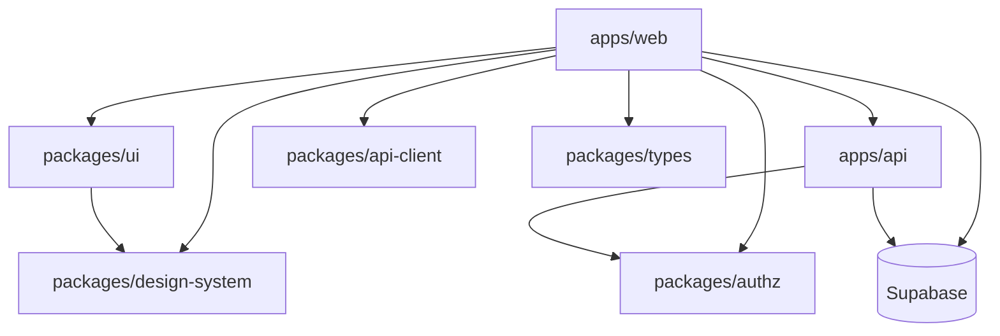
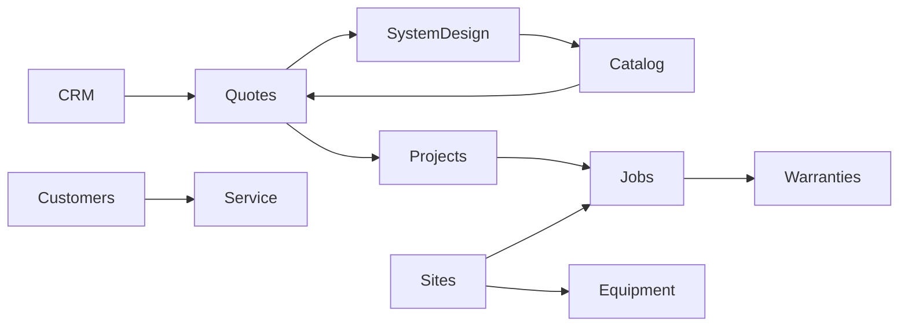

# DEPENDENCY MAP — SITE SECURE

**Date:** 2026-10-02 · Proven from manifests + `main.py` imports + package names. Full import graph of every file: **not exhaustively enumerated**.

## 1. Application-level

## 2. Backend dependency sketch

- `main.py` → routers → `deps` / `authz` / domain helpers → `UserClient`/`ServiceClient` → Supabase HTTP.
- Domain clusters: quotes/CPQ/PDF, catalog import, CCTV/system_designs, jobs lifecycle, ops_modules, admin, documents.
- Unwired: ipam, connections, customer_portal (still importable by tests).

## 3. Frontend dependency sketch

- Routes → components → `lib/*` + `@site-secure/*` + React Query.
- Quote/CCTV cluster is densest (`components/quotes/cpq/*`, `lib/cctv-*`).
- i18n: most app screens → `i18n/he.ts`; public → `i18n/public*`.

## 4. API ↔ Database (representative)

| API area | Tables (examples) |
|----------|-------------------|
| customers | customers, customer_contacts |
| quotes | quotes, quote_items, quote_sections, quote_versions, quote_events |
| catalog | products, product_categories, quote_packages* |
| system_designs | system_designs, system_design_components |
| projects/jobs | projects, project_planned_items, jobs, assignments |
| sites/equipment | sites, systems, equipment |
| ipam (unwired) | site_vlans, site_networks, site_ip_addresses |
| connections (unwired) | asset_connections |
| portal (unwired) | customer_portal_access, customer_portal_invite |
| authz | workspace_memberships, subscriptions, overrides, RPC |

## 5. Business module dependencies

## 6. Build/runtime config influencers

| File | Affects |
|------|---------|
| `package.json` / lock | web+packages install |
| `apps/web/vite.config.ts` | web build |
| `apps/api/pyproject.toml` | API deps |
| `vercel.json` | web deploy |
| `render.yaml` / `deploy/Dockerfile.api` | API deploy |
| `supabase/config.toml` | local supabase |
| `.env*` | runtime secrets/URLs |

## 7. Gaps

- Automated madge/pydeps graph not generated.
- Exact screen→endpoint matrix incomplete (see API_REFERENCE + route files for manual pairing).
