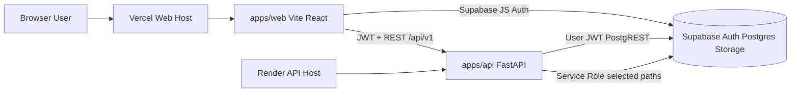
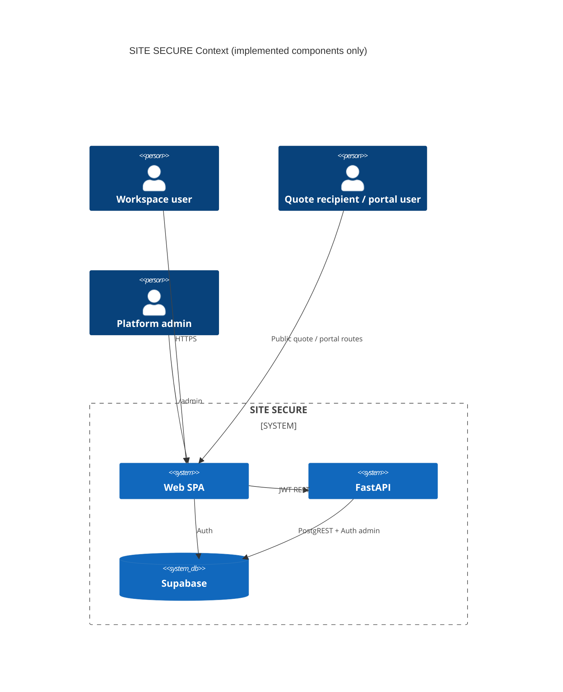
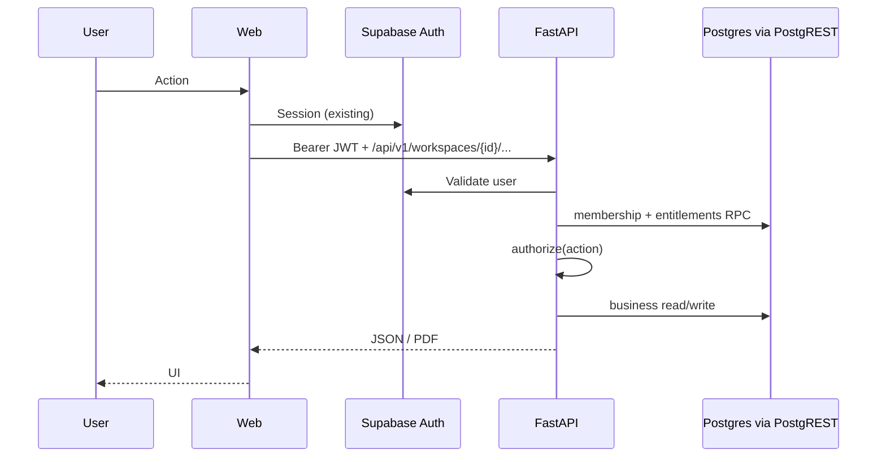
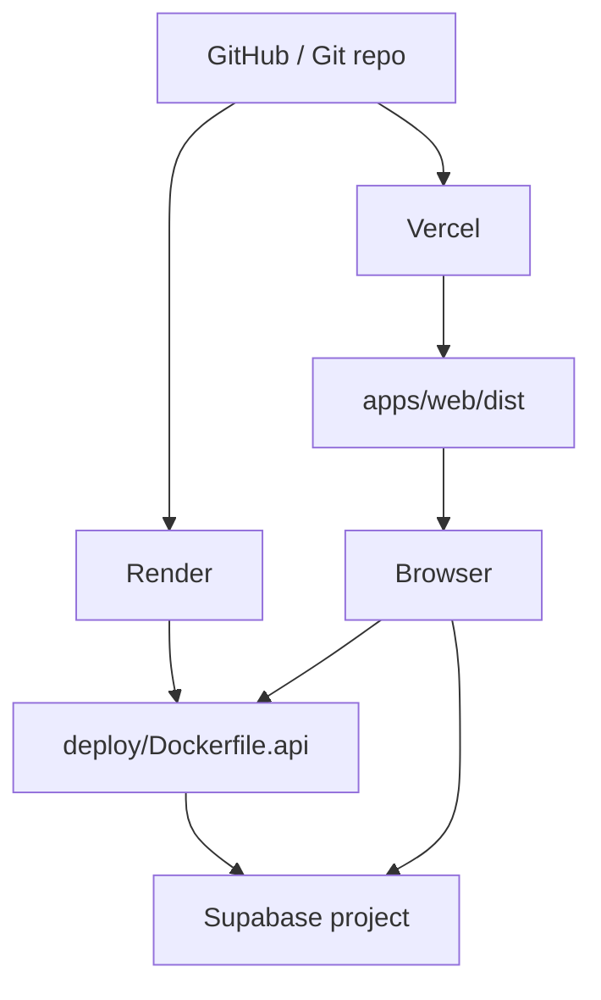
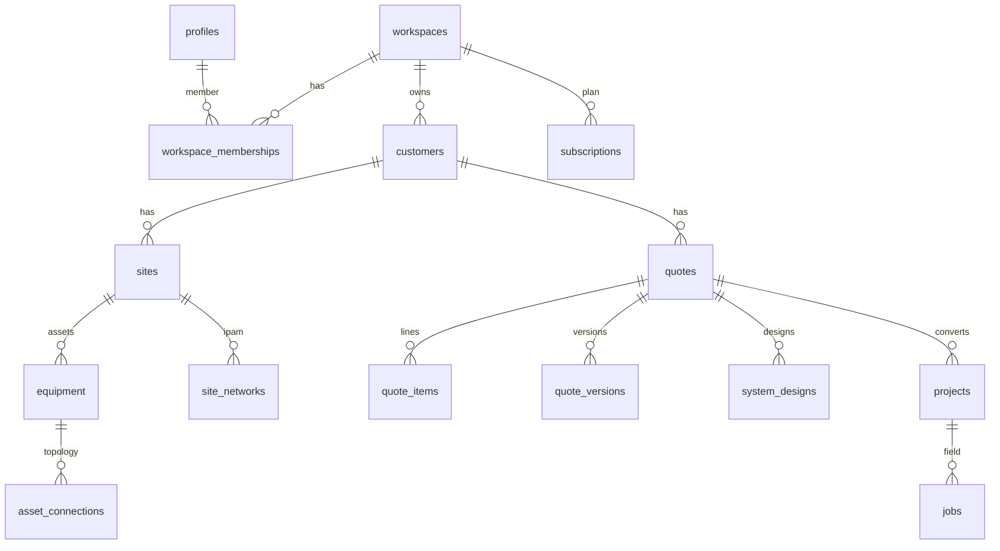
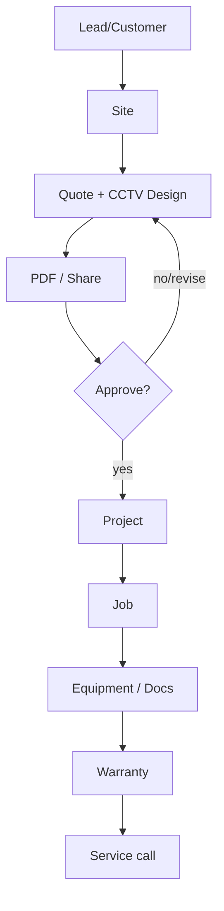
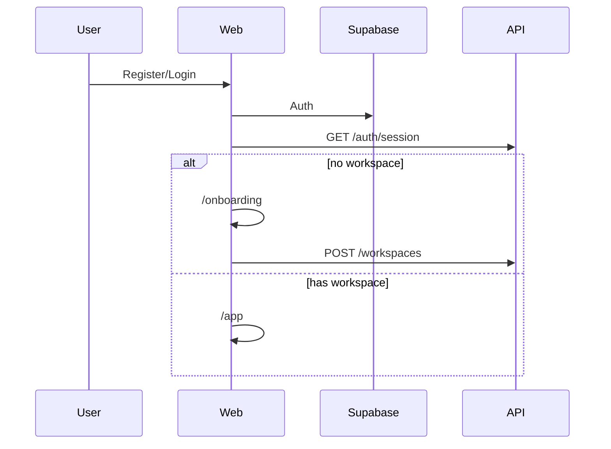
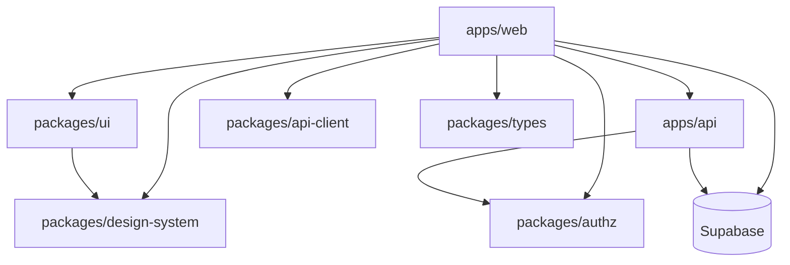
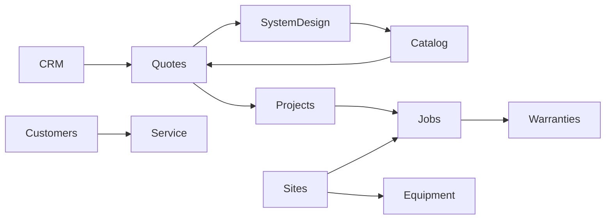

# SITE SECURE — COMPLETE SYSTEM DOCUMENTATION

> **Master consolidated documentation.** Built by lossless integration of the 2026-10-02 engineering audit pack.  
> **Source pack:** `Docs/engineering-audit-2026-10-02/`  
> **Original source documents are preserved unchanged.**

---

## Table of contents

- [חלק א׳ — פרטי המסמך וניהול גרסאות](#חלק-א--פרטי-המסמך-וניהול-גרסאות)
- [חלק ב׳ — תקציר מנהלים](#חלק-ב--תקציר-מנהלים)
- [חלק ג׳ — תמונת המערכת המלאה](#חלק-ג--תמונת-המערכת-המלאה)
- [חלק ד׳ — ארכיטקטורה ותשתיות](#חלק-ד--ארכיטקטורה-ותשתיות)
- [חלק ה׳ — Frontend מלא](#חלק-ה--frontend-מלא)
- [חלק ו׳ — Backend ו-API מלאים](#חלק-ו--backend-ו-api-מלאים)
- [חלק ז׳ — Database ו-Migrations](#חלק-ז--database-ו-migrations)
- [חלק ח׳ — Authentication Authorization ואבטחה](#חלק-ח--authentication-authorization-ואבטחה)
- [חלק ט׳ — Plans Modules Capabilities ו-Entitlements](#חלק-ט--plans-modules-capabilities-ו-entitlements)
- [חלק י׳ — כל המודולים העסקיים](#חלק-י--כל-המודולים-העסקיים)
- [חלק י״א — תהליכים עסקיים מקצה לקצה](#חלק-יא--תהליכים-עסקיים-מקצה-לקצה)
- [חלק י״ב — קטלוג ציוד ספקים ומחירונים](#חלק-יב--קטלוג-ציוד-ספקים-ומחירונים)
- [חלק י״ג — בדיקות ומצב תפקודי](#חלק-יג--בדיקות-ומצב-תפקודי)
- [חלק י״ד — Deployment ו-Environment](#חלק-יד--deployment-ו-environment)
- [חלק ט״ו — Dependencies וחוב טכני](#חלק-טו--dependencies-וחוב-טכני)
- [חלק ט״ז — מפת קבצים מלאה](#חלק-טז--מפת-קבצים-מלאה)
- [חלק י״ז — Dependency Maps](#חלק-יז--dependency-maps)
- [חלק י״ח — מצב המערכת](#חלק-יח--מצב-המערכת)
- [חלק י״ט — ממצאים סיכונים והמלצות](#חלק-יט--ממצאים-סיכונים-והמלצות)
- [חלק כ׳ — כיסוי הסריקה](#חלק-כ--כיסוי-הסריקה)
- [חלק כ״א — מילון מונחים](#חלק-כא--מילון-מונחים)
- [חלק כ״ב — היסטוריית תיעוד](#חלק-כב--היסטוריית-תיעוד)
- [נספח A — API Reference מלא](#נספח-a--api-reference-מלא)
- [נספח B — Exclusions JSON](#נספח-b--exclusions-json)
- [נספח C — Tables extracts](#נספח-c--tables-extracts)
- [נספח D — Source pack index (README)](#נספח-d--source-pack-index-readme)

---
## חלק א׳ — פרטי המסמך וניהול גרסאות

| Field | Value |
|-------|-------|
| System name | SITE SECURE |
| Document name | SITE_SECURE_COMPLETE_SYSTEM_DOCUMENTATION.md |
| Consolidation date | 2026-10-02 (UTC+3) |
| Original audit datetime | 2026-10-02 ~23:40–24:00 Asia/Jerusalem |
| Git branch | `feat/quote-cpq-phase-ab` |
| Git HEAD | `23a8121f802ec71b27f100f938b595cb6c1e24e4` |
| HEAD subject | feat(quotes): ship SYSTEM-DESIGNER-1 CCTV Designer founding-beta (2026-10-01) |
| Repository root | `.../Projects/SiteSecure/current/SiteSecureV1` |
| Documentation version | 1.0.0-consolidated (from engineering-audit-2026-10-02) |
| Inventory rows embedded | 2071 |
| API_REFERENCE.md bytes embedded | 23463 |
| FILE_INVENTORY.csv bytes source | 296450 |

### Purpose

Central knowledge source for humans and AI tools describing SITE SECURE **as implemented at HEAD**, not as aspirational product vision.

### Scope of original scan

Static repository audit: filesystem inventory, route/API/migration extracts, authz catalog, deploy config. **No** application code changes; **no** live Production E2E in that pass; **no** test suite execution in that pass.

### Documentation limitations (inherited)

- Live Supabase schema equality to migrations: NOT VERIFIED.
- Render/Vercel runtime health: NOT VERIFIED.
- Secret values: never documented.
- Component-level props for all ~178 components: partial in sources.
- Column-level dump for all 76 tables: partial in sources (migrations remain SoT).

### Information sources

All content below is integrated from the 20 audit artifacts listed in חלק כ״ב / coverage report. Helper JSON extracts (`_tables*.json`, `_exclusions.json`, `_api_endpoints.json`) are also embedded or referenced.

### Status taxonomy (do not upgrade without new evidence)

`VERIFIED WORKING` · `IMPLEMENTED — NOT FULLY VERIFIED` · `PARTIALLY IMPLEMENTED` · `UI ONLY / BACKEND MISSING` · `BACKEND ONLY / UI MISSING` · `BACKEND ONLY / NOT MOUNTED` · `BROKEN` · `PLANNED / NOT IMPLEMENTED` · `NOT FOUND` · `NOT VERIFIED` · `CONFLICT — REQUIRES VERIFICATION`

---
## חלק ב׳ — תקציר מנהלים

SITE SECURE is a Hebrew-first (RTL) multi-tenant SaaS for security-system businesses (CCTV / install / service). Stack: React 19 + Vite web, FastAPI API, Supabase Auth/Postgres/Storage; deploy configs target Vercel (web) and Render (API). Mobile app is **NOT FOUND**.

**What exists (static):** Auth/workspaces, CRM, catalog, quotes/CPQ including CCTV system design, sites/equipment, projects/jobs, service/warranties (partial depth), documents, dashboard, settings, platform admin.

**Implementation confidence:** Almost no feature is `VERIFIED WORKING` in the audit pass because tests/live hosts were not executed. Core mounted modules are typically `IMPLEMENTED — NOT FULLY VERIFIED`.

**Critical gaps:** 28 API endpoints in `ipam` / `connections` / `customer_portal` exist in code/tests but are **not mounted** in `main.py` (AUDIT-001). No Stripe/payment provider (AUDIT-006). `database.ts` missing 25 migration tables (AUDIT-002).

**Security posture (static):** JWT + `authorize()` + RLS migrations + entitlements fail-closed in code; FE gates are UX-only. Process-local rate limit; dual feature/capability vocabularies; local `.env` files present on disk (values not read).

**Working tree interference:** thousands of AppleDouble `._*` files pollute git status (AUDIT-007).

Full matrices remain in later sections (לא הוחלפו בסיכום זה).

---
## חלק ג׳ — תמונת המערכת המלאה
### Source: SYSTEM_OVERVIEW.md (full)
**Sources:** `package.json`, `apps/web/package.json`, `apps/api/pyproject.toml`, `apps/api/app/main.py`, `supabase/`, `packages/authz/catalog.json`, `vercel.json`, `render.yaml`, `.env.example`.  
**As of:** 2026-10-02 · HEAD `23a8121f802ec71b27f100f938b595cb6c1e24e4`

### 1. Purpose

SITE SECURE is a multi-tenant SaaS for security installation/service companies: CRM, catalog/CPQ quotes (including CCTV system design), sites/assets, projects/jobs, service calls, warranties, documents, workspace settings, and platform admin for beta operations.

### 2. High-level architecture (implemented)



**Communication:** Web obtains Supabase session (anon key + Auth), then calls FastAPI with `Authorization: Bearer <access_token>`. API validates user via Supabase Auth (`UserClient`), loads workspace membership + entitlements RPC, enforces `authorize()`, then reads/writes via PostgREST HTTP clients (`http_supabase.py` / `supabase_user.py` / `supabase_service.py`).

**Not present:** `apps/mobile` (env stubs only). No Stripe/payment SDK in application source (static search).

### 3. Monorepo layout

```
SiteSecureV1/
  apps/web/          # SPA
  apps/api/          # FastAPI
  packages/authz/    # RBAC/plan catalog JSON + TS helpers
  packages/api-client/
  packages/ui/
  packages/design-system/
  packages/types/    # database.ts (STALE vs migrations — see DATABASE doc)
  supabase/migrations|seed|tests|functions|config.toml
  Docs/              # historical + this audit pack
  deploy/            # Dockerfile.api
```

Root `package.json` name: `site-secure`; workspaces: `apps/web`, `packages/*`. Scripts: `web:dev|build|test|lint|typecheck`. Engines: Node `>=20`.

### 4. Frontend summary

- **Framework:** React 19, Vite 6, TanStack Router (file routes under `apps/web/src/routes`), TanStack Query, Zod, Tailwind 4.
- **Entry:** Vite `index.html` → app bootstrap; root route `routes/__root.tsx`.
- **App shell guard:** `routes/app/route.tsx` requires session user + `session.has_workspace`; uses `memberships[0]` only (no workspace switcher).
- **i18n:** App chrome primarily hardcoded Hebrew via `i18n/he.ts`. Public marketing has HE/EN (`i18n/public-*.ts`). Full bilingual app UI: **NOT FOUND**.

### 5. Backend summary

- **Entry:** `apps/api/app/main.py` → `create_app()` → `app = create_app()`.
- **Title/version in code:** `"SITE SECURE V2 API"` / `0.7.0`.
- **Middleware:** CORS from settings; in-memory per-IP rate limit (~120 req/min); `X-Request-Id`; Hebrew validation errors.
- **Routers included in `main.py`:** health, auth, workspaces, workspace_settings, feedback, telemetry, admin, team, customers, sites, systems, search, jobs, ops_modules, quotes, quote_cpq, system_designs, catalog, catalog_import, cctv, public_quotes, documents, dashboard.
- **Routers present BUT NOT `include_router`'d:** `ipam.py`, `connections.py`, `customer_portal.py` → HTTP surface for INF-1B/1C and customer portal is **not mounted** despite code + unit tests. See AUDIT-001.

### 6. Database summary

- **Migrations on disk:** 87 SQL files under `supabase/migrations/` (excluding AppleDouble).
- **`CREATE TABLE` names found in migrations:** 76.
- **`packages/types/src/database.ts` Tables:** 51 — **25 tables present in migrations but missing from generated types** (drift). See AUDIT-002.
- **Tenant key:** `workspace_id` on business tables; membership via `workspace_memberships`.
- **Entitlements:** plans/features/overrides + RPC `my_workspace_entitlements` (API fail-closed on RPC failure per `deps.parse_entitlements_rpc`).

### 7. Auth / tenancy (summary)

| Concern | Mechanism | Evidence |
|---------|-----------|----------|
| Authentication | Supabase Auth email/password; web session hydrate | web routes login/register; API `deps.bearer_token` / `current_user` |
| Authorization | Shared catalog + API `authorize()` | `packages/authz/catalog.json`, `apps/api/app/authz/*` |
| Entitlements | RPC + overrides | `deps.load_authz_context`, migrations 0028/0041 |
| Tenant isolation | workspace_id path params + membership check + RLS policies in SQL | routers + migrations |
| Platform admin | `profiles.is_platform_admin` + `/admin` routes | admin router + web `/admin` |

### 8. Business modules (existence)

Implemented with UI+API+DB (static connectivity): Auth/Workspace, Customers/Leads, Catalog/Quotes/CPQ/PDF/Public quote, Sites, Projects/Jobs (ops), Service list, Warranties, Tasks, Knowledge, Documents, Dashboard/Today, Settings, Platform Admin, CCTV recommend + system designs.

Partial / unwired / schema-ahead: Customer portal (API router unwired), IPAM & asset connections (unwired), notifications product UI, inventory/finance/reports features (catalog gates without modules), billing provider, mobile, calendar grid, multi-workspace switcher.

### 9. Environments

| Env | Evidence | Live verification |
|-----|----------|-------------------|
| Local | `.env.example`, Vite/API localhost defaults | NOT VERIFIED runtime |
| Web production/staging | `vercel.json`; Render blueprint references `https://site-secure-umber.vercel.app` | NOT VERIFIED live |
| API staging | `render.yaml` service `site-secure-api-staging` | NOT VERIFIED live |
| Supabase | URL/keys via env (names only) | Schema vs migrations NOT VERIFIED live |

### 10. Diagrams

#### System context



#### Frontend → Backend request flow



#### Deployment



### 11. Limitations of this overview

- Does not claim Production schema equals migration set.
- Does not claim all UI screens are E2E-proven.
- Folder name `SiteSecureV1` vs API title `V2` is naming inconsistency only — same tree.

---
## חלק ד׳ — ארכיטקטורה ותשתיות

This part combines architecture from SYSTEM_OVERVIEW with deployment/config. Frontend/Backend deep dives follow in חלק ה׳–ו׳.

### Architecture diagrams

All Mermaid diagrams from `SYSTEM_OVERVIEW.md` are preserved in [חלק ג׳](#חלק-ג--תמונת-המערכת-המלאה) (system context, request flow, deployment, high-level flowchart).

### Deployment & environments (full source)
**Date:** 2026-10-02 · Config-as-code only. Live hosts **NOT probed**.

### 1. Hosting map (from repo config)

| Component | Platform | Config evidence |
|-----------|----------|-----------------|
| Web SPA | Vercel | `vercel.json` — `npm ci`, `npm run web:build`, `outputDirectory: apps/web/dist`, SPA rewrites, security headers |
| API | Render | `render.yaml` — Docker `deploy/Dockerfile.api`, health `/health`, service name `site-secure-api-staging`, region frankfurt, plan free |
| DB/Auth/Storage | Supabase | `.env.example` + `supabase/` |
| Mobile | — | **NOT FOUND** |

Render blueprint references `WEB_PUBLIC_URL=https://site-secure-umber.vercel.app` — indicates a known web deployment URL in config; **live uptime NOT VERIFIED**.

### 2. Build / start (local — documented, not executed here)

| App | Build | Start (typical) |
|-----|-------|-----------------|
| Web | `npm run web:build` / `web:dev` | Vite |
| API | Docker or `uvicorn` (see deploy docs) | Render Dockerfile |
| DB | `supabase` CLI migrations | local or cloud |

Existing ops docs under `Docs/operations/` / `Docs/development/SETUP.md` may exist — treat as claims; reconcile with current scripts.

### 3. Environment variables (names only)

From `.env.example`:

| Name | Purpose | Consumers | Required? | Template? |
|------|---------|-----------|-----------|-----------|
| SUPABASE_URL | Project URL | API (+ shared) | yes | yes |
| SUPABASE_ANON_KEY | Anon key | API | yes | yes |
| SUPABASE_SERVICE_ROLE_KEY | Service role | **API only** | yes (API) | yes |
| API_PUBLIC_URL | Public API origin | API/docs | yes | yes |
| WEB_PUBLIC_URL | Public web origin | API CORS/links | yes | yes |
| APP_ENV | environment label | API | yes | yes |
| CORS_EXTRA_ORIGINS | extra origins | API | optional | yes |
| VITE_SUPABASE_URL | Web Supabase | Web build | yes | yes |
| VITE_SUPABASE_ANON_KEY | Web anon | Web build | yes | yes |
| VITE_API_URL | Web → API | Web build | yes | yes |
| EXPO_PUBLIC_* | Mobile stubs | Mobile (absent) | n/a | yes |
| PLATFORM_ADMIN_BOOTSTRAP_EMAIL | commented bootstrap | scripts | optional | commented |

**Values:** never documented. Local `.env` / `.env.local` exist on disk per inventory — treat as sensitive.

### 4. CORS / security headers

- API: CORSMiddleware with settings allowlist + credentials; methods/headers `*`.
- Web (Vercel): `X-Frame-Options: DENY`, `X-Content-Type-Options: nosniff`, noindex on app/auth paths.

### 5. CI/CD

- Vercel/Render git integration assumed by config; **GitHub Actions workflows:** scan for `.github/workflows` — if absent, CI may be platform-native only.
- Root scripts for lint/typecheck/test exist; CI execution **NOT VERIFIED**.

### 6. Branch → environment mapping

- Current branch: `feat/quote-cpq-phase-ab`.
- Mapping to staging/production: **NOT VERIFIED** from repo alone (Render blueprint named staging).

### 7. Backups / monitoring / rollback

- Docs mention beta backup checklists (`Docs/BETA_BACKUP_*`, `GATE_10_*`) — operational runbooks exist as documents.
- Live backup success: NOT VERIFIED.
- API logging: structured request logs; external APM: NOT FOUND in quick scan.

### 8. Limitations

Cannot claim Production health, secret correctness, or migration apply status without external access.

---
## חלק ה׳ — Frontend מלא
**Scope:** `apps/web`  
**Evidence date:** 2026-10-02 · HEAD `23a8121f…`  
**Status labels:** per IMPLEMENTATION_STATUS taxonomy

### 1. Stack & bootstrap

| Item | Evidence |
|------|----------|
| Package | `@site-secure/web` `0.1.1` (`apps/web/package.json`) |
| Bundler | Vite 6 (`vite`, `@vitejs/plugin-react`) |
| Router | TanStack Router + `@tanstack/router-plugin`; generated `src/routeTree.gen.ts` |
| Data | TanStack Query 5; Zod; `@supabase/supabase-js` |
| UI | `@site-secure/ui`, Tailwind 4, Lucide, ApexCharts, Lottie, pdfjs |
| Analytics | `@vercel/analytics` via `components/VercelAnalytics` in `__root.tsx` |

**Root route:** `src/routes/__root.tsx` — `ThemeRuntime` + `Outlet` + Vercel Analytics. No auth gate at root.

### 2. Route map (file routes)

71 route modules under `apps/web/src/routes/**/*.tsx` (AppleDouble excluded).

#### Public / auth

| Path (file) | Purpose | Auth |
|-------------|---------|------|
| `index.tsx` | Marketing landing | Public |
| `login.tsx` | Login | Guest |
| `register.tsx` | Register | Guest |
| `forgot-password.tsx` / `reset-password.tsx` | Password recovery | Guest |
| `verify-email.tsx` | Email verify | Guest/flow |
| `onboarding.tsx` | Workspace create after auth | Authenticated, no workspace |
| `invite/$token.tsx` | Team invite accept | Mixed |
| `legal/index.tsx`, `legal/$slug.tsx` | Legal pages | Public |
| `q/$token.tsx`, `public/quotes/$token.tsx` | Public quote | Token public |
| `dev/ui.tsx` | UI playground | Dev (treat as non-prod) |

#### App (`/app` layout: `app/route.tsx`)

**Guard evidence:** requires `user`; on API error without session shows `ErrorState`; if `!session.has_workspace` → onboarding path; uses `session.memberships[0]` only.

| Path | Purpose |
|------|---------|
| `app/index.tsx` | App home redirect/entry |
| `app/dashboard.tsx` | Dashboard |
| `app/today.tsx` | Field “today” |
| `app/analytics.tsx` | Analytics UI |
| `app/catalog.tsx` | Catalog |
| `app/customers/index.tsx`, `$customerId.tsx` | CRM |
| `app/leads/index.tsx`, `$leadId.tsx` | Leads |
| `app/quotes/index.tsx`, `new.tsx`, `$quoteId.tsx`, `$quoteId.preview.tsx` | Quotes / builder |
| `app/projects/index.tsx`, `$projectId.tsx` | Projects |
| `app/jobs/index.tsx`, `$jobId.tsx` | Field jobs |
| `app/sites/index.tsx`, `$siteId.tsx`, `$siteId_.assets.$assetId.tsx` | Sites / assets |
| `app/service/index.tsx` | Service calls **list** (no `$callId` route found) |
| `app/warranties/index.tsx`, `$warrantyId.tsx` | Warranties |
| `app/tasks/index.tsx` | Tasks (nav may label calendar) |
| `app/knowledge/index.tsx` | Knowledge |
| `app/settings/*` | Settings hub (company, users, roles, pdf-templates, security, …) |

#### Portal

| Path | Purpose |
|------|---------|
| `portal/route.tsx`, `index.tsx`, `choose.tsx`, `invite/$token.tsx` | Customer portal UI |

**Note:** Matching API router `customer_portal.py` is **not mounted** in `main.py` → portal backend HTTP may be unavailable in running API (AUDIT-001). Frontend existence ≠ working end-to-end.

#### Admin

| Path | Purpose |
|------|---------|
| `admin/route.tsx` + `index`, `users`, `organizations`, `invitations`, `beta`, `feedback`, `flags`, `audit`, `badges`, `archive` | Platform admin |

### 3. Layout & navigation

- **AppShell** (`components/AppShell`) wraps authenticated app routes.
- Navigation gating expected via authz `can()` + plan features (exact matrix: see AUTH doc; FE gating is UX-only — backend must enforce).
- Multi-workspace: **UI uses first membership only** (`app/route.tsx`).

### 4. State management

| Mechanism | Role |
|-----------|------|
| React Context session (`lib/session.tsx`) | User, memberships, entitlements surface |
| TanStack Query | Server state |
| Local component state | Forms, CCTV designer workspace |
| LocalStorage | Public locale key `site-secure-public-locale` (`i18n/public.ts`) |

No Redux/Zustand found in package.json dependencies.

### 5. API client pattern

- Package `@site-secure/api-client` + web `lib` helpers call `VITE_API_URL`.
- Supabase client uses `VITE_SUPABASE_URL` + `VITE_SUPABASE_ANON_KEY`.
- **Never** service role in web (documented in README / `.env.example`).

### 6. Localization / RTL

| Area | HE | EN | Mechanism |
|------|----|----|-----------|
| In-app product UI | Primary (`i18n/he.ts` imports everywhere) | **NOT FOUND** as full catalog | Hardcoded HE object |
| Public landing | Yes | Yes | `public-he.ts` / `public-en.ts` + locale switch |
| Legal | HE (`legal-he.ts`) | Partial/unknown | |
| RTL | Expected Hebrew-first; many `dir="rtl"` usages | LTR for EN public | |

**Do not claim full i18n switch for `/app`.** Status: **PARTIALLY IMPLEMENTED** (public bilingual; app HE-first).

### 7. Major UI modules / components

| Area | Key components (examples) | Status (static) |
|------|---------------------------|-----------------|
| Quotes/CPQ | `QuoteBuilder`, `SystemBuilderDrawer`, CCTV panels | IMPLEMENTED — NOT FULLY VERIFIED (live) |
| Sites/Assets | Site dossier routes + asset detail | IMPLEMENTED — NOT FULLY VERIFIED |
| Dashboard/Today | dashboard/today routes | IMPLEMENTED — NOT FULLY VERIFIED |
| Settings | many settings routes | IMPLEMENTED — NOT FULLY VERIFIED |
| Portal | portal routes | PARTIALLY IMPLEMENTED (API mount gap) |
| Analytics | `app/analytics.tsx` | NOT VERIFIED depth |

### 8. Tests

`apps/web/tests`: **103** `*.ts/tsx` files covering quotes/CCTV, settings, sites/assets/IPAM UI, warranties, navigation, theme, etc.  
**This audit did not execute** `npm run web:test` (no dependency install/upgrade; avoid claiming pass/fail).

### 9. Gaps / FE findings

1. Service call detail route missing (`service/index` only) — PARTIAL.
2. Workspace switcher missing — PARTIAL.
3. Portal FE present while API router unwired — risk of UI-only failure.
4. AppleDouble / OneDrive copies may confuse local tooling — environmental.
5. Prior audit claimed unused dashboard components — **re-verify before deleting** (POTENTIALLY UNUSED).

---
## חלק ו׳ — Backend ו-API מלאים
**Scope:** `apps/api`  
**Entry:** `app/main.py` (`create_app`, `app = create_app()`)  
**Version string:** FastAPI title `SITE SECURE V2 API`, version `0.7.0`  
**Python:** `>=3.12` (`pyproject.toml`)

### 1. Application structure

```
apps/api/app/
  main.py              # app factory, CORS, rate limit, router includes
  config.py            # pydantic-settings
  deps.py              # bearer auth, current_user, authz context, entitlements
  errors.py            # ApiError + Hebrew messages
  http_supabase.py     # HTTP client helpers
  supabase_user.py     # user-JWT PostgREST
  supabase_service.py  # service-role client
  authz/               # catalog load, engine, guard, limits, usage, scope
  routers/             # HTTP routers
  catalog_import/      # import pipeline
  cctv_recommend/ cctv_sizing/ quote_rules/ system_designs/ documents/
  *.py domain helpers (quotes PDF, pricing, jobs lifecycle, IPAM helpers, …)
```

### 2. Request pipeline

1. CORS (`settings.cors_allow_origins()`).
2. Middleware assigns `request_id`, in-memory rate limit (deque per client IP; >120/min → 429 `RATE_LIMITED`).
3. Route dependency: `bearer_token` → `UserClient` → `current_user` (rejects soft-archived profiles via `profiles.archived_at`).
4. Workspace-scoped routes: load membership + `my_workspace_entitlements` via `parse_entitlements_rpc` (**fail-closed** on RPC errors).
5. `authorize()` / `require` checks permission + feature entitlement + subscription status.
6. Data access via PostgREST HTTP (not SQLAlchemy ORM).

### 3. Routers mounted in `main.py`

| Module | Mounted |
|--------|---------|
| health, auth, workspaces, workspace_settings | yes |
| feedback, telemetry, admin, team | yes |
| customers, sites, systems, search, jobs | yes |
| ops_modules (leads/projects/service/warranties/tasks/knowledge) | yes |
| quotes, quote_cpq, system_designs, catalog, catalog_import, cctv | yes |
| public_quotes, documents, dashboard | yes |

### 4. Routers NOT mounted (CRITICAL)

| File | Tags / prefix pattern | Unit tests exist? | HTTP available in create_app? |
|------|-----------------------|-------------------|-------------------------------|
| `routers/ipam.py` | `/api/v1/workspaces/{workspace_id}` IPAM | `tests/test_ipam_inf1b.py` | **NO** |
| `routers/connections.py` | asset connections / topology | `tests/test_connections_inf1c.py` | **NO** |
| `routers/customer_portal.py` | customer portal + invites | `tests/test_customer_portal.py` | **NO** |

**Classification:** BACKEND ONLY (code+tests) / **not wired to running app** until `include_router` is added. Frontend portal/IPAM UI calling these paths would fail at runtime if they expect this API process.

### 5. Domain logic highlights

| Domain | Modules | Notes |
|--------|---------|-------|
| Quotes/CPQ | `routers/quotes.py`, `quote_cpq.py`, `quote_pdf.py`, `quote_validation.py`, … | Large surface; versions, send, share, PDF |
| System design / CCTV | `system_designs.py`, `cctv.py`, `cctv_recommend`, `cctv_sizing` | Designer + recommend |
| Catalog | `catalog.py`, `catalog_import/*` | Products, packages, import commit RPC |
| Jobs | `jobs.py`, `job_lifecycle.py` | Dispatch lifecycle endpoints |
| Ops | `ops_modules.py` | Leads, projects, service-calls, warranties, tasks, knowledge |
| Sites/systems/equipment | `sites.py`, `systems.py`, `equipment_asset.py` | Equipment asset foundation |
| Documents | `documents.py` + `documents/` | Upload URL + complete + signed URL |
| Admin | `admin.py` | Orgs, users archive, beta, flags, invitations |
| Team/settings | `team.py`, `workspace_settings.py` | Members, usage, PDF templates, roles |

### 6. Error handling & logging

- `ApiError` → structured JSON `{error:{code,message,details}}` + `X-Request-Id`.
- Validation → 400 `VALIDATION_ERROR` (Hebrew message).
- Logger name `site-secure`; request latency logged in middleware.

### 7. Background / webhooks / schedules

- **In-process rate limiter only** (not Redis) — weak for multi-instance.
- No Stripe webhook handlers found in app source.
- Supabase `functions/` may host edge functions — **partial review**; not claimed as active without deploy proof.

### 8. Configuration

See `app/config.py` + `.env.example` names: `SUPABASE_URL`, `SUPABASE_ANON_KEY`, `SUPABASE_SERVICE_ROLE_KEY`, `API_PUBLIC_URL`, `WEB_PUBLIC_URL`, `APP_ENV`, `CORS_EXTRA_ORIGINS`, log level settings.

### 9. Tests

`apps/api/tests`: **70** `test_*.py` files (unit + some `live` marked).  
**Not executed** as a full suite in this audit pass.

### 10. Dependencies (declared)

fastapi, uvicorn, pydantic, pydantic-settings, httpx, python-dotenv, fpdf2, uharfbuzz, tzdata, openpyxl, python-multipart. Dev: pytest, pytest-asyncio, ruff.

### API inventory

The **complete** endpoint table (204 endpoints, wired/unwired, file:line evidence) is preserved verbatim in [נספח A — API Reference מלא](#נספח-a--api-reference-מלא). Do not treat this paragraph as a substitute for that table.

---
## חלק ז׳ — Database ו-Migrations
**Sources:** `supabase/migrations/*.sql` (87 files), `packages/types/src/database.ts`, `supabase/seed/0001_dev.sql`, `supabase/tests/rls_isolation.sql`  
**Live DB inspection:** NOT PERFORMED (read-only remote schema not queried in this pass)  
**As of:** 2026-10-02

### 1. Summary counts

| Metric | Count | Source |
|--------|------:|--------|
| Migration SQL files | 87 | filesystem (excl. `._*`) |
| Distinct `CREATE TABLE` names in migrations | 76 | regex extract → `_tables_from_migrations.json` |
| Tables in `database.ts` | 51 | `_tables.json` |
| Tables in migrations but missing from `database.ts` | 25 | see §3 |
| RPCs listed in `database.ts` Functions | 19 | `_rpcs.json` (incomplete vs later migrations) |
| Enums in `database.ts` | 60 | `_enums.json` |

### 2. Tenant model

- Primary tenant entity: `workspaces`.
- Membership: `workspace_memberships` (role keys).
- Business rows carry `workspace_id`.
- Auth helpers / RLS policies in early migrations (`0007_auth_helpers.sql`, per-table policies thereafter).
- Entitlements: `plans`, `plan_features`, `plan_limits`, `subscriptions`, `workspace_feature_overrides`, RPCs (`0028`, `0041`).
- Capabilities registry later: `capabilities`, `plan_capabilities` (`0050_v3_capabilities_registry.sql`).

### 3. Drift: migrations vs TypeScript types (AUDIT-002)

Present in migrations `CREATE TABLE` but **absent** from `packages/types/src/database.ts`:

accounting_documents, archive, asset_connections, beta_participants, capabilities, customer_portal_access, customer_portal_invite, feature_flags, feedback_reports, generated_documents, pdf_document_templates, plan_capabilities, platform_admin_events, portal_login_events, project_planned_items, quote_package_items, quote_packages, quote_public_access, quote_sections, site_ip_addresses, site_networks, site_vlans, system_design_components, system_designs, workspace_roles

**Impact:** FE/TS consumers using generated types may miss newer tables; runtime still uses untyped/partial access via API.

### 4. Table catalog (from migrations CREATE TABLE)

Business meaning is inferred from names + surrounding migrations; column-level detail for all 76 tables is **not fully expanded in this pass** (see prior `Docs/PRODUCT_STATUS_UNIFIED.md` and individual migration files for column definitions). For authoritative columns, open the creating migration.

#### Core identity / tenancy
workspaces, workspace_memberships, workspace_settings, workspace_counters, workspace_feature_overrides, workspace_roles, profiles, invitations, roles, permissions, role_permissions, features, plans, plan_features, plan_limits, plan_capabilities, capabilities, subscriptions

#### CRM / sales
customers, customer_contacts, customer_notes, customer_activities, leads, quotes, quote_items, quote_sections, quote_versions, quote_events, quote_templates, quote_template_items, quote_packages, quote_package_items, quote_public_access, product_categories, products

#### Delivery / field
projects, project_planned_items, jobs, job_checklist_items, checklist_templates, checklist_template_items, assignments, after_action_reports, service_calls, service_contracts, warranties, tasks

#### Sites / assets / network
sites, site_zones, site_timeline_events, site_readiness, systems, equipment, site_vlans, site_networks, site_ip_addresses, asset_connections, system_designs, system_design_components

#### Docs / portal / platform
documents, generated_documents, pdf_document_templates, accounting_documents, notifications, notification_preferences, knowledge_articles, audit_logs, idempotency_keys, customer_portal_access, customer_portal_invite, portal_login_events, feature_flags, feedback_reports, beta_participants, platform_admin_events, archive

### 5. Migration history (ordered file list)

Numeric early chain `0001`–`0056`, then timestamped `20260816…` through `20260930210000…`.

**Notable collision:** two files share prefix `0048_`:
- `0048_technician_seed_grants_nonempty.sql`
- `0048_v3_plan_labels_free_pro_enterprise.sql`  
Also `0049_technician_seed_grants_nonempty.sql` (related). **Risk:** apply-order ambiguity depending on Supabase migrator lexicographic sort — document as AUDIT-003. Live apply state: **NOT VERIFIED**.

#### Themes by band (abbreviated)

| Band | Intent |
|------|--------|
| 0001–0008 | Extensions, profiles, workspaces, RBAC, plans/features |
| 0009–0024 | Assignments, CRM, sites, systems, docs, leads, catalog, quotes, projects/jobs, service, warranties, tasks, notifications, audit, storage, grants |
| 0025–0042 | Defaults, realtime, invite/entitlement RPCs, quotas, platform admin hygiene |
| 0043–0056 | Settings/PDF, company docs, technician scope/isolation, capabilities, job dispatch, system designs |
| 202608–202609 | CPQ revenue loop, catalog hierarchy/import, badges/beta admin, SaaS quotas, customer portal, warranties policy, quote cost lockdown, project planned items, equipment/IPAM/topology/lifecycle, admin invitations, archive |

**Migration applied on Production?** NOT VERIFIED — do not run migrations to check.

### 6. RLS / isolation

- Policies defined across migrations; dedicated SQL test `supabase/tests/rls_isolation.sql`.
- API often authorizes then uses user client (RLS) or service role for selected privileged operations — concentration risk noted historically; treat as **IMPLEMENTED — NOT FULLY VERIFIED** for live cross-tenant proof in this pass.
- Customer portal tables intentionally revoke broad grants (asserted in unit test reading migration text).

### 7. ERD (core relationships — simplified)



### 8. Seed & storage

- Seed: `supabase/seed/0001_dev.sql`.
- Storage policies: `0023_storage.sql` (+ later document size/quota migrations).
- Config: `supabase/config.toml`.

### 9. Verification gaps

- Equality of live Supabase schema to migration set: NOT VERIFIED.
- Full column/index/trigger inventory per table: partial (use migrations as SoT).
- Whether all 76 tables are used by API/UI: mixed; some schema-ahead (notifications, service_contracts, after_action_reports, etc.).

### Machine extracts (full JSON)

See [נספח C — Tables extracts](#נספח-c--tables-extracts) for `_tables.json` and `_tables_from_migrations.json` verbatim.

---
## חלק ח׳ — Authentication, Authorization ואבטחה
**Mode:** Static review only — no exploitation, no production penetration, no secret values.  
**Date:** 2026-10-02

### 1. Authentication (CURRENT STATE)

| Flow | Evidence | Status |
|------|----------|--------|
| Register | `apps/web/src/routes/register.tsx` + Supabase Auth | IMPLEMENTED — NOT FULLY VERIFIED live |
| Login | `routes/login.tsx` | same |
| Logout | session helpers / Supabase signOut (web) | same |
| Email verification | `verify-email.tsx` | same |
| Password reset | `forgot-password.tsx`, `reset-password.tsx` | same |
| Session API | `GET` auth session in `routers/auth.py` | mounted |
| Soft-archive gate | `deps.current_user` checks `profiles.archived_at` | IMPLEMENTED in code |
| Platform admin | `profiles.is_platform_admin` + `/admin` | IMPLEMENTED in code |

Tokens: Supabase JWT in `Authorization: Bearer`. Service role used only in API process (`SUPABASE_SERVICE_ROLE_KEY`) — must never ship to Vercel web (documented in README / `.env.example`).

### 2. Authorization model

#### Roles (`packages/authz/catalog.json`)

System roles: `owner`, `administrator`, `manager`, `sales`, `technician`, `viewer`.  
`founding_technician` still appears in `seat_buckets.seats_field` but migrations include `20260908210000_retire_founding_technician_role.sql` — **catalog vs DB retirement drift** (AUDIT-004).

#### Permissions & grants

Catalog lists permission keys (`dashboard.view`, `quotes.*`, `crm.*`, …) and per-role grants (`owner: ["*"]`, administrator long list, …).  
API engine: `apps/api/app/authz/engine.py` + `guard.py`.  
Web: `can()` style checks from `@site-secure/authz` for UX — **not a security boundary**.

#### Plans / features

Plans in catalog keys: `solo`, `business`, `enterprise` (labels Free/Pro/Enterprise).  
Features gated via entitlements RPC + `permission_feature` map.  
API `parse_entitlements_rpc` **fail-closed** on RPC failure (does not invent base-plan features).

#### Capabilities (V3 registry)

Migration `0050_v3_capabilities_registry.sql` + tables `capabilities` / `plan_capabilities`. Relationship to catalog `features` — dual vocabulary; treat as **multiple related sources** (AUDIT-005). Intended single entitlement source is architectural goal; current code still uses plan features + overrides + capabilities tables.

### 3. Roles × access matrix (catalog grants — abbreviated)

| Role | Typical access (from catalog grants) | Forbidden / limited |
|------|--------------------------------------|---------------------|
| owner | `*` | — |
| administrator | Broad ops + settings + quotes cost + users/roles | workspace.delete / billing may differ — check catalog |
| manager | Broad ops without full workspace destroy | roles.manage / some billing |
| sales | CRM/quotes oriented | field complete? check grants list |
| technician | Field/jobs/sites scoped | commercial isolation migrations 0046/0047 |
| viewer | Read-heavy | mutate |

**Full grant lists:** see `packages/authz/catalog.json` `grants` object.  
**Enforcement:** API `authorize` + RLS. FE hide ≠ deny.

### 4. Tenant isolation

| Control | Present? | Notes |
|---------|----------|-------|
| workspace_id in routes | Yes | `/api/v1/workspaces/{workspace_id}/...` |
| Membership check | Yes | `load_authz_context` |
| Client-supplied workspace trust | Must be validated server-side — code path exists; live bypass proof NOT done | |
| RLS | Yes in migrations | Live effectiveness NOT VERIFIED this pass |
| Cross-tenant automated tests | `supabase/tests/rls_isolation.sql` + some API live tests exist | **Not executed here** |
| Multi-workspace UX | Partial — `memberships[0]` only | Product risk / confusion |

### 5. Billing / subscription security

- `subscriptions` table + status used in authorize path.
- **No Stripe/payment webhook verification code found** in app source.
- Workspace creation historically sets active subscription (prior audits) — treat paid `active` without provider confirmation as **business/process risk** if still true (re-verify `workspaces.py` create path before claiming). **NOT re-line-audited in full this pass** → mark suspicion AUDIT-006.

### 6. Security findings (static)

| ID | Severity | Finding | Evidence | Verified exploit? |
|----|----------|---------|----------|-------------------|
| SEC-001 | High | IPAM / connections / customer_portal routers not mounted — if FE calls them, broken; if alternate deploy mounts old code, confusion | `main.py` vs router files | No — config defect |
| SEC-002 | Medium | In-memory rate limit not shared across instances | `main.py` middleware | Suspicion |
| SEC-003 | Medium | Service-role use for privileged quote/public paths — requires tight authorize discipline | service client modules | Not exploited |
| SEC-004 | Medium | Storage ACL historically coarser than document RBAC | migration `0023` + docs router | Suspicion from prior audit; not re-proven |
| SEC-005 | Low–Med | `database.ts` stale — type-safety gap for new tables | types vs migrations | Config/quality |
| SEC-006 | Medium | Local `.env` files present on disk in workspace — secret leakage via backups/sync risk | inventory env files | Do not open values |
| SEC-007 | Low | AppleDouble `._*` flood + pack idx warnings — supply-chain/hygiene | git status | Integrity annoyance |
| SEC-008 | Medium | Dual entitlement vocabularies (features vs capabilities) may cause inconsistent gates | catalog + 0050 | Suspicion |
| SEC-009 | Low | CORS `allow_methods=["*"]`, `allow_headers=["*"]` with credentialed origins | `main.py` | Depends on origin allowlist correctness |
| SEC-010 | Info | Public quote token endpoints intentionally unauthenticated | `public_quotes.py` | By design — token secrecy critical |

### 7. Frontend route guards

- `/app/*`: session + workspace required (`app/route.tsx`).
- `/admin/*`: platform admin gate in `admin/route.tsx` (verify on read — treat as IMPLEMENTED — NOT FULLY VERIFIED).
- Hidden nav items ≠ authorization.

### 8. What was not done

- No live cross-tenant IDOR testing.
- No password brute-force testing.
- No dependency CVE scan execution.
- No production log review.

---
## חלק ט׳ — Plans, Modules, Capabilities ו-Entitlements

### Entitlements narrative (from AUTH + MODULES sources)

The authorization model, roles, plans (`solo`/`business`/`enterprise`), feature gates, capabilities registry, dual SoT risk (AUDIT-005), and founding_technician drift (AUDIT-004) are documented in חלק ח׳.

Below is the **full modules/features matrix** from `MODULES_AND_FEATURES.md`, including entitlements columns and sources-of-truth list.
**Taxonomy:** VERIFIED WORKING | IMPLEMENTED — NOT FULLY VERIFIED | PARTIALLY IMPLEMENTED | UI ONLY / BACKEND MISSING | BACKEND ONLY / UI MISSING | BACKEND ONLY / NOT MOUNTED | BROKEN | PLANNED / NOT IMPLEMENTED | NOT FOUND | NOT VERIFIED  
**Date:** 2026-10-02 · Static evidence unless noted

| Module | Status | Screens | API | DB | Entitlement | Notes |
|--------|--------|---------|-----|----|-------------|-------|
| Auth / Session | IMPLEMENTED — NOT FULLY VERIFIED | login/register/reset/verify | auth router | profiles | — | Soft-archive gate in deps |
| Workspaces / Onboarding | IMPLEMENTED — NOT FULLY VERIFIED | onboarding | workspaces | workspaces, memberships | plan default solo | memberships[0] UX |
| RBAC / Entitlements | IMPLEMENTED — NOT FULLY VERIFIED | settings/roles (matrix) | authorize + authz/catalog | roles, grants, overrides, RPC | features + capabilities | Dual vocab AUDIT-005 |
| Invitations / Team | IMPLEMENTED — NOT FULLY VERIFIED | invite token + settings users | workspaces invitations + team | invitations | seat quotas | |
| Customers CRM | IMPLEMENTED — NOT FULLY VERIFIED | customers/* | customers | customers, contacts | crm | |
| Leads | IMPLEMENTED — NOT FULLY VERIFIED | leads/* | ops_modules | leads | leads.* | |
| Catalog | IMPLEMENTED — NOT FULLY VERIFIED | catalog | catalog + import | products, categories | catalog | |
| Quotes / CPQ | IMPLEMENTED — NOT FULLY VERIFIED | quotes/* + builder | quotes + quote_cpq | quotes, items, sections, versions | quotes | Core product |
| CCTV System Design | IMPLEMENTED — NOT FULLY VERIFIED | CPQ CCTV components | cctv + system_designs | system_designs* | quotes | HEAD commit focus |
| Public quote approve/PDF | IMPLEMENTED — NOT FULLY VERIFIED | `/q/$token` | public_quotes | quote_public_access | token | |
| PDF templates / company profile | IMPLEMENTED — NOT FULLY VERIFIED | settings | workspace_settings | pdf_document_templates | settings | |
| Projects | IMPLEMENTED — NOT FULLY VERIFIED | projects/* | ops_modules | projects, planned_items | projects | from-quote path |
| Field Jobs | IMPLEMENTED — NOT FULLY VERIFIED | jobs/* | jobs | jobs, assignments | jobs | lifecycle endpoints |
| Service calls | PARTIALLY IMPLEMENTED | list only | ops_modules | service_calls | service | no detail route |
| Warranties | IMPLEMENTED — NOT FULLY VERIFIED | warranties/* | ops_modules | warranties | warranties | |
| Tasks / “Calendar” | PARTIALLY IMPLEMENTED | tasks | ops_modules | tasks | calendar.* perms | No true calendar grid found |
| Sites / Site file | IMPLEMENTED — NOT FULLY VERIFIED | sites/* | sites + systems | sites, systems, equipment | sites | |
| Equipment assets | IMPLEMENTED — NOT FULLY VERIFIED | asset detail route | systems/equipment | equipment | systems | INF-1A era |
| IPAM | BACKEND ONLY / NOT MOUNTED (+ FE tests) | site network UI tests exist | ipam router **unwired** | site_vlans/networks/ips | — | AUDIT-001 |
| Asset topology | BACKEND ONLY / NOT MOUNTED | FE tests | connections **unwired** | asset_connections | — | AUDIT-001 |
| Customer portal | PARTIALLY IMPLEMENTED | portal routes | customer_portal **unwired** | portal tables | customer_portal.* perms in tests | AUDIT-001 |
| Documents / Storage | IMPLEMENTED — NOT FULLY VERIFIED | embedded | documents | documents | documents + quotas | |
| Dashboard / Today | IMPLEMENTED — NOT FULLY VERIFIED | dashboard, today | dashboard | aggregated | dashboard.view | |
| Analytics | NOT VERIFIED | analytics.tsx | ? | — | reports? | Depth unknown |
| Knowledge | PARTIALLY IMPLEMENTED | knowledge index | ops_modules | knowledge_articles | knowledge | |
| Notifications product | PARTIALLY IMPLEMENTED / schema-ahead | settings notifications? | no dedicated list router found | notifications tables | — | Prior gap G-008 |
| Inventory stock | NOT FOUND (feature flag only) | — | — | — | inventory feature | Catalog feature without module |
| Finance / Accounting docs | PARTIALLY / schema | — | accounting helpers exist | accounting_documents | finance / accounting_documents | Not full product |
| Reports module | NOT FOUND | — | — | — | reports feature | |
| Billing / Stripe | NOT FOUND (provider) | usage UI may exist | no checkout/webhook | subscriptions | workspace.billing perm | Schema stub |
| Platform Admin | IMPLEMENTED — NOT FULLY VERIFIED | /admin/* | admin | flags, beta, archive | is_platform_admin | |
| Mobile native | NOT FOUND | — | env stubs | — | — | apps/mobile missing |
| SITE AI / LLM | NOT FOUND | — | — | — | ai feature | Rules ≠ AI |
| Workforce scheduling | NOT FOUND / PLANNED | — | — | — | V3 docs | |
| Maps | NOT FOUND | — | — | — | — | |
| Inspections / Patrol | PLANNED / NOT IMPLEMENTED | — | — | capabilities docs | V3 | |
| Supplier portals | NOT FOUND | — | — | — | — | |

### Entitlements sources of truth (as implemented)

1. `packages/authz/catalog.json` — plans/features/permissions/grants (API+FE package).
2. DB `plans` / `plan_features` / `plan_limits` / `subscriptions`.
3. `workspace_feature_overrides` + RPC effective entitlements.
4. `capabilities` / `plan_capabilities` (V3 registry migration).
5. FE visibility checks (non-authoritative).

**Conflict risk:** multiple editable/parallel concepts — document only; do not “fix” here.

---
## חלק י׳ — כל המודולים העסקיים

Each module below restates the authoritative row from `MODULES_AND_FEATURES.md` and cross-links related frontend/backend/DB evidence already included in this master document. Status values are **not upgraded**.

### Auth / Session
- **Status:** IMPLEMENTED — NOT FULLY VERIFIED
- **Screens:** login/register/reset/verify (`apps/web/src/routes/*`)
- **API:** auth router (`apps/api/app/routers/auth.py`) — mounted
- **DB:** profiles
- **Notes:** Soft-archive gate in `deps.current_user`

### Workspaces / Onboarding
- **Status:** IMPLEMENTED — NOT FULLY VERIFIED
- **Screens:** onboarding
- **API:** workspaces — mounted
- **DB:** workspaces, memberships
- **Notes:** `memberships[0]` UX only

### RBAC / Entitlements
- **Status:** IMPLEMENTED — NOT FULLY VERIFIED
- **Screens:** settings/roles
- **API:** authorize + authz catalog
- **DB:** roles, grants, overrides, RPC; also capabilities tables
- **Notes:** Dual vocab AUDIT-005

### Invitations / Team
- **Status:** IMPLEMENTED — NOT FULLY VERIFIED
- **Screens:** invite token + settings users
- **API:** workspaces invitations + team — mounted
- **DB:** invitations; seat quotas

### Customers CRM
- **Status:** IMPLEMENTED — NOT FULLY VERIFIED
- **Screens:** `app/customers/*`
- **API:** customers — mounted
- **DB:** customers, contacts
- **Entitlement:** crm

### Leads
- **Status:** IMPLEMENTED — NOT FULLY VERIFIED
- **Screens:** `app/leads/*`
- **API:** ops_modules — mounted
- **DB:** leads

### Catalog
- **Status:** IMPLEMENTED — NOT FULLY VERIFIED
- **Screens:** catalog
- **API:** catalog + catalog_import — mounted
- **DB:** products, categories
- **See also:** חלק י״ב

### Quotes / CPQ
- **Status:** IMPLEMENTED — NOT FULLY VERIFIED
- **Screens:** quotes/* + QuoteBuilder
- **API:** quotes + quote_cpq — mounted
- **DB:** quotes, items, sections, versions

### CCTV System Design
- **Status:** IMPLEMENTED — NOT FULLY VERIFIED
- **Screens:** CPQ CCTV components
- **API:** cctv + system_designs — mounted
- **DB:** system_designs*
- **Notes:** HEAD commit focus

### Public quote approve/PDF
- **Status:** IMPLEMENTED — NOT FULLY VERIFIED
- **Screens:** `/q/$token`
- **API:** public_quotes — mounted
- **DB:** quote_public_access

### PDF templates / company profile
- **Status:** IMPLEMENTED — NOT FULLY VERIFIED
- **Screens:** settings
- **API:** workspace_settings — mounted
- **DB:** pdf_document_templates

### Projects
- **Status:** IMPLEMENTED — NOT FULLY VERIFIED
- **Screens:** projects/*
- **API:** ops_modules — mounted
- **DB:** projects, planned_items

### Field Jobs
- **Status:** IMPLEMENTED — NOT FULLY VERIFIED
- **Screens:** jobs/*
- **API:** jobs — mounted
- **DB:** jobs, assignments

### Service calls
- **Status:** PARTIALLY IMPLEMENTED
- **Screens:** list only (`service/index.tsx`)
- **API:** ops_modules — mounted
- **DB:** service_calls
- **Gap:** no `$callId` route

### Warranties
- **Status:** IMPLEMENTED — NOT FULLY VERIFIED
- **Screens:** warranties/*
- **API:** ops_modules — mounted
- **DB:** warranties

### Tasks / “Calendar”
- **Status:** PARTIALLY IMPLEMENTED
- **Screens:** tasks
- **API:** ops_modules — mounted
- **DB:** tasks
- **Notes:** No true calendar grid found

### Sites / Site file
- **Status:** IMPLEMENTED — NOT FULLY VERIFIED
- **Screens:** sites/*
- **API:** sites + systems — mounted
- **DB:** sites, systems, equipment

### Equipment assets
- **Status:** IMPLEMENTED — NOT FULLY VERIFIED
- **Screens:** asset detail route
- **API:** systems/equipment — mounted
- **DB:** equipment

### IPAM
- **Status:** BACKEND ONLY / NOT MOUNTED (+ FE tests)
- **API:** ipam router **unwired** (AUDIT-001)
- **DB:** site_vlans/networks/ips

### Asset topology
- **Status:** BACKEND ONLY / NOT MOUNTED
- **API:** connections **unwired**
- **DB:** asset_connections

### Customer portal
- **Status:** PARTIALLY IMPLEMENTED
- **Screens:** portal routes
- **API:** customer_portal **unwired**
- **DB:** portal tables

### Documents / Storage
- **Status:** IMPLEMENTED — NOT FULLY VERIFIED
- **API:** documents — mounted
- **DB:** documents

### Dashboard / Today
- **Status:** IMPLEMENTED — NOT FULLY VERIFIED
- **Screens:** dashboard, today
- **API:** dashboard — mounted

### Analytics
- **Status:** NOT VERIFIED
- **Screens:** analytics.tsx
- **Notes:** Depth unknown

### Knowledge
- **Status:** PARTIALLY IMPLEMENTED
- **Screens:** knowledge index
- **API:** ops_modules — mounted
- **DB:** knowledge_articles

### Notifications product
- **Status:** PARTIALLY IMPLEMENTED / schema-ahead
- **API:** no dedicated list router found
- **DB:** notifications tables

### Inventory stock
- **Status:** NOT FOUND (feature flag only)

### Finance / Accounting docs
- **Status:** PARTIALLY / schema
- **DB:** accounting_documents
- **Notes:** accounting helpers exist; not full product

### Reports module
- **Status:** NOT FOUND

### Billing / Stripe
- **Status:** NOT FOUND (provider)
- **DB:** subscriptions schema stub

### Platform Admin
- **Status:** IMPLEMENTED — NOT FULLY VERIFIED
- **Screens:** /admin/*
- **API:** admin — mounted

### Mobile native
- **Status:** NOT FOUND (`apps/mobile` missing)

### SITE AI / LLM
- **Status:** NOT FOUND (ai feature flag ≠ implementation)

### Workforce scheduling
- **Status:** NOT FOUND / PLANNED

### Maps
- **Status:** NOT FOUND

### Inspections / Patrol
- **Status:** PLANNED / NOT IMPLEMENTED

### Supplier portals
- **Status:** NOT FOUND

---
## חלק י״א — תהליכים עסקיים מקצה לקצה
**Date:** 2026-10-02 · Static mapping. Runtime E2E: NOT RUN in this audit.

### 1. Canonical commercial → field loop (requested)

| # | Step | Implemented? | Evidence | Status |
|---|------|--------------|----------|--------|
| 1 | Customer contacts business | Outside system | — | N/A |
| 2 | Open customer or lead | Yes | customers + leads routes/API | IMPLEMENTED — NOT FULLY VERIFIED |
| 3 | Site visit / survey | Partial | sites create/edit; no dedicated survey module | PARTIAL |
| 4 | CCTV system design | Yes | system_designs + CCTV UI/API | IMPLEMENTED — NOT FULLY VERIFIED |
| 5 | Equipment selection | Yes | catalog + designer components | same |
| 6 | Quantities & pricing | Yes | quote items, recalculate, margin override | same |
| 7 | Build quote | Yes | QuoteBuilder | same |
| 8 | Generate PDF | Yes | quote PDF endpoints + preview | same |
| 9 | Send quote | Partial | send/share + mailto/wa style clients historically | PARTIAL (no full ESP proven) |
| 10 | Customer approval | Yes | public quote approve/reject | IMPLEMENTED — NOT FULLY VERIFIED |
| 11 | Open project | Yes | projects/from-quote | same |
| 12 | Open field job | Yes | jobs API/UI | same |
| 13 | Installation | Partial | job lifecycle start/complete | PARTIAL depth |
| 14 | Site documentation | Partial | documents + site dossier | PARTIAL |
| 15 | Register equipment | Partial | equipment + planned→installed paths | PARTIAL |
| 16 | Warranty | Partial | warranties module | PARTIAL |
| 17 | Service & maintenance | Partial | service_calls list; contracts table schema-ahead | PARTIAL |

**Do not present the full loop as VERIFIED WORKING end-to-end.**



### 2. Auth / onboarding flow



### 3. Quote send → public approve

1. User edits quote in `QuoteBuilder`.
2. API mutate quote/items/sections (mounted routers).
3. Send/share creates public token access.
4. Recipient opens `/q/{token}` or public route.
5. `public_quotes` approve/reject/PDF.
6. Optional project creation from quote.

### 4. Team invite

Invite create (seat checks) → peek → accept RPC → membership. Web: `/invite/$token`.

### 5. Customer portal (intended vs mounted)

FE portal routes exist; API `customer_portal` **not included** in `main.py` → flow **broken or incomplete at HTTP layer** until wired (AUDIT-001).

### 6. Platform admin beta ops

`/admin` → organizations, invitations, users archive, feature flags, feedback — API `admin` router mounted.

---
## חלק י״ב — קטלוג ציוד, ספקים ומחירונים

### CURRENT STATE (from audit sources — not a new scan)

| Topic | Status / evidence |
|-------|-------------------|
| Product catalog | IMPLEMENTED — NOT FULLY VERIFIED — `products`, `product_categories`; UI `app/catalog.tsx`; API `catalog.py` + `catalog_import/*` mounted |
| Quote packages | Present in migrations (`quote_packages`, `quote_package_items`) and quote_cpq API |
| Import mechanism | `catalog_import` router + commit RPC migrations (20260905*) |
| Pricing / margin | quote recalculate, margin-override endpoints in quote_cpq; cost column lockdown migrations |
| Manufacturers / suppliers as first-class portals | **NOT FOUND** as Supplier Portal product |
| Supplier catalogs integration | **NOT FOUND** beyond local workspace catalog |
| Sensitive price lists | Documented as workspace-scoped; do not expose publicly |

**Planned-only:** Supplier Portals marked NOT FOUND / Planned in MODULES matrix.

Full API paths for catalog appear in נספח A. Full table names appear in חלק ז׳.

---
## חלק י״ג — בדיקות ומצב תפקודי
**Date:** 2026-10-02  
**Policy this audit:** non-destructive; no dependency install/upgrade; **did not run** full test suites.

### 1. Test inventory (filesystem)

| Suite | Path | Count | Runner |
|-------|------|------:|--------|
| Web unit/component | `apps/web/tests/**/*.{ts,tsx}` | 103 | Vitest (`npm run test` in web / root `web:test`) |
| UI package | `packages/ui/tests` | present | Vitest |
| API | `apps/api/tests/test_*.py` | 70 | pytest (`pyproject.toml`) |
| SQL RLS | `supabase/tests/rls_isolation.sql` | 1+ | Supabase SQL |

API markers include `live` (requires connected V2 Supabase + user JWTs) — **not run here**.

### 2. Quality scripts declared

| Script | Command | Executed this audit? |
|--------|---------|----------------------|
| web:test | ui + web vitest | **No** |
| web:lint | eslint | **No** |
| web:typecheck | tsc | **No** |
| web:build | vite build | **No** (dist/ exists from prior builds — stale artifact only) |
| API pytest | pytest | **No** |
| ruff | configured | **No** |

### 3. Coverage themes (by filename sampling)

Web: CCTV designer phases, quote builder UX, settings, sites/assets/IPAM/topology UI, warranties, navigation, theme, auth-related.  
API: quotes/CPQ, authz/quotas, catalog import, CCTV recommend, IPAM/connections/portal **unit** tests (even though routers unwired), admin, jobs, etc.

### 4. Classification reminder

Existence of tests ≠ VERIFIED WORKING for product features. Tests not executed → product status remains **IMPLEMENTED — NOT FULLY VERIFIED** unless other proof.

### 5. CI

`.github/workflows`: **NOT FOUND** in repo root scan this pass. Quality gates may rely on Vercel build + local discipline.

### 6. Prior certification docs

Many `Docs/BETA_*`, `Docs/beta-e2e-*`, gate reports claim historical runs. Those are **historical claims** relative to older commits — not re-validated against HEAD `23a8121f…`.

### 7. What is required to complete verification

1. Clean AppleDouble pollution (or ignore) for reliable git.
2. Install deps from lockfile (operator action) without upgrading.
3. Run `npm run web:typecheck && npm run web:test`.
4. Run API unit pytest without live markers.
5. Optionally run `live` tests against non-prod Supabase with test users.
6. Mount/unmount decision for ipam/connections/customer_portal then add HTTP smoke.
7. Compare live schema to migrations (read-only).

### Implementation status snapshot (full)
**Date:** 2026-10-02 · HEAD `23a8121f802ec71b27f100f938b595cb6c1e24e4`  
**Rule:** No feature marked VERIFIED WORKING without executed proof in this audit. Because suites were not run and live hosts not probed, almost all product features are at best **IMPLEMENTED — NOT FULLY VERIFIED**.

### Snapshot

| Status | Examples |
|--------|----------|
| VERIFIED WORKING | **None claimed in this pass** (no E2E/live suite execution) |
| IMPLEMENTED — NOT FULLY VERIFIED | Auth, CRM, Quotes/CPQ/CCTV design, Catalog, Sites, Projects/Jobs, Dashboard, Documents, Admin, mounted APIs |
| PARTIALLY IMPLEMENTED | Service calls (list), Tasks-as-calendar, quote delivery channels, multi-workspace UX, notifications product, warranties depth |
| BACKEND ONLY / NOT MOUNTED | IPAM, asset connections, customer_portal routers |
| UI ONLY / BACKEND MISSING | Portal UI risk relative to unwired API |
| BACKEND ONLY / UI MISSING | Some schema tables (contracts, after_action_reports, notifications list) |
| PLANNED / NOT IMPLEMENTED | Workforce scheduling, maps, patrol/inspections, SITE AI, inventory stock, finance reports product |
| NOT FOUND | Mobile app, Stripe billing, `.github/workflows` |
| BROKEN | HTTP for unwired routers if clients expect them (logical breakage) |
| NOT VERIFIED | Production schema sync, Render/Vercel live health, entitlement behavior under load |

### Quantitative (this scan)

| Metric | Value |
|--------|------:|
| Indexed files | 2071 |
| Web route modules | 71 |
| API endpoints scanned | 204 |
| Endpoints mounted | 176 |
| Endpoints unwired | 28 |
| Migrations | 87 |
| Tables (migrations CREATE) | 76 |
| Tables in database.ts | 51 |
| Web tests | 103 |
| API tests | 70 |
| Packages | 5 (`api-client`, `authz`, `design-system`, `types`, `ui`) |
| Apps present | web, api (mobile absent) |

### Compared to older audits

| Metric | Aug 2026 CURRENT_STATE_AUDIT | This audit |
|--------|------------------------------|------------|
| Migrations | 41 | 87 |
| Web tests | 33 | 103 |
| API tests | 22 | 70 |
| Router files | 18 | 26 router modules (3 unwired) |

Prior “WORKING” labels are **historical** and not automatically inherited.

---
## חלק י״ד — Deployment ו-Environment

The complete `DEPLOYMENT_AND_ENVIRONMENTS.md` content (hosting map, env var **names**, CORS, CI absence, limitations) is embedded in [חלק ד׳](#חלק-ד--ארכיטקטורה-ותשתיות). It is not omitted; see that section for all tables and notes.

---
## חלק ט״ו — Dependencies וחוב טכני
**Facts vs recommendations separated.** Date: 2026-10-02

### A. Facts (with evidence)

| ID | Description | Evidence | Impact | Severity |
|----|-------------|----------|--------|----------|
| TD-001 | Three routers implemented + tested but not `include_router` in `main.py` | `main.py` vs `ipam.py`/`connections.py`/`customer_portal.py` | Features unreachable via HTTP | High |
| TD-002 | `database.ts` missing 25 migration tables | types vs CREATE TABLE extract | Type drift; AI/FE mistakes | Medium |
| TD-003 | Duplicate migration prefix `0048_*` (+ related `0049`) | migrations dir | Apply-order risk | Medium |
| TD-004 | AppleDouble `._*` mass + pack idx errors | git status / git stderr | Tooling noise; accidental commit risk | Medium |
| TD-005 | README still describes early “clean rebuild / apps not scaffolded” while apps are large | root `README.md` | Onboarding confusion | Low |
| TD-006 | Folder name SiteSecureV1 vs API “V2” branding | paths vs `main.py` title | Naming confusion | Low |
| TD-007 | `founding_technician` still in catalog seat_buckets after retirement migration | catalog.json + migration | Role drift | Medium |
| TD-008 | Dual feature/capability entitlement systems | catalog + 0050 | Inconsistent gates | Medium |
| TD-009 | In-memory rate limiter | `main.py` | Weak multi-instance | Medium |
| TD-010 | No payment provider integration | static search | Cannot claim paid billing | High (product) |
| TD-011 | apps/mobile missing despite env stubs | filesystem | Dead config | Low |
| TD-012 | Prior PRODUCT_STATUS / CURRENT_STATE audits outdated counts | 2026-08/09 docs vs now | Doc drift | Medium |
| TD-013 | Large Docs QA PNG trees in workspace | Docs/*-qa | Repo size / inventory noise | Low |
| TD-014 | Service call detail UI missing | routes | Incomplete module | Medium |
| TD-015 | Multi-workspace uses memberships[0] only | `app/route.tsx` | Wrong-tenant UX risk if multi-member | Medium |

### B. Recommendations (NOT implemented)

1. **Critical:** Decide mount vs delete for ipam/connections/customer_portal; wire or remove FE calls.
2. **Security/stability:** Regenerate `database.ts` from live schema; add CI drift check.
3. **Hygiene:** Remove AppleDouble files from working tree; fix git pack pollution.
4. **Docs:** Refresh root README to match monorepo reality; point to this audit pack.
5. **Product:** Clarify billing path (provider vs admin grants vs free).
6. **Authz:** Align founding_technician + capabilities vs features single SoT.
7. **Testing:** Run unit suites on clean tree; add HTTP smoke for newly mounted routers.

### C. POTENTIALLY UNUSED (not proven dead)

- Some dashboard snapshot components (historical claim).
- Schema tables without API (notifications, service_contracts, after_action_reports, …).
- Root zip design packs / Fintech reference (excluded from runtime).
- API local `_q00012_*` / `_rtl_*` QA artifacts.

Do not delete solely based on this list.

### Declared runtime dependencies (from BACKEND/FRONTEND sources)

**API (`pyproject.toml`):** fastapi, uvicorn, pydantic, pydantic-settings, httpx, python-dotenv, fpdf2, uharfbuzz, tzdata, openpyxl, python-multipart; dev pytest/ruff.

**Web (`apps/web/package.json`):** React 19, Vite 6, TanStack Router/Query, Supabase JS, Zod, Tailwind 4, Lucide, ApexCharts, Lottie, pdfjs, Vercel Analytics; workspace packages `@site-secure/*`.

**Root:** Node `>=20`; npm workspaces.

---
## חלק ט״ז — מפת קבצים מלאה
### Inventory narrative (full FILE_INVENTORY.md)
**Generated:** 2026-10-02  
**Machine CSV:** [FILE_INVENTORY.csv](./FILE_INVENTORY.csv) (2071 rows after AppleDouble filter)  
**Raw scan input:** `_audit_inventory_raw.csv` at repo root (audit helper; not product)  
**Exclusions policy:** [_exclusions.json](./_exclusions.json)

### 1. Scan scope

| Category | Count | Notes |
|----------|------:|-------|
| Indexed files (CSV) | 2071 | Excludes `node_modules`, `.git`, `dist`, venvs, caches, `_backup_vault`, `_qa_local_archive`, `Fintech App UI/`, `lottiefiles/`, `Images/`, `.external-reference/`, `._*` |
| In Git (among indexed) | 1427 | |
| Not in Git (among indexed) | 644 | Includes local `.env*`, many Docs QA PNGs, build leftovers, untracked docs assets |
| Excluded trees | See `_exclusions.json` | Not silently omitted — listed |

### 2. By file type (indexed)

| FileType | Count |
|----------|------:|
| asset_image | 825 |
| frontend_source | 453 |
| test | 196 |
| documentation | 143 |
| backend_source | 137 |
| config | 133 |
| sql | 89 |
| other | 48 |
| document_pdf | 32 |
| env | 6 |
| script | 6 |
| stylesheet | 3 |

**Note:** Docs QA folders contribute most PNGs. Binary image content was **not** semantically analyzed.

### 3. Top-level module buckets

| Module / top path | Approx files | Role |
|-------------------|-------------:|------|
| `Docs/` | 962 | Historical reports, QA snapshots, architecture notes |
| `apps/web` | (subset of apps 947) | SPA source, tests, scripts, public |
| `apps/api` | (subset) | FastAPI, tests, scripts |
| `supabase/` | 92 | Migrations, seed, RLS tests, config |
| `packages/*` | 32 | Shared libraries |
| `deploy/` | 4 | API Docker |
| Root configs | small | `package.json`, `vercel.json`, `render.yaml`, env templates |

### 4. Critical source files (non-exhaustive)

| Path | Role |
|------|------|
| `apps/api/app/main.py` | API app factory; router mount list |
| `apps/api/app/deps.py` | Auth user, authz context, entitlements RPC |
| `apps/api/app/authz/*` | Authorization engine |
| `apps/api/app/routers/*.py` | HTTP endpoints (some unwired — see API_REFERENCE) |
| `apps/web/src/routes/**` | File-based routes (71 `.tsx`) |
| `apps/web/src/lib/session.tsx` | Session provider |
| `apps/web/src/i18n/he.ts` | Primary app strings (Hebrew) |
| `packages/authz/catalog.json` | Roles, plans, permissions grants |
| `packages/types/src/database.ts` | Generated DB types (**stale vs migrations**) |
| `supabase/migrations/*.sql` | Schema + RLS + RPCs (87 files) |
| `.env.example` | Env **names** only |
| `vercel.json` / `render.yaml` | Deploy |

### 5. Per-directory notes

#### `apps/web/src`
- `routes/` — TanStack file routes (auth, `/app/*`, `/admin/*`, portal, public quotes).
- `components/` — ~178 TS/TSX component files (count from scan).
- `lib/` — ~93 TS/TSX helpers (API wrappers, CCTV designer logic, auth helpers).
- `i18n/` — `he.ts` (app), `public-he.ts` / `public-en.ts` / `public.ts` (marketing), `legal-he.ts`.

#### `apps/api/app`
- `routers/` — HTTP layer.
- Domain helpers: `quote_*`, `cctv_*`, `catalog_import/`, `documents/`, `system_designs/`, `ipam.py`, etc.
- Local artifacts under `apps/api/` (`_q00012_*.pdf/png`, `_rtl_*.pdf`) — QA leftovers; **POTENTIALLY UNUSED** in runtime; indexed if not excluded.

#### `packages`
- `authz` — catalog + TS exports used by web; API loads JSON catalog.
- `api-client` — typed client surface.
- `ui` / `design-system` — shared UI/tokens.
- `types` — DB types (drift).

#### `supabase`
- `migrations/` — chronological + timestamped migrations; includes duplicate number collision `0048_*` (two files).
- `seed/0001_dev.sql` — dev seed.
- `tests/rls_isolation.sql` — SQL RLS tests.
- `functions/` — edge functions if any (present in tree; detailed content review: partial).

#### `Docs`
- Large historical documentation + QA PNG trees. Prior audits: `SITE_SECURE_CURRENT_STATE_AUDIT.txt`, `PRODUCT_STATUS_UNIFIED.md`. **Do not assume they match HEAD.**

### 6. Environment / secrets handling in inventory

Indexed `.env`, `.env.local`, `apps/web/.env*` may exist locally. **Values are never copied into this documentation.** Only names from `.env.example` are listed in DEPLOYMENT doc.

### 7. Integrity statement

Every non-excluded, non-AppleDouble file under the scan roots should appear in `FILE_INVENTORY.csv`. Excluded roots appear only in `_exclusions.json`. If a path is missing from both, that is a coverage defect — report in DOCUMENTATION_COVERAGE.md.

### 8. Helper artifacts in this folder (audit-only)

| File | Purpose |
|------|---------|
| `_generate_audit_artifacts.py` | Regenerates CSV + endpoint/table JSON |
| `_api_endpoints.json` | Endpoint extract |
| `_tables.json` | Tables from `database.ts` |
| `_tables_from_migrations.json` | Tables from `CREATE TABLE` |
| `_rpcs.json` / `_enums.json` | From `database.ts` |
| `_exclusions.json` | Exclusion policy |
| `_audit_inventory_raw.csv` | Repo-root raw list (companion) |

### Complete FILE_INVENTORY.csv as Markdown table

**Row count:** 2071 (must equal 2071 per original audit).  
**Source file:** `Docs/engineering-audit-2026-10-02/FILE_INVENTORY.csv`  
**SHA-256:** `87149a1b6de30b8f74a761002fc3eef929edb6b1ba8d274a313b826f0b689c32`

> This table is the full inventory. It is intentionally long.

| RelativePath | FileName | Extension | FileType | SizeBytes | InGit | LocalGitStatus | Module | Importance | UsageIdentified | Scanned | DocumentationStatus | Notes |
| --- | --- | --- | --- | --- | --- | --- | --- | --- | --- | --- | --- | --- |
| .dockerignore | .dockerignore | .dockerignore | other | 248 | yes |  | .dockerignore | medium | unknown | indexed | inventory_listed |  |
| .DS_Store | .DS_Store | .DS_Store | other | 12292 | no |  | .DS_Store | medium | unknown | indexed | inventory_listed |  |
| .env | .env | .env | env | 672 | no |  | .env | medium | unknown | indexed | inventory_listed | local env present; secret values not documented |
| .env.example | .env.example | .example | env | 971 | yes |  | .env.example | medium | unknown | indexed | inventory_listed |  |
| .env.local | .env.local | .local | env | 1353 | no |  | .env.local | medium | unknown | indexed | inventory_listed | local env present; secret values not documented |
| .gitignore | .gitignore | .gitignore | other | 1050 | yes |  | .gitignore | medium | unknown | indexed | inventory_listed |  |
| .nvmrc | .nvmrc | .nvmrc | other | 3 | yes |  | .nvmrc | medium | unknown | indexed | inventory_listed |  |
| .vercelignore | .vercelignore | .vercelignore | other | 350 | yes |  | .vercelignore | medium | unknown | indexed | inventory_listed |  |
| Admin Dashboard html css copy.zip | Admin Dashboard html css copy.zip | .zip | other | 7227731 | no | ?? | Admin Dashboard html css copy.zip | medium | unknown | indexed | inventory_listed |  |
| avatar_woman.png | avatar_woman.png | .png | asset_image | 38218 | no | ?? | avatar_woman.png | low | asset | indexed | inventory_listed |  |
| avater_man.png | avater_man.png | .png | asset_image | 32174 | no | ?? | avater_man.png | low | asset | indexed | inventory_listed |  |
| f2.png | f2.png | .png | asset_image | 277364 | no | ?? | f2.png | low | asset | indexed | inventory_listed |  |
| f3.png | f3.png | .png | asset_image | 1268996 | no | ?? | f3.png | low | asset | indexed | inventory_listed |  |
| f4.png | f4.png | .png | asset_image | 1045002 | no | ?? | f4.png | low | asset | indexed | inventory_listed |  |
| f5.png | f5.png | .png | asset_image | 329775 | no | ?? | f5.png | low | asset | indexed | inventory_listed |  |
| f6.png | f6.png | .png | asset_image | 407530 | no | ?? | f6.png | low | asset | indexed | inventory_listed |  |
| f7.png | f7.png | .png | asset_image | 365430 | no | ?? | f7.png | low | asset | indexed | inventory_listed |  |
| f8.png | f8.png | .png | asset_image | 391913 | no | ?? | f8.png | low | asset | indexed | inventory_listed |  |
| Fintech App UI.zip | Fintech App UI.zip | .zip | other | 362247840 | no | ?? | Fintech App UI.zip | medium | unknown | indexed | inventory_listed |  |
| original-4d4e0d7fe0c1d5c91abdc213c53772ec.webp | original-4d4e0d7fe0c1d5c91abdc213c53772ec.webp | .webp | asset_image | 32624 | no | ?? | original-4d4e0d7fe0c1d5c91abdc213c53772ec.webp | low | asset | indexed | inventory_listed |  |
| package-lock.json | package-lock.json | .json | config | 248988 | yes |  | package-lock.json | medium | unknown | indexed | inventory_listed |  |
| package.json | package.json | .json | config | 541 | yes |  | package.json | medium | unknown | indexed | inventory_listed |  |
| pnpm-workspace.yaml | pnpm-workspace.yaml | .yaml | config | 42 | no |  | pnpm-workspace.yaml | medium | unknown | indexed | inventory_listed |  |
| README.md | README.md | .md | documentation | 1611 | yes |  | README.md | low | docs | indexed | inventory_listed |  |
| render.yaml | render.yaml | .yaml | config | 991 | yes |  | render.yaml | medium | unknown | indexed | inventory_listed |  |
| SITE SECURE — Project Minimum Workspace and Execution Queue Research Report.pdf | SITE SECURE — Project Minimum Workspace and Execution Queue Research Report.pdf | .pdf | document_pdf | 318446 | no |  | SITE SECURE — Project Minimum Workspace and Execution Queue Research Report.pdf | low | unknown | indexed | inventory_listed |  |
| SITE SECURE — Secure Production Onboarding & Invitation System.pdf | SITE SECURE — Secure Production Onboarding & Invitation System.pdf | .pdf | document_pdf | 371957 | no |  | SITE SECURE — Secure Production Onboarding & Invitation System.pdf | low | unknown | indexed | inventory_listed |  |
| SITE_SECURE_CURRENT_STATE_AUDIT.txt | SITE_SECURE_CURRENT_STATE_AUDIT.txt | .txt | other | 58714 | yes |  | SITE_SECURE_CURRENT_STATE_AUDIT.txt | medium | unknown | indexed | inventory_listed |  |
| SITE_SECURE_MASTER_PRODUCT_BLUEPRINT.md | SITE_SECURE_MASTER_PRODUCT_BLUEPRINT.md | .md | documentation | 47656 | yes |  | SITE_SECURE_MASTER_PRODUCT_BLUEPRINT.md | low | docs | indexed | inventory_listed |  |
| vercel.json | vercel.json | .json | config | 1441 | yes |  | vercel.json | medium | unknown | indexed | inventory_listed |  |
| _seed_part.sql | _seed_part.sql | .sql | sql | 14984 | yes |  | _seed_part.sql | medium | unknown | indexed | inventory_listed |  |
| _seed_payload.json | _seed_payload.json | .json | config | 15069 | yes |  | _seed_payload.json | medium | unknown | indexed | inventory_listed |  |
| .cursor/settings.json | settings.json | .json | config | 69 | no |  | .cursor | medium | unknown | indexed | inventory_listed |  |
| .cursor/rules/site-secure-ui-design-governance.mdc | site-secure-ui-design-governance.mdc | .mdc | other | 1253 | no |  | .cursor | medium | unknown | indexed | inventory_listed |  |
| apps/api/.env | .env | .env | env | 791 | no |  | apps/api | medium | unknown | indexed | inventory_listed | local env present; secret values not documented |
| apps/api/pyproject.toml | pyproject.toml | .toml | config | 1200 | yes |  | apps/api | medium | unknown | indexed | inventory_listed |  |
| apps/api/_q00012_p2_fix.png | _q00012_p2_fix.png | .png | asset_image | 25869 | yes |  | apps/api | low | asset | indexed | inventory_listed |  |
| apps/api/_q00012_rebuilt.pdf | _q00012_rebuilt.pdf | .pdf | document_pdf | 34474 | yes |  | apps/api | low | unknown | indexed | inventory_listed |  |
| apps/api/_q00012_rebuilt.png | _q00012_rebuilt.png | .png | asset_image | 117667 | yes |  | apps/api | low | asset | indexed | inventory_listed |  |
| apps/api/_q00012_rebuilt_p2.png | _q00012_rebuilt_p2.png | .png | asset_image | 24014 | yes |  | apps/api | low | asset | indexed | inventory_listed |  |
| apps/api/_q00012_v3_p1.png | _q00012_v3_p1.png | .png | asset_image | 174436 | yes |  | apps/api | low | asset | indexed | inventory_listed |  |
| apps/api/_q00012_v3_p2.png | _q00012_v3_p2.png | .png | asset_image | 40154 | yes |  | apps/api | low | asset | indexed | inventory_listed |  |
| apps/api/_rtl_auto.pdf | _rtl_auto.pdf | .pdf | document_pdf | 11788 | yes |  | apps/api | low | unknown | indexed | inventory_listed |  |
| apps/api/_rtl_force_rtl.pdf | _rtl_force_rtl.pdf | .pdf | document_pdf | 11790 | yes |  | apps/api | low | unknown | indexed | inventory_listed |  |
| apps/api/_rtl_he.pdf | _rtl_he.pdf | .pdf | document_pdf | 11790 | yes |  | apps/api | low | unknown | indexed | inventory_listed |  |
| apps/api/_rtl_off.pdf | _rtl_off.pdf | .pdf | document_pdf | 11671 | yes |  | apps/api | low | unknown | indexed | inventory_listed |  |
| apps/api/_rtl_probe.pdf | _rtl_probe.pdf | .pdf | document_pdf | 8247 | yes |  | apps/api | low | unknown | indexed | inventory_listed |  |
| apps/api/_test_quote.pdf | _test_quote.pdf | .pdf | document_pdf | 16090 | yes |  | apps/api | low | unknown | indexed | inventory_listed |  |
| apps/api/_test_quote_fixed.pdf | _test_quote_fixed.pdf | .pdf | document_pdf | 26408 | yes |  | apps/api | low | unknown | indexed | inventory_listed |  |
| apps/api/_test_quote_rebuilt.pdf | _test_quote_rebuilt.pdf | .pdf | document_pdf | 25660 | yes |  | apps/api | low | unknown | indexed | inventory_listed |  |
| apps/api/_test_quote_rebuilt.png | _test_quote_rebuilt.png | .png | asset_image | 71322 | yes |  | apps/api | low | asset | indexed | inventory_listed |  |
| apps/api/app/audit.py | audit.py | .py | backend_source | 689 | yes |  | apps/api | medium | unknown | indexed | inventory_listed |  |
| apps/api/app/catalog_attrs.py | catalog_attrs.py | .py | backend_source | 20172 | yes |  | apps/api | medium | unknown | indexed | inventory_listed |  |
| apps/api/app/config.py | config.py | .py | backend_source | 3151 | yes |  | apps/api | medium | unknown | indexed | inventory_listed |  |
| apps/api/app/dashboard.py | dashboard.py | .py | backend_source | 23424 | yes |  | apps/api | medium | unknown | indexed | inventory_listed |  |
| apps/api/app/deps.py | deps.py | .py | backend_source | 8198 | yes |  | apps/api | critical | unknown | indexed | inventory_listed |  |
| apps/api/app/equipment_asset.py | equipment_asset.py | .py | backend_source | 5512 | yes |  | apps/api | medium | unknown | indexed | inventory_listed |  |
| apps/api/app/errors.py | errors.py | .py | backend_source | 3711 | yes |  | apps/api | medium | unknown | indexed | inventory_listed |  |
| apps/api/app/http_supabase.py | http_supabase.py | .py | backend_source | 1932 | yes |  | apps/api | medium | unknown | indexed | inventory_listed |  |
| apps/api/app/idempotency.py | idempotency.py | .py | backend_source | 828 | yes |  | apps/api | medium | unknown | indexed | inventory_listed |  |
| apps/api/app/identity.py | identity.py | .py | backend_source | 722 | yes |  | apps/api | medium | unknown | indexed | inventory_listed |  |
| apps/api/app/installed_assets_from_planned.py | installed_assets_from_planned.py | .py | backend_source | 14435 | yes |  | apps/api | medium | unknown | indexed | inventory_listed |  |
| apps/api/app/ipam.py | ipam.py | .py | backend_source | 3495 | yes |  | apps/api | medium | unknown | indexed | inventory_listed |  |
| apps/api/app/job_lifecycle.py | job_lifecycle.py | .py | backend_source | 1867 | yes |  | apps/api | medium | unknown | indexed | inventory_listed |  |
| apps/api/app/main.py | main.py | .py | backend_source | 4299 | yes |  | apps/api | critical | unknown | indexed | inventory_listed |  |
| apps/api/app/pagination.py | pagination.py | .py | backend_source | 1470 | yes |  | apps/api | medium | unknown | indexed | inventory_listed |  |
| apps/api/app/pdf_response.py | pdf_response.py | .py | backend_source | 585 | yes |  | apps/api | medium | unknown | indexed | inventory_listed |  |
| apps/api/app/pdf_template_sample.py | pdf_template_sample.py | .py | backend_source | 4962 | yes |  | apps/api | medium | unknown | indexed | inventory_listed |  |
| apps/api/app/platform.py | platform.py | .py | backend_source | 1539 | yes |  | apps/api | medium | unknown | indexed | inventory_listed |  |
| apps/api/app/portal_access.py | portal_access.py | .py | backend_source | 7577 | yes |  | apps/api | medium | unknown | indexed | inventory_listed |  |
| apps/api/app/pricing.py | pricing.py | .py | backend_source | 7187 | yes |  | apps/api | medium | unknown | indexed | inventory_listed |  |
| apps/api/app/project_from_quote.py | project_from_quote.py | .py | backend_source | 3012 | yes |  | apps/api | medium | unknown | indexed | inventory_listed |  |
| apps/api/app/project_scope_from_quote.py | project_scope_from_quote.py | .py | backend_source | 5177 | yes |  | apps/api | medium | unknown | indexed | inventory_listed |  |
| apps/api/app/quote_pdf.py | quote_pdf.py | .py | backend_source | 36100 | yes |  | apps/api | medium | unknown | indexed | inventory_listed |  |
| apps/api/app/quote_signature.py | quote_signature.py | .py | backend_source | 7689 | yes |  | apps/api | medium | unknown | indexed | inventory_listed |  |
| apps/api/app/quote_snapshot.py | quote_snapshot.py | .py | backend_source | 8291 | yes |  | apps/api | medium | unknown | indexed | inventory_listed |  |
| apps/api/app/quote_tokens.py | quote_tokens.py | .py | backend_source | 241 | yes |  | apps/api | medium | unknown | indexed | inventory_listed |  |
| apps/api/app/quote_validation.py | quote_validation.py | .py | backend_source | 1642 | yes |  | apps/api | medium | unknown | indexed | inventory_listed |  |
| apps/api/app/quote_workspace_defaults.py | quote_workspace_defaults.py | .py | backend_source | 2350 | yes |  | apps/api | medium | unknown | indexed | inventory_listed |  |
| apps/api/app/rest.py | rest.py | .py | backend_source | 2841 | yes |  | apps/api | medium | unknown | indexed | inventory_listed |  |
| apps/api/app/site_requirements.py | site_requirements.py | .py | backend_source | 2178 | yes |  | apps/api | medium | unknown | indexed | inventory_listed |  |
| apps/api/app/site_timeline.py | site_timeline.py | .py | backend_source | 955 | yes |  | apps/api | medium | unknown | indexed | inventory_listed |  |
| apps/api/app/supabase_service.py | supabase_service.py | .py | backend_source | 8180 | yes |  | apps/api | medium | unknown | indexed | inventory_listed |  |
| apps/api/app/supabase_user.py | supabase_user.py | .py | backend_source | 4401 | yes |  | apps/api | medium | unknown | indexed | inventory_listed |  |
| apps/api/app/user_archive.py | user_archive.py | .py | backend_source | 11508 | yes |  | apps/api | medium | unknown | indexed | inventory_listed |  |
| apps/api/app/workspace_rbac.py | workspace_rbac.py | .py | backend_source | 7958 | yes |  | apps/api | medium | unknown | indexed | inventory_listed |  |
| apps/api/app/__init__.py | __init__.py | .py | backend_source | 0 | yes |  | apps/api | medium | unknown | indexed | inventory_listed |  |
| apps/api/app/assets/fonts/DejaVuSans-Bold.ttf | DejaVuSans-Bold.ttf | .ttf | other | 705684 | yes |  | apps/api | medium | unknown | indexed | inventory_listed |  |
| apps/api/app/assets/fonts/DejaVuSans.ttf | DejaVuSans.ttf | .ttf | other | 757076 | yes |  | apps/api | medium | unknown | indexed | inventory_listed |  |
| apps/api/app/assets/fonts/NotoSansHebrew-Bold.ttf | NotoSansHebrew-Bold.ttf | .ttf | other | 27164 | yes |  | apps/api | medium | unknown | indexed | inventory_listed |  |
| apps/api/app/assets/fonts/NotoSansHebrew-Regular.ttf | NotoSansHebrew-Regular.ttf | .ttf | other | 26900 | yes |  | apps/api | medium | unknown | indexed | inventory_listed |  |
| apps/api/app/authz/catalog.py | catalog.py | .py | backend_source | 1985 | yes |  | apps/api | critical | unknown | indexed | inventory_listed |  |
| apps/api/app/authz/engine.py | engine.py | .py | backend_source | 4735 | yes |  | apps/api | critical | unknown | indexed | inventory_listed |  |
| apps/api/app/authz/guard.py | guard.py | .py | backend_source | 631 | yes |  | apps/api | critical | unknown | indexed | inventory_listed |  |
| apps/api/app/authz/limits.py | limits.py | .py | backend_source | 6803 | yes |  | apps/api | critical | unknown | indexed | inventory_listed |  |
| apps/api/app/authz/scope.py | scope.py | .py | backend_source | 5572 | yes |  | apps/api | critical | unknown | indexed | inventory_listed |  |
| apps/api/app/authz/types.py | types.py | .py | backend_source | 1221 | yes |  | apps/api | critical | unknown | indexed | inventory_listed |  |
| apps/api/app/authz/usage.py | usage.py | .py | backend_source | 16298 | yes |  | apps/api | critical | unknown | indexed | inventory_listed |  |
| apps/api/app/authz/__init__.py | __init__.py | .py | backend_source | 153 | yes |  | apps/api | critical | unknown | indexed | inventory_listed |  |
| apps/api/app/catalog_import/engine.py | engine.py | .py | backend_source | 11588 | yes |  | apps/api | medium | unknown | indexed | inventory_listed |  |
| apps/api/app/catalog_import/mapping.py | mapping.py | .py | backend_source | 7717 | yes |  | apps/api | medium | unknown | indexed | inventory_listed |  |
| apps/api/app/catalog_import/normalize.py | normalize.py | .py | backend_source | 9096 | yes |  | apps/api | medium | unknown | indexed | inventory_listed |  |
| apps/api/app/catalog_import/parse.py | parse.py | .py | backend_source | 6566 | yes |  | apps/api | medium | unknown | indexed | inventory_listed |  |
| apps/api/app/catalog_import/session.py | session.py | .py | backend_source | 2552 | yes |  | apps/api | critical | unknown | indexed | inventory_listed |  |
| apps/api/app/catalog_import/template.py | template.py | .py | backend_source | 4562 | yes |  | apps/api | medium | unknown | indexed | inventory_listed |  |
| apps/api/app/catalog_import/__init__.py | __init__.py | .py | backend_source | 399 | yes |  | apps/api | medium | unknown | indexed | inventory_listed |  |
| apps/api/app/cctv_recommend/__init__.py | __init__.py | .py | backend_source | 50818 | yes |  | apps/api | medium | unknown | indexed | inventory_listed |  |
| apps/api/app/cctv_sizing/__init__.py | __init__.py | .py | backend_source | 36908 | yes |  | apps/api | medium | unknown | indexed | inventory_listed |  |
| apps/api/app/documents/accounting.py | accounting.py | .py | backend_source | 3097 | yes |  | apps/api | medium | unknown | indexed | inventory_listed |  |
| apps/api/app/documents/company_profile.py | company_profile.py | .py | backend_source | 11151 | yes |  | apps/api | medium | unknown | indexed | inventory_listed |  |
| apps/api/app/documents/context.py | context.py | .py | backend_source | 2869 | yes |  | apps/api | medium | unknown | indexed | inventory_listed |  |
| apps/api/app/documents/formatters.py | formatters.py | .py | backend_source | 1005 | yes |  | apps/api | medium | unknown | indexed | inventory_listed |  |
| apps/api/app/documents/invoice_foundation.py | invoice_foundation.py | .py | backend_source | 2539 | yes |  | apps/api | medium | unknown | indexed | inventory_listed |  |
| apps/api/app/documents/logo.py | logo.py | .py | backend_source | 1240 | yes |  | apps/api | medium | unknown | indexed | inventory_listed |  |
| apps/api/app/documents/types.py | types.py | .py | backend_source | 1822 | yes |  | apps/api | medium | unknown | indexed | inventory_listed |  |
| apps/api/app/documents/__init__.py | __init__.py | .py | backend_source | 719 | yes |  | apps/api | medium | unknown | indexed | inventory_listed |  |
| apps/api/app/quote_rules/__init__.py | __init__.py | .py | backend_source | 11427 | yes |  | apps/api | medium | unknown | indexed | inventory_listed |  |
| apps/api/app/routers/admin.py | admin.py | .py | backend_source | 64054 | yes |  | apps/api | medium | api_router | indexed | inventory_listed |  |
| apps/api/app/routers/auth.py | auth.py | .py | backend_source | 7408 | yes |  | apps/api | medium | api_router | indexed | inventory_listed |  |
| apps/api/app/routers/catalog.py | catalog.py | .py | backend_source | 22035 | yes |  | apps/api | medium | api_router | indexed | inventory_listed |  |
| apps/api/app/routers/catalog_import.py | catalog_import.py | .py | backend_source | 13920 | yes |  | apps/api | medium | api_router | indexed | inventory_listed |  |
| apps/api/app/routers/cctv.py | cctv.py | .py | backend_source | 5777 | yes |  | apps/api | medium | api_router | indexed | inventory_listed |  |
| apps/api/app/routers/connections.py | connections.py | .py | backend_source | 16436 | yes |  | apps/api | medium | api_router | indexed | inventory_listed |  |
| apps/api/app/routers/customers.py | customers.py | .py | backend_source | 10657 | yes |  | apps/api | medium | api_router | indexed | inventory_listed |  |
| apps/api/app/routers/customer_portal.py | customer_portal.py | .py | backend_source | 27246 | yes |  | apps/api | medium | api_router | indexed | inventory_listed |  |
| apps/api/app/routers/dashboard.py | dashboard.py | .py | backend_source | 11544 | yes |  | apps/api | medium | api_router | indexed | inventory_listed |  |
| apps/api/app/routers/documents.py | documents.py | .py | backend_source | 11048 | yes |  | apps/api | medium | api_router | indexed | inventory_listed |  |
| apps/api/app/routers/feedback.py | feedback.py | .py | backend_source | 5079 | yes |  | apps/api | medium | api_router | indexed | inventory_listed |  |
| apps/api/app/routers/health.py | health.py | .py | backend_source | 266 | yes |  | apps/api | medium | api_router | indexed | inventory_listed |  |
| apps/api/app/routers/ipam.py | ipam.py | .py | backend_source | 29139 | yes |  | apps/api | medium | api_router | indexed | inventory_listed |  |
| apps/api/app/routers/jobs.py | jobs.py | .py | backend_source | 24331 | yes |  | apps/api | medium | api_router | indexed | inventory_listed |  |
| apps/api/app/routers/ops_modules.py | ops_modules.py | .py | backend_source | 37624 | yes |  | apps/api | medium | api_router | indexed | inventory_listed |  |
| apps/api/app/routers/public_quotes.py | public_quotes.py | .py | backend_source | 14680 | yes |  | apps/api | medium | api_router | indexed | inventory_listed |  |
| apps/api/app/routers/quotes.py | quotes.py | .py | backend_source | 69769 | yes |  | apps/api | medium | api_router | indexed | inventory_listed |  |
| apps/api/app/routers/quote_cpq.py | quote_cpq.py | .py | backend_source | 31909 | yes |  | apps/api | medium | api_router | indexed | inventory_listed |  |
| apps/api/app/routers/search.py | search.py | .py | backend_source | 8628 | yes |  | apps/api | medium | api_router | indexed | inventory_listed |  |
| apps/api/app/routers/sites.py | sites.py | .py | backend_source | 8162 | yes |  | apps/api | medium | api_router | indexed | inventory_listed |  |
| apps/api/app/routers/systems.py | systems.py | .py | backend_source | 9249 | yes |  | apps/api | medium | api_router | indexed | inventory_listed |  |
| apps/api/app/routers/system_designs.py | system_designs.py | .py | backend_source | 26987 | yes |  | apps/api | medium | api_router | indexed | inventory_listed |  |
| apps/api/app/routers/team.py | team.py | .py | backend_source | 15696 | yes |  | apps/api | medium | api_router | indexed | inventory_listed |  |
| apps/api/app/routers/telemetry.py | telemetry.py | .py | backend_source | 3101 | yes |  | apps/api | medium | api_router | indexed | inventory_listed |  |
| apps/api/app/routers/workspaces.py | workspaces.py | .py | backend_source | 20867 | yes |  | apps/api | medium | api_router | indexed | inventory_listed |  |
| apps/api/app/routers/workspace_settings.py | workspace_settings.py | .py | backend_source | 34056 | yes |  | apps/api | medium | api_router | indexed | inventory_listed |  |
| apps/api/app/system_designs/apply.py | apply.py | .py | backend_source | 14833 | yes |  | apps/api | medium | unknown | indexed | inventory_listed |  |
| apps/api/app/system_designs/__init__.py | __init__.py | .py | backend_source | 2257 | yes |  | apps/api | medium | unknown | indexed | inventory_listed |  |
| apps/api/scripts/.tmp_import_token | .tmp_import_token | .tmp_import_token | other | 964 | no |  | apps/api | medium | unknown | indexed | inventory_listed |  |
| apps/api/scripts/apply_sql_via_mcp_helper.py | apply_sql_via_mcp_helper.py | .py | backend_source | 245 | yes |  | apps/api | medium | unknown | indexed | inventory_listed |  |
| apps/api/scripts/auth_live_verification.py | auth_live_verification.py | .py | backend_source | 32778 | yes |  | apps/api | medium | unknown | indexed | inventory_listed |  |
| apps/api/scripts/beta_014_closeout_smoke.py | beta_014_closeout_smoke.py | .py | backend_source | 8061 | yes |  | apps/api | medium | unknown | indexed | inventory_listed |  |
| apps/api/scripts/beta_016_commercial_isolation_matrix.py | beta_016_commercial_isolation_matrix.py | .py | backend_source | 6725 | yes |  | apps/api | medium | unknown | indexed | inventory_listed |  |
| apps/api/scripts/beta_cctv_blocker_regression.py | beta_cctv_blocker_regression.py | .py | backend_source | 16855 | yes |  | apps/api | medium | unknown | indexed | inventory_listed |  |
| apps/api/scripts/beta_e2e_1a_alignment.py | beta_e2e_1a_alignment.py | .py | backend_source | 24530 | yes |  | apps/api | medium | unknown | indexed | inventory_listed |  |
| apps/api/scripts/beta_e2e_1_certification.py | beta_e2e_1_certification.py | .py | backend_source | 63757 | yes |  | apps/api | medium | unknown | indexed | inventory_listed |  |
| apps/api/scripts/beta_gate_backup_drill.py | beta_gate_backup_drill.py | .py | backend_source | 1453 | yes |  | apps/api | medium | unknown | indexed | inventory_listed |  |
| apps/api/scripts/beta_gate_security_checklist.py | beta_gate_security_checklist.py | .py | backend_source | 2974 | yes |  | apps/api | medium | unknown | indexed | inventory_listed |  |
| apps/api/scripts/beta_go_live_2_final_smoke.py | beta_go_live_2_final_smoke.py | .py | backend_source | 38215 | yes |  | apps/api | medium | unknown | indexed | inventory_listed |  |
| apps/api/scripts/beta_integrity_smoke.py | beta_integrity_smoke.py | .py | backend_source | 15719 | yes |  | apps/api | medium | unknown | indexed | inventory_listed |  |
| apps/api/scripts/beta_task04_local_e2e.py | beta_task04_local_e2e.py | .py | backend_source | 72029 | yes |  | apps/api | medium | unknown | indexed | inventory_listed |  |
| apps/api/scripts/beta_technician_qa_seed.py | beta_technician_qa_seed.py | .py | backend_source | 8619 | yes |  | apps/api | medium | unknown | indexed | inventory_listed |  |
| apps/api/scripts/bootstrap_platform_admin.py | bootstrap_platform_admin.py | .py | backend_source | 4232 | yes |  | apps/api | medium | unknown | indexed | inventory_listed |  |
| apps/api/scripts/debug_quote_errors.py | debug_quote_errors.py | .py | backend_source | 4189 | yes |  | apps/api | medium | unknown | indexed | inventory_listed |  |
| apps/api/scripts/e2e_quote_audit.py | e2e_quote_audit.py | .py | backend_source | 4074 | yes |  | apps/api | medium | unknown | indexed | inventory_listed |  |
| apps/api/scripts/e2e_quote_flow_live.py | e2e_quote_flow_live.py | .py | backend_source | 9104 | yes |  | apps/api | medium | unknown | indexed | inventory_listed |  |
| apps/api/scripts/e2e_quote_verify_8000.py | e2e_quote_verify_8000.py | .py | backend_source | 2859 | yes |  | apps/api | medium | unknown | indexed | inventory_listed |  |
| apps/api/scripts/fetch_q12_pdf.py | fetch_q12_pdf.py | .py | backend_source | 891 | yes |  | apps/api | medium | unknown | indexed | inventory_listed |  |
| apps/api/scripts/final_api_closeout_smoke.py | final_api_closeout_smoke.py | .py | backend_source | 7418 | yes |  | apps/api | medium | unknown | indexed | inventory_listed |  |
| apps/api/scripts/final_external_beta_smoke.py | final_external_beta_smoke.py | .py | backend_source | 33294 | yes |  | apps/api | medium | unknown | indexed | inventory_listed |  |
| apps/api/scripts/gen_fixture_quote_v2.py | gen_fixture_quote_v2.py | .py | backend_source | 759 | yes |  | apps/api | medium | unknown | indexed | inventory_listed |  |
| apps/api/scripts/get_owner_token.py | get_owner_token.py | .py | backend_source | 1733 | yes |  | apps/api | medium | unknown | indexed | inventory_listed |  |
| apps/api/scripts/import_quote_500.py | import_quote_500.py | .py | backend_source | 7370 | yes |  | apps/api | medium | unknown | indexed | inventory_listed |  |
| apps/api/scripts/platform_admin_beta_closeout.py | platform_admin_beta_closeout.py | .py | backend_source | 16468 | yes |  | apps/api | medium | unknown | indexed | inventory_listed |  |
| apps/api/scripts/probe_pdf_rebuild.py | probe_pdf_rebuild.py | .py | backend_source | 955 | yes |  | apps/api | medium | unknown | indexed | inventory_listed |  |
| apps/api/scripts/qa_catalog_seed.py | qa_catalog_seed.py | .py | backend_source | 31712 | yes |  | apps/api | medium | unknown | indexed | inventory_listed |  |
| apps/api/scripts/smoke_share_truth.py | smoke_share_truth.py | .py | backend_source | 4689 | yes |  | apps/api | medium | unknown | indexed | inventory_listed |  |
| apps/api/scripts/task12_e2e_verification.py | task12_e2e_verification.py | .py | backend_source | 14225 | yes |  | apps/api | medium | unknown | indexed | inventory_listed |  |
| apps/api/scripts/task13a_catalog_qa.mjs | task13a_catalog_qa.mjs | .mjs | script | 5214 | yes |  | apps/api | medium | unknown | indexed | inventory_listed |  |
| apps/api/scripts/task13c_recommend_qa.mjs | task13c_recommend_qa.mjs | .mjs | script | 7023 | yes |  | apps/api | medium | unknown | indexed | inventory_listed |  |
| apps/api/scripts/task13d_build_qa.mjs | task13d_build_qa.mjs | .mjs | script | 10133 | yes |  | apps/api | medium | unknown | indexed | inventory_listed |  |
| apps/api/scripts/task14_hardening_qa.mjs | task14_hardening_qa.mjs | .mjs | script | 6983 | yes |  | apps/api | medium | unknown | indexed | inventory_listed |  |
| apps/api/scripts/verify_phase1_critical_flows.py | verify_phase1_critical_flows.py | .py | backend_source | 22215 | yes |  | apps/api | medium | unknown | indexed | inventory_listed |  |
| apps/api/scripts/_debug_prod_doc_upload.py | _debug_prod_doc_upload.py | .py | backend_source | 2832 | yes |  | apps/api | medium | unknown | indexed | inventory_listed |  |
| apps/api/scripts/_field_photo_regression.py | _field_photo_regression.py | .py | backend_source | 2113 | yes |  | apps/api | medium | unknown | indexed | inventory_listed |  |
| apps/api/scripts/_fixture_quote_v2.pdf | _fixture_quote_v2.pdf | .pdf | document_pdf | 32341 | yes |  | apps/api | low | unknown | indexed | inventory_listed |  |
| apps/api/scripts/_forensics_api_deploy.json | _forensics_api_deploy.json | .json | config | 1904 | yes |  | apps/api | medium | unknown | indexed | inventory_listed |  |
| apps/api/scripts/_forensics_api_deploy.py | _forensics_api_deploy.py | .py | backend_source | 7388 | yes |  | apps/api | medium | unknown | indexed | inventory_listed |  |
| apps/api/scripts/_generate_full_inventory_md.py | _generate_full_inventory_md.py | .py | backend_source | 10207 | yes |  | apps/api | medium | unknown | indexed | inventory_listed |  |
| apps/api/scripts/_gen_studio_fixtures.py | _gen_studio_fixtures.py | .py | backend_source | 7212 | yes |  | apps/api | medium | unknown | indexed | inventory_listed |  |
| apps/api/scripts/_merge_product_docs.py | _merge_product_docs.py | .py | backend_source | 3661 | yes |  | apps/api | medium | unknown | indexed | inventory_listed |  |
| apps/api/scripts/_probe_api_image_catalog.py | _probe_api_image_catalog.py | .py | backend_source | 3596 | yes |  | apps/api | medium | unknown | indexed | inventory_listed |  |
| apps/api/scripts/_qa_send_check.py | _qa_send_check.py | .py | backend_source | 648 | yes |  | apps/api | medium | unknown | indexed | inventory_listed |  |
| apps/api/scripts/_reprobe2_external.py | _reprobe2_external.py | .py | backend_source | 8879 | yes |  | apps/api | medium | unknown | indexed | inventory_listed |  |
| apps/api/scripts/_reprobe_external_failures.py | _reprobe_external_failures.py | .py | backend_source | 5268 | yes |  | apps/api | medium | unknown | indexed | inventory_listed |  |
| apps/api/scripts/durability/beta_015_durability_matrix.py | beta_015_durability_matrix.py | .py | backend_source | 7899 | yes |  | apps/api | medium | unknown | indexed | inventory_listed |  |
| apps/api/scripts/durability/gate10b_drill.py | gate10b_drill.py | .py | backend_source | 29373 | yes |  | apps/api | medium | unknown | indexed | inventory_listed |  |
| apps/api/scripts/durability/logical_backup.py | logical_backup.py | .py | backend_source | 16582 | yes |  | apps/api | medium | unknown | indexed | inventory_listed |  |
| apps/api/scripts/durability/logical_restore.py | logical_restore.py | .py | backend_source | 9914 | yes |  | apps/api | medium | unknown | indexed | inventory_listed |  |
| apps/api/scripts/durability/storage_reconcile.py | storage_reconcile.py | .py | backend_source | 10854 | yes |  | apps/api | medium | unknown | indexed | inventory_listed |  |
| apps/api/scripts/durability/_probe_deploy_identity.py | _probe_deploy_identity.py | .py | backend_source | 1244 | yes |  | apps/api | medium | unknown | indexed | inventory_listed |  |
| apps/api/scripts/durability/reports/beta_015_durability_matrix.json | beta_015_durability_matrix.json | .json | config | 488 | no |  | apps/api | medium | unknown | indexed | inventory_listed |  |
| apps/api/scripts/durability/reports/gate10b_drill_1789127448.json | gate10b_drill_1789127448.json | .json | config | 4583 | no |  | apps/api | medium | unknown | indexed | inventory_listed |  |
| apps/api/scripts/durability/reports/gate10b_drill_1789127705.json | gate10b_drill_1789127705.json | .json | config | 4590 | no |  | apps/api | medium | unknown | indexed | inventory_listed |  |
| apps/api/scripts/durability/reports/gate10b_drill_1789127913.json | gate10b_drill_1789127913.json | .json | config | 4590 | no |  | apps/api | medium | unknown | indexed | inventory_listed |  |
| apps/api/scripts/durability/reports/reconcile.json | reconcile.json | .json | config | 9203 | no |  | apps/api | medium | unknown | indexed | inventory_listed |  |
| apps/api/scripts/durability/reports/reconcile_015.json | reconcile_015.json | .json | config | 9212 | no |  | apps/api | medium | unknown | indexed | inventory_listed |  |
| apps/api/scripts/_auth_live_verification/report_1789119295.json | report_1789119295.json | .json | config | 49030 | yes |  | apps/api | medium | unknown | indexed | inventory_listed |  |
| apps/api/scripts/_auth_live_verification/report_latest.json | report_latest.json | .json | config | 49030 | yes |  | apps/api | medium | unknown | indexed | inventory_listed |  |
| apps/api/scripts/_beta_014_closeout_smoke/report.json | report.json | .json | config | 356 | yes |  | apps/api | medium | unknown | indexed | inventory_listed |  |
| apps/api/scripts/_beta_cctv_blocker/report.json | report.json | .json | config | 17142 | yes |  | apps/api | medium | unknown | indexed | inventory_listed |  |
| apps/api/scripts/_beta_integrity/report.json | report.json | .json | config | 1672 | yes |  | apps/api | medium | unknown | indexed | inventory_listed |  |
| apps/api/scripts/_beta_integrity/scale_00544cfa.xlsx | scale_00544cfa.xlsx | .xlsx | other | 12341 | yes |  | apps/api | medium | unknown | indexed | inventory_listed |  |
| apps/api/scripts/_beta_integrity/scale_56687b96.xlsx | scale_56687b96.xlsx | .xlsx | other | 12344 | yes |  | apps/api | medium | unknown | indexed | inventory_listed |  |
| apps/api/scripts/_beta_integrity/scale_c57c7351.xlsx | scale_c57c7351.xlsx | .xlsx | other | 12342 | yes |  | apps/api | medium | unknown | indexed | inventory_listed |  |
| apps/api/scripts/_beta_task04/fixture_0b4adf4b.xlsx | fixture_0b4adf4b.xlsx | .xlsx | other | 7068 | yes |  | apps/api | medium | unknown | indexed | inventory_listed |  |
| apps/api/scripts/_beta_task04/fixture_0e29f943.xlsx | fixture_0e29f943.xlsx | .xlsx | other | 7068 | yes |  | apps/api | medium | unknown | indexed | inventory_listed |  |
| apps/api/scripts/_beta_task04/fixture_1b01fcc0.xlsx | fixture_1b01fcc0.xlsx | .xlsx | other | 7066 | yes |  | apps/api | medium | unknown | indexed | inventory_listed |  |
| apps/api/scripts/_beta_task04/fixture_ca3dffde.xlsx | fixture_ca3dffde.xlsx | .xlsx | other | 7069 | yes |  | apps/api | medium | unknown | indexed | inventory_listed |  |
| apps/api/scripts/_beta_task04/mobile-375.png | mobile-375.png | .png | asset_image | 15713 | yes |  | apps/api | low | asset | indexed | inventory_listed |  |
| apps/api/scripts/_beta_task04/mobile-390.png | mobile-390.png | .png | asset_image | 15663 | yes |  | apps/api | low | asset | indexed | inventory_listed |  |
| apps/api/scripts/_beta_task04/mobile-430.png | mobile-430.png | .png | asset_image | 15370 | yes |  | apps/api | low | asset | indexed | inventory_listed |  |
| apps/api/scripts/_beta_task04/quote_0b4adf4b.pdf | quote_0b4adf4b.pdf | .pdf | document_pdf | 33696 | yes |  | apps/api | low | unknown | indexed | inventory_listed |  |
| apps/api/scripts/_beta_task04/quote_0e29f943.pdf | quote_0e29f943.pdf | .pdf | document_pdf | 33613 | yes |  | apps/api | low | unknown | indexed | inventory_listed |  |
| apps/api/scripts/_beta_task04/quote_1b01fcc0.pdf | quote_1b01fcc0.pdf | .pdf | document_pdf | 29479 | yes |  | apps/api | low | unknown | indexed | inventory_listed |  |
| apps/api/scripts/_beta_task04/quote_ca3dffde.pdf | quote_ca3dffde.pdf | .pdf | document_pdf | 33880 | yes |  | apps/api | low | unknown | indexed | inventory_listed |  |
| apps/api/scripts/_beta_task04/report.json | report.json | .json | config | 14692 | yes |  | apps/api | medium | unknown | indexed | inventory_listed |  |
| apps/api/scripts/_beta_task04/scale_0b4adf4b.xlsx | scale_0b4adf4b.xlsx | .xlsx | other | 22896 | yes |  | apps/api | medium | unknown | indexed | inventory_listed |  |
| apps/api/scripts/_beta_task04/scale_0e29f943.xlsx | scale_0e29f943.xlsx | .xlsx | other | 22893 | yes |  | apps/api | medium | unknown | indexed | inventory_listed |  |
| apps/api/scripts/_beta_task04/scale_ca3dffde.xlsx | scale_ca3dffde.xlsx | .xlsx | other | 22895 | yes |  | apps/api | medium | unknown | indexed | inventory_listed |  |
| apps/api/scripts/_beta_task04/_ui_mobile.mjs | _ui_mobile.mjs | .mjs | script | 2882 | yes |  | apps/api | medium | unknown | indexed | inventory_listed |  |
| apps/api/scripts/_beta_task04/_ui_register_smoke.mjs | _ui_register_smoke.mjs | .mjs | script | 1206 | yes |  | apps/api | medium | unknown | indexed | inventory_listed |  |
| apps/api/scripts/_final_api_closeout_smoke/report.json | report.json | .json | config | 1348 | yes |  | apps/api | medium | unknown | indexed | inventory_listed |  |
| apps/api/scripts/_final_external_beta_smoke/quote_6f789dd7.pdf | quote_6f789dd7.pdf | .pdf | document_pdf | 30833 | yes |  | apps/api | low | unknown | indexed | inventory_listed |  |
| apps/api/scripts/_final_external_beta_smoke/reconcile.json | reconcile.json | .json | config | 9212 | yes |  | apps/api | medium | unknown | indexed | inventory_listed |  |
| apps/api/scripts/_final_external_beta_smoke/report.json | report.json | .json | config | 8220 | yes |  | apps/api | medium | unknown | indexed | inventory_listed |  |
| apps/api/scripts/_final_external_beta_smoke/reprobe2.json | reprobe2.json | .json | config | 1126 | yes |  | apps/api | medium | unknown | indexed | inventory_listed |  |
| apps/api/scripts/_platform_admin_closeout/report.json | report.json | .json | config | 4772 | yes |  | apps/api | medium | unknown | indexed | inventory_listed |  |
| apps/api/scripts/_verify_out/min.pdf | min.pdf | .pdf | document_pdf | 21772 | no |  | apps/api | low | unknown | indexed | inventory_listed |  |
| apps/api/scripts/_verify_out/q21_v2.pdf | q21_v2.pdf | .pdf | document_pdf | 29837 | no |  | apps/api | low | unknown | indexed | inventory_listed |  |
| apps/api/scripts/_verify_out/quote.json | quote.json | .json | config | 2156 | no |  | apps/api | medium | unknown | indexed | inventory_listed |  |
| apps/api/scripts/_verify_out/quote_pre_sign.pdf | quote_pre_sign.pdf | .pdf | document_pdf | 32409 | no |  | apps/api | low | unknown | indexed | inventory_listed |  |
| apps/api/scripts/_verify_out/quote_signed.pdf | quote_signed.pdf | .pdf | document_pdf | 32352 | no |  | apps/api | low | unknown | indexed | inventory_listed |  |
| apps/api/scripts/_verify_out/quote_signed_p1.png | quote_signed_p1.png | .png | asset_image | 87320 | no |  | apps/api | low | asset | indexed | inventory_listed |  |
| apps/api/scripts/_verify_out/quote_signed_text.txt | quote_signed_text.txt | .txt | other | 1121 | no |  | apps/api | medium | unknown | indexed | inventory_listed |  |
| apps/api/scripts/_verify_out/report.json | report.json | .json | config | 7480 | no |  | apps/api | medium | unknown | indexed | inventory_listed |  |
| apps/api/scripts/_verify_out/run.log | run.log | .log | other | 103 | no |  | apps/api | medium | unknown | indexed | inventory_listed |  |
| apps/api/tests/conftest.py | conftest.py | .py | test | 438 | yes |  | apps/api | medium | test | indexed | inventory_listed |  |
| apps/api/tests/test_api_foundation.py | test_api_foundation.py | .py | test | 4216 | yes |  | apps/api | medium | test | indexed | inventory_listed |  |
| apps/api/tests/test_apply_package.py | test_apply_package.py | .py | test | 649 | yes |  | apps/api | medium | test | indexed | inventory_listed |  |
| apps/api/tests/test_apply_template.py | test_apply_template.py | .py | test | 4418 | yes |  | apps/api | medium | test | indexed | inventory_listed |  |
| apps/api/tests/test_asset_lifecycle_inf1d.py | test_asset_lifecycle_inf1d.py | .py | test | 7297 | yes |  | apps/api | medium | test | indexed | inventory_listed |  |
| apps/api/tests/test_authorize.py | test_authorize.py | .py | test | 13593 | yes |  | apps/api | medium | test | indexed | inventory_listed |  |
| apps/api/tests/test_authz_scope.py | test_authz_scope.py | .py | test | 1836 | yes |  | apps/api | critical | test | indexed | inventory_listed |  |
| apps/api/tests/test_beta_admin_invitations.py | test_beta_admin_invitations.py | .py | test | 5408 | yes |  | apps/api | medium | test | indexed | inventory_listed |  |
| apps/api/tests/test_beta_admin_invitations_live.py | test_beta_admin_invitations_live.py | .py | test | 11924 | yes |  | apps/api | medium | test | indexed | inventory_listed |  |
| apps/api/tests/test_beta_admin_ops_summary.py | test_beta_admin_ops_summary.py | .py | test | 5733 | yes |  | apps/api | medium | test | indexed | inventory_listed |  |
| apps/api/tests/test_catalog_attrs.py | test_catalog_attrs.py | .py | test | 6905 | yes |  | apps/api | medium | test | indexed | inventory_listed |  |
| apps/api/tests/test_catalog_import.py | test_catalog_import.py | .py | test | 9092 | yes |  | apps/api | medium | test | indexed | inventory_listed |  |
| apps/api/tests/test_catalog_import_http.py | test_catalog_import_http.py | .py | test | 22360 | yes |  | apps/api | medium | test | indexed | inventory_listed |  |
| apps/api/tests/test_cctv_hardening.py | test_cctv_hardening.py | .py | test | 4551 | yes |  | apps/api | medium | test | indexed | inventory_listed |  |
| apps/api/tests/test_cctv_recommend.py | test_cctv_recommend.py | .py | test | 27006 | yes |  | apps/api | medium | test | indexed | inventory_listed |  |
| apps/api/tests/test_cctv_sizing_parity.py | test_cctv_sizing_parity.py | .py | test | 6995 | yes |  | apps/api | medium | test | indexed | inventory_listed |  |
| apps/api/tests/test_company_document_system.py | test_company_document_system.py | .py | test | 9566 | yes |  | apps/api | medium | test | indexed | inventory_listed |  |
| apps/api/tests/test_connections_inf1c.py | test_connections_inf1c.py | .py | test | 13960 | yes |  | apps/api | medium | test | indexed | inventory_listed |  |
| apps/api/tests/test_create_installed_assets_q8c.py | test_create_installed_assets_q8c.py | .py | test | 16806 | yes |  | apps/api | medium | test | indexed | inventory_listed |  |
| apps/api/tests/test_customer_portal.py | test_customer_portal.py | .py | test | 6262 | yes |  | apps/api | medium | test | indexed | inventory_listed |  |
| apps/api/tests/test_dashboard.py | test_dashboard.py | .py | test | 10009 | yes |  | apps/api | medium | test | indexed | inventory_listed |  |
| apps/api/tests/test_dispatch_ops.py | test_dispatch_ops.py | .py | test | 15503 | yes |  | apps/api | medium | test | indexed | inventory_listed |  |
| apps/api/tests/test_documents_durability.py | test_documents_durability.py | .py | test | 5857 | yes |  | apps/api | medium | test | indexed | inventory_listed |  |
| apps/api/tests/test_domain_api.py | test_domain_api.py | .py | test | 6715 | yes |  | apps/api | medium | test | indexed | inventory_listed |  |
| apps/api/tests/test_domain_live.py | test_domain_live.py | .py | test | 7744 | yes |  | apps/api | medium | test | indexed | inventory_listed |  |
| apps/api/tests/test_entitlements_effective.py | test_entitlements_effective.py | .py | test | 3032 | yes |  | apps/api | medium | test | indexed | inventory_listed |  |
| apps/api/tests/test_entitlements_fail_closed.py | test_entitlements_fail_closed.py | .py | test | 3658 | yes |  | apps/api | medium | test | indexed | inventory_listed |  |
| apps/api/tests/test_entitlements_live.py | test_entitlements_live.py | .py | test | 11907 | yes |  | apps/api | medium | test | indexed | inventory_listed |  |
| apps/api/tests/test_equipment_asset_inf1.py | test_equipment_asset_inf1.py | .py | test | 9889 | yes |  | apps/api | medium | test | indexed | inventory_listed |  |
| apps/api/tests/test_http_supabase.py | test_http_supabase.py | .py | test | 1863 | yes |  | apps/api | medium | test | indexed | inventory_listed |  |
| apps/api/tests/test_invite_accept_errors.py | test_invite_accept_errors.py | .py | test | 1200 | yes |  | apps/api | medium | test | indexed | inventory_listed |  |
| apps/api/tests/test_invite_accept_live.py | test_invite_accept_live.py | .py | test | 9377 | yes |  | apps/api | medium | test | indexed | inventory_listed |  |
| apps/api/tests/test_ipam_inf1b.py | test_ipam_inf1b.py | .py | test | 10860 | yes |  | apps/api | medium | test | indexed | inventory_listed |  |
| apps/api/tests/test_job_lifecycle.py | test_job_lifecycle.py | .py | test | 1964 | yes |  | apps/api | medium | test | indexed | inventory_listed |  |
| apps/api/tests/test_leads.py | test_leads.py | .py | test | 1060 | yes |  | apps/api | medium | test | indexed | inventory_listed |  |
| apps/api/tests/test_limits.py | test_limits.py | .py | test | 3869 | yes |  | apps/api | medium | test | indexed | inventory_listed |  |
| apps/api/tests/test_occupancy.py | test_occupancy.py | .py | test | 5966 | yes |  | apps/api | medium | test | indexed | inventory_listed |  |
| apps/api/tests/test_pdf_studio_verification.py | test_pdf_studio_verification.py | .py | test | 15946 | yes |  | apps/api | medium | test | indexed | inventory_listed |  |
| apps/api/tests/test_pdf_template_preview.py | test_pdf_template_preview.py | .py | test | 1633 | yes |  | apps/api | medium | test | indexed | inventory_listed |  |
| apps/api/tests/test_planned_equipment_send_block.py | test_planned_equipment_send_block.py | .py | test | 2206 | yes |  | apps/api | medium | test | indexed | inventory_listed |  |
| apps/api/tests/test_platform_admin.py | test_platform_admin.py | .py | test | 1418 | yes |  | apps/api | medium | test | indexed | inventory_listed |  |
| apps/api/tests/test_platform_admin_live.py | test_platform_admin_live.py | .py | test | 7073 | yes |  | apps/api | medium | test | indexed | inventory_listed |  |
| apps/api/tests/test_platform_beta_closeout_unit.py | test_platform_beta_closeout_unit.py | .py | test | 716 | yes |  | apps/api | medium | test | indexed | inventory_listed |  |
| apps/api/tests/test_pricing.py | test_pricing.py | .py | test | 4506 | yes |  | apps/api | medium | test | indexed | inventory_listed |  |
| apps/api/tests/test_project_from_quote.py | test_project_from_quote.py | .py | test | 4654 | yes |  | apps/api | medium | test | indexed | inventory_listed |  |
| apps/api/tests/test_project_scope_q8b.py | test_project_scope_q8b.py | .py | test | 6423 | yes |  | apps/api | medium | test | indexed | inventory_listed |  |
| apps/api/tests/test_public_quote_boundary.py | test_public_quote_boundary.py | .py | test | 2005 | yes |  | apps/api | medium | test | indexed | inventory_listed |  |
| apps/api/tests/test_quota_limits.py | test_quota_limits.py | .py | test | 2941 | yes |  | apps/api | medium | test | indexed | inventory_listed |  |
| apps/api/tests/test_quota_live.py | test_quota_live.py | .py | test | 9849 | yes |  | apps/api | medium | test | indexed | inventory_listed |  |
| apps/api/tests/test_quote_a3_outbound_integrity.py | test_quote_a3_outbound_integrity.py | .py | test | 15966 | yes |  | apps/api | medium | test | indexed | inventory_listed |  |
| apps/api/tests/test_quote_commercial_q4.py | test_quote_commercial_q4.py | .py | test | 7950 | yes |  | apps/api | medium | test | indexed | inventory_listed |  |
| apps/api/tests/test_quote_item_sku_and_share_policy.py | test_quote_item_sku_and_share_policy.py | .py | test | 820 | yes |  | apps/api | medium | test | indexed | inventory_listed |  |
| apps/api/tests/test_quote_pdf.py | test_quote_pdf.py | .py | test | 8673 | yes |  | apps/api | medium | test | indexed | inventory_listed |  |
| apps/api/tests/test_quote_phase2.py | test_quote_phase2.py | .py | test | 1728 | yes |  | apps/api | medium | test | indexed | inventory_listed |  |
| apps/api/tests/test_quote_revision_q5.py | test_quote_revision_q5.py | .py | test | 9135 | yes |  | apps/api | medium | test | indexed | inventory_listed |  |
| apps/api/tests/test_quote_share_truth.py | test_quote_share_truth.py | .py | test | 850 | yes |  | apps/api | medium | test | indexed | inventory_listed |  |
| apps/api/tests/test_quote_signature.py | test_quote_signature.py | .py | test | 2026 | yes |  | apps/api | medium | test | indexed | inventory_listed |  |
| apps/api/tests/test_quote_snapshot.py | test_quote_snapshot.py | .py | test | 4740 | yes |  | apps/api | medium | test | indexed | inventory_listed |  |
| apps/api/tests/test_quote_validation.py | test_quote_validation.py | .py | test | 2008 | yes |  | apps/api | medium | test | indexed | inventory_listed |  |
| apps/api/tests/test_quote_workspace_defaults.py | test_quote_workspace_defaults.py | .py | test | 3450 | yes |  | apps/api | medium | test | indexed | inventory_listed |  |
| apps/api/tests/test_service_client_boundary_live.py | test_service_client_boundary_live.py | .py | test | 16255 | yes |  | apps/api | medium | test | indexed | inventory_listed |  |
| apps/api/tests/test_site_requirements.py | test_site_requirements.py | .py | test | 1639 | yes |  | apps/api | medium | test | indexed | inventory_listed |  |
| apps/api/tests/test_system_designs_r1.py | test_system_designs_r1.py | .py | test | 12862 | yes |  | apps/api | medium | test | indexed | inventory_listed |  |
| apps/api/tests/test_system_designs_r3_apply.py | test_system_designs_r3_apply.py | .py | test | 23011 | yes |  | apps/api | medium | test | indexed | inventory_listed |  |
| apps/api/tests/test_tasks_assignee.py | test_tasks_assignee.py | .py | test | 4214 | yes |  | apps/api | medium | test | indexed | inventory_listed |  |
| apps/api/tests/test_tenant_isolation.py | test_tenant_isolation.py | .py | test | 18996 | yes |  | apps/api | medium | test | indexed | inventory_listed |  |
| apps/api/tests/test_usage.py | test_usage.py | .py | test | 1133 | yes |  | apps/api | medium | test | indexed | inventory_listed |  |
| apps/api/tests/test_user_archive.py | test_user_archive.py | .py | test | 12020 | yes |  | apps/api | medium | test | indexed | inventory_listed |  |
| apps/api/tests/test_v3_p1_t02_capabilities.py | test_v3_p1_t02_capabilities.py | .py | test | 5611 | yes |  | apps/api | medium | test | indexed | inventory_listed |  |
| apps/api/tests/test_warranties.py | test_warranties.py | .py | test | 9503 | yes |  | apps/api | medium | test | indexed | inventory_listed |  |
| apps/api/tests/test_workspace_team_invitations_live.py | test_workspace_team_invitations_live.py | .py | test | 9953 | yes |  | apps/api | medium | test | indexed | inventory_listed |  |
| apps/api/tests/_pdf_studio_fixtures/A_small_one_page.pdf | A_small_one_page.pdf | .pdf | test | 30311 | yes |  | apps/api | medium | test | indexed | inventory_listed |  |
| apps/api/tests/_pdf_studio_fixtures/A_small_one_page_p1.png | A_small_one_page_p1.png | .png | test | 69686 | yes |  | apps/api | medium | test | indexed | inventory_listed |  |
| apps/api/tests/_pdf_studio_fixtures/B_large_multipage.pdf | B_large_multipage.pdf | .pdf | test | 76727 | yes |  | apps/api | medium | test | indexed | inventory_listed |  |
| apps/api/tests/_pdf_studio_fixtures/B_large_multipage_p1.png | B_large_multipage_p1.png | .png | test | 99050 | yes |  | apps/api | medium | test | indexed | inventory_listed |  |
| apps/api/tests/_pdf_studio_fixtures/B_large_multipage_p2.png | B_large_multipage_p2.png | .png | test | 122273 | yes |  | apps/api | medium | test | indexed | inventory_listed |  |
| apps/api/tests/_pdf_studio_fixtures/B_large_multipage_p3.png | B_large_multipage_p3.png | .png | test | 125276 | yes |  | apps/api | medium | test | indexed | inventory_listed |  |
| apps/api/tests/_pdf_studio_fixtures/C_no_logo_incomplete_company.pdf | C_no_logo_incomplete_company.pdf | .pdf | test | 26067 | yes |  | apps/api | medium | test | indexed | inventory_listed |  |
| apps/api/tests/_pdf_studio_fixtures/C_no_logo_incomplete_company_p1.png | C_no_logo_incomplete_company_p1.png | .png | test | 46268 | yes |  | apps/api | medium | test | indexed | inventory_listed |  |
| apps/api/tests/_pdf_studio_fixtures/D_historical_before_brand_change.pdf | D_historical_before_brand_change.pdf | .pdf | test | 35374 | yes |  | apps/api | medium | test | indexed | inventory_listed |  |
| apps/api/tests/_pdf_studio_fixtures/D_historical_before_brand_change_p1.png | D_historical_before_brand_change_p1.png | .png | test | 57485 | yes |  | apps/api | medium | test | indexed | inventory_listed |  |
| apps/api/tests/_pdf_studio_fixtures/E_new_after_brand_change.pdf | E_new_after_brand_change.pdf | .pdf | test | 33856 | yes |  | apps/api | medium | test | indexed | inventory_listed |  |
| apps/api/tests/_pdf_studio_fixtures/E_new_after_brand_change_p1.png | E_new_after_brand_change_p1.png | .png | test | 53729 | yes |  | apps/api | medium | test | indexed | inventory_listed |  |
| apps/api/tests/_pdf_studio_fixtures/footer_probe.pdf | footer_probe.pdf | .pdf | test | 73418 | yes |  | apps/api | medium | test | indexed | inventory_listed |  |
| apps/api/tests/_pdf_studio_fixtures/rtl_live.pdf | rtl_live.pdf | .pdf | test | 30449 | yes |  | apps/api | medium | test | indexed | inventory_listed |  |
| apps/api/tests/_pdf_studio_fixtures/rtl_live_extract.txt | rtl_live_extract.txt | .txt | test | 1460 | yes |  | apps/api | medium | test | indexed | inventory_listed |  |
| apps/api/tests/_pdf_studio_fixtures/rtl_live_p1.png | rtl_live_p1.png | .png | test | 69686 | yes |  | apps/api | medium | test | indexed | inventory_listed |  |
| apps/api/tests/_pdf_studio_fixtures/rtl_probe.pdf | rtl_probe.pdf | .pdf | test | 28739 | yes |  | apps/api | medium | test | indexed | inventory_listed |  |
| apps/api/tests/_pdf_studio_fixtures/rtl_probe.txt | rtl_probe.txt | .txt | test | 841 | yes |  | apps/api | medium | test | indexed | inventory_listed |  |
| apps/web/.env | .env | .env | env | 326 | no |  | apps/web | medium | unknown | indexed | inventory_listed | local env present; secret values not documented |
| apps/web/.env.local | .env.local | .local | env | 39 | no |  | apps/web | medium | unknown | indexed | inventory_listed | local env present; secret values not documented |
| apps/web/eslint.config.js | eslint.config.js | .js | frontend_source | 377 | yes |  | apps/web | medium | unknown | indexed | inventory_listed |  |
| apps/web/index.html | index.html | .html | other | 2960 | yes |  | apps/web | medium | unknown | indexed | inventory_listed |  |
| apps/web/package.json | package.json | .json | config | 1643 | yes |  | apps/web | medium | unknown | indexed | inventory_listed |  |
| apps/web/tsconfig.json | tsconfig.json | .json | config | 464 | yes |  | apps/web | medium | unknown | indexed | inventory_listed |  |
| apps/web/vite.config.ts | vite.config.ts | .ts | frontend_source | 3141 | yes |  | apps/web | medium | unknown | indexed | inventory_listed |  |
| apps/web/public/favicon.ico | favicon.ico | .ico | other | 192 | yes |  | apps/web | medium | unknown | indexed | inventory_listed |  |
| apps/web/public/favicon.svg | favicon.svg | .svg | asset_image | 531 | yes |  | apps/web | low | asset | indexed | inventory_listed |  |
| apps/web/public/robots.txt | robots.txt | .txt | other | 164 | yes |  | apps/web | medium | unknown | indexed | inventory_listed |  |
| apps/web/public/avatars/avatar-man.png | avatar-man.png | .png | asset_image | 32174 | yes |  | apps/web | low | asset | indexed | inventory_listed |  |
| apps/web/public/avatars/avatar-woman.png | avatar-woman.png | .png | asset_image | 38218 | yes |  | apps/web | low | asset | indexed | inventory_listed |  |
| apps/web/public/landing-v2/01-quote-builder-desktop.jpg | 01-quote-builder-desktop.jpg | .jpg | asset_image | 178057 | yes |  | apps/web | low | asset | indexed | inventory_listed |  |
| apps/web/public/landing-v2/02-quote-review-desktop.jpg | 02-quote-review-desktop.jpg | .jpg | asset_image | 173489 | yes |  | apps/web | low | asset | indexed | inventory_listed |  |
| apps/web/public/landing-v2/02b-quote-preview-desktop.jpg | 02b-quote-preview-desktop.jpg | .jpg | asset_image | 157839 | yes |  | apps/web | low | asset | indexed | inventory_listed |  |
| apps/web/public/landing-v2/03-site-file-desktop.jpg | 03-site-file-desktop.jpg | .jpg | asset_image | 95384 | yes |  | apps/web | low | asset | indexed | inventory_listed |  |
| apps/web/public/landing-v2/03b-site-equipment-desktop.jpg | 03b-site-equipment-desktop.jpg | .jpg | asset_image | 115453 | yes |  | apps/web | low | asset | indexed | inventory_listed |  |
| apps/web/public/landing-v2/04-asset-detail-desktop.jpg | 04-asset-detail-desktop.jpg | .jpg | asset_image | 115453 | yes |  | apps/web | low | asset | indexed | inventory_listed |  |
| apps/web/public/landing-v2/05-today-mobile.jpg | 05-today-mobile.jpg | .jpg | asset_image | 96728 | yes |  | apps/web | low | asset | indexed | inventory_listed |  |
| apps/web/public/landing-v2/06-fieldjob-mobile.jpg | 06-fieldjob-mobile.jpg | .jpg | asset_image | 99484 | yes |  | apps/web | low | asset | indexed | inventory_listed |  |
| apps/web/public/landing-v2/07-project-desktop.jpg | 07-project-desktop.jpg | .jpg | asset_image | 65003 | yes |  | apps/web | low | asset | indexed | inventory_listed |  |
| apps/web/scripts/active_work_visual_regression_qa.mjs | active_work_visual_regression_qa.mjs | .mjs | frontend_source | 12918 | yes |  | apps/web | medium | unknown | indexed | inventory_listed |  |
| apps/web/scripts/beta_admin_4_visual_qa.mjs | beta_admin_4_visual_qa.mjs | .mjs | frontend_source | 9163 | yes |  | apps/web | medium | unknown | indexed | inventory_listed |  |
| apps/web/scripts/beta_admin_5_visual_qa.mjs | beta_admin_5_visual_qa.mjs | .mjs | frontend_source | 8106 | yes |  | apps/web | medium | unknown | indexed | inventory_listed |  |
| apps/web/scripts/beta_e2e_1_ui_smoke.mjs | beta_e2e_1_ui_smoke.mjs | .mjs | frontend_source | 2567 | yes |  | apps/web | medium | unknown | indexed | inventory_listed |  |
| apps/web/scripts/beta_gate08_supplier_pilot.mjs | beta_gate08_supplier_pilot.mjs | .mjs | frontend_source | 36787 | yes |  | apps/web | medium | unknown | indexed | inventory_listed |  |
| apps/web/scripts/beta_gate08_supplier_pilot.mjs.bak | beta_gate08_supplier_pilot.mjs.bak | .bak | other | 40615 | yes |  | apps/web | medium | unknown | indexed | inventory_listed |  |
| apps/web/scripts/company_settings_qa.mjs | company_settings_qa.mjs | .mjs | frontend_source | 5873 | yes |  | apps/web | medium | unknown | indexed | inventory_listed |  |
| apps/web/scripts/customers_core_ux_qa.mjs | customers_core_ux_qa.mjs | .mjs | frontend_source | 8930 | yes |  | apps/web | medium | unknown | indexed | inventory_listed |  |
| apps/web/scripts/dashboard_dash12_qa.mjs | dashboard_dash12_qa.mjs | .mjs | frontend_source | 9405 | yes |  | apps/web | medium | unknown | indexed | inventory_listed |  |
| apps/web/scripts/dashboard_perf_trace.mjs | dashboard_perf_trace.mjs | .mjs | frontend_source | 4795 | yes |  | apps/web | medium | unknown | indexed | inventory_listed |  |
| apps/web/scripts/dashboard_premium_command_center_qa.mjs | dashboard_premium_command_center_qa.mjs | .mjs | frontend_source | 6176 | yes |  | apps/web | medium | unknown | indexed | inventory_listed |  |
| apps/web/scripts/dashboard_v21_live_qa.mjs | dashboard_v21_live_qa.mjs | .mjs | frontend_source | 6012 | yes |  | apps/web | medium | unknown | indexed | inventory_listed |  |
| apps/web/scripts/dashboard_v22_live_qa.mjs | dashboard_v22_live_qa.mjs | .mjs | frontend_source | 6688 | yes |  | apps/web | medium | unknown | indexed | inventory_listed |  |
| apps/web/scripts/dashboard_v3_live_qa.mjs | dashboard_v3_live_qa.mjs | .mjs | frontend_source | 9235 | yes |  | apps/web | medium | unknown | indexed | inventory_listed |  |
| apps/web/scripts/dashboard_visual_redesign_qa.mjs | dashboard_visual_redesign_qa.mjs | .mjs | frontend_source | 4209 | yes |  | apps/web | medium | unknown | indexed | inventory_listed |  |
| apps/web/scripts/equipment_intent_e1_qa.mjs | equipment_intent_e1_qa.mjs | .mjs | frontend_source | 10556 | yes |  | apps/web | medium | unknown | indexed | inventory_listed |  |
| apps/web/scripts/equipment_intent_e2_qa.mjs | equipment_intent_e2_qa.mjs | .mjs | frontend_source | 11738 | yes |  | apps/web | medium | unknown | indexed | inventory_listed |  |
| apps/web/scripts/founding_technician_product_experience_qa.mjs | founding_technician_product_experience_qa.mjs | .mjs | frontend_source | 13726 | yes |  | apps/web | medium | unknown | indexed | inventory_listed |  |
| apps/web/scripts/ft1_observation_qa.mjs | ft1_observation_qa.mjs | .mjs | frontend_source | 12098 | no | ?? | apps/web | medium | unknown | indexed | inventory_listed |  |
| apps/web/scripts/jobs_list_manager_visibility_qa.mjs | jobs_list_manager_visibility_qa.mjs | .mjs | frontend_source | 6656 | yes |  | apps/web | medium | unknown | indexed | inventory_listed |  |
| apps/web/scripts/landing_v2_snapshots.mjs | landing_v2_snapshots.mjs | .mjs | frontend_source | 17046 | no | ?? | apps/web | medium | unknown | indexed | inventory_listed |  |
| apps/web/scripts/landing_v2_visual_qa.mjs | landing_v2_visual_qa.mjs | .mjs | frontend_source | 3309 | no | ?? | apps/web | medium | unknown | indexed | inventory_listed |  |
| apps/web/scripts/more_overflow_qa.mjs | more_overflow_qa.mjs | .mjs | frontend_source | 10711 | yes |  | apps/web | medium | unknown | indexed | inventory_listed |  |
| apps/web/scripts/pdf_studio_native_preview_qa.mjs | pdf_studio_native_preview_qa.mjs | .mjs | frontend_source | 15867 | yes |  | apps/web | medium | unknown | indexed | inventory_listed |  |
| apps/web/scripts/phase_1b21_hero_time_qa.mjs | phase_1b21_hero_time_qa.mjs | .mjs | frontend_source | 5725 | yes |  | apps/web | medium | unknown | indexed | inventory_listed |  |
| apps/web/scripts/phase_1b2_dashboard_qa.mjs | phase_1b2_dashboard_qa.mjs | .mjs | frontend_source | 4850 | yes |  | apps/web | medium | unknown | indexed | inventory_listed |  |
| apps/web/scripts/phase_1b31_empty_qa.mjs | phase_1b31_empty_qa.mjs | .mjs | frontend_source | 4311 | yes |  | apps/web | medium | unknown | indexed | inventory_listed |  |
| apps/web/scripts/phase_1b3_dashboard_qa.mjs | phase_1b3_dashboard_qa.mjs | .mjs | frontend_source | 6431 | yes |  | apps/web | medium | unknown | indexed | inventory_listed |  |
| apps/web/scripts/phase_1b4_adaptive_qa.mjs | phase_1b4_adaptive_qa.mjs | .mjs | frontend_source | 10221 | yes |  | apps/web | medium | unknown | indexed | inventory_listed |  |
| apps/web/scripts/phase_2_1_payment_qa.mjs | phase_2_1_payment_qa.mjs | .mjs | frontend_source | 9927 | yes |  | apps/web | medium | unknown | indexed | inventory_listed |  |
| apps/web/scripts/phase_2_continuation_qa.mjs | phase_2_continuation_qa.mjs | .mjs | frontend_source | 11511 | yes |  | apps/web | medium | unknown | indexed | inventory_listed |  |
| apps/web/scripts/phase_3_field_qa.mjs | phase_3_field_qa.mjs | .mjs | frontend_source | 9383 | yes |  | apps/web | medium | unknown | indexed | inventory_listed |  |
| apps/web/scripts/platform_admin_ui_smoke.mjs | platform_admin_ui_smoke.mjs | .mjs | frontend_source | 3978 | yes |  | apps/web | medium | unknown | indexed | inventory_listed |  |
| apps/web/scripts/profile_settings_2_qa.mjs | profile_settings_2_qa.mjs | .mjs | frontend_source | 5679 | no | ?? | apps/web | medium | unknown | indexed | inventory_listed |  |
| apps/web/scripts/project_minimum_workspace_qa.mjs | project_minimum_workspace_qa.mjs | .mjs | frontend_source | 5974 | yes |  | apps/web | medium | unknown | indexed | inventory_listed |  |
| apps/web/scripts/quote_9_founding_beta_qa.mjs | quote_9_founding_beta_qa.mjs | .mjs | frontend_source | 27858 | no | ?? | apps/web | medium | unknown | indexed | inventory_listed |  |
| apps/web/scripts/quote_builder_bottom_stack_qa.mjs | quote_builder_bottom_stack_qa.mjs | .mjs | frontend_source | 10935 | yes |  | apps/web | medium | unknown | indexed | inventory_listed |  |
| apps/web/scripts/quote_builder_flagship_qa.mjs | quote_builder_flagship_qa.mjs | .mjs | frontend_source | 9795 | yes |  | apps/web | medium | unknown | indexed | inventory_listed |  |
| apps/web/scripts/quote_builder_guided_p0_qa.mjs | quote_builder_guided_p0_qa.mjs | .mjs | frontend_source | 6663 | yes |  | apps/web | medium | unknown | indexed | inventory_listed |  |
| apps/web/scripts/quote_builder_guided_v1_qa.mjs | quote_builder_guided_v1_qa.mjs | .mjs | frontend_source | 17540 | yes |  | apps/web | medium | unknown | indexed | inventory_listed |  |
| apps/web/scripts/quote_builder_kai_desktop_qa.mjs | quote_builder_kai_desktop_qa.mjs | .mjs | frontend_source | 5604 | yes |  | apps/web | medium | unknown | indexed | inventory_listed |  |
| apps/web/scripts/quote_builder_kai_premium_qa.mjs | quote_builder_kai_premium_qa.mjs | .mjs | frontend_source | 5965 | yes |  | apps/web | medium | unknown | indexed | inventory_listed |  |
| apps/web/scripts/quote_builder_mobile_qa.mjs | quote_builder_mobile_qa.mjs | .mjs | frontend_source | 8592 | yes |  | apps/web | medium | unknown | indexed | inventory_listed |  |
| apps/web/scripts/quote_builder_structural_stage_separation_qa.mjs | quote_builder_structural_stage_separation_qa.mjs | .mjs | frontend_source | 14428 | yes |  | apps/web | medium | unknown | indexed | inventory_listed |  |
| apps/web/scripts/quote_fast_quote_q3b_benchmark.mjs | quote_fast_quote_q3b_benchmark.mjs | .mjs | frontend_source | 13560 | yes |  | apps/web | medium | unknown | indexed | inventory_listed |  |
| apps/web/scripts/quote_fast_quote_q3b_seed_fixtures.mjs | quote_fast_quote_q3b_seed_fixtures.mjs | .mjs | frontend_source | 10993 | yes |  | apps/web | medium | unknown | indexed | inventory_listed |  |
| apps/web/scripts/quote_fast_quote_q3_benchmark.mjs | quote_fast_quote_q3_benchmark.mjs | .mjs | frontend_source | 13038 | yes |  | apps/web | medium | unknown | indexed | inventory_listed |  |
| apps/web/scripts/quote_p0_occlusion_probe.mjs | quote_p0_occlusion_probe.mjs | .mjs | frontend_source | 7407 | yes |  | apps/web | medium | unknown | indexed | inventory_listed |  |
| apps/web/scripts/quote_q4s_commercial_visual_qa.mjs | quote_q4s_commercial_visual_qa.mjs | .mjs | frontend_source | 9380 | yes |  | apps/web | medium | unknown | indexed | inventory_listed |  |
| apps/web/scripts/quote_q4v_pricing_stage_visual_qa.mjs | quote_q4v_pricing_stage_visual_qa.mjs | .mjs | frontend_source | 20234 | yes |  | apps/web | medium | unknown | indexed | inventory_listed |  |
| apps/web/scripts/quote_q5_revision_visual_qa.mjs | quote_q5_revision_visual_qa.mjs | .mjs | frontend_source | 11183 | yes |  | apps/web | medium | unknown | indexed | inventory_listed |  |
| apps/web/scripts/quote_q6a_preview_pdf_parity.mjs | quote_q6a_preview_pdf_parity.mjs | .mjs | frontend_source | 22437 | yes |  | apps/web | medium | unknown | indexed | inventory_listed |  |
| apps/web/scripts/security_settings_2_qa.mjs | security_settings_2_qa.mjs | .mjs | frontend_source | 5888 | no | ?? | apps/web | medium | unknown | indexed | inventory_listed |  |
| apps/web/scripts/settings_3c_visual_qa.mjs | settings_3c_visual_qa.mjs | .mjs | frontend_source | 9759 | no | ?? | apps/web | medium | unknown | indexed | inventory_listed |  |
| apps/web/scripts/settings_responsive_qa.mjs | settings_responsive_qa.mjs | .mjs | frontend_source | 4842 | yes |  | apps/web | medium | unknown | indexed | inventory_listed |  |
| apps/web/scripts/system_designer_1_visual_qa.mjs | system_designer_1_visual_qa.mjs | .mjs | frontend_source | 22308 | yes |  | apps/web | medium | unknown | indexed | inventory_listed |  |
| apps/web/scripts/task09_live_qa.mjs | task09_live_qa.mjs | .mjs | frontend_source | 19720 | yes |  | apps/web | medium | unknown | indexed | inventory_listed |  |
| apps/web/scripts/task09_save_error.mjs | task09_save_error.mjs | .mjs | frontend_source | 2954 | yes |  | apps/web | medium | unknown | indexed | inventory_listed |  |
| apps/web/scripts/task09_save_flow.mjs | task09_save_flow.mjs | .mjs | frontend_source | 3391 | yes |  | apps/web | medium | unknown | indexed | inventory_listed |  |
| apps/web/scripts/task09_supplement.mjs | task09_supplement.mjs | .mjs | frontend_source | 5599 | yes |  | apps/web | medium | unknown | indexed | inventory_listed |  |
| apps/web/scripts/task09_template_debug.mjs | task09_template_debug.mjs | .mjs | frontend_source | 3313 | yes |  | apps/web | medium | unknown | indexed | inventory_listed |  |
| apps/web/scripts/task09_template_final.mjs | task09_template_final.mjs | .mjs | frontend_source | 4673 | yes |  | apps/web | medium | unknown | indexed | inventory_listed |  |
| apps/web/scripts/task09_template_save.mjs | task09_template_save.mjs | .mjs | frontend_source | 5079 | yes |  | apps/web | medium | unknown | indexed | inventory_listed |  |
| apps/web/scripts/task10_live_qa.mjs | task10_live_qa.mjs | .mjs | frontend_source | 4099 | yes |  | apps/web | medium | unknown | indexed | inventory_listed |  |
| apps/web/scripts/task11_live_qa.mjs | task11_live_qa.mjs | .mjs | frontend_source | 4209 | yes |  | apps/web | medium | unknown | indexed | inventory_listed |  |
| apps/web/scripts/task12_e2e_ui.mjs | task12_e2e_ui.mjs | .mjs | frontend_source | 11407 | yes |  | apps/web | medium | unknown | indexed | inventory_listed |  |
| apps/web/scripts/task12_live_qa.mjs | task12_live_qa.mjs | .mjs | frontend_source | 4337 | yes |  | apps/web | medium | unknown | indexed | inventory_listed |  |
| apps/web/scripts/task14_mobile_build_qa.mjs | task14_mobile_build_qa.mjs | .mjs | frontend_source | 7195 | yes |  | apps/web | medium | unknown | indexed | inventory_listed |  |
| apps/web/scripts/task15b_catalog_import_qa.mjs | task15b_catalog_import_qa.mjs | .mjs | frontend_source | 13526 | yes |  | apps/web | medium | unknown | indexed | inventory_listed |  |
| apps/web/scripts/task15_wizard_ui_qa.mjs | task15_wizard_ui_qa.mjs | .mjs | frontend_source | 6299 | yes |  | apps/web | medium | unknown | indexed | inventory_listed |  |
| apps/web/scripts/tasks_core_ux_qa.mjs | tasks_core_ux_qa.mjs | .mjs | frontend_source | 11147 | yes |  | apps/web | medium | unknown | indexed | inventory_listed |  |
| apps/web/scripts/topbar_avatar_qa.mjs | topbar_avatar_qa.mjs | .mjs | frontend_source | 4128 | yes |  | apps/web | medium | unknown | indexed | inventory_listed |  |
| apps/web/scripts/visual_qa_home.mjs | visual_qa_home.mjs | .mjs | frontend_source | 1927 | yes |  | apps/web | medium | unknown | indexed | inventory_listed |  |
| apps/web/scripts/work_navigation_qa.mjs | work_navigation_qa.mjs | .mjs | frontend_source | 12268 | yes |  | apps/web | medium | unknown | indexed | inventory_listed |  |
| apps/web/scripts/_debug_pdf_studio_auth.mjs | _debug_pdf_studio_auth.mjs | .mjs | frontend_source | 2719 | yes |  | apps/web | medium | unknown | indexed | inventory_listed |  |
| apps/web/scripts/_debug_pdf_studio_auth2.mjs | _debug_pdf_studio_auth2.mjs | .mjs | frontend_source | 2398 | yes |  | apps/web | medium | unknown | indexed | inventory_listed |  |
| apps/web/scripts/_final_external_ui_smoke.mjs | _final_external_ui_smoke.mjs | .mjs | frontend_source | 6787 | yes |  | apps/web | medium | unknown | indexed | inventory_listed |  |
| apps/web/scripts/_final_external_ui_smoke_b.mjs | _final_external_ui_smoke_b.mjs | .mjs | frontend_source | 3295 | yes |  | apps/web | medium | unknown | indexed | inventory_listed |  |
| apps/web/scripts/_final_external_ui_smoke/desktop-app.png | desktop-app.png | .png | asset_image | 38827 | yes |  | apps/web | low | asset | indexed | inventory_listed |  |
| apps/web/scripts/_final_external_ui_smoke/mobile-390-b.png | mobile-390-b.png | .png | asset_image | 969796 | yes |  | apps/web | low | asset | indexed | inventory_listed |  |
| apps/web/scripts/_final_external_ui_smoke/report.json | report.json | .json | config | 789 | yes |  | apps/web | medium | unknown | indexed | inventory_listed |  |
| apps/web/scripts/_final_external_ui_smoke/report_b.json | report_b.json | .json | config | 539 | yes |  | apps/web | medium | unknown | indexed | inventory_listed |  |
| apps/web/scripts/_pdf_studio_native_qa/debug-app.png | debug-app.png | .png | asset_image | 719731 | yes |  | apps/web | low | asset | indexed | inventory_listed |  |
| apps/web/scripts/_pdf_studio_native_qa/debug-studio.png | debug-studio.png | .png | asset_image | 753521 | yes |  | apps/web | low | asset | indexed | inventory_listed |  |
| apps/web/scripts/_pdf_studio_native_qa/debug-studio2.png | debug-studio2.png | .png | asset_image | 629745 | yes |  | apps/web | low | asset | indexed | inventory_listed |  |
| apps/web/scripts/_pdf_studio_native_qa/debug.html | debug.html | .html | other | 1790 | yes |  | apps/web | medium | unknown | indexed | inventory_listed |  |
| apps/web/scripts/_pdf_studio_native_qa/desktop-error.png | desktop-error.png | .png | asset_image | 5851 | yes |  | apps/web | low | asset | indexed | inventory_listed |  |
| apps/web/scripts/_pdf_studio_native_qa/desktop-multipage.png | desktop-multipage.png | .png | asset_image | 92265 | yes |  | apps/web | low | asset | indexed | inventory_listed |  |
| apps/web/scripts/_pdf_studio_native_qa/live-backend-preview.png | live-backend-preview.png | .png | asset_image | 109997 | yes |  | apps/web | low | asset | indexed | inventory_listed |  |
| apps/web/scripts/_pdf_studio_native_qa/mobile-375-error.png | mobile-375-error.png | .png | asset_image | 354058 | yes |  | apps/web | low | asset | indexed | inventory_listed |  |
| apps/web/scripts/_pdf_studio_native_qa/mobile-375-preview.png | mobile-375-preview.png | .png | asset_image | 35356 | yes |  | apps/web | low | asset | indexed | inventory_listed |  |
| apps/web/scripts/_pdf_studio_native_qa/mobile-390-error.png | mobile-390-error.png | .png | asset_image | 382297 | yes |  | apps/web | low | asset | indexed | inventory_listed |  |
| apps/web/scripts/_pdf_studio_native_qa/mobile-390-preview.png | mobile-390-preview.png | .png | asset_image | 36367 | yes |  | apps/web | low | asset | indexed | inventory_listed |  |
| apps/web/scripts/_pdf_studio_native_qa/mobile-430-error.png | mobile-430-error.png | .png | asset_image | 2549 | yes |  | apps/web | low | asset | indexed | inventory_listed |  |
| apps/web/scripts/_pdf_studio_native_qa/mobile-430-preview.png | mobile-430-preview.png | .png | asset_image | 33512 | yes |  | apps/web | low | asset | indexed | inventory_listed |  |
| apps/web/scripts/_pdf_studio_native_qa/report.json | report.json | .json | config | 1866 | yes |  | apps/web | medium | unknown | indexed | inventory_listed |  |
| apps/web/scripts/_platform_admin_ui/admin.png | admin.png | .png | asset_image | 33100 | yes |  | apps/web | low | asset | indexed | inventory_listed |  |
| apps/web/scripts/_platform_admin_ui/report.json | report.json | .json | config | 217 | yes |  | apps/web | medium | unknown | indexed | inventory_listed |  |
| apps/web/scripts/_task09_qa/desktop-final.png | desktop-final.png | .png | asset_image | 17316 | yes |  | apps/web | low | asset | indexed | inventory_listed |  |
| apps/web/scripts/_task09_qa/mobile-375.png | mobile-375.png | .png | asset_image | 17316 | yes |  | apps/web | low | asset | indexed | inventory_listed |  |
| apps/web/scripts/_task09_qa/report.json | report.json | .json | config | 1754 | yes |  | apps/web | medium | unknown | indexed | inventory_listed |  |
| apps/web/scripts/_task09_qa/template-debug.png | template-debug.png | .png | asset_image | 74086 | yes |  | apps/web | low | asset | indexed | inventory_listed |  |
| apps/web/scripts/_task11_qa/375x812-actions.png | 375x812-actions.png | .png | asset_image | 37344 | yes |  | apps/web | low | asset | indexed | inventory_listed |  |
| apps/web/scripts/_task11_qa/375x812-keyboard.png | 375x812-keyboard.png | .png | asset_image | 36939 | yes |  | apps/web | low | asset | indexed | inventory_listed |  |
| apps/web/scripts/_task11_qa/390x844-actions.png | 390x844-actions.png | .png | asset_image | 39433 | yes |  | apps/web | low | asset | indexed | inventory_listed |  |
| apps/web/scripts/_task11_qa/390x844-keyboard.png | 390x844-keyboard.png | .png | asset_image | 36777 | yes |  | apps/web | low | asset | indexed | inventory_listed |  |
| apps/web/scripts/_task11_qa/430x932-actions.png | 430x932-actions.png | .png | asset_image | 44696 | yes |  | apps/web | low | asset | indexed | inventory_listed |  |
| apps/web/scripts/_task11_qa/430x932-keyboard.png | 430x932-keyboard.png | .png | asset_image | 38628 | yes |  | apps/web | low | asset | indexed | inventory_listed |  |
| apps/web/scripts/_task11_qa/report.json | report.json | .json | config | 1086 | yes |  | apps/web | medium | unknown | indexed | inventory_listed |  |
| apps/web/scripts/_task12_e2e/report.json | report.json | .json | config | 3528 | yes |  | apps/web | medium | unknown | indexed | inventory_listed |  |
| apps/web/scripts/_task12_e2e/ui_payload.json | ui_payload.json | .json | config | 1335 | yes |  | apps/web | medium | unknown | indexed | inventory_listed |  |
| apps/web/scripts/_task12_e2e/ui_report.json | ui_report.json | .json | config | 1124 | yes |  | apps/web | medium | unknown | indexed | inventory_listed |  |
| apps/web/scripts/_task12_e2e/_probe_mobile_sent.mjs | _probe_mobile_sent.mjs | .mjs | frontend_source | 2003 | yes |  | apps/web | medium | unknown | indexed | inventory_listed |  |
| apps/web/scripts/_task12_e2e/_probe_open.mjs | _probe_open.mjs | .mjs | frontend_source | 3125 | yes |  | apps/web | medium | unknown | indexed | inventory_listed |  |
| apps/web/scripts/_task12_e2e/_probe_open_nav.mjs | _probe_open_nav.mjs | .mjs | frontend_source | 1956 | yes |  | apps/web | medium | unknown | indexed | inventory_listed |  |
| apps/web/scripts/_task12_e2e/_probe_site_picker.mjs | _probe_site_picker.mjs | .mjs | frontend_source | 4220 | yes |  | apps/web | medium | unknown | indexed | inventory_listed |  |
| apps/web/scripts/_task12_qa/report.json | report.json | .json | config | 17 | yes |  | apps/web | medium | unknown | indexed | inventory_listed |  |
| apps/web/scripts/_task14_qa/build-375-error.png | build-375-error.png | .png | asset_image | 45545 | yes |  | apps/web | low | asset | indexed | inventory_listed |  |
| apps/web/scripts/_task14_qa/build-375.png | build-375.png | .png | asset_image | 57866 | yes |  | apps/web | low | asset | indexed | inventory_listed |  |
| apps/web/scripts/_task14_qa/build-390-error.png | build-390-error.png | .png | asset_image | 47310 | yes |  | apps/web | low | asset | indexed | inventory_listed |  |
| apps/web/scripts/_task14_qa/build-390.png | build-390.png | .png | asset_image | 58194 | yes |  | apps/web | low | asset | indexed | inventory_listed |  |
| apps/web/scripts/_task14_qa/build-430-error.png | build-430-error.png | .png | asset_image | 50308 | yes |  | apps/web | low | asset | indexed | inventory_listed |  |
| apps/web/scripts/_task14_qa/build-430.png | build-430.png | .png | asset_image | 63178 | yes |  | apps/web | low | asset | indexed | inventory_listed |  |
| apps/web/scripts/_task14_qa/report.json | report.json | .json | config | 673 | yes |  | apps/web | medium | unknown | indexed | inventory_listed |  |
| apps/web/scripts/_task15b_qa/desktop-1280-catalog.png | desktop-1280-catalog.png | .png | asset_image | 51171 | yes |  | apps/web | low | asset | indexed | inventory_listed |  |
| apps/web/scripts/_task15b_qa/desktop-1280-empty.png | desktop-1280-empty.png | .png | asset_image | 56212 | yes |  | apps/web | low | asset | indexed | inventory_listed |  |
| apps/web/scripts/_task15b_qa/desktop-1280-import.png | desktop-1280-import.png | .png | asset_image | 67750 | yes |  | apps/web | low | asset | indexed | inventory_listed |  |
| apps/web/scripts/_task15b_qa/disposable-import.xlsx | disposable-import.xlsx | .xlsx | other | 5566 | yes |  | apps/web | medium | unknown | indexed | inventory_listed |  |
| apps/web/scripts/_task15b_qa/mobile-390.png | mobile-390.png | .png | asset_image | 37406 | yes |  | apps/web | low | asset | indexed | inventory_listed |  |
| apps/web/scripts/_task15b_qa/report.json | report.json | .json | config | 1361 | yes |  | apps/web | medium | unknown | indexed | inventory_listed |  |
| apps/web/scripts/_task15b_qa/_mk_xlsx.py | _mk_xlsx.py | .py | backend_source | 624 | yes |  | apps/web | medium | unknown | indexed | inventory_listed |  |
| apps/web/scripts/_task15_wizard_ui_qa/dark-desktop-1280.png | dark-desktop-1280.png | .png | asset_image | 70532 | yes |  | apps/web | low | asset | indexed | inventory_listed |  |
| apps/web/scripts/_task15_wizard_ui_qa/dark-mobile-390.png | dark-mobile-390.png | .png | asset_image | 37614 | yes |  | apps/web | low | asset | indexed | inventory_listed |  |
| apps/web/scripts/_task15_wizard_ui_qa/dark-tablet-768.png | dark-tablet-768.png | .png | asset_image | 62033 | yes |  | apps/web | low | asset | indexed | inventory_listed |  |
| apps/web/scripts/_task15_wizard_ui_qa/debug-catalog.png | debug-catalog.png | .png | asset_image | 46910 | yes |  | apps/web | low | asset | indexed | inventory_listed |  |
| apps/web/scripts/_task15_wizard_ui_qa/fail-light-desktop-1280.png | fail-light-desktop-1280.png | .png | asset_image | 425202 | yes |  | apps/web | low | asset | indexed | inventory_listed |  |
| apps/web/scripts/_task15_wizard_ui_qa/light-desktop-1280.png | light-desktop-1280.png | .png | asset_image | 71828 | yes |  | apps/web | low | asset | indexed | inventory_listed |  |
| apps/web/scripts/_task15_wizard_ui_qa/light-mobile-390.png | light-mobile-390.png | .png | asset_image | 37406 | yes |  | apps/web | low | asset | indexed | inventory_listed |  |
| apps/web/scripts/_task15_wizard_ui_qa/light-tablet-768.png | light-tablet-768.png | .png | asset_image | 62940 | yes |  | apps/web | low | asset | indexed | inventory_listed |  |
| apps/web/scripts/_task15_wizard_ui_qa/qa-err.txt | qa-err.txt | .txt | other | 2748 | yes |  | apps/web | medium | unknown | indexed | inventory_listed |  |
| apps/web/scripts/_task15_wizard_ui_qa/qa-out.txt | qa-out.txt | .txt | other | 328 | yes |  | apps/web | medium | unknown | indexed | inventory_listed |  |
| apps/web/scripts/_task15_wizard_ui_qa/report.json | report.json | .json | config | 3325 | yes |  | apps/web | medium | unknown | indexed | inventory_listed |  |
| apps/web/scripts/_visual_qa/full-1024.png | full-1024.png | .png | asset_image | 670259 | yes |  | apps/web | low | asset | indexed | inventory_listed |  |
| apps/web/scripts/_visual_qa/full-1280.png | full-1280.png | .png | asset_image | 760077 | yes |  | apps/web | low | asset | indexed | inventory_listed |  |
| apps/web/scripts/_visual_qa/full-1440.png | full-1440.png | .png | asset_image | 830692 | yes |  | apps/web | low | asset | indexed | inventory_listed |  |
| apps/web/scripts/_visual_qa/full-360.png | full-360.png | .png | asset_image | 537373 | yes |  | apps/web | low | asset | indexed | inventory_listed |  |
| apps/web/scripts/_visual_qa/full-390.png | full-390.png | .png | asset_image | 545826 | yes |  | apps/web | low | asset | indexed | inventory_listed |  |
| apps/web/scripts/_visual_qa/full-768.png | full-768.png | .png | asset_image | 619557 | yes |  | apps/web | low | asset | indexed | inventory_listed |  |
| apps/web/scripts/_visual_qa/hero-1024.png | hero-1024.png | .png | asset_image | 124715 | yes |  | apps/web | low | asset | indexed | inventory_listed |  |
| apps/web/scripts/_visual_qa/hero-1280.png | hero-1280.png | .png | asset_image | 146379 | yes |  | apps/web | low | asset | indexed | inventory_listed |  |
| apps/web/scripts/_visual_qa/hero-1440.png | hero-1440.png | .png | asset_image | 174170 | yes |  | apps/web | low | asset | indexed | inventory_listed |  |
| apps/web/scripts/_visual_qa/hero-360.png | hero-360.png | .png | asset_image | 83075 | yes |  | apps/web | low | asset | indexed | inventory_listed |  |
| apps/web/scripts/_visual_qa/hero-390.png | hero-390.png | .png | asset_image | 90217 | yes |  | apps/web | low | asset | indexed | inventory_listed |  |
| apps/web/scripts/_visual_qa/hero-768.png | hero-768.png | .png | asset_image | 121440 | yes |  | apps/web | low | asset | indexed | inventory_listed |  |
| apps/web/scripts/_visual_qa/section-field.png | section-field.png | .png | asset_image | 74496 | yes |  | apps/web | low | asset | indexed | inventory_listed |  |
| apps/web/scripts/_visual_qa/section-intelligence.png | section-intelligence.png | .png | asset_image | 90540 | yes |  | apps/web | low | asset | indexed | inventory_listed |  |
| apps/web/scripts/_visual_qa/section-operations.png | section-operations.png | .png | asset_image | 31969 | yes |  | apps/web | low | asset | indexed | inventory_listed |  |
| apps/web/scripts/_visual_qa/section-pain.png | section-pain.png | .png | asset_image | 78606 | yes |  | apps/web | low | asset | indexed | inventory_listed |  |
| apps/web/scripts/_visual_qa/section-pilot.png | section-pilot.png | .png | asset_image | 104904 | yes |  | apps/web | low | asset | indexed | inventory_listed |  |
| apps/web/scripts/_visual_qa/section-security.png | section-security.png | .png | asset_image | 87101 | yes |  | apps/web | low | asset | indexed | inventory_listed |  |
| apps/web/scripts/_visual_qa/section-site-file.png | section-site-file.png | .png | asset_image | 78240 | yes |  | apps/web | low | asset | indexed | inventory_listed |  |
| apps/web/scripts/_visual_qa/section-twin.png | section-twin.png | .png | asset_image | 68775 | yes |  | apps/web | low | asset | indexed | inventory_listed |  |
| apps/web/src/catalog.d.ts | catalog.d.ts | .ts | frontend_source | 565 | yes |  | apps/web | medium | unknown | indexed | inventory_listed |  |
| apps/web/src/fonts.css | fonts.css | .css | stylesheet | 2943 | yes |  | apps/web | medium | unknown | indexed | inventory_listed |  |
| apps/web/src/main.tsx | main.tsx | .tsx | frontend_source | 935 | yes |  | apps/web | medium | unknown | indexed | inventory_listed |  |
| apps/web/src/routeTree.gen.ts | routeTree.gen.ts | .ts | frontend_source | 55580 | yes |  | apps/web | medium | unknown | indexed | inventory_listed |  |
| apps/web/src/styles.css | styles.css | .css | stylesheet | 567427 | yes |  | apps/web | medium | unknown | indexed | inventory_listed |  |
| apps/web/src/vite-env.d.ts | vite-env.d.ts | .ts | frontend_source | 502 | yes |  | apps/web | medium | unknown | indexed | inventory_listed |  |
| apps/web/src/assets/avatars/avatar-man.png | avatar-man.png | .png | asset_image | 32174 | yes |  | apps/web | low | asset | indexed | inventory_listed |  |
| apps/web/src/assets/avatars/avatar-woman.png | avatar-woman.png | .png | asset_image | 38218 | yes |  | apps/web | low | asset | indexed | inventory_listed |  |
| apps/web/src/assets/lottie/network-connecting.json | network-connecting.json | .json | config | 9373 | yes |  | apps/web | medium | unknown | indexed | inventory_listed |  |
| apps/web/src/assets/lottie/scan.json | scan.json | .json | config | 28947 | yes |  | apps/web | medium | unknown | indexed | inventory_listed |  |
| apps/web/src/assets/lottie/security-shield.json | security-shield.json | .json | config | 26589 | yes |  | apps/web | medium | unknown | indexed | inventory_listed |  |
| apps/web/src/assets/lottie/sent-email.json | sent-email.json | .json | config | 45078 | yes |  | apps/web | medium | unknown | indexed | inventory_listed |  |
| apps/web/src/assets/lottie/success.json | success.json | .json | config | 15830 | yes |  | apps/web | medium | unknown | indexed | inventory_listed |  |
| apps/web/src/components/AccountAvatarPicker.tsx | AccountAvatarPicker.tsx | .tsx | frontend_source | 3338 | yes |  | apps/web | medium | unknown | indexed | inventory_listed |  |
| apps/web/src/components/AppBottomNav.tsx | AppBottomNav.tsx | .tsx | frontend_source | 5235 | yes |  | apps/web | medium | unknown | indexed | inventory_listed |  |
| apps/web/src/components/AppErrorBoundary.tsx | AppErrorBoundary.tsx | .tsx | frontend_source | 1709 | yes |  | apps/web | medium | unknown | indexed | inventory_listed |  |
| apps/web/src/components/AppShell.tsx | AppShell.tsx | .tsx | frontend_source | 8979 | yes |  | apps/web | medium | unknown | indexed | inventory_listed |  |
| apps/web/src/components/AppSidebar.tsx | AppSidebar.tsx | .tsx | frontend_source | 6585 | yes |  | apps/web | medium | unknown | indexed | inventory_listed |  |
| apps/web/src/components/AuthLayout.tsx | AuthLayout.tsx | .tsx | frontend_source | 48 | yes |  | apps/web | medium | unknown | indexed | inventory_listed |  |
| apps/web/src/components/BetaBadge.tsx | BetaBadge.tsx | .tsx | frontend_source | 266 | yes |  | apps/web | medium | unknown | indexed | inventory_listed |  |
| apps/web/src/components/Can.tsx | Can.tsx | .tsx | frontend_source | 726 | yes |  | apps/web | medium | unknown | indexed | inventory_listed |  |
| apps/web/src/components/CommandPalette.tsx | CommandPalette.tsx | .tsx | frontend_source | 10857 | yes |  | apps/web | medium | unknown | indexed | inventory_listed |  |
| apps/web/src/components/FeedbackCenter.tsx | FeedbackCenter.tsx | .tsx | frontend_source | 8068 | yes |  | apps/web | medium | unknown | indexed | inventory_listed |  |
| apps/web/src/components/FoundingTechnicianBadge.tsx | FoundingTechnicianBadge.tsx | .tsx | frontend_source | 322 | yes |  | apps/web | medium | unknown | indexed | inventory_listed |  |
| apps/web/src/components/HeaderPopover.tsx | HeaderPopover.tsx | .tsx | frontend_source | 4146 | yes |  | apps/web | medium | unknown | indexed | inventory_listed |  |
| apps/web/src/components/LoginForm.tsx | LoginForm.tsx | .tsx | frontend_source | 3631 | yes |  | apps/web | medium | unknown | indexed | inventory_listed |  |
| apps/web/src/components/MobileMoreSheet.tsx | MobileMoreSheet.tsx | .tsx | frontend_source | 9905 | yes |  | apps/web | medium | unknown | indexed | inventory_listed |  |
| apps/web/src/components/MobileNavSheet.tsx | MobileNavSheet.tsx | .tsx | frontend_source | 4167 | yes |  | apps/web | medium | unknown | indexed | inventory_listed |  |
| apps/web/src/components/MobileWorkSheet.tsx | MobileWorkSheet.tsx | .tsx | frontend_source | 1373 | yes |  | apps/web | medium | unknown | indexed | inventory_listed |  |
| apps/web/src/components/NavIcon.tsx | NavIcon.tsx | .tsx | frontend_source | 1108 | yes |  | apps/web | medium | unknown | indexed | inventory_listed |  |
| apps/web/src/components/OnboardingForm.tsx | OnboardingForm.tsx | .tsx | frontend_source | 4650 | yes |  | apps/web | medium | unknown | indexed | inventory_listed |  |
| apps/web/src/components/RegisterForm.tsx | RegisterForm.tsx | .tsx | frontend_source | 3467 | yes |  | apps/web | medium | unknown | indexed | inventory_listed |  |
| apps/web/src/components/ThemePicker.tsx | ThemePicker.tsx | .tsx | frontend_source | 5787 | yes |  | apps/web | medium | unknown | indexed | inventory_listed |  |
| apps/web/src/components/UserAccountMenu.tsx | UserAccountMenu.tsx | .tsx | frontend_source | 13790 | yes |  | apps/web | medium | unknown | indexed | inventory_listed |  |
| apps/web/src/components/VercelAnalytics.tsx | VercelAnalytics.tsx | .tsx | frontend_source | 1375 | yes |  | apps/web | medium | unknown | indexed | inventory_listed |  |
| apps/web/src/components/VerifyEmailPanel.tsx | VerifyEmailPanel.tsx | .tsx | frontend_source | 1496 | yes |  | apps/web | medium | unknown | indexed | inventory_listed |  |
| apps/web/src/components/WorkspaceSystemStatus.tsx | WorkspaceSystemStatus.tsx | .tsx | frontend_source | 3828 | yes |  | apps/web | medium | unknown | indexed | inventory_listed |  |
| apps/web/src/components/admin/AdminInvitationsPanel.tsx | AdminInvitationsPanel.tsx | .tsx | frontend_source | 12669 | yes |  | apps/web | medium | unknown | indexed | inventory_listed |  |
| apps/web/src/components/admin/AdminTabs.tsx | AdminTabs.tsx | .tsx | frontend_source | 3203 | yes |  | apps/web | medium | unknown | indexed | inventory_listed |  |
| apps/web/src/components/admin/OpsCommandCenter.tsx | OpsCommandCenter.tsx | .tsx | frontend_source | 30838 | yes |  | apps/web | medium | unknown | indexed | inventory_listed |  |
| apps/web/src/components/auth/AuthBrandPanel.tsx | AuthBrandPanel.tsx | .tsx | frontend_source | 1424 | yes |  | apps/web | medium | unknown | indexed | inventory_listed |  |
| apps/web/src/components/auth/AuthExperience.tsx | AuthExperience.tsx | .tsx | frontend_source | 715 | yes |  | apps/web | medium | unknown | indexed | inventory_listed |  |
| apps/web/src/components/auth/AuthField.tsx | AuthField.tsx | .tsx | frontend_source | 606 | yes |  | apps/web | medium | unknown | indexed | inventory_listed |  |
| apps/web/src/components/auth/AuthFooter.tsx | AuthFooter.tsx | .tsx | frontend_source | 471 | yes |  | apps/web | medium | unknown | indexed | inventory_listed |  |
| apps/web/src/components/auth/AuthForm.tsx | AuthForm.tsx | .tsx | frontend_source | 359 | yes |  | apps/web | medium | unknown | indexed | inventory_listed |  |
| apps/web/src/components/auth/AuthHeader.tsx | AuthHeader.tsx | .tsx | frontend_source | 1753 | yes |  | apps/web | medium | unknown | indexed | inventory_listed |  |
| apps/web/src/components/auth/AuthHydrateError.tsx | AuthHydrateError.tsx | .tsx | frontend_source | 759 | yes |  | apps/web | medium | unknown | indexed | inventory_listed |  |
| apps/web/src/components/auth/AuthLaunchScreen.tsx | AuthLaunchScreen.tsx | .tsx | frontend_source | 2869 | yes |  | apps/web | medium | unknown | indexed | inventory_listed |  |
| apps/web/src/components/auth/AuthLayout.tsx | AuthLayout.tsx | .tsx | frontend_source | 3524 | yes |  | apps/web | medium | unknown | indexed | inventory_listed |  |
| apps/web/src/components/auth/AuthProductFlow.tsx | AuthProductFlow.tsx | .tsx | frontend_source | 3613 | yes |  | apps/web | medium | unknown | indexed | inventory_listed |  |
| apps/web/src/components/auth/AuthStepRail.tsx | AuthStepRail.tsx | .tsx | frontend_source | 2396 | yes |  | apps/web | medium | unknown | indexed | inventory_listed |  |
| apps/web/src/components/auth/AuthTrust.tsx | AuthTrust.tsx | .tsx | frontend_source | 1468 | yes |  | apps/web | medium | unknown | indexed | inventory_listed |  |
| apps/web/src/components/auth/index.ts | index.ts | .ts | frontend_source | 736 | yes |  | apps/web | medium | unknown | indexed | inventory_listed |  |
| apps/web/src/components/auth/PasswordField.tsx | PasswordField.tsx | .tsx | frontend_source | 1481 | yes |  | apps/web | medium | unknown | indexed | inventory_listed |  |
| apps/web/src/components/auth/PasswordStrength.tsx | PasswordStrength.tsx | .tsx | frontend_source | 1803 | yes |  | apps/web | medium | unknown | indexed | inventory_listed |  |
| apps/web/src/components/catalog/CatalogBulkPricing.tsx | CatalogBulkPricing.tsx | .tsx | frontend_source | 4601 | yes |  | apps/web | medium | unknown | indexed | inventory_listed |  |
| apps/web/src/components/catalog/CatalogImportWizard.tsx | CatalogImportWizard.tsx | .tsx | frontend_source | 33627 | yes |  | apps/web | medium | unknown | indexed | inventory_listed |  |
| apps/web/src/components/customers/CustomerActionMenu.tsx | CustomerActionMenu.tsx | .tsx | frontend_source | 4994 | yes |  | apps/web | medium | unknown | indexed | inventory_listed |  |
| apps/web/src/components/customers/CustomerDirectory.tsx | CustomerDirectory.tsx | .tsx | frontend_source | 16067 | yes |  | apps/web | medium | unknown | indexed | inventory_listed |  |
| apps/web/src/components/customers/CustomerPortalAccess.tsx | CustomerPortalAccess.tsx | .tsx | frontend_source | 24156 | yes |  | apps/web | medium | unknown | indexed | inventory_listed |  |
| apps/web/src/components/customers/CustomerProfile.tsx | CustomerProfile.tsx | .tsx | frontend_source | 61022 | yes |  | apps/web | medium | unknown | indexed | inventory_listed |  |
| apps/web/src/components/customers/portal-build.ts | portal-build.ts | .ts | frontend_source | 6599 | yes |  | apps/web | medium | unknown | indexed | inventory_listed |  |
| apps/web/src/components/dashboard/ActivationCard.tsx | ActivationCard.tsx | .tsx | frontend_source | 4102 | yes |  | apps/web | medium | unknown | indexed | inventory_listed |  |
| apps/web/src/components/dashboard/ActiveWork.tsx | ActiveWork.tsx | .tsx | frontend_source | 3707 | yes |  | apps/web | medium | unknown | indexed | inventory_listed |  |
| apps/web/src/components/dashboard/ActivityList.tsx | ActivityList.tsx | .tsx | frontend_source | 2258 | yes |  | apps/web | medium | unknown | indexed | inventory_listed |  |
| apps/web/src/components/dashboard/AnalyticsWorkspace.tsx | AnalyticsWorkspace.tsx | .tsx | frontend_source | 8131 | yes |  | apps/web | medium | unknown | indexed | inventory_listed |  |
| apps/web/src/components/dashboard/AttentionList.tsx | AttentionList.tsx | .tsx | frontend_source | 6479 | yes |  | apps/web | medium | unknown | indexed | inventory_listed |  |
| apps/web/src/components/dashboard/BusinessHealth.tsx | BusinessHealth.tsx | .tsx | frontend_source | 1920 | yes |  | apps/web | medium | unknown | indexed | inventory_listed |  |
| apps/web/src/components/dashboard/BusinessSnapshot.tsx | BusinessSnapshot.tsx | .tsx | frontend_source | 6050 | yes |  | apps/web | medium | unknown | indexed | inventory_listed |  |
| apps/web/src/components/dashboard/CommandStatus.tsx | CommandStatus.tsx | .tsx | frontend_source | 2477 | yes |  | apps/web | medium | unknown | indexed | inventory_listed |  |
| apps/web/src/components/dashboard/CommercialPulse.tsx | CommercialPulse.tsx | .tsx | frontend_source | 2524 | yes |  | apps/web | medium | unknown | indexed | inventory_listed |  |
| apps/web/src/components/dashboard/CommercialPulseChart.tsx | CommercialPulseChart.tsx | .tsx | frontend_source | 5580 | yes |  | apps/web | medium | unknown | indexed | inventory_listed |  |
| apps/web/src/components/dashboard/DashboardActivity.tsx | DashboardActivity.tsx | .tsx | frontend_source | 1739 | yes |  | apps/web | medium | unknown | indexed | inventory_listed |  |
| apps/web/src/components/dashboard/DashboardCommandBalance.tsx | DashboardCommandBalance.tsx | .tsx | frontend_source | 3232 | yes |  | apps/web | medium | unknown | indexed | inventory_listed |  |
| apps/web/src/components/dashboard/DashboardCommandHeader.tsx | DashboardCommandHeader.tsx | .tsx | frontend_source | 3100 | yes |  | apps/web | medium | unknown | indexed | inventory_listed |  |
| apps/web/src/components/dashboard/DashboardCommandHero.tsx | DashboardCommandHero.tsx | .tsx | frontend_source | 6610 | yes |  | apps/web | medium | unknown | indexed | inventory_listed |  |
| apps/web/src/components/dashboard/DashboardCreateMenu.tsx | DashboardCreateMenu.tsx | .tsx | frontend_source | 4095 | yes |  | apps/web | medium | unknown | indexed | inventory_listed |  |
| apps/web/src/components/dashboard/DashboardCreateProjectDialog.tsx | DashboardCreateProjectDialog.tsx | .tsx | frontend_source | 3484 | yes |  | apps/web | medium | unknown | indexed | inventory_listed |  |
| apps/web/src/components/dashboard/DashboardFreshness.tsx | DashboardFreshness.tsx | .tsx | frontend_source | 565 | yes |  | apps/web | medium | unknown | indexed | inventory_listed |  |
| apps/web/src/components/dashboard/DashboardKpiRow.tsx | DashboardKpiRow.tsx | .tsx | frontend_source | 2537 | yes |  | apps/web | medium | unknown | indexed | inventory_listed |  |
| apps/web/src/components/dashboard/DashboardQuickActions.tsx | DashboardQuickActions.tsx | .tsx | frontend_source | 4069 | yes |  | apps/web | medium | unknown | indexed | inventory_listed |  |
| apps/web/src/components/dashboard/DashboardSignalStrip.tsx | DashboardSignalStrip.tsx | .tsx | frontend_source | 1759 | yes |  | apps/web | medium | unknown | indexed | inventory_listed |  |
| apps/web/src/components/dashboard/DashboardSkeleton.tsx | DashboardSkeleton.tsx | .tsx | frontend_source | 1321 | yes |  | apps/web | medium | unknown | indexed | inventory_listed |  |
| apps/web/src/components/dashboard/DashboardZone.tsx | DashboardZone.tsx | .tsx | frontend_source | 580 | yes |  | apps/web | medium | unknown | indexed | inventory_listed |  |
| apps/web/src/components/dashboard/FieldTodaySkeleton.tsx | FieldTodaySkeleton.tsx | .tsx | frontend_source | 1075 | yes |  | apps/web | medium | unknown | indexed | inventory_listed |  |
| apps/web/src/components/dashboard/LeadsAttention.tsx | LeadsAttention.tsx | .tsx | frontend_source | 2834 | yes |  | apps/web | medium | unknown | indexed | inventory_listed |  |
| apps/web/src/components/dashboard/NextBestAction.tsx | NextBestAction.tsx | .tsx | frontend_source | 2913 | yes |  | apps/web | medium | unknown | indexed | inventory_listed |  |
| apps/web/src/components/dashboard/OpsDashboard.tsx | OpsDashboard.tsx | .tsx | frontend_source | 13303 | yes |  | apps/web | medium | unknown | indexed | inventory_listed |  |
| apps/web/src/components/dashboard/OpsHero.tsx | OpsHero.tsx | .tsx | frontend_source | 2915 | yes |  | apps/web | medium | unknown | indexed | inventory_listed |  |
| apps/web/src/components/dashboard/QuotePipeline.tsx | QuotePipeline.tsx | .tsx | frontend_source | 5553 | yes |  | apps/web | medium | unknown | indexed | inventory_listed |  |
| apps/web/src/components/dashboard/RecentQuotes.tsx | RecentQuotes.tsx | .tsx | frontend_source | 4353 | yes |  | apps/web | medium | unknown | indexed | inventory_listed |  |
| apps/web/src/components/dashboard/RingMetric.tsx | RingMetric.tsx | .tsx | frontend_source | 3790 | yes |  | apps/web | medium | unknown | indexed | inventory_listed |  |
| apps/web/src/components/dashboard/SalesSnapshot.tsx | SalesSnapshot.tsx | .tsx | frontend_source | 2900 | yes |  | apps/web | medium | unknown | indexed | inventory_listed |  |
| apps/web/src/components/dashboard/SecurityStatus.tsx | SecurityStatus.tsx | .tsx | frontend_source | 4369 | yes |  | apps/web | medium | unknown | indexed | inventory_listed |  |
| apps/web/src/components/dashboard/TodayHome.tsx | TodayHome.tsx | .tsx | frontend_source | 1775 | yes |  | apps/web | medium | unknown | indexed | inventory_listed |  |
| apps/web/src/components/dashboard/TodayList.tsx | TodayList.tsx | .tsx | frontend_source | 5708 | yes |  | apps/web | medium | unknown | indexed | inventory_listed |  |
| apps/web/src/components/dashboard/UsageSnapshot.tsx | UsageSnapshot.tsx | .tsx | frontend_source | 11473 | yes |  | apps/web | medium | unknown | indexed | inventory_listed |  |
| apps/web/src/components/dashboard/UsageThresholdBanner.tsx | UsageThresholdBanner.tsx | .tsx | frontend_source | 2025 | yes |  | apps/web | medium | unknown | indexed | inventory_listed |  |
| apps/web/src/components/dashboard/UxRings.tsx | UxRings.tsx | .tsx | frontend_source | 1171 | yes |  | apps/web | medium | unknown | indexed | inventory_listed |  |
| apps/web/src/components/dashboard/WorkspaceSetup.tsx | WorkspaceSetup.tsx | .tsx | frontend_source | 1668 | yes |  | apps/web | medium | unknown | indexed | inventory_listed |  |
| apps/web/src/components/field/FieldActionSheet.tsx | FieldActionSheet.tsx | .tsx | frontend_source | 4165 | yes |  | apps/web | medium | unknown | indexed | inventory_listed |  |
| apps/web/src/components/field/FieldJob.tsx | FieldJob.tsx | .tsx | frontend_source | 30456 | yes |  | apps/web | medium | unknown | indexed | inventory_listed |  |
| apps/web/src/components/jobs/JobsListPage.tsx | JobsListPage.tsx | .tsx | frontend_source | 8508 | yes |  | apps/web | medium | unknown | indexed | inventory_listed |  |
| apps/web/src/components/jobs/JobWorkCard.tsx | JobWorkCard.tsx | .tsx | frontend_source | 5114 | yes |  | apps/web | medium | unknown | indexed | inventory_listed |  |
| apps/web/src/components/leads/LeadProfile.tsx | LeadProfile.tsx | .tsx | frontend_source | 14341 | yes |  | apps/web | medium | unknown | indexed | inventory_listed |  |
| apps/web/src/components/leads/NewLeadSheet.tsx | NewLeadSheet.tsx | .tsx | frontend_source | 37208 | yes |  | apps/web | medium | unknown | indexed | inventory_listed |  |
| apps/web/src/components/leads/ScheduleVisitSheet.tsx | ScheduleVisitSheet.tsx | .tsx | frontend_source | 5095 | yes |  | apps/web | medium | unknown | indexed | inventory_listed |  |
| apps/web/src/components/lottie/index.ts | index.ts | .ts | frontend_source | 170 | yes |  | apps/web | medium | unknown | indexed | inventory_listed |  |
| apps/web/src/components/lottie/lottie-registry.ts | lottie-registry.ts | .ts | frontend_source | 3836 | yes |  | apps/web | medium | unknown | indexed | inventory_listed |  |
| apps/web/src/components/lottie/LottieAnimation.tsx | LottieAnimation.tsx | .tsx | frontend_source | 5393 | yes |  | apps/web | medium | unknown | indexed | inventory_listed |  |
| apps/web/src/components/modules/ModuleKit.tsx | ModuleKit.tsx | .tsx | frontend_source | 5101 | yes |  | apps/web | medium | unknown | indexed | inventory_listed |  |
| apps/web/src/components/pdf/PdfDocumentPreview.tsx | PdfDocumentPreview.tsx | .tsx | frontend_source | 9018 | yes |  | apps/web | medium | unknown | indexed | inventory_listed |  |
| apps/web/src/components/projects/CreateInstalledAssetsConfirm.tsx | CreateInstalledAssetsConfirm.tsx | .tsx | frontend_source | 2599 | yes |  | apps/web | medium | unknown | indexed | inventory_listed |  |
| apps/web/src/components/projects/ProjectJobCard.tsx | ProjectJobCard.tsx | .tsx | frontend_source | 413 | yes |  | apps/web | medium | unknown | indexed | inventory_listed |  |
| apps/web/src/components/projects/ProjectPlannedScope.tsx | ProjectPlannedScope.tsx | .tsx | frontend_source | 6585 | yes |  | apps/web | medium | unknown | indexed | inventory_listed |  |
| apps/web/src/components/projects/ProjectsListPage.tsx | ProjectsListPage.tsx | .tsx | frontend_source | 14187 | yes |  | apps/web | medium | unknown | indexed | inventory_listed |  |
| apps/web/src/components/projects/ProjectWorkspace.tsx | ProjectWorkspace.tsx | .tsx | frontend_source | 19195 | yes |  | apps/web | medium | unknown | indexed | inventory_listed |  |
| apps/web/src/components/public/LegalDocument.tsx | LegalDocument.tsx | .tsx | frontend_source | 4714 | yes |  | apps/web | medium | unknown | indexed | inventory_listed |  |
| apps/web/src/components/public/LegalNav.tsx | LegalNav.tsx | .tsx | frontend_source | 2330 | yes |  | apps/web | medium | unknown | indexed | inventory_listed |  |
| apps/web/src/components/public/PublicChrome.tsx | PublicChrome.tsx | .tsx | frontend_source | 8392 | yes |  | apps/web | medium | unknown | indexed | inventory_listed |  |
| apps/web/src/components/public/PublicHome.tsx | PublicHome.tsx | .tsx | frontend_source | 10831 | yes |  | apps/web | medium | unknown | indexed | inventory_listed |  |
| apps/web/src/components/public/PublicLangPicker.tsx | PublicLangPicker.tsx | .tsx | frontend_source | 5181 | yes |  | apps/web | medium | unknown | indexed | inventory_listed |  |
| apps/web/src/components/public/PublicLocaleProvider.tsx | PublicLocaleProvider.tsx | .tsx | frontend_source | 1922 | yes |  | apps/web | medium | unknown | indexed | inventory_listed |  |
| apps/web/src/components/public/PublicSurfaces.tsx | PublicSurfaces.tsx | .tsx | frontend_source | 4126 | yes |  | apps/web | medium | unknown | indexed | inventory_listed |  |
| apps/web/src/components/public/useReducedMotion.ts | useReducedMotion.ts | .ts | frontend_source | 65 | yes |  | apps/web | medium | unknown | indexed | inventory_listed |  |
| apps/web/src/components/quotes/CreateQuoteDialog.tsx | CreateQuoteDialog.tsx | .tsx | frontend_source | 152 | yes |  | apps/web | medium | unknown | indexed | inventory_listed |  |
| apps/web/src/components/quotes/CustomerNewQuoteButton.tsx | CustomerNewQuoteButton.tsx | .tsx | frontend_source | 2485 | yes |  | apps/web | medium | unknown | indexed | inventory_listed |  |
| apps/web/src/components/quotes/NewQuoteButton.tsx | NewQuoteButton.tsx | .tsx | frontend_source | 2386 | yes |  | apps/web | medium | unknown | indexed | inventory_listed |  |
| apps/web/src/components/quotes/QuoteBuilder.tsx | QuoteBuilder.tsx | .tsx | frontend_source | 120454 | yes |  | apps/web | medium | unknown | indexed | inventory_listed |  |
| apps/web/src/components/quotes/QuoteCustomerView.tsx | QuoteCustomerView.tsx | .tsx | frontend_source | 425 | yes |  | apps/web | medium | unknown | indexed | inventory_listed |  |
| apps/web/src/components/quotes/QuoteShareDialog.tsx | QuoteShareDialog.tsx | .tsx | frontend_source | 3280 | yes |  | apps/web | medium | unknown | indexed | inventory_listed |  |
| apps/web/src/components/quotes/QuotesWorkspace.tsx | QuotesWorkspace.tsx | .tsx | frontend_source | 21560 | yes |  | apps/web | medium | unknown | indexed | inventory_listed |  |
| apps/web/src/components/quotes/SendQuoteConfirm.tsx | SendQuoteConfirm.tsx | .tsx | frontend_source | 4259 | yes |  | apps/web | medium | unknown | indexed | inventory_listed |  |
| apps/web/src/components/quotes/SignaturePad.tsx | SignaturePad.tsx | .tsx | frontend_source | 3639 | yes |  | apps/web | medium | unknown | indexed | inventory_listed |  |
| apps/web/src/components/quotes/cpq/CctvComponentPicker.tsx | CctvComponentPicker.tsx | .tsx | frontend_source | 10273 | yes |  | apps/web | medium | unknown | indexed | inventory_listed |  |
| apps/web/src/components/quotes/cpq/CctvEngineeringSummaryPanel.tsx | CctvEngineeringSummaryPanel.tsx | .tsx | frontend_source | 7518 | yes |  | apps/web | medium | unknown | indexed | inventory_listed |  |
| apps/web/src/components/quotes/cpq/CctvRequirementsWorkspace.tsx | CctvRequirementsWorkspace.tsx | .tsx | frontend_source | 28582 | yes |  | apps/web | medium | unknown | indexed | inventory_listed |  |
| apps/web/src/components/quotes/cpq/CctvReviewPanel.tsx | CctvReviewPanel.tsx | .tsx | frontend_source | 10865 | yes |  | apps/web | medium | unknown | indexed | inventory_listed |  |
| apps/web/src/components/quotes/cpq/LeadRequirementsCard.tsx | LeadRequirementsCard.tsx | .tsx | frontend_source | 2702 | yes |  | apps/web | medium | unknown | indexed | inventory_listed |  |
| apps/web/src/components/quotes/cpq/PlanningSystemDesignCard.tsx | PlanningSystemDesignCard.tsx | .tsx | frontend_source | 2060 | yes |  | apps/web | medium | unknown | indexed | inventory_listed |  |
| apps/web/src/components/quotes/cpq/QuoteAuditStrip.tsx | QuoteAuditStrip.tsx | .tsx | frontend_source | 2592 | yes |  | apps/web | medium | unknown | indexed | inventory_listed |  |
| apps/web/src/components/quotes/cpq/QuoteFastStart.tsx | QuoteFastStart.tsx | .tsx | frontend_source | 2731 | yes |  | apps/web | medium | unknown | indexed | inventory_listed |  |
| apps/web/src/components/quotes/cpq/QuoteLineRow.tsx | QuoteLineRow.tsx | .tsx | frontend_source | 12048 | yes |  | apps/web | medium | unknown | indexed | inventory_listed |  |
| apps/web/src/components/quotes/cpq/QuoteLinesPanel.tsx | QuoteLinesPanel.tsx | .tsx | frontend_source | 21086 | yes |  | apps/web | medium | unknown | indexed | inventory_listed |  |
| apps/web/src/components/quotes/cpq/QuoteQuickAdd.tsx | QuoteQuickAdd.tsx | .tsx | frontend_source | 9934 | yes |  | apps/web | medium | unknown | indexed | inventory_listed |  |
| apps/web/src/components/quotes/cpq/QuoteSectionDiscountField.tsx | QuoteSectionDiscountField.tsx | .tsx | frontend_source | 3329 | yes |  | apps/web | medium | unknown | indexed | inventory_listed |  |
| apps/web/src/components/quotes/cpq/QuoteSectionNameField.tsx | QuoteSectionNameField.tsx | .tsx | frontend_source | 3697 | yes |  | apps/web | medium | unknown | indexed | inventory_listed |  |
| apps/web/src/components/quotes/cpq/QuoteSummaryAside.tsx | QuoteSummaryAside.tsx | .tsx | frontend_source | 7551 | yes |  | apps/web | medium | unknown | indexed | inventory_listed |  |
| apps/web/src/components/quotes/cpq/RevisionComparePanel.tsx | RevisionComparePanel.tsx | .tsx | frontend_source | 2696 | yes |  | apps/web | medium | unknown | indexed | inventory_listed |  |
| apps/web/src/components/quotes/cpq/RevisionHistoryPanel.tsx | RevisionHistoryPanel.tsx | .tsx | frontend_source | 8108 | yes |  | apps/web | medium | unknown | indexed | inventory_listed |  |
| apps/web/src/components/quotes/cpq/SolutionItemCard.tsx | SolutionItemCard.tsx | .tsx | frontend_source | 13385 | yes |  | apps/web | medium | unknown | indexed | inventory_listed |  |
| apps/web/src/components/quotes/cpq/SystemBuilderDrawer.tsx | SystemBuilderDrawer.tsx | .tsx | frontend_source | 29800 | yes |  | apps/web | medium | unknown | indexed | inventory_listed |  |
| apps/web/src/components/quotes/cpq/SystemPickerModal.tsx | SystemPickerModal.tsx | .tsx | frontend_source | 3549 | yes |  | apps/web | medium | unknown | indexed | inventory_listed |  |
| apps/web/src/components/quotes/cpq/TemplateApplyModal.tsx | TemplateApplyModal.tsx | .tsx | frontend_source | 3409 | yes |  | apps/web | medium | unknown | indexed | inventory_listed |  |
| apps/web/src/components/quotes/cpq/TemplateFastPath.tsx | TemplateFastPath.tsx | .tsx | frontend_source | 1928 | yes |  | apps/web | medium | unknown | indexed | inventory_listed |  |
| apps/web/src/components/quotes/document/QuoteDocument.tsx | QuoteDocument.tsx | .tsx | frontend_source | 14448 | yes |  | apps/web | medium | unknown | indexed | inventory_listed |  |
| apps/web/src/components/quotes/quote-creation/CustomerCreateFlow.tsx | CustomerCreateFlow.tsx | .tsx | frontend_source | 2815 | yes |  | apps/web | medium | unknown | indexed | inventory_listed |  |
| apps/web/src/components/quotes/quote-creation/CustomerSelector.tsx | CustomerSelector.tsx | .tsx | frontend_source | 7635 | yes |  | apps/web | medium | unknown | indexed | inventory_listed |  |
| apps/web/src/components/quotes/quote-creation/index.ts | index.ts | .ts | frontend_source | 373 | yes |  | apps/web | medium | unknown | indexed | inventory_listed |  |
| apps/web/src/components/quotes/quote-creation/NewQuoteDialog.tsx | NewQuoteDialog.tsx | .tsx | frontend_source | 4821 | yes |  | apps/web | medium | unknown | indexed | inventory_listed |  |
| apps/web/src/components/quotes/quote-creation/QuoteContextCard.tsx | QuoteContextCard.tsx | .tsx | frontend_source | 3742 | yes |  | apps/web | medium | unknown | indexed | inventory_listed |  |
| apps/web/src/components/quotes/quote-creation/QuoteFlowSheet.tsx | QuoteFlowSheet.tsx | .tsx | frontend_source | 5218 | yes |  | apps/web | medium | unknown | indexed | inventory_listed |  |
| apps/web/src/components/quotes/quote-creation/QuoteStartOptions.tsx | QuoteStartOptions.tsx | .tsx | frontend_source | 2283 | yes |  | apps/web | medium | unknown | indexed | inventory_listed |  |
| apps/web/src/components/quotes/workspace/QuoteContextBar.tsx | QuoteContextBar.tsx | .tsx | frontend_source | 4758 | yes |  | apps/web | medium | unknown | indexed | inventory_listed |  |
| apps/web/src/components/quotes/workspace/QuoteHeader.tsx | QuoteHeader.tsx | .tsx | frontend_source | 6651 | yes |  | apps/web | medium | unknown | indexed | inventory_listed |  |
| apps/web/src/components/quotes/workspace/QuoteLifecycleBanner.tsx | QuoteLifecycleBanner.tsx | .tsx | frontend_source | 3984 | yes |  | apps/web | medium | unknown | indexed | inventory_listed |  |
| apps/web/src/components/quotes/workspace/QuoteMobileActionsBar.tsx | QuoteMobileActionsBar.tsx | .tsx | frontend_source | 4636 | yes |  | apps/web | medium | unknown | indexed | inventory_listed |  |
| apps/web/src/components/quotes/workspace/QuoteMobileAddMenu.tsx | QuoteMobileAddMenu.tsx | .tsx | frontend_source | 2602 | yes |  | apps/web | medium | unknown | indexed | inventory_listed |  |
| apps/web/src/components/quotes/workspace/QuoteMobileSheet.tsx | QuoteMobileSheet.tsx | .tsx | frontend_source | 4759 | yes |  | apps/web | medium | unknown | indexed | inventory_listed |  |
| apps/web/src/components/quotes/workspace/QuoteSaveIndicator.tsx | QuoteSaveIndicator.tsx | .tsx | frontend_source | 1454 | yes |  | apps/web | medium | unknown | indexed | inventory_listed |  |
| apps/web/src/components/quotes/workspace/QuoteSidebar.tsx | QuoteSidebar.tsx | .tsx | frontend_source | 290 | yes |  | apps/web | medium | unknown | indexed | inventory_listed |  |
| apps/web/src/components/quotes/workspace/QuoteSidebarPanel.tsx | QuoteSidebarPanel.tsx | .tsx | frontend_source | 346 | yes |  | apps/web | medium | unknown | indexed | inventory_listed |  |
| apps/web/src/components/quotes/workspace/QuoteStagePanel.tsx | QuoteStagePanel.tsx | .tsx | frontend_source | 854 | yes |  | apps/web | medium | unknown | indexed | inventory_listed |  |
| apps/web/src/components/quotes/workspace/QuoteStepper.tsx | QuoteStepper.tsx | .tsx | frontend_source | 2156 | yes |  | apps/web | medium | unknown | indexed | inventory_listed |  |
| apps/web/src/components/quotes/workspace/types.ts | types.ts | .ts | frontend_source | 757 | yes |  | apps/web | medium | unknown | indexed | inventory_listed |  |
| apps/web/src/components/quotes/workspace/UnifiedReadiness.tsx | UnifiedReadiness.tsx | .tsx | frontend_source | 4927 | yes |  | apps/web | medium | unknown | indexed | inventory_listed |  |
| apps/web/src/components/settings/PaymentDetailsCard.tsx | PaymentDetailsCard.tsx | .tsx | frontend_source | 3153 | yes |  | apps/web | medium | unknown | indexed | inventory_listed |  |
| apps/web/src/components/settings/RequirePermission.tsx | RequirePermission.tsx | .tsx | frontend_source | 1026 | yes |  | apps/web | medium | unknown | indexed | inventory_listed |  |
| apps/web/src/components/settings/SettingsShell.tsx | SettingsShell.tsx | .tsx | frontend_source | 12853 | yes |  | apps/web | medium | unknown | indexed | inventory_listed |  |
| apps/web/src/components/sites/AssetConnectionsSection.tsx | AssetConnectionsSection.tsx | .tsx | frontend_source | 11824 | yes |  | apps/web | medium | unknown | indexed | inventory_listed |  |
| apps/web/src/components/sites/AssetDetail.tsx | AssetDetail.tsx | .tsx | frontend_source | 22288 | yes |  | apps/web | medium | unknown | indexed | inventory_listed |  |
| apps/web/src/components/sites/AssetDocumentsSection.tsx | AssetDocumentsSection.tsx | .tsx | frontend_source | 6550 | yes |  | apps/web | medium | unknown | indexed | inventory_listed |  |
| apps/web/src/components/sites/AssetLifecycleSections.tsx | AssetLifecycleSections.tsx | .tsx | frontend_source | 3953 | yes |  | apps/web | medium | unknown | indexed | inventory_listed |  |
| apps/web/src/components/sites/SiteAssetsPanel.tsx | SiteAssetsPanel.tsx | .tsx | frontend_source | 12560 | yes |  | apps/web | medium | unknown | indexed | inventory_listed |  |
| apps/web/src/components/sites/SiteDossier.tsx | SiteDossier.tsx | .tsx | frontend_source | 49866 | yes |  | apps/web | medium | unknown | indexed | inventory_listed |  |
| apps/web/src/components/sites/SiteNetworkPanel.tsx | SiteNetworkPanel.tsx | .tsx | frontend_source | 20035 | yes |  | apps/web | medium | unknown | indexed | inventory_listed |  |
| apps/web/src/components/sites/SiteTopologyPanel.tsx | SiteTopologyPanel.tsx | .tsx | frontend_source | 13590 | yes |  | apps/web | medium | unknown | indexed | inventory_listed |  |
| apps/web/src/components/warranties/WarrantyDocumentView.tsx | WarrantyDocumentView.tsx | .tsx | frontend_source | 3121 | yes |  | apps/web | medium | unknown | indexed | inventory_listed |  |
| apps/web/src/components/warranties/WarrantyStudio.tsx | WarrantyStudio.tsx | .tsx | frontend_source | 36233 | yes |  | apps/web | medium | unknown | indexed | inventory_listed |  |
| apps/web/src/components/workflow/NextActionDialog.tsx | NextActionDialog.tsx | .tsx | frontend_source | 2157 | yes |  | apps/web | medium | unknown | indexed | inventory_listed |  |
| apps/web/src/components/workflow/ProjectFromQuoteDialog.tsx | ProjectFromQuoteDialog.tsx | .tsx | frontend_source | 6623 | yes |  | apps/web | medium | unknown | indexed | inventory_listed |  |
| apps/web/src/i18n/he.ts | he.ts | .ts | frontend_source | 197639 | yes |  | apps/web | medium | unknown | indexed | inventory_listed |  |
| apps/web/src/i18n/legal-he.ts | legal-he.ts | .ts | frontend_source | 19432 | yes |  | apps/web | medium | unknown | indexed | inventory_listed |  |
| apps/web/src/i18n/public-en.ts | public-en.ts | .ts | frontend_source | 6174 | yes |  | apps/web | medium | unknown | indexed | inventory_listed |  |
| apps/web/src/i18n/public-he.ts | public-he.ts | .ts | frontend_source | 7503 | yes |  | apps/web | medium | unknown | indexed | inventory_listed |  |
| apps/web/src/i18n/public-messages.ts | public-messages.ts | .ts | frontend_source | 262 | yes |  | apps/web | medium | unknown | indexed | inventory_listed |  |
| apps/web/src/i18n/public.ts | public.ts | .ts | frontend_source | 2642 | yes |  | apps/web | medium | unknown | indexed | inventory_listed |  |
| apps/web/src/lib/account-avatar.ts | account-avatar.ts | .ts | frontend_source | 3051 | yes |  | apps/web | medium | unknown | indexed | inventory_listed |  |
| apps/web/src/lib/activation.ts | activation.ts | .ts | frontend_source | 2148 | yes |  | apps/web | medium | unknown | indexed | inventory_listed |  |
| apps/web/src/lib/address.ts | address.ts | .ts | frontend_source | 3013 | yes |  | apps/web | medium | unknown | indexed | inventory_listed |  |
| apps/web/src/lib/admin-ops-center.test.ts | admin-ops-center.test.ts | .ts | test | 4064 | yes |  | apps/web | medium | test | indexed | inventory_listed |  |
| apps/web/src/lib/admin-ops-center.ts | admin-ops-center.ts | .ts | frontend_source | 8057 | yes |  | apps/web | medium | unknown | indexed | inventory_listed |  |
| apps/web/src/lib/app-nav.ts | app-nav.ts | .ts | frontend_source | 15311 | yes |  | apps/web | medium | unknown | indexed | inventory_listed |  |
| apps/web/src/lib/app-version.ts | app-version.ts | .ts | frontend_source | 387 | yes |  | apps/web | medium | unknown | indexed | inventory_listed |  |
| apps/web/src/lib/attention-queue.ts | attention-queue.ts | .ts | frontend_source | 9491 | yes |  | apps/web | medium | unknown | indexed | inventory_listed |  |
| apps/web/src/lib/auth-errors.ts | auth-errors.ts | .ts | frontend_source | 1278 | yes |  | apps/web | medium | unknown | indexed | inventory_listed |  |
| apps/web/src/lib/auth-launch.ts | auth-launch.ts | .ts | frontend_source | 547 | yes |  | apps/web | medium | unknown | indexed | inventory_listed |  |
| apps/web/src/lib/auth-motion.ts | auth-motion.ts | .ts | frontend_source | 492 | yes |  | apps/web | medium | unknown | indexed | inventory_listed |  |
| apps/web/src/lib/auth-redirect.ts | auth-redirect.ts | .ts | frontend_source | 1155 | yes |  | apps/web | medium | unknown | indexed | inventory_listed |  |
| apps/web/src/lib/auth-routes.ts | auth-routes.ts | .ts | frontend_source | 1299 | yes |  | apps/web | medium | unknown | indexed | inventory_listed |  |
| apps/web/src/lib/can.ts | can.ts | .ts | frontend_source | 1586 | yes |  | apps/web | medium | unknown | indexed | inventory_listed |  |
| apps/web/src/lib/catalog-technical.ts | catalog-technical.ts | .ts | frontend_source | 5320 | yes |  | apps/web | medium | unknown | indexed | inventory_listed |  |
| apps/web/src/lib/cctv-build-requirements.ts | cctv-build-requirements.ts | .ts | frontend_source | 8255 | yes |  | apps/web | medium | unknown | indexed | inventory_listed |  |
| apps/web/src/lib/cctv-component-keys.ts | cctv-component-keys.ts | .ts | frontend_source | 5979 | yes |  | apps/web | medium | unknown | indexed | inventory_listed |  |
| apps/web/src/lib/cctv-design-persistence.ts | cctv-design-persistence.ts | .ts | frontend_source | 10887 | yes |  | apps/web | medium | unknown | indexed | inventory_listed |  |
| apps/web/src/lib/cctv-designer-review.ts | cctv-designer-review.ts | .ts | frontend_source | 13561 | yes |  | apps/web | medium | unknown | indexed | inventory_listed |  |
| apps/web/src/lib/cctv-designer-summary.ts | cctv-designer-summary.ts | .ts | frontend_source | 15277 | yes |  | apps/web | medium | unknown | indexed | inventory_listed |  |
| apps/web/src/lib/cctv-designer-workspace.ts | cctv-designer-workspace.ts | .ts | frontend_source | 5286 | yes |  | apps/web | medium | unknown | indexed | inventory_listed |  |
| apps/web/src/lib/cctv-equipment-intent-e1.ts | cctv-equipment-intent-e1.ts | .ts | frontend_source | 11526 | yes |  | apps/web | medium | unknown | indexed | inventory_listed |  |
| apps/web/src/lib/cctv-equipment-intent-e2.ts | cctv-equipment-intent-e2.ts | .ts | frontend_source | 4432 | yes |  | apps/web | medium | unknown | indexed | inventory_listed |  |
| apps/web/src/lib/cctv-recommend-copy.ts | cctv-recommend-copy.ts | .ts | frontend_source | 16832 | yes |  | apps/web | medium | unknown | indexed | inventory_listed |  |
| apps/web/src/lib/cctv-recommend-projection.ts | cctv-recommend-projection.ts | .ts | frontend_source | 10390 | yes |  | apps/web | medium | unknown | indexed | inventory_listed |  |
| apps/web/src/lib/cctv-recommend-types.ts | cctv-recommend-types.ts | .ts | frontend_source | 1997 | yes |  | apps/web | medium | unknown | indexed | inventory_listed |  |
| apps/web/src/lib/clipboard.ts | clipboard.ts | .ts | frontend_source | 1180 | yes |  | apps/web | medium | unknown | indexed | inventory_listed |  |
| apps/web/src/lib/customer-directory.ts | customer-directory.ts | .ts | frontend_source | 5663 | yes |  | apps/web | medium | unknown | indexed | inventory_listed |  |
| apps/web/src/lib/customer-profile.ts | customer-profile.ts | .ts | frontend_source | 8440 | yes |  | apps/web | medium | unknown | indexed | inventory_listed |  |
| apps/web/src/lib/dashboard-kpi.ts | dashboard-kpi.ts | .ts | frontend_source | 786 | yes |  | apps/web | medium | unknown | indexed | inventory_listed |  |
| apps/web/src/lib/dashboard-maturity.ts | dashboard-maturity.ts | .ts | frontend_source | 505 | yes |  | apps/web | medium | unknown | indexed | inventory_listed |  |
| apps/web/src/lib/document-meta.ts | document-meta.ts | .ts | frontend_source | 1138 | yes |  | apps/web | medium | unknown | indexed | inventory_listed |  |
| apps/web/src/lib/download-blob.ts | download-blob.ts | .ts | frontend_source | 1749 | yes |  | apps/web | medium | unknown | indexed | inventory_listed |  |
| apps/web/src/lib/greeting.ts | greeting.ts | .ts | frontend_source | 3016 | yes |  | apps/web | medium | unknown | indexed | inventory_listed |  |
| apps/web/src/lib/home.ts | home.ts | .ts | frontend_source | 2548 | yes |  | apps/web | medium | unknown | indexed | inventory_listed |  |
| apps/web/src/lib/job-nav.ts | job-nav.ts | .ts | frontend_source | 2301 | yes |  | apps/web | medium | unknown | indexed | inventory_listed |  |
| apps/web/src/lib/leads.ts | leads.ts | .ts | frontend_source | 8655 | yes |  | apps/web | medium | unknown | indexed | inventory_listed |  |
| apps/web/src/lib/new-lead.ts | new-lead.ts | .ts | frontend_source | 2581 | yes |  | apps/web | medium | unknown | indexed | inventory_listed |  |
| apps/web/src/lib/next-best-action.ts | next-best-action.ts | .ts | frontend_source | 4200 | yes |  | apps/web | medium | unknown | indexed | inventory_listed |  |
| apps/web/src/lib/password-strength.ts | password-strength.ts | .ts | frontend_source | 426 | yes |  | apps/web | medium | unknown | indexed | inventory_listed |  |
| apps/web/src/lib/payment-details.ts | payment-details.ts | .ts | frontend_source | 846 | yes |  | apps/web | medium | unknown | indexed | inventory_listed |  |
| apps/web/src/lib/pdf-preview.ts | pdf-preview.ts | .ts | frontend_source | 1582 | yes |  | apps/web | medium | unknown | indexed | inventory_listed |  |
| apps/web/src/lib/pdf-template-config.ts | pdf-template-config.ts | .ts | frontend_source | 5238 | yes |  | apps/web | medium | unknown | indexed | inventory_listed |  |
| apps/web/src/lib/pdf-templates-demo.ts | pdf-templates-demo.ts | .ts | frontend_source | 5110 | yes |  | apps/web | medium | unknown | indexed | inventory_listed |  |
| apps/web/src/lib/pdfjs.ts | pdfjs.ts | .ts | frontend_source | 354 | yes |  | apps/web | medium | unknown | indexed | inventory_listed |  |
| apps/web/src/lib/plan-quota.ts | plan-quota.ts | .ts | frontend_source | 853 | yes |  | apps/web | medium | unknown | indexed | inventory_listed |  |
| apps/web/src/lib/portal-entry.ts | portal-entry.ts | .ts | frontend_source | 451 | yes |  | apps/web | medium | unknown | indexed | inventory_listed |  |
| apps/web/src/lib/project-workspace.ts | project-workspace.ts | .ts | frontend_source | 4333 | yes |  | apps/web | medium | unknown | indexed | inventory_listed |  |
| apps/web/src/lib/public-api-url.ts | public-api-url.ts | .ts | frontend_source | 1518 | yes |  | apps/web | medium | unknown | indexed | inventory_listed |  |
| apps/web/src/lib/public-locale.ts | public-locale.ts | .ts | frontend_source | 841 | yes |  | apps/web | medium | unknown | indexed | inventory_listed |  |
| apps/web/src/lib/quote-builder.ts | quote-builder.ts | .ts | frontend_source | 6314 | yes |  | apps/web | medium | unknown | indexed | inventory_listed |  |
| apps/web/src/lib/quote-cpq.ts | quote-cpq.ts | .ts | frontend_source | 8005 | yes |  | apps/web | medium | unknown | indexed | inventory_listed |  |
| apps/web/src/lib/quote-lifecycle.ts | quote-lifecycle.ts | .ts | frontend_source | 2813 | yes |  | apps/web | medium | unknown | indexed | inventory_listed |  |
| apps/web/src/lib/quote-line-edit.ts | quote-line-edit.ts | .ts | frontend_source | 6626 | yes |  | apps/web | medium | unknown | indexed | inventory_listed |  |
| apps/web/src/lib/quote-live-document.ts | quote-live-document.ts | .ts | frontend_source | 2313 | yes |  | apps/web | medium | unknown | indexed | inventory_listed |  |
| apps/web/src/lib/quote-pricing.ts | quote-pricing.ts | .ts | frontend_source | 8058 | yes |  | apps/web | medium | unknown | indexed | inventory_listed |  |
| apps/web/src/lib/quote-readiness.ts | quote-readiness.ts | .ts | frontend_source | 4083 | yes |  | apps/web | medium | unknown | indexed | inventory_listed |  |
| apps/web/src/lib/quote-recipient-phone.ts | quote-recipient-phone.ts | .ts | frontend_source | 960 | yes |  | apps/web | medium | unknown | indexed | inventory_listed |  |
| apps/web/src/lib/quote-whatsapp-share.ts | quote-whatsapp-share.ts | .ts | frontend_source | 2413 | yes |  | apps/web | medium | unknown | indexed | inventory_listed |  |
| apps/web/src/lib/quote-workspace.ts | quote-workspace.ts | .ts | frontend_source | 6003 | yes |  | apps/web | medium | unknown | indexed | inventory_listed |  |
| apps/web/src/lib/quotes.ts | quotes.ts | .ts | frontend_source | 2154 | yes |  | apps/web | medium | unknown | indexed | inventory_listed |  |
| apps/web/src/lib/relative-age.ts | relative-age.ts | .ts | frontend_source | 1114 | yes |  | apps/web | medium | unknown | indexed | inventory_listed |  |
| apps/web/src/lib/remember-device.ts | remember-device.ts | .ts | frontend_source | 1283 | yes |  | apps/web | medium | unknown | indexed | inventory_listed |  |
| apps/web/src/lib/role-catalog.ts | role-catalog.ts | .ts | frontend_source | 962 | yes |  | apps/web | medium | unknown | indexed | inventory_listed |  |
| apps/web/src/lib/session.tsx | session.tsx | .tsx | frontend_source | 5459 | yes |  | apps/web | critical | unknown | indexed | inventory_listed |  |
| apps/web/src/lib/settings-rbac-demo.ts | settings-rbac-demo.ts | .ts | frontend_source | 5297 | yes |  | apps/web | medium | unknown | indexed | inventory_listed |  |
| apps/web/src/lib/site-assets.ts | site-assets.ts | .ts | frontend_source | 3171 | yes |  | apps/web | medium | unknown | indexed | inventory_listed |  |
| apps/web/src/lib/supabase.ts | supabase.ts | .ts | frontend_source | 498 | yes |  | apps/web | medium | unknown | indexed | inventory_listed |  |
| apps/web/src/lib/system-builder.ts | system-builder.ts | .ts | frontend_source | 6091 | yes |  | apps/web | medium | unknown | indexed | inventory_listed |  |
| apps/web/src/lib/system-section.ts | system-section.ts | .ts | frontend_source | 712 | yes |  | apps/web | medium | unknown | indexed | inventory_listed |  |
| apps/web/src/lib/tasks.ts | tasks.ts | .ts | frontend_source | 1833 | yes |  | apps/web | medium | unknown | indexed | inventory_listed |  |
| apps/web/src/lib/theme.ts | theme.ts | .ts | frontend_source | 5881 | yes |  | apps/web | medium | unknown | indexed | inventory_listed |  |
| apps/web/src/lib/use-account-avatar.ts | use-account-avatar.ts | .ts | frontend_source | 461 | yes |  | apps/web | medium | unknown | indexed | inventory_listed |  |
| apps/web/src/lib/use-online-status.ts | use-online-status.ts | .ts | frontend_source | 587 | yes |  | apps/web | medium | unknown | indexed | inventory_listed |  |
| apps/web/src/lib/use-reduced-motion.ts | use-reduced-motion.ts | .ts | frontend_source | 708 | yes |  | apps/web | medium | unknown | indexed | inventory_listed |  |
| apps/web/src/lib/use-theme.ts | use-theme.ts | .ts | frontend_source | 1140 | yes |  | apps/web | medium | unknown | indexed | inventory_listed |  |
| apps/web/src/lib/ux-metrics.ts | ux-metrics.ts | .ts | frontend_source | 4175 | yes |  | apps/web | medium | unknown | indexed | inventory_listed |  |
| apps/web/src/lib/warranties.ts | warranties.ts | .ts | frontend_source | 2865 | yes |  | apps/web | medium | unknown | indexed | inventory_listed |  |
| apps/web/src/lib/warranty-document.ts | warranty-document.ts | .ts | frontend_source | 24536 | yes |  | apps/web | medium | unknown | indexed | inventory_listed |  |
| apps/web/src/lib/workflow-context.ts | workflow-context.ts | .ts | frontend_source | 2630 | yes |  | apps/web | medium | unknown | indexed | inventory_listed |  |
| apps/web/src/lib/workspace-header.ts | workspace-header.ts | .ts | frontend_source | 4856 | yes |  | apps/web | medium | unknown | indexed | inventory_listed |  |
| apps/web/src/lib/workspace-prefs.ts | workspace-prefs.ts | .ts | frontend_source | 4232 | yes |  | apps/web | medium | unknown | indexed | inventory_listed |  |
| apps/web/src/lib/workspace-setup.ts | workspace-setup.ts | .ts | frontend_source | 3731 | yes |  | apps/web | medium | unknown | indexed | inventory_listed |  |
| apps/web/src/lib/cctv-sizing/bitrate-defaults.ts | bitrate-defaults.ts | .ts | frontend_source | 1750 | yes |  | apps/web | medium | unknown | indexed | inventory_listed |  |
| apps/web/src/lib/cctv-sizing/engine.ts | engine.ts | .ts | frontend_source | 7108 | yes |  | apps/web | medium | unknown | indexed | inventory_listed |  |
| apps/web/src/lib/cctv-sizing/hdd.ts | hdd.ts | .ts | frontend_source | 4698 | yes |  | apps/web | medium | unknown | indexed | inventory_listed |  |
| apps/web/src/lib/cctv-sizing/index.ts | index.ts | .ts | frontend_source | 1246 | yes |  | apps/web | medium | unknown | indexed | inventory_listed |  |
| apps/web/src/lib/cctv-sizing/infrastructure.ts | infrastructure.ts | .ts | frontend_source | 1626 | yes |  | apps/web | medium | unknown | indexed | inventory_listed |  |
| apps/web/src/lib/cctv-sizing/poe.ts | poe.ts | .ts | frontend_source | 7710 | yes |  | apps/web | medium | unknown | indexed | inventory_listed |  |
| apps/web/src/lib/cctv-sizing/recorder.ts | recorder.ts | .ts | frontend_source | 2477 | yes |  | apps/web | medium | unknown | indexed | inventory_listed |  |
| apps/web/src/lib/cctv-sizing/storage.ts | storage.ts | .ts | frontend_source | 6614 | yes |  | apps/web | medium | unknown | indexed | inventory_listed |  |
| apps/web/src/lib/cctv-sizing/types.ts | types.ts | .ts | frontend_source | 6943 | yes |  | apps/web | medium | unknown | indexed | inventory_listed |  |
| apps/web/src/lib/cctv-sizing/validate.ts | validate.ts | .ts | frontend_source | 3678 | yes |  | apps/web | medium | unknown | indexed | inventory_listed |  |
| apps/web/src/routes/forgot-password.tsx | forgot-password.tsx | .tsx | frontend_source | 3403 | yes |  | apps/web | medium | frontend_route | indexed | inventory_listed |  |
| apps/web/src/routes/index.tsx | index.tsx | .tsx | frontend_source | 757 | yes |  | apps/web | medium | frontend_route | indexed | inventory_listed |  |
| apps/web/src/routes/login.tsx | login.tsx | .tsx | frontend_source | 4234 | yes |  | apps/web | medium | frontend_route | indexed | inventory_listed |  |
| apps/web/src/routes/onboarding.tsx | onboarding.tsx | .tsx | frontend_source | 5512 | yes |  | apps/web | medium | frontend_route | indexed | inventory_listed |  |
| apps/web/src/routes/register.tsx | register.tsx | .tsx | frontend_source | 5185 | yes |  | apps/web | medium | frontend_route | indexed | inventory_listed |  |
| apps/web/src/routes/reset-password.tsx | reset-password.tsx | .tsx | frontend_source | 3718 | yes |  | apps/web | medium | frontend_route | indexed | inventory_listed |  |
| apps/web/src/routes/verify-email.tsx | verify-email.tsx | .tsx | frontend_source | 2266 | yes |  | apps/web | medium | frontend_route | indexed | inventory_listed |  |
| apps/web/src/routes/__root.tsx | __root.tsx | .tsx | frontend_source | 361 | yes |  | apps/web | critical | frontend_route | indexed | inventory_listed |  |
| apps/web/src/routes/admin/archive.tsx | archive.tsx | .tsx | frontend_source | 376 | yes |  | apps/web | medium | frontend_route | indexed | inventory_listed |  |
| apps/web/src/routes/admin/audit.tsx | audit.tsx | .tsx | frontend_source | 2202 | yes |  | apps/web | medium | frontend_route | indexed | inventory_listed |  |
| apps/web/src/routes/admin/badges.tsx | badges.tsx | .tsx | frontend_source | 264 | yes |  | apps/web | medium | frontend_route | indexed | inventory_listed |  |
| apps/web/src/routes/admin/beta.tsx | beta.tsx | .tsx | frontend_source | 9001 | yes |  | apps/web | medium | frontend_route | indexed | inventory_listed |  |
| apps/web/src/routes/admin/feedback.tsx | feedback.tsx | .tsx | frontend_source | 3184 | yes |  | apps/web | medium | frontend_route | indexed | inventory_listed |  |
| apps/web/src/routes/admin/flags.tsx | flags.tsx | .tsx | frontend_source | 262 | yes |  | apps/web | medium | frontend_route | indexed | inventory_listed |  |
| apps/web/src/routes/admin/index.tsx | index.tsx | .tsx | frontend_source | 9281 | yes |  | apps/web | medium | frontend_route | indexed | inventory_listed |  |
| apps/web/src/routes/admin/invitations.tsx | invitations.tsx | .tsx | frontend_source | 286 | yes |  | apps/web | medium | frontend_route | indexed | inventory_listed |  |
| apps/web/src/routes/admin/organizations.tsx | organizations.tsx | .tsx | frontend_source | 12389 | yes |  | apps/web | medium | frontend_route | indexed | inventory_listed |  |
| apps/web/src/routes/admin/route.tsx | route.tsx | .tsx | frontend_source | 7957 | yes |  | apps/web | medium | frontend_route | indexed | inventory_listed |  |
| apps/web/src/routes/admin/users.tsx | users.tsx | .tsx | frontend_source | 37188 | yes |  | apps/web | medium | frontend_route | indexed | inventory_listed |  |
| apps/web/src/routes/app/analytics.tsx | analytics.tsx | .tsx | frontend_source | 4127 | yes |  | apps/web | medium | frontend_route | indexed | inventory_listed |  |
| apps/web/src/routes/app/catalog.tsx | catalog.tsx | .tsx | frontend_source | 23348 | yes |  | apps/web | medium | frontend_route | indexed | inventory_listed |  |
| apps/web/src/routes/app/dashboard.tsx | dashboard.tsx | .tsx | frontend_source | 5920 | yes |  | apps/web | medium | frontend_route | indexed | inventory_listed |  |
| apps/web/src/routes/app/index.tsx | index.tsx | .tsx | frontend_source | 470 | yes |  | apps/web | medium | frontend_route | indexed | inventory_listed |  |
| apps/web/src/routes/app/route.tsx | route.tsx | .tsx | frontend_source | 2885 | yes |  | apps/web | medium | frontend_route | indexed | inventory_listed |  |
| apps/web/src/routes/app/today.tsx | today.tsx | .tsx | frontend_source | 2776 | yes |  | apps/web | medium | frontend_route | indexed | inventory_listed |  |
| apps/web/src/routes/app/customers/$customerId.tsx | $customerId.tsx | .tsx | frontend_source | 2216 | yes |  | apps/web | medium | frontend_route | indexed | inventory_listed |  |
| apps/web/src/routes/app/customers/index.tsx | index.tsx | .tsx | frontend_source | 8224 | yes |  | apps/web | medium | frontend_route | indexed | inventory_listed |  |
| apps/web/src/routes/app/jobs/$jobId.tsx | $jobId.tsx | .tsx | frontend_source | 543 | yes |  | apps/web | medium | frontend_route | indexed | inventory_listed |  |
| apps/web/src/routes/app/jobs/index.tsx | index.tsx | .tsx | frontend_source | 446 | yes |  | apps/web | medium | frontend_route | indexed | inventory_listed |  |
| apps/web/src/routes/app/knowledge/index.tsx | index.tsx | .tsx | frontend_source | 3994 | yes |  | apps/web | medium | frontend_route | indexed | inventory_listed |  |
| apps/web/src/routes/app/leads/$leadId.tsx | $leadId.tsx | .tsx | frontend_source | 1355 | yes |  | apps/web | medium | frontend_route | indexed | inventory_listed |  |
| apps/web/src/routes/app/leads/index.tsx | index.tsx | .tsx | frontend_source | 6702 | yes |  | apps/web | medium | frontend_route | indexed | inventory_listed |  |
| apps/web/src/routes/app/projects/$projectId.tsx | $projectId.tsx | .tsx | frontend_source | 7053 | yes |  | apps/web | medium | frontend_route | indexed | inventory_listed |  |
| apps/web/src/routes/app/projects/index.tsx | index.tsx | .tsx | frontend_source | 4537 | yes |  | apps/web | medium | frontend_route | indexed | inventory_listed |  |
| apps/web/src/routes/app/quotes/$quoteId.preview.tsx | $quoteId.preview.tsx | .tsx | frontend_source | 12421 | yes |  | apps/web | medium | frontend_route | indexed | inventory_listed |  |
| apps/web/src/routes/app/quotes/$quoteId.tsx | $quoteId.tsx | .tsx | frontend_source | 1986 | yes |  | apps/web | medium | frontend_route | indexed | inventory_listed |  |
| apps/web/src/routes/app/quotes/index.tsx | index.tsx | .tsx | frontend_source | 7411 | yes |  | apps/web | medium | frontend_route | indexed | inventory_listed |  |
| apps/web/src/routes/app/quotes/new.tsx | new.tsx | .tsx | frontend_source | 1809 | yes |  | apps/web | medium | frontend_route | indexed | inventory_listed |  |
| apps/web/src/routes/app/service/index.tsx | index.tsx | .tsx | frontend_source | 12146 | yes |  | apps/web | medium | frontend_route | indexed | inventory_listed |  |
| apps/web/src/routes/app/settings/appearance.tsx | appearance.tsx | .tsx | frontend_source | 322 | yes |  | apps/web | medium | frontend_route | indexed | inventory_listed |  |
| apps/web/src/routes/app/settings/audit.tsx | audit.tsx | .tsx | frontend_source | 2542 | yes |  | apps/web | medium | frontend_route | indexed | inventory_listed |  |
| apps/web/src/routes/app/settings/company.tsx | company.tsx | .tsx | frontend_source | 20410 | yes |  | apps/web | medium | frontend_route | indexed | inventory_listed |  |
| apps/web/src/routes/app/settings/general.tsx | general.tsx | .tsx | frontend_source | 6852 | yes |  | apps/web | medium | frontend_route | indexed | inventory_listed |  |
| apps/web/src/routes/app/settings/index.tsx | index.tsx | .tsx | frontend_source | 1875 | yes |  | apps/web | medium | frontend_route | indexed | inventory_listed |  |
| apps/web/src/routes/app/settings/notifications.tsx | notifications.tsx | .tsx | frontend_source | 1263 | yes |  | apps/web | medium | frontend_route | indexed | inventory_listed |  |
| apps/web/src/routes/app/settings/numbering.tsx | numbering.tsx | .tsx | frontend_source | 4915 | yes |  | apps/web | medium | frontend_route | indexed | inventory_listed |  |
| apps/web/src/routes/app/settings/pdf-templates.tsx | pdf-templates.tsx | .tsx | frontend_source | 34979 | yes |  | apps/web | medium | frontend_route | indexed | inventory_listed |  |
| apps/web/src/routes/app/settings/profile.tsx | profile.tsx | .tsx | frontend_source | 10904 | yes |  | apps/web | medium | frontend_route | indexed | inventory_listed |  |
| apps/web/src/routes/app/settings/quotes.tsx | quotes.tsx | .tsx | frontend_source | 5262 | yes |  | apps/web | medium | frontend_route | indexed | inventory_listed |  |
| apps/web/src/routes/app/settings/roles.tsx | roles.tsx | .tsx | frontend_source | 11149 | yes |  | apps/web | medium | frontend_route | indexed | inventory_listed |  |
| apps/web/src/routes/app/settings/route.tsx | route.tsx | .tsx | frontend_source | 351 | yes |  | apps/web | medium | frontend_route | indexed | inventory_listed |  |
| apps/web/src/routes/app/settings/security.tsx | security.tsx | .tsx | frontend_source | 10088 | yes |  | apps/web | medium | frontend_route | indexed | inventory_listed |  |
| apps/web/src/routes/app/settings/sites.tsx | sites.tsx | .tsx | frontend_source | 4676 | yes |  | apps/web | medium | frontend_route | indexed | inventory_listed |  |
| apps/web/src/routes/app/settings/system.tsx | system.tsx | .tsx | frontend_source | 1784 | yes |  | apps/web | medium | frontend_route | indexed | inventory_listed |  |
| apps/web/src/routes/app/settings/users.tsx | users.tsx | .tsx | frontend_source | 16749 | yes |  | apps/web | medium | frontend_route | indexed | inventory_listed |  |
| apps/web/src/routes/app/sites/$siteId.tsx | $siteId.tsx | .tsx | frontend_source | 564 | yes |  | apps/web | medium | frontend_route | indexed | inventory_listed |  |
| apps/web/src/routes/app/sites/$siteId_.assets.$assetId.tsx | $siteId_.assets.$assetId.tsx | .tsx | frontend_source | 626 | yes |  | apps/web | medium | frontend_route | indexed | inventory_listed |  |
| apps/web/src/routes/app/sites/index.tsx | index.tsx | .tsx | frontend_source | 5276 | yes |  | apps/web | medium | frontend_route | indexed | inventory_listed |  |
| apps/web/src/routes/app/tasks/index.tsx | index.tsx | .tsx | frontend_source | 4342 | yes |  | apps/web | medium | frontend_route | indexed | inventory_listed |  |
| apps/web/src/routes/app/warranties/$warrantyId.tsx | $warrantyId.tsx | .tsx | frontend_source | 9248 | yes |  | apps/web | medium | frontend_route | indexed | inventory_listed |  |
| apps/web/src/routes/app/warranties/index.tsx | index.tsx | .tsx | frontend_source | 12187 | yes |  | apps/web | medium | frontend_route | indexed | inventory_listed |  |
| apps/web/src/routes/dev/ui.tsx | ui.tsx | .tsx | frontend_source | 8288 | yes |  | apps/web | medium | frontend_route | indexed | inventory_listed |  |
| apps/web/src/routes/invite/$token.tsx | $token.tsx | .tsx | frontend_source | 7986 | yes |  | apps/web | medium | frontend_route | indexed | inventory_listed |  |
| apps/web/src/routes/legal/$slug.tsx | $slug.tsx | .tsx | frontend_source | 443 | yes |  | apps/web | medium | frontend_route | indexed | inventory_listed |  |
| apps/web/src/routes/legal/index.tsx | index.tsx | .tsx | frontend_source | 253 | yes |  | apps/web | medium | frontend_route | indexed | inventory_listed |  |
| apps/web/src/routes/portal/choose.tsx | choose.tsx | .tsx | frontend_source | 1227 | yes |  | apps/web | medium | frontend_route | indexed | inventory_listed |  |
| apps/web/src/routes/portal/index.tsx | index.tsx | .tsx | frontend_source | 5807 | yes |  | apps/web | medium | frontend_route | indexed | inventory_listed |  |
| apps/web/src/routes/portal/route.tsx | route.tsx | .tsx | frontend_source | 274 | yes |  | apps/web | medium | frontend_route | indexed | inventory_listed |  |
| apps/web/src/routes/portal/invite/$token.tsx | $token.tsx | .tsx | frontend_source | 3368 | yes |  | apps/web | medium | frontend_route | indexed | inventory_listed |  |
| apps/web/src/routes/public/quotes/$token.tsx | $token.tsx | .tsx | frontend_source | 9815 | yes |  | apps/web | medium | frontend_route | indexed | inventory_listed |  |
| apps/web/src/routes/q/$token.tsx | $token.tsx | .tsx | frontend_source | 347 | yes |  | apps/web | medium | frontend_route | indexed | inventory_listed |  |
| apps/web/tests/activation.test.ts | activation.test.ts | .ts | test | 2711 | yes |  | apps/web | medium | test | indexed | inventory_listed |  |
| apps/web/tests/active-work-dash4.test.tsx | active-work-dash4.test.tsx | .tsx | test | 6226 | yes |  | apps/web | medium | test | indexed | inventory_listed |  |
| apps/web/tests/address-customer-360.test.ts | address-customer-360.test.ts | .ts | test | 4831 | yes |  | apps/web | medium | test | indexed | inventory_listed |  |
| apps/web/tests/analytics.test.tsx | analytics.test.tsx | .tsx | test | 5250 | yes |  | apps/web | medium | test | indexed | inventory_listed |  |
| apps/web/tests/attention-dash3.test.tsx | attention-dash3.test.tsx | .tsx | test | 7072 | yes |  | apps/web | medium | test | indexed | inventory_listed |  |
| apps/web/tests/attention-queue.test.ts | attention-queue.test.ts | .ts | test | 4365 | yes |  | apps/web | medium | test | indexed | inventory_listed |  |
| apps/web/tests/auth.test.tsx | auth.test.tsx | .tsx | test | 15398 | yes |  | apps/web | medium | test | indexed | inventory_listed |  |
| apps/web/tests/catalog-technical.test.ts | catalog-technical.test.ts | .ts | test | 1635 | yes |  | apps/web | medium | test | indexed | inventory_listed |  |
| apps/web/tests/cctv-build-system.test.ts | cctv-build-system.test.ts | .ts | test | 10804 | yes |  | apps/web | medium | test | indexed | inventory_listed |  |
| apps/web/tests/cctv-design-persistence.test.ts | cctv-design-persistence.test.ts | .ts | test | 8684 | yes |  | apps/web | medium | test | indexed | inventory_listed |  |
| apps/web/tests/cctv-designer-1a-semantics.test.ts | cctv-designer-1a-semantics.test.ts | .ts | test | 5159 | yes |  | apps/web | medium | test | indexed | inventory_listed |  |
| apps/web/tests/cctv-designer-1b-technology.test.ts | cctv-designer-1b-technology.test.ts | .ts | test | 3794 | yes |  | apps/web | medium | test | indexed | inventory_listed |  |
| apps/web/tests/cctv-designer-1c-workspace.test.tsx | cctv-designer-1c-workspace.test.tsx | .tsx | test | 8562 | yes |  | apps/web | medium | test | indexed | inventory_listed |  |
| apps/web/tests/cctv-designer-1d-summary.test.tsx | cctv-designer-1d-summary.test.tsx | .tsx | test | 11454 | yes |  | apps/web | medium | test | indexed | inventory_listed |  |
| apps/web/tests/cctv-designer-1e-review.test.tsx | cctv-designer-1e-review.test.tsx | .tsx | test | 11823 | yes |  | apps/web | medium | test | indexed | inventory_listed |  |
| apps/web/tests/cctv-designer-1f-lifecycle.test.tsx | cctv-designer-1f-lifecycle.test.tsx | .tsx | test | 17646 | yes |  | apps/web | medium | test | indexed | inventory_listed |  |
| apps/web/tests/cctv-equipment-intent-e1.test.ts | cctv-equipment-intent-e1.test.ts | .ts | test | 9769 | yes |  | apps/web | medium | test | indexed | inventory_listed |  |
| apps/web/tests/cctv-equipment-intent-e2.test.ts | cctv-equipment-intent-e2.test.ts | .ts | test | 14068 | yes |  | apps/web | medium | test | indexed | inventory_listed |  |
| apps/web/tests/cctv-sizing.test.ts | cctv-sizing.test.ts | .ts | test | 12029 | yes |  | apps/web | medium | test | indexed | inventory_listed |  |
| apps/web/tests/contact-flow.test.tsx | contact-flow.test.tsx | .tsx | test | 3638 | yes |  | apps/web | medium | test | indexed | inventory_listed |  |
| apps/web/tests/customer-directory.test.tsx | customer-directory.test.tsx | .tsx | test | 4935 | yes |  | apps/web | medium | test | indexed | inventory_listed |  |
| apps/web/tests/customer-portal-access.test.tsx | customer-portal-access.test.tsx | .tsx | test | 10848 | yes |  | apps/web | medium | test | indexed | inventory_listed |  |
| apps/web/tests/customer-quote-experience.test.ts | customer-quote-experience.test.ts | .ts | test | 483 | yes |  | apps/web | medium | test | indexed | inventory_listed |  |
| apps/web/tests/customers-page.test.tsx | customers-page.test.tsx | .tsx | test | 11601 | yes |  | apps/web | medium | test | indexed | inventory_listed |  |
| apps/web/tests/dashboard-command-center.test.tsx | dashboard-command-center.test.tsx | .tsx | test | 8411 | yes |  | apps/web | medium | test | indexed | inventory_listed |  |
| apps/web/tests/dashboard-final-polish.test.tsx | dashboard-final-polish.test.tsx | .tsx | test | 3082 | yes |  | apps/web | medium | test | indexed | inventory_listed |  |
| apps/web/tests/dashboard-kpi.test.ts | dashboard-kpi.test.ts | .ts | test | 1665 | yes |  | apps/web | medium | test | indexed | inventory_listed |  |
| apps/web/tests/dashboard-tablet-breakpoint.test.tsx | dashboard-tablet-breakpoint.test.tsx | .tsx | test | 4022 | yes |  | apps/web | medium | test | indexed | inventory_listed |  |
| apps/web/tests/dashboard.test.tsx | dashboard.test.tsx | .tsx | test | 46281 | yes |  | apps/web | medium | test | indexed | inventory_listed |  |
| apps/web/tests/entitlements.test.ts | entitlements.test.ts | .ts | test | 1664 | yes |  | apps/web | medium | test | indexed | inventory_listed |  |
| apps/web/tests/feedback.test.tsx | feedback.test.tsx | .tsx | test | 1366 | yes |  | apps/web | medium | test | indexed | inventory_listed |  |
| apps/web/tests/field-job.test.tsx | field-job.test.tsx | .tsx | test | 4241 | yes |  | apps/web | medium | test | indexed | inventory_listed |  |
| apps/web/tests/forbidden.test.tsx | forbidden.test.tsx | .tsx | test | 896 | yes |  | apps/web | medium | test | indexed | inventory_listed |  |
| apps/web/tests/foundation.test.tsx | foundation.test.tsx | .tsx | test | 12344 | yes |  | apps/web | medium | test | indexed | inventory_listed |  |
| apps/web/tests/invite-accept.test.ts | invite-accept.test.ts | .ts | test | 1974 | yes |  | apps/web | medium | test | indexed | inventory_listed |  |
| apps/web/tests/job-nav.test.ts | job-nav.test.ts | .ts | test | 1750 | yes |  | apps/web | medium | test | indexed | inventory_listed |  |
| apps/web/tests/jobs-list.test.tsx | jobs-list.test.tsx | .tsx | test | 7804 | yes |  | apps/web | medium | test | indexed | inventory_listed |  |
| apps/web/tests/leads.test.ts | leads.test.ts | .ts | test | 3242 | yes |  | apps/web | medium | test | indexed | inventory_listed |  |
| apps/web/tests/legal.test.tsx | legal.test.tsx | .tsx | test | 2341 | yes |  | apps/web | medium | test | indexed | inventory_listed |  |
| apps/web/tests/lottie.test.tsx | lottie.test.tsx | .tsx | test | 1957 | yes |  | apps/web | medium | test | indexed | inventory_listed |  |
| apps/web/tests/more-navigation.test.ts | more-navigation.test.ts | .ts | test | 4656 | yes |  | apps/web | medium | test | indexed | inventory_listed |  |
| apps/web/tests/new-lead-sheet.test.tsx | new-lead-sheet.test.tsx | .tsx | test | 8820 | yes |  | apps/web | medium | test | indexed | inventory_listed |  |
| apps/web/tests/payment-details.test.tsx | payment-details.test.tsx | .tsx | test | 4258 | yes |  | apps/web | medium | test | indexed | inventory_listed |  |
| apps/web/tests/pdf-document-preview.test.tsx | pdf-document-preview.test.tsx | .tsx | test | 5686 | yes |  | apps/web | medium | test | indexed | inventory_listed |  |
| apps/web/tests/pdf-studio-permissions.test.ts | pdf-studio-permissions.test.ts | .ts | test | 1189 | yes |  | apps/web | medium | test | indexed | inventory_listed |  |
| apps/web/tests/pdf-template-studio.test.ts | pdf-template-studio.test.ts | .ts | test | 1352 | yes |  | apps/web | medium | test | indexed | inventory_listed |  |
| apps/web/tests/plan-quota.test.ts | plan-quota.test.ts | .ts | test | 867 | yes |  | apps/web | medium | test | indexed | inventory_listed |  |
| apps/web/tests/profile-settings-2.test.tsx | profile-settings-2.test.tsx | .tsx | test | 5307 | yes |  | apps/web | medium | test | indexed | inventory_listed |  |
| apps/web/tests/profile-settings-3.test.tsx | profile-settings-3.test.tsx | .tsx | test | 1490 | yes |  | apps/web | medium | test | indexed | inventory_listed |  |
| apps/web/tests/project-workspace-lib.test.ts | project-workspace-lib.test.ts | .ts | test | 3528 | yes |  | apps/web | medium | test | indexed | inventory_listed |  |
| apps/web/tests/project-workspace.test.tsx | project-workspace.test.tsx | .tsx | test | 17563 | yes |  | apps/web | medium | test | indexed | inventory_listed |  |
| apps/web/tests/projects-list.test.tsx | projects-list.test.tsx | .tsx | test | 8116 | yes |  | apps/web | medium | test | indexed | inventory_listed |  |
| apps/web/tests/public.test.tsx | public.test.tsx | .tsx | test | 5647 | yes |  | apps/web | medium | test | indexed | inventory_listed |  |
| apps/web/tests/quick-actions-dash6.test.tsx | quick-actions-dash6.test.tsx | .tsx | test | 5266 | yes |  | apps/web | medium | test | indexed | inventory_listed |  |
| apps/web/tests/quote-builder.test.tsx | quote-builder.test.tsx | .tsx | test | 15411 | yes |  | apps/web | medium | test | indexed | inventory_listed |  |
| apps/web/tests/quote-commercial-q4.test.ts | quote-commercial-q4.test.ts | .ts | test | 2580 | yes |  | apps/web | medium | test | indexed | inventory_listed |  |
| apps/web/tests/quote-composition-a2.test.tsx | quote-composition-a2.test.tsx | .tsx | test | 4493 | yes |  | apps/web | medium | test | indexed | inventory_listed |  |
| apps/web/tests/quote-cpq.test.ts | quote-cpq.test.ts | .ts | test | 6522 | yes |  | apps/web | medium | test | indexed | inventory_listed |  |
| apps/web/tests/quote-delivery-q7a.test.tsx | quote-delivery-q7a.test.tsx | .tsx | test | 6063 | yes |  | apps/web | medium | test | indexed | inventory_listed |  |
| apps/web/tests/quote-document.test.tsx | quote-document.test.tsx | .tsx | test | 3811 | yes |  | apps/web | medium | test | indexed | inventory_listed |  |
| apps/web/tests/quote-fast-quote-q3.test.tsx | quote-fast-quote-q3.test.tsx | .tsx | test | 9532 | yes |  | apps/web | medium | test | indexed | inventory_listed |  |
| apps/web/tests/quote-guided-stages-p0.test.tsx | quote-guided-stages-p0.test.tsx | .tsx | test | 6698 | yes |  | apps/web | medium | test | indexed | inventory_listed |  |
| apps/web/tests/quote-lifecycle-continuity.test.tsx | quote-lifecycle-continuity.test.tsx | .tsx | test | 8766 | yes |  | apps/web | medium | test | indexed | inventory_listed |  |
| apps/web/tests/quote-line-edit.test.ts | quote-line-edit.test.ts | .ts | test | 2607 | yes |  | apps/web | medium | test | indexed | inventory_listed |  |
| apps/web/tests/quote-line-row.test.tsx | quote-line-row.test.tsx | .tsx | test | 7788 | yes |  | apps/web | medium | test | indexed | inventory_listed |  |
| apps/web/tests/quote-lines-panel.test.tsx | quote-lines-panel.test.tsx | .tsx | test | 1291 | yes |  | apps/web | medium | test | indexed | inventory_listed |  |
| apps/web/tests/quote-mobile-actions.test.tsx | quote-mobile-actions.test.tsx | .tsx | test | 9799 | yes |  | apps/web | medium | test | indexed | inventory_listed |  |
| apps/web/tests/quote-phase2.test.ts | quote-phase2.test.ts | .ts | test | 716 | yes |  | apps/web | medium | test | indexed | inventory_listed |  |
| apps/web/tests/quote-pipeline-dash5.test.tsx | quote-pipeline-dash5.test.tsx | .tsx | test | 8153 | yes |  | apps/web | medium | test | indexed | inventory_listed |  |
| apps/web/tests/quote-pricing-parity.test.ts | quote-pricing-parity.test.ts | .ts | test | 6981 | yes |  | apps/web | medium | test | indexed | inventory_listed |  |
| apps/web/tests/quote-readiness-unified.test.ts | quote-readiness-unified.test.ts | .ts | test | 1193 | yes |  | apps/web | medium | test | indexed | inventory_listed |  |
| apps/web/tests/quote-readiness.test.ts | quote-readiness.test.ts | .ts | test | 2005 | yes |  | apps/web | medium | test | indexed | inventory_listed |  |
| apps/web/tests/quote-recipient-phone.test.ts | quote-recipient-phone.test.ts | .ts | test | 1024 | yes |  | apps/web | medium | test | indexed | inventory_listed |  |
| apps/web/tests/quote-revision-q5.test.tsx | quote-revision-q5.test.tsx | .tsx | test | 6288 | yes |  | apps/web | medium | test | indexed | inventory_listed |  |
| apps/web/tests/quote-save-indicator.test.tsx | quote-save-indicator.test.tsx | .tsx | test | 1215 | yes |  | apps/web | medium | test | indexed | inventory_listed |  |
| apps/web/tests/quote-save-state-consistency.test.tsx | quote-save-state-consistency.test.tsx | .tsx | test | 1543 | yes |  | apps/web | medium | test | indexed | inventory_listed |  |
| apps/web/tests/quote-section-name-field.test.tsx | quote-section-name-field.test.tsx | .tsx | test | 2872 | yes |  | apps/web | medium | test | indexed | inventory_listed |  |
| apps/web/tests/quote-stage-entry.test.ts | quote-stage-entry.test.ts | .ts | test | 1078 | yes |  | apps/web | medium | test | indexed | inventory_listed |  |
| apps/web/tests/quote-structural-stage-separation.test.tsx | quote-structural-stage-separation.test.tsx | .tsx | test | 5948 | yes |  | apps/web | medium | test | indexed | inventory_listed |  |
| apps/web/tests/quote-system-apply.test.tsx | quote-system-apply.test.tsx | .tsx | test | 8307 | yes |  | apps/web | medium | test | indexed | inventory_listed |  |
| apps/web/tests/quote-whatsapp-share.test.ts | quote-whatsapp-share.test.ts | .ts | test | 1978 | yes |  | apps/web | medium | test | indexed | inventory_listed |  |
| apps/web/tests/quotes.test.tsx | quotes.test.tsx | .tsx | test | 18535 | yes |  | apps/web | medium | test | indexed | inventory_listed |  |
| apps/web/tests/relative-age.test.ts | relative-age.test.ts | .ts | test | 711 | yes |  | apps/web | medium | test | indexed | inventory_listed |  |
| apps/web/tests/security-settings-2.test.tsx | security-settings-2.test.tsx | .tsx | test | 5181 | yes |  | apps/web | medium | test | indexed | inventory_listed |  |
| apps/web/tests/settings-expansion.test.ts | settings-expansion.test.ts | .ts | test | 8505 | yes |  | apps/web | medium | test | indexed | inventory_listed |  |
| apps/web/tests/settings-hub.test.tsx | settings-hub.test.tsx | .tsx | test | 2587 | yes |  | apps/web | medium | test | indexed | inventory_listed |  |
| apps/web/tests/settings-shell.test.tsx | settings-shell.test.tsx | .tsx | test | 3871 | yes |  | apps/web | medium | test | indexed | inventory_listed |  |
| apps/web/tests/setup.ts | setup.ts | .ts | test | 784 | yes |  | apps/web | medium | test | indexed | inventory_listed |  |
| apps/web/tests/site-asset-lifecycle-inf1d.test.tsx | site-asset-lifecycle-inf1d.test.tsx | .tsx | test | 6595 | yes |  | apps/web | medium | test | indexed | inventory_listed |  |
| apps/web/tests/site-assets-inf1a.test.tsx | site-assets-inf1a.test.tsx | .tsx | test | 9224 | yes |  | apps/web | medium | test | indexed | inventory_listed |  |
| apps/web/tests/site-connections-topology-inf1c.test.tsx | site-connections-topology-inf1c.test.tsx | .tsx | test | 8244 | yes |  | apps/web | medium | test | indexed | inventory_listed |  |
| apps/web/tests/site-dossier.test.tsx | site-dossier.test.tsx | .tsx | test | 4298 | yes |  | apps/web | medium | test | indexed | inventory_listed |  |
| apps/web/tests/site-network-ipam-inf1b.test.tsx | site-network-ipam-inf1b.test.tsx | .tsx | test | 6745 | yes |  | apps/web | medium | test | indexed | inventory_listed |  |
| apps/web/tests/solution-item-card-delete.test.tsx | solution-item-card-delete.test.tsx | .tsx | test | 2430 | yes |  | apps/web | medium | test | indexed | inventory_listed |  |
| apps/web/tests/system-section.test.ts | system-section.test.ts | .ts | test | 648 | yes |  | apps/web | medium | test | indexed | inventory_listed |  |
| apps/web/tests/tasks.test.tsx | tasks.test.tsx | .tsx | test | 10281 | yes |  | apps/web | medium | test | indexed | inventory_listed |  |
| apps/web/tests/theme.test.tsx | theme.test.tsx | .tsx | test | 13237 | yes |  | apps/web | medium | test | indexed | inventory_listed |  |
| apps/web/tests/today-routing.test.tsx | today-routing.test.tsx | .tsx | test | 5056 | yes |  | apps/web | medium | test | indexed | inventory_listed |  |
| apps/web/tests/warranties.test.ts | warranties.test.ts | .ts | test | 2767 | yes |  | apps/web | medium | test | indexed | inventory_listed |  |
| apps/web/tests/warranty-document.test.ts | warranty-document.test.ts | .ts | test | 2172 | yes |  | apps/web | medium | test | indexed | inventory_listed |  |
| apps/web/tests/work-navigation.test.ts | work-navigation.test.ts | .ts | test | 4856 | yes |  | apps/web | medium | test | indexed | inventory_listed |  |
| apps/web/tests/workflow-context.test.ts | workflow-context.test.ts | .ts | test | 2121 | yes |  | apps/web | medium | test | indexed | inventory_listed |  |
| apps/web/tests/workspace-header.test.tsx | workspace-header.test.tsx | .tsx | test | 12384 | yes |  | apps/web | medium | test | indexed | inventory_listed |  |
| apps/web/vercel-env/.gitkeep | .gitkeep | .gitkeep | other | 0 | yes |  | apps/web | medium | unknown | indexed | inventory_listed |  |
| deploy/compose.staging.yml | compose.staging.yml | .yml | config | 924 | yes |  | deploy | medium | unknown | indexed | inventory_listed |  |
| deploy/Dockerfile.api | Dockerfile.api | .api | other | 425 | yes |  | deploy | medium | unknown | indexed | inventory_listed |  |
| deploy/Dockerfile.web | Dockerfile.web | .web | other | 562 | yes |  | deploy | medium | unknown | indexed | inventory_listed |  |
| deploy/nginx.web.conf | nginx.web.conf | .conf | other | 523 | yes |  | deploy | medium | unknown | indexed | inventory_listed |  |
| Docs/.DS_Store | .DS_Store | .DS_Store | other | 8196 | no |  | Docs | medium | unknown | indexed | inventory_listed |  |
| Docs/ADMIN-USER-ARCHIVE-1-REPORT.md | ADMIN-USER-ARCHIVE-1-REPORT.md | .md | documentation | 8740 | no | ?? | Docs | low | docs | indexed | inventory_listed |  |
| Docs/ARCHIVE-SMOKE-WORKSPACES-2026-09-30.md | ARCHIVE-SMOKE-WORKSPACES-2026-09-30.md | .md | documentation | 1024 | no | ?? | Docs | low | docs | indexed | inventory_listed |  |
| Docs/BETA-0-FOUNDING-TECHNICIAN-RELEASE-READINESS-REPORT.md | BETA-0-FOUNDING-TECHNICIAN-RELEASE-READINESS-REPORT.md | .md | documentation | 13044 | yes |  | Docs | low | docs | indexed | inventory_listed |  |
| Docs/BETA-ADMIN-1-PLATFORM-ADMIN-INVITATION-REPORT.md | BETA-ADMIN-1-PLATFORM-ADMIN-INVITATION-REPORT.md | .md | documentation | 8225 | yes |  | Docs | low | docs | indexed | inventory_listed |  |
| Docs/BETA-ADMIN-2-WORKSPACE-TEAM-INVITATION-REPORT.md | BETA-ADMIN-2-WORKSPACE-TEAM-INVITATION-REPORT.md | .md | documentation | 4413 | yes |  | Docs | low | docs | indexed | inventory_listed |  |
| Docs/BETA-ADMIN-3-FOUNDING-BETA-OPERATIONS-REPORT.md | BETA-ADMIN-3-FOUNDING-BETA-OPERATIONS-REPORT.md | .md | documentation | 8270 | yes |  | Docs | low | docs | indexed | inventory_listed |  |
| Docs/BETA-ADMIN-4-PREMIUM-OPERATIONS-COMMAND-CENTER-REPORT.md | BETA-ADMIN-4-PREMIUM-OPERATIONS-COMMAND-CENTER-REPORT.md | .md | documentation | 7652 | no | ?? | Docs | low | docs | indexed | inventory_listed |  |
| Docs/BETA-ADMIN-5-ADMIN-IA-USERS-ARCHIVE-REPORT.md | BETA-ADMIN-5-ADMIN-IA-USERS-ARCHIVE-REPORT.md | .md | documentation | 4933 | no | ?? | Docs | low | docs | indexed | inventory_listed |  |
| Docs/BETA-GO-LIVE-4-REQUEST-ID-LOG-PROOF.md | BETA-GO-LIVE-4-REQUEST-ID-LOG-PROOF.md | .md | documentation | 2096 | yes |  | Docs | low | docs | indexed | inventory_listed |  |
| Docs/BETA_015_EXTERNAL_READINESS.md | BETA_015_EXTERNAL_READINESS.md | .md | documentation | 5098 | yes |  | Docs | low | docs | indexed | inventory_listed |  |
| Docs/BETA_016_COMMERCIAL_ISOLATION.md | BETA_016_COMMERCIAL_ISOLATION.md | .md | documentation | 1674 | yes |  | Docs | low | docs | indexed | inventory_listed |  |
| Docs/BETA_BACKUP_OPERATOR_CHECKLIST.md | BETA_BACKUP_OPERATOR_CHECKLIST.md | .md | documentation | 1147 | yes |  | Docs | low | docs | indexed | inventory_listed |  |
| Docs/BETA_GATE.md | BETA_GATE.md | .md | documentation | 1255 | yes |  | Docs | low | docs | indexed | inventory_listed |  |
| Docs/BETA_GATE_E2E.md | BETA_GATE_E2E.md | .md | documentation | 921 | yes |  | Docs | low | docs | indexed | inventory_listed |  |
| Docs/CORE-APP-UX-INFORMATION-ARCHITECTURE.md | CORE-APP-UX-INFORMATION-ARCHITECTURE.md | .md | documentation | 16273 | yes |  | Docs | low | docs | indexed | inventory_listed |  |
| Docs/DASHBOARD-2-ROLE-TUNING-REPORT.md | DASHBOARD-2-ROLE-TUNING-REPORT.md | .md | documentation | 7895 | yes |  | Docs | low | docs | indexed | inventory_listed |  |
| Docs/DASHBOARD-CAPABILITY-AUDIT.md | DASHBOARD-CAPABILITY-AUDIT.md | .md | documentation | 26759 | yes |  | Docs | low | docs | indexed | inventory_listed |  |
| Docs/DASHBOARD-PREMIUM-COMMAND-CENTER-REDESIGN.md | DASHBOARD-PREMIUM-COMMAND-CENTER-REDESIGN.md | .md | documentation | 16348 | yes |  | Docs | low | docs | indexed | inventory_listed |  |
| Docs/DURABLE-CCTV-PRODUCTION-VERIFICATION.md | DURABLE-CCTV-PRODUCTION-VERIFICATION.md | .md | documentation | 10293 | yes |  | Docs | low | docs | indexed | inventory_listed |  |
| Docs/DURABLE-SYSTEM-DESIGN-IMPLEMENTATION-READINESS.md | DURABLE-SYSTEM-DESIGN-IMPLEMENTATION-READINESS.md | .md | documentation | 29436 | yes |  | Docs | low | docs | indexed | inventory_listed |  |
| Docs/DURABLE-SYSTEM-DESIGN-MODEL.md | DURABLE-SYSTEM-DESIGN-MODEL.md | .md | documentation | 34360 | yes |  | Docs | low | docs | indexed | inventory_listed |  |
| Docs/DURABLE-SYSTEM-DESIGN-R1-IMPLEMENTATION.md | DURABLE-SYSTEM-DESIGN-R1-IMPLEMENTATION.md | .md | documentation | 6222 | yes |  | Docs | low | docs | indexed | inventory_listed |  |
| Docs/DURABLE-SYSTEM-DESIGN-R2-CCTV-HYDRATION.md | DURABLE-SYSTEM-DESIGN-R2-CCTV-HYDRATION.md | .md | documentation | 5243 | yes |  | Docs | low | docs | indexed | inventory_listed |  |
| Docs/DURABLE-SYSTEM-DESIGN-R3-ATOMIC-APPLY-PREFLIGHT.md | DURABLE-SYSTEM-DESIGN-R3-ATOMIC-APPLY-PREFLIGHT.md | .md | documentation | 21017 | yes |  | Docs | low | docs | indexed | inventory_listed |  |
| Docs/DURABLE-SYSTEM-DESIGN-R3-ATOMIC-APPLY.md | DURABLE-SYSTEM-DESIGN-R3-ATOMIC-APPLY.md | .md | documentation | 9778 | yes |  | Docs | low | docs | indexed | inventory_listed |  |
| Docs/EQUIPMENT-INTENT-E1-ENGINEERING-RESOLUTION-UX.md | EQUIPMENT-INTENT-E1-ENGINEERING-RESOLUTION-UX.md | .md | documentation | 6803 | yes |  | Docs | low | docs | indexed | inventory_listed |  |
| Docs/EQUIPMENT-INTENT-E2-DURABLE-PERSISTENCE.md | EQUIPMENT-INTENT-E2-DURABLE-PERSISTENCE.md | .md | documentation | 9784 | yes |  | Docs | low | docs | indexed | inventory_listed |  |
| Docs/FINAL_EXTERNAL_BETA_SMOKE.md | FINAL_EXTERNAL_BETA_SMOKE.md | .md | documentation | 6529 | yes |  | Docs | low | docs | indexed | inventory_listed |  |
| Docs/FINTECH-TO-SITE-SECURE-DESIGN-MIGRATION.md | FINTECH-TO-SITE-SECURE-DESIGN-MIGRATION.md | .md | documentation | 71378 | yes |  | Docs | low | docs | indexed | inventory_listed |  |
| Docs/FOUNDING-TECHNICIAN-PRODUCT-EXPERIENCE.md | FOUNDING-TECHNICIAN-PRODUCT-EXPERIENCE.md | .md | documentation | 8653 | yes |  | Docs | low | docs | indexed | inventory_listed |  |
| Docs/GATE_10B_DURABILITY.md | GATE_10B_DURABILITY.md | .md | documentation | 8368 | yes |  | Docs | low | docs | indexed | inventory_listed |  |
| Docs/GATE_10_BACKUP_RESTORE_DRILL.md | GATE_10_BACKUP_RESTORE_DRILL.md | .md | documentation | 7545 | yes |  | Docs | low | docs | indexed | inventory_listed |  |
| Docs/INF-1A-ASSET-EXPERIENCE-REPORT.md | INF-1A-ASSET-EXPERIENCE-REPORT.md | .md | documentation | 5265 | yes |  | Docs | low | docs | indexed | inventory_listed |  |
| Docs/INF-1B-NETWORK-IPAM-REPORT.md | INF-1B-NETWORK-IPAM-REPORT.md | .md | documentation | 4463 | yes |  | Docs | low | docs | indexed | inventory_listed |  |
| Docs/INF-1C-CONNECTIONS-TOPOLOGY-REPORT.md | INF-1C-CONNECTIONS-TOPOLOGY-REPORT.md | .md | documentation | 7004 | yes |  | Docs | low | docs | indexed | inventory_listed |  |
| Docs/INF-1D-ASSET-LIFECYCLE-REPORT.md | INF-1D-ASSET-LIFECYCLE-REPORT.md | .md | documentation | 6237 | yes |  | Docs | low | docs | indexed | inventory_listed |  |
| Docs/JOBS-LIST-MANAGER-VISIBILITY-IMPLEMENTATION.md | JOBS-LIST-MANAGER-VISIBILITY-IMPLEMENTATION.md | .md | documentation | 6333 | yes |  | Docs | low | docs | indexed | inventory_listed |  |
| Docs/LANDING-V2-PRODUCT-LED-HOMEPAGE-REPORT.md | LANDING-V2-PRODUCT-LED-HOMEPAGE-REPORT.md | .md | documentation | 9224 | no | ?? | Docs | low | docs | indexed | inventory_listed |  |
| Docs/MULTI-WORKSPACE-HARDENING.md | MULTI-WORKSPACE-HARDENING.md | .md | documentation | 1163 | yes |  | Docs | low | docs | indexed | inventory_listed |  |
| Docs/PHASE-1A-IMPLEMENTATION-REPORT.md | PHASE-1A-IMPLEMENTATION-REPORT.md | .md | documentation | 25546 | yes |  | Docs | low | docs | indexed | inventory_listed |  |
| Docs/PHASE-1B-IMPLEMENTATION-REPORT.md | PHASE-1B-IMPLEMENTATION-REPORT.md | .md | documentation | 23559 | yes |  | Docs | low | docs | indexed | inventory_listed |  |
| Docs/PHASE-1B.1-FLAGSHIP-DASHBOARD-REPORT.md | PHASE-1B.1-FLAGSHIP-DASHBOARD-REPORT.md | .md | documentation | 12488 | yes |  | Docs | low | docs | indexed | inventory_listed |  |
| Docs/PHASE-1B.2-DASHBOARD-RECOMPOSITION-REPORT.md | PHASE-1B.2-DASHBOARD-RECOMPOSITION-REPORT.md | .md | documentation | 15210 | yes |  | Docs | low | docs | indexed | inventory_listed |  |
| Docs/PHASE-1B.3-DASHBOARD-V2-REPORT.md | PHASE-1B.3-DASHBOARD-V2-REPORT.md | .md | documentation | 12224 | yes |  | Docs | low | docs | indexed | inventory_listed |  |
| Docs/PHASE-1B.4-ADAPTIVE-DASHBOARD-REPORT.md | PHASE-1B.4-ADAPTIVE-DASHBOARD-REPORT.md | .md | documentation | 18963 | yes |  | Docs | low | docs | indexed | inventory_listed |  |
| Docs/PHASE-2-CONTINUATION-REPORT.md | PHASE-2-CONTINUATION-REPORT.md | .md | documentation | 9268 | yes |  | Docs | low | docs | indexed | inventory_listed |  |
| Docs/PHASE-2-IMPLEMENTATION-REPORT.md | PHASE-2-IMPLEMENTATION-REPORT.md | .md | documentation | 11878 | yes |  | Docs | low | docs | indexed | inventory_listed |  |
| Docs/PHASE-2.1-PAYMENT-DETAILS-CARD-REPORT.md | PHASE-2.1-PAYMENT-DETAILS-CARD-REPORT.md | .md | documentation | 4346 | yes |  | Docs | low | docs | indexed | inventory_listed |  |
| Docs/PHASE-3-FIELD-OPERATIONS-REPORT.md | PHASE-3-FIELD-OPERATIONS-REPORT.md | .md | documentation | 11480 | yes |  | Docs | low | docs | indexed | inventory_listed |  |
| Docs/PLATFORM-ADMIN-EARLY-ACCESS-READINESS.md | PLATFORM-ADMIN-EARLY-ACCESS-READINESS.md | .md | documentation | 13005 | yes |  | Docs | low | docs | indexed | inventory_listed |  |
| Docs/PRODUCTION-BROWSER-VERIFICATION-2026-09-24.md | PRODUCTION-BROWSER-VERIFICATION-2026-09-24.md | .md | documentation | 10090 | yes |  | Docs | low | docs | indexed | inventory_listed |  |
| Docs/PRODUCT_STATUS_UNIFIED.md | PRODUCT_STATUS_UNIFIED.md | .md | documentation | 100656 | yes |  | Docs | low | docs | indexed | inventory_listed |  |
| Docs/PROFILE-SETTINGS-2-PROFILE-PAGE-POLISH-REPORT.md | PROFILE-SETTINGS-2-PROFILE-PAGE-POLISH-REPORT.md | .md | documentation | 4940 | no | ?? | Docs | low | docs | indexed | inventory_listed |  |
| Docs/PROFILE-SETTINGS-3-APPEARANCE-MERGE-REPORT.md | PROFILE-SETTINGS-3-APPEARANCE-MERGE-REPORT.md | .md | documentation | 3584 | no | ?? | Docs | low | docs | indexed | inventory_listed |  |
| Docs/PROJECT-JOB-HANDOFF-DISCOVERY.md | PROJECT-JOB-HANDOFF-DISCOVERY.md | .md | documentation | 12146 | yes |  | Docs | low | docs | indexed | inventory_listed |  |
| Docs/PROJECT-MINIMUM-WORKSPACE-IMPLEMENTATION.md | PROJECT-MINIMUM-WORKSPACE-IMPLEMENTATION.md | .md | documentation | 6925 | yes |  | Docs | low | docs | indexed | inventory_listed |  |
| Docs/PUBLIC-LANDING-POLISH-REPORT.md | PUBLIC-LANDING-POLISH-REPORT.md | .md | documentation | 10725 | yes |  | Docs | low | docs | indexed | inventory_listed |  |
| Docs/Q8-C-CREATE-INSTALLED-ASSETS-REPORT.md | Q8-C-CREATE-INSTALLED-ASSETS-REPORT.md | .md | documentation | 7441 | yes |  | Docs | low | docs | indexed | inventory_listed |  |
| Docs/QUOTE-10-PLAN-VS-PRICING-STAGES-REPORT.md | QUOTE-10-PLAN-VS-PRICING-STAGES-REPORT.md | .md | documentation | 4235 | no | ?? | Docs | low | docs | indexed | inventory_listed |  |
| Docs/QUOTE-11-CCTV-PLANNER-QUOTE-REPORT.md | QUOTE-11-CCTV-PLANNER-QUOTE-REPORT.md | .md | documentation | 6215 | yes |  | Docs | low | docs | indexed | inventory_listed |  |
| Docs/QUOTE-9-FOUNDING-BETA-QUOTE-BUILDER-REPORT.md | QUOTE-9-FOUNDING-BETA-QUOTE-BUILDER-REPORT.md | .md | documentation | 8592 | no | ?? | Docs | low | docs | indexed | inventory_listed |  |
| Docs/QUOTE-BUILDER-A3-OUTBOUND-INTEGRITY-PREFLIGHT.md | QUOTE-BUILDER-A3-OUTBOUND-INTEGRITY-PREFLIGHT.md | .md | documentation | 28443 | yes |  | Docs | low | docs | indexed | inventory_listed |  |
| Docs/QUOTE-BUILDER-CAPABILITY-AUDIT.md | QUOTE-BUILDER-CAPABILITY-AUDIT.md | .md | documentation | 41986 | yes |  | Docs | low | docs | indexed | inventory_listed |  |
| Docs/QUOTE-BUILDER-GERMAN-PRODUCT-QUALITY-AUDIT.md | QUOTE-BUILDER-GERMAN-PRODUCT-QUALITY-AUDIT.md | .md | documentation | 8745 | yes |  | Docs | low | docs | indexed | inventory_listed |  |
| Docs/QUOTE-BUILDER-GUIDED-WORKSPACE-DISCOVERY.md | QUOTE-BUILDER-GUIDED-WORKSPACE-DISCOVERY.md | .md | documentation | 27436 | yes |  | Docs | low | docs | indexed | inventory_listed |  |
| Docs/QUOTE-BUILDER-GUIDED-WORKSPACE-P0.md | QUOTE-BUILDER-GUIDED-WORKSPACE-P0.md | .md | documentation | 5863 | yes |  | Docs | low | docs | indexed | inventory_listed |  |
| Docs/QUOTE-BUILDER-GUIDED-WORKSPACE-V1.md | QUOTE-BUILDER-GUIDED-WORKSPACE-V1.md | .md | documentation | 5972 | yes |  | Docs | low | docs | indexed | inventory_listed |  |
| Docs/QUOTE-BUILDER-KAI-DESKTOP-REDESIGN.md | QUOTE-BUILDER-KAI-DESKTOP-REDESIGN.md | .md | documentation | 9560 | yes |  | Docs | low | docs | indexed | inventory_listed |  |
| Docs/QUOTE-BUILDER-KAI-PREMIUM-RESPONSIVE-POLISH.md | QUOTE-BUILDER-KAI-PREMIUM-RESPONSIVE-POLISH.md | .md | documentation | 8431 | yes |  | Docs | low | docs | indexed | inventory_listed |  |
| Docs/QUOTE-BUILDER-MOBILE-UX-REPORT.md | QUOTE-BUILDER-MOBILE-UX-REPORT.md | .md | documentation | 18337 | yes |  | Docs | low | docs | indexed | inventory_listed |  |
| Docs/QUOTE-BUILDER-POST-A3-E2E-QA.md | QUOTE-BUILDER-POST-A3-E2E-QA.md | .md | documentation | 14304 | yes |  | Docs | low | docs | indexed | inventory_listed |  |
| Docs/QUOTE-BUILDER-PRODUCT-DECISIONS.md | QUOTE-BUILDER-PRODUCT-DECISIONS.md | .md | documentation | 33118 | yes |  | Docs | low | docs | indexed | inventory_listed |  |
| Docs/QUOTE-BUILDER-STRUCTURAL-STAGE-SEPARATION.md | QUOTE-BUILDER-STRUCTURAL-STAGE-SEPARATION.md | .md | documentation | 5646 | yes |  | Docs | low | docs | indexed | inventory_listed |  |
| Docs/QUOTE-BUILDER-UNIFIED-INTERACTION-ARCHITECTURE.md | QUOTE-BUILDER-UNIFIED-INTERACTION-ARCHITECTURE.md | .md | documentation | 40462 | yes |  | Docs | low | docs | indexed | inventory_listed |  |
| Docs/QUOTE-BUILDER-UNIFIED-PRODUCT-ARCHITECTURE.md | QUOTE-BUILDER-UNIFIED-PRODUCT-ARCHITECTURE.md | .md | documentation | 22772 | yes |  | Docs | low | docs | indexed | inventory_listed |  |
| Docs/quote-commercial-q4-report.md | quote-commercial-q4-report.md | .md | documentation | 6624 | yes |  | Docs | low | docs | indexed | inventory_listed |  |
| Docs/RECOVERY_RUNBOOK.md | RECOVERY_RUNBOOK.md | .md | documentation | 6755 | yes |  | Docs | low | docs | indexed | inventory_listed |  |
| Docs/SAAS-PHASE-1-ENTITLEMENT-CORE.md | SAAS-PHASE-1-ENTITLEMENT-CORE.md | .md | documentation | 3746 | yes |  | Docs | low | docs | indexed | inventory_listed |  |
| Docs/SAAS-PHASE-1-PRODUCTION-DEPLOYMENT-2026-09-24.md | SAAS-PHASE-1-PRODUCTION-DEPLOYMENT-2026-09-24.md | .md | documentation | 9180 | yes |  | Docs | low | docs | indexed | inventory_listed |  |
| Docs/SAAS-PHASE-2-PLAN-USAGE-UI.md | SAAS-PHASE-2-PLAN-USAGE-UI.md | .md | documentation | 994 | yes |  | Docs | low | docs | indexed | inventory_listed |  |
| Docs/SAAS-PHASE-3-STORAGE-QUOTA.md | SAAS-PHASE-3-STORAGE-QUOTA.md | .md | documentation | 852 | yes |  | Docs | low | docs | indexed | inventory_listed |  |
| Docs/SAAS-PHASE-4-BILLING-READINESS.md | SAAS-PHASE-4-BILLING-READINESS.md | .md | documentation | 1066 | yes |  | Docs | low | docs | indexed | inventory_listed |  |
| Docs/SAAS-RBAC-ENTITLEMENTS-RECONCILIATION.md | SAAS-RBAC-ENTITLEMENTS-RECONCILIATION.md | .md | documentation | 14751 | yes |  | Docs | low | docs | indexed | inventory_listed |  |
| Docs/SECURITY-SETTINGS-2-ACCOUNT-ACCESS-SECURITY-REPORT.md | SECURITY-SETTINGS-2-ACCOUNT-ACCESS-SECURITY-REPORT.md | .md | documentation | 7271 | no | ?? | Docs | low | docs | indexed | inventory_listed |  |
| Docs/SERVICE-CALL-V1-DISCOVERY.md | SERVICE-CALL-V1-DISCOVERY.md | .md | documentation | 26937 | yes |  | Docs | low | docs | indexed | inventory_listed |  |
| Docs/SETTINGS-2-PREMIUM-SETTINGS-REPORT.md | SETTINGS-2-PREMIUM-SETTINGS-REPORT.md | .md | documentation | 9965 | yes |  | Docs | low | docs | indexed | inventory_listed |  |
| Docs/SETTINGS-3A-CURRENT-SETTINGS-AUDIT.md | SETTINGS-3A-CURRENT-SETTINGS-AUDIT.md | .md | documentation | 22181 | no | ?? | Docs | low | docs | indexed | inventory_listed |  |
| Docs/SETTINGS-3B-SETTINGS-INTEGRITY-REPORT.md | SETTINGS-3B-SETTINGS-INTEGRITY-REPORT.md | .md | documentation | 6367 | no | ?? | Docs | low | docs | indexed | inventory_listed |  |
| Docs/SETTINGS-3C-PROFILE-LED-PREMIUM-REDESIGN-REPORT.md | SETTINGS-3C-PROFILE-LED-PREMIUM-REDESIGN-REPORT.md | .md | documentation | 5232 | no | ?? | Docs | low | docs | indexed | inventory_listed |  |
| Docs/SETTINGS-3C-PROFILE-LED-PREMIUM-SETTINGS-PROMPT.md | SETTINGS-3C-PROFILE-LED-PREMIUM-SETTINGS-PROMPT.md | .md | documentation | 11262 | no | ?? | Docs | low | docs | indexed | inventory_listed |  |
| Docs/SITE-SECURE-CODEBASE-SNAPSHOT.md | SITE-SECURE-CODEBASE-SNAPSHOT.md | .md | documentation | 58345 | yes |  | Docs | low | docs | indexed | inventory_listed |  |
| Docs/SITE-SECURE-CONTEXT.md | SITE-SECURE-CONTEXT.md | .md | documentation | 50953 | yes |  | Docs | low | docs | indexed | inventory_listed |  |
| Docs/SITE-SECURE-HOW-IT-WORKS.md | SITE-SECURE-HOW-IT-WORKS.md | .md | documentation | 29021 | yes |  | Docs | low | docs | indexed | inventory_listed |  |
| Docs/SITE-SECURE-MASTER-PROJECT-BASELINE.md | SITE-SECURE-MASTER-PROJECT-BASELINE.md | .md | documentation | 41163 | yes |  | Docs | low | docs | indexed | inventory_listed |  |
| Docs/SITE-SECURE-PRODUCT-COMPLETION-PLAN.md | SITE-SECURE-PRODUCT-COMPLETION-PLAN.md | .md | documentation | 30935 | yes |  | Docs | low | docs | indexed | inventory_listed |  |
| Docs/SITE-SECURE-QUOTE-SALES-PLATFORM-MASTER-PLAN.md | SITE-SECURE-QUOTE-SALES-PLATFORM-MASTER-PLAN.md | .md | documentation | 41901 | yes |  | Docs | low | docs | indexed | inventory_listed |  |
| Docs/SUPABASE-MIGRATION-DEPLOYMENT-2026-09-24.md | SUPABASE-MIGRATION-DEPLOYMENT-2026-09-24.md | .md | documentation | 11006 | yes |  | Docs | low | docs | indexed | inventory_listed |  |
| Docs/SUPABASE-MIGRATION-DEPLOYMENT-READINESS-2026-09-24.md | SUPABASE-MIGRATION-DEPLOYMENT-READINESS-2026-09-24.md | .md | documentation | 13896 | yes |  | Docs | low | docs | indexed | inventory_listed |  |
| Docs/SUPABASE-MIGRATION-PREFLIGHT-2026-09-24.md | SUPABASE-MIGRATION-PREFLIGHT-2026-09-24.md | .md | documentation | 14432 | yes |  | Docs | low | docs | indexed | inventory_listed |  |
| Docs/SYSTEM-BUILDER-CATALOG-INDEPENDENT-UX-DISCOVERY.md | SYSTEM-BUILDER-CATALOG-INDEPENDENT-UX-DISCOVERY.md | .md | documentation | 25825 | yes |  | Docs | low | docs | indexed | inventory_listed |  |
| Docs/SYSTEM-DESIGN-ENGINE-PLATFORM-DISCOVERY.md | SYSTEM-DESIGN-ENGINE-PLATFORM-DISCOVERY.md | .md | documentation | 32972 | yes |  | Docs | low | docs | indexed | inventory_listed |  |
| Docs/TASK_13_BUILD_SYSTEM_V1_ARCHITECTURE_AUDIT.md | TASK_13_BUILD_SYSTEM_V1_ARCHITECTURE_AUDIT.md | .md | documentation | 27208 | yes |  | Docs | low | docs | indexed | inventory_listed |  |
| Docs/VISUAL-QA-AND-FT1-OBSERVATION.md | VISUAL-QA-AND-FT1-OBSERVATION.md | .md | documentation | 2250 | no | ?? | Docs | low | docs | indexed | inventory_listed |  |
| Docs/architecture/V1-TO-V2.md | V1-TO-V2.md | .md | documentation | 12006 | yes |  | Docs | low | docs | indexed | inventory_listed |  |
| Docs/architecture/V2-API.md | V2-API.md | .md | documentation | 6059 | yes |  | Docs | low | docs | indexed | inventory_listed |  |
| Docs/architecture/V2-ARCHITECTURE.md | V2-ARCHITECTURE.md | .md | documentation | 16903 | yes |  | Docs | low | docs | indexed | inventory_listed |  |
| Docs/architecture/V2-IA.md | V2-IA.md | .md | documentation | 6795 | yes |  | Docs | low | docs | indexed | inventory_listed |  |
| Docs/architecture/V2-MOBILE.md | V2-MOBILE.md | .md | documentation | 4599 | yes |  | Docs | low | docs | indexed | inventory_listed |  |
| Docs/architecture/V2-PUBLIC-WEB.md | V2-PUBLIC-WEB.md | .md | documentation | 11829 | yes |  | Docs | low | docs | indexed | inventory_listed |  |
| Docs/architecture/V2-ROADMAP.md | V2-ROADMAP.md | .md | documentation | 6032 | yes |  | Docs | low | docs | indexed | inventory_listed |  |
| Docs/architecture/V2-SAAS-EXPERIENCE.md | V2-SAAS-EXPERIENCE.md | .md | documentation | 18322 | yes |  | Docs | low | docs | indexed | inventory_listed |  |
| Docs/architecture/V2-WEB.md | V2-WEB.md | .md | documentation | 7657 | yes |  | Docs | low | docs | indexed | inventory_listed |  |
| Docs/architecture/V3-PHASE0-DECISION-MEMO.md | V3-PHASE0-DECISION-MEMO.md | .md | documentation | 7801 | yes |  | Docs | low | docs | indexed | inventory_listed |  |
| Docs/architecture/V3-PHASE1-TECHNICAL-SPEC.md | V3-PHASE1-TECHNICAL-SPEC.md | .md | documentation | 36366 | yes |  | Docs | low | docs | indexed | inventory_listed |  |
| Docs/architecture/V3-READINESS-AUDIT.md | V3-READINESS-AUDIT.md | .md | documentation | 27092 | yes |  | Docs | low | docs | indexed | inventory_listed |  |
| Docs/beta-admin-3-ops-qa/1032-dark.png | 1032-dark.png | .png | asset_image | 327240 | no |  | Docs | low | asset | indexed | inventory_listed |  |
| Docs/beta-admin-3-ops-qa/1440-dark.png | 1440-dark.png | .png | asset_image | 501275 | no |  | Docs | low | asset | indexed | inventory_listed |  |
| Docs/beta-admin-3-ops-qa/360-dark.png | 360-dark.png | .png | asset_image | 168147 | no |  | Docs | low | asset | indexed | inventory_listed |  |
| Docs/beta-admin-3-ops-qa/390-dark.png | 390-dark.png | .png | asset_image | 181798 | no |  | Docs | low | asset | indexed | inventory_listed |  |
| Docs/beta-admin-3-ops-qa/768-dark.png | 768-dark.png | .png | asset_image | 310135 | no |  | Docs | low | asset | indexed | inventory_listed |  |
| Docs/beta-admin-3-ops-qa/report.json | report.json | .json | config | 1462 | no |  | Docs | medium | unknown | indexed | inventory_listed |  |
| Docs/beta-admin-4-visual-qa/1032-dark.png | 1032-dark.png | .png | asset_image | 123926 | no |  | Docs | low | asset | indexed | inventory_listed |  |
| Docs/beta-admin-4-visual-qa/1440-dark.png | 1440-dark.png | .png | asset_image | 150436 | no |  | Docs | low | asset | indexed | inventory_listed |  |
| Docs/beta-admin-4-visual-qa/1440-light.png | 1440-light.png | .png | asset_image | 151154 | no |  | Docs | low | asset | indexed | inventory_listed |  |
| Docs/beta-admin-4-visual-qa/360-dark.png | 360-dark.png | .png | asset_image | 52858 | no |  | Docs | low | asset | indexed | inventory_listed |  |
| Docs/beta-admin-4-visual-qa/390-dark.png | 390-dark.png | .png | asset_image | 54039 | no |  | Docs | low | asset | indexed | inventory_listed |  |
| Docs/beta-admin-4-visual-qa/768-dark.png | 768-dark.png | .png | asset_image | 102215 | no |  | Docs | low | asset | indexed | inventory_listed |  |
| Docs/beta-admin-4-visual-qa/attention-empty.png | attention-empty.png | .png | asset_image | 96604 | no |  | Docs | low | asset | indexed | inventory_listed |  |
| Docs/beta-admin-4-visual-qa/attention-populated.png | attention-populated.png | .png | asset_image | 150436 | no |  | Docs | low | asset | indexed | inventory_listed |  |
| Docs/beta-admin-4-visual-qa/grouped-qa-noise.png | grouped-qa-noise.png | .png | asset_image | 161533 | no |  | Docs | low | asset | indexed | inventory_listed |  |
| Docs/beta-admin-4-visual-qa/long-email.png | long-email.png | .png | asset_image | 161533 | no |  | Docs | low | asset | indexed | inventory_listed |  |
| Docs/beta-admin-4-visual-qa/report.json | report.json | .json | config | 2200 | no |  | Docs | medium | unknown | indexed | inventory_listed |  |
| Docs/beta-admin-4-visual-qa/status-connected-disconnected.png | status-connected-disconnected.png | .png | asset_image | 161533 | no |  | Docs | low | asset | indexed | inventory_listed |  |
| Docs/beta-admin-5-visual-qa/admin-home-1440-dark.png | admin-home-1440-dark.png | .png | asset_image | 97841 | no |  | Docs | low | asset | indexed | inventory_listed |  |
| Docs/beta-admin-5-visual-qa/beta-badges-1440-dark.png | beta-badges-1440-dark.png | .png | asset_image | 51881 | no |  | Docs | low | asset | indexed | inventory_listed |  |
| Docs/beta-admin-5-visual-qa/beta-flags-1440-dark.png | beta-flags-1440-dark.png | .png | asset_image | 39271 | no |  | Docs | low | asset | indexed | inventory_listed |  |
| Docs/beta-admin-5-visual-qa/beta-overview-1440-dark.png | beta-overview-1440-dark.png | .png | asset_image | 52027 | no |  | Docs | low | asset | indexed | inventory_listed |  |
| Docs/beta-admin-5-visual-qa/orgs-active-1440-dark.png | orgs-active-1440-dark.png | .png | asset_image | 66050 | no |  | Docs | low | asset | indexed | inventory_listed |  |
| Docs/beta-admin-5-visual-qa/orgs-archived-1440-dark.png | orgs-archived-1440-dark.png | .png | asset_image | 51013 | no |  | Docs | low | asset | indexed | inventory_listed |  |
| Docs/beta-admin-5-visual-qa/report.json | report.json | .json | config | 3681 | no |  | Docs | medium | unknown | indexed | inventory_listed |  |
| Docs/beta-admin-5-visual-qa/users-active-1440-dark.png | users-active-1440-dark.png | .png | asset_image | 47959 | no |  | Docs | low | asset | indexed | inventory_listed |  |
| Docs/beta-admin-5-visual-qa/users-active-1440-light.png | users-active-1440-light.png | .png | asset_image | 47505 | no |  | Docs | low | asset | indexed | inventory_listed |  |
| Docs/beta-admin-5-visual-qa/users-active-390-dark.png | users-active-390-dark.png | .png | asset_image | 31392 | no |  | Docs | low | asset | indexed | inventory_listed |  |
| Docs/beta-admin-5-visual-qa/users-archived-1440-dark.png | users-archived-1440-dark.png | .png | asset_image | 53002 | no |  | Docs | low | asset | indexed | inventory_listed |  |
| Docs/beta-admin-5-visual-qa/users-invitations-1440-dark.png | users-invitations-1440-dark.png | .png | asset_image | 68218 | no |  | Docs | low | asset | indexed | inventory_listed |  |
| Docs/beta-e2e-1-certification/BETA-E2E-1-FULL-PRE-LAUNCH-CERTIFICATION-REPORT.md | BETA-E2E-1-FULL-PRE-LAUNCH-CERTIFICATION-REPORT.md | .md | documentation | 8907 | no |  | Docs | low | docs | indexed | inventory_listed |  |
| Docs/beta-e2e-1-certification/matrix.md | matrix.md | .md | documentation | 5119 | no |  | Docs | low | docs | indexed | inventory_listed |  |
| Docs/beta-e2e-1-certification/artifacts/report.json | report.json | .json | config | 13776 | no |  | Docs | medium | unknown | indexed | inventory_listed |  |
| Docs/beta-e2e-1-certification/artifacts/run.log | run.log | .log | other | 3258 | no |  | Docs | medium | unknown | indexed | inventory_listed |  |
| Docs/beta-e2e-1-certification/pdfs/quote-22e9a0d4.pdf | quote-22e9a0d4.pdf | .pdf | document_pdf | 34669 | no |  | Docs | low | unknown | indexed | inventory_listed |  |
| Docs/beta-e2e-1-certification/pdfs/quote-2df10927.pdf | quote-2df10927.pdf | .pdf | document_pdf | 34874 | no |  | Docs | low | unknown | indexed | inventory_listed |  |
| Docs/beta-e2e-1-certification/pdfs/quote-55f108f6.pdf | quote-55f108f6.pdf | .pdf | document_pdf | 35014 | no |  | Docs | low | unknown | indexed | inventory_listed |  |
| Docs/beta-e2e-1-certification/pdfs/quote-7bddf426.pdf | quote-7bddf426.pdf | .pdf | document_pdf | 35077 | no |  | Docs | low | unknown | indexed | inventory_listed |  |
| Docs/beta-e2e-1-certification/pdfs/quote-c3a97240.pdf | quote-c3a97240.pdf | .pdf | document_pdf | 34922 | no |  | Docs | low | unknown | indexed | inventory_listed |  |
| Docs/beta-e2e-1-certification/pdfs/quote-f77725ea.pdf | quote-f77725ea.pdf | .pdf | document_pdf | 35184 | no |  | Docs | low | unknown | indexed | inventory_listed |  |
| Docs/beta-e2e-1-certification/screenshots/desktop-1440-forgot-password.png | desktop-1440-forgot-password.png | .png | asset_image | 528616 | no |  | Docs | low | asset | indexed | inventory_listed |  |
| Docs/beta-e2e-1-certification/screenshots/desktop-1440-login.png | desktop-1440-login.png | .png | asset_image | 526881 | no |  | Docs | low | asset | indexed | inventory_listed |  |
| Docs/beta-e2e-1-certification/screenshots/mobile-390-forgot-password.png | mobile-390-forgot-password.png | .png | asset_image | 187482 | no |  | Docs | low | asset | indexed | inventory_listed |  |
| Docs/beta-e2e-1-certification/screenshots/mobile-390-login.png | mobile-390-login.png | .png | asset_image | 191328 | no |  | Docs | low | asset | indexed | inventory_listed |  |
| Docs/beta-e2e-1-certification/screenshots/ui-smoke.json | ui-smoke.json | .json | config | 296 | no |  | Docs | medium | unknown | indexed | inventory_listed |  |
| Docs/beta-e2e-1a-alignment/BETA-E2E-1A-LIVE-ALIGNMENT-REPORT.md | BETA-E2E-1A-LIVE-ALIGNMENT-REPORT.md | .md | documentation | 4964 | no |  | Docs | low | docs | indexed | inventory_listed |  |
| Docs/beta-e2e-1a-alignment/artifacts/report.json | report.json | .json | config | 4619 | no |  | Docs | medium | unknown | indexed | inventory_listed |  |
| Docs/beta-e2e-1a-alignment/artifacts/run.log | run.log | .log | other | 2833 | no |  | Docs | medium | unknown | indexed | inventory_listed |  |
| Docs/beta-e2e-1a-alignment/pdfs/quote-52f16515-e2bc-4cdb-9bb2-3e147105bc1f.pdf | quote-52f16515-e2bc-4cdb-9bb2-3e147105bc1f.pdf | .pdf | document_pdf | 29267 | no |  | Docs | low | unknown | indexed | inventory_listed |  |
| Docs/beta-e2e-1a-alignment/pdfs/quote-ebcfb360-701f-48f9-a5c2-0bc277d876f1.pdf | quote-ebcfb360-701f-48f9-a5c2-0bc277d876f1.pdf | .pdf | document_pdf | 29451 | no |  | Docs | low | unknown | indexed | inventory_listed |  |
| Docs/core-app-ux-qa/company/1440-dark-company.png | 1440-dark-company.png | .png | asset_image | 231209 | no |  | Docs | low | asset | indexed | inventory_listed |  |
| Docs/core-app-ux-qa/company/390-dark-company.png | 390-dark-company.png | .png | asset_image | 48753 | no |  | Docs | low | asset | indexed | inventory_listed |  |
| Docs/core-app-ux-qa/company/report.json | report.json | .json | config | 562 | no |  | Docs | medium | unknown | indexed | inventory_listed |  |
| Docs/core-app-ux-qa/customers/1440-dark-create-form.png | 1440-dark-create-form.png | .png | asset_image | 63865 | no |  | Docs | low | asset | indexed | inventory_listed |  |
| Docs/core-app-ux-qa/customers/1440-dark-customer-open.png | 1440-dark-customer-open.png | .png | asset_image | 40566 | no |  | Docs | low | asset | indexed | inventory_listed |  |
| Docs/core-app-ux-qa/customers/1440-dark-populated.png | 1440-dark-populated.png | .png | asset_image | 60563 | no |  | Docs | low | asset | indexed | inventory_listed |  |
| Docs/core-app-ux-qa/customers/1440-dark-search-filtered.png | 1440-dark-search-filtered.png | .png | asset_image | 62625 | no |  | Docs | low | asset | indexed | inventory_listed |  |
| Docs/core-app-ux-qa/customers/1440-light-populated.png | 1440-light-populated.png | .png | asset_image | 61033 | no |  | Docs | low | asset | indexed | inventory_listed |  |
| Docs/core-app-ux-qa/customers/360-dark-populated.png | 360-dark-populated.png | .png | asset_image | 33766 | no |  | Docs | low | asset | indexed | inventory_listed |  |
| Docs/core-app-ux-qa/customers/390-dark-populated.png | 390-dark-populated.png | .png | asset_image | 34546 | no |  | Docs | low | asset | indexed | inventory_listed |  |
| Docs/core-app-ux-qa/customers/390-light-populated.png | 390-light-populated.png | .png | asset_image | 35019 | no |  | Docs | low | asset | indexed | inventory_listed |  |
| Docs/core-app-ux-qa/customers/report.json | report.json | .json | config | 3091 | no |  | Docs | medium | unknown | indexed | inventory_listed |  |
| Docs/core-app-ux-qa/dashboard/1024-dark.png | 1024-dark.png | .png | asset_image | 167053 | no |  | Docs | low | asset | indexed | inventory_listed |  |
| Docs/core-app-ux-qa/dashboard/1440-dark.png | 1440-dark.png | .png | asset_image | 190841 | no |  | Docs | low | asset | indexed | inventory_listed |  |
| Docs/core-app-ux-qa/dashboard/1440-light.png | 1440-light.png | .png | asset_image | 186858 | no |  | Docs | low | asset | indexed | inventory_listed |  |
| Docs/core-app-ux-qa/dashboard/360-dark.png | 360-dark.png | .png | asset_image | 62843 | no |  | Docs | low | asset | indexed | inventory_listed |  |
| Docs/core-app-ux-qa/dashboard/390-dark.png | 390-dark.png | .png | asset_image | 75203 | no |  | Docs | low | asset | indexed | inventory_listed |  |
| Docs/core-app-ux-qa/dashboard/390-light.png | 390-light.png | .png | asset_image | 79175 | no |  | Docs | low | asset | indexed | inventory_listed |  |
| Docs/core-app-ux-qa/dashboard/768-dark.png | 768-dark.png | .png | asset_image | 145318 | no |  | Docs | low | asset | indexed | inventory_listed |  |
| Docs/core-app-ux-qa/dashboard/report.json | report.json | .json | config | 8205 | no |  | Docs | medium | unknown | indexed | inventory_listed |  |
| Docs/core-app-ux-qa/dashboard/sidebar-1440-dark.png | sidebar-1440-dark.png | .png | asset_image | 28083 | no |  | Docs | low | asset | indexed | inventory_listed |  |
| Docs/core-app-ux-qa/dashboard/sidebar-1440-light.png | sidebar-1440-light.png | .png | asset_image | 28198 | no |  | Docs | low | asset | indexed | inventory_listed |  |
| Docs/core-app-ux-qa/dashboard/sidebar-report.json | sidebar-report.json | .json | config | 1091 | no |  | Docs | medium | unknown | indexed | inventory_listed |  |
| Docs/core-app-ux-qa/dashboard/tech-redirect-1440-dark.png | tech-redirect-1440-dark.png | .png | asset_image | 92594 | no |  | Docs | low | asset | indexed | inventory_listed |  |
| Docs/core-app-ux-qa/dashboard/vercel-landing-after-fix.png | vercel-landing-after-fix.png | .png | asset_image | 141973 | no |  | Docs | low | asset | indexed | inventory_listed |  |
| Docs/core-app-ux-qa/dashboard/active-work-regression/1024-dark-stress.png | 1024-dark-stress.png | .png | asset_image | 77978 | no |  | Docs | low | asset | indexed | inventory_listed |  |
| Docs/core-app-ux-qa/dashboard/active-work-regression/1024-light-stress.png | 1024-light-stress.png | .png | asset_image | 75438 | no |  | Docs | low | asset | indexed | inventory_listed |  |
| Docs/core-app-ux-qa/dashboard/active-work-regression/1440-dark-stress.png | 1440-dark-stress.png | .png | asset_image | 73388 | no |  | Docs | low | asset | indexed | inventory_listed |  |
| Docs/core-app-ux-qa/dashboard/active-work-regression/1440-light-stress.png | 1440-light-stress.png | .png | asset_image | 73092 | no |  | Docs | low | asset | indexed | inventory_listed |  |
| Docs/core-app-ux-qa/dashboard/active-work-regression/360-dark-stress.png | 360-dark-stress.png | .png | asset_image | 68332 | no |  | Docs | low | asset | indexed | inventory_listed |  |
| Docs/core-app-ux-qa/dashboard/active-work-regression/390-dark-stress.png | 390-dark-stress.png | .png | asset_image | 78426 | no |  | Docs | low | asset | indexed | inventory_listed |  |
| Docs/core-app-ux-qa/dashboard/active-work-regression/390-light-stress.png | 390-light-stress.png | .png | asset_image | 76382 | no |  | Docs | low | asset | indexed | inventory_listed |  |
| Docs/core-app-ux-qa/dashboard/active-work-regression/430-dark-stress.png | 430-dark-stress.png | .png | asset_image | 80923 | no |  | Docs | low | asset | indexed | inventory_listed |  |
| Docs/core-app-ux-qa/dashboard/active-work-regression/700-dark-stress.png | 700-dark-stress.png | .png | asset_image | 81112 | no |  | Docs | low | asset | indexed | inventory_listed |  |
| Docs/core-app-ux-qa/dashboard/active-work-regression/700-light-stress.png | 700-light-stress.png | .png | asset_image | 79909 | no |  | Docs | low | asset | indexed | inventory_listed |  |
| Docs/core-app-ux-qa/dashboard/active-work-regression/768-dark-stress.png | 768-dark-stress.png | .png | asset_image | 81591 | no |  | Docs | low | asset | indexed | inventory_listed |  |
| Docs/core-app-ux-qa/dashboard/active-work-regression/768-light-stress.png | 768-light-stress.png | .png | asset_image | 80611 | no |  | Docs | low | asset | indexed | inventory_listed |  |
| Docs/core-app-ux-qa/dashboard/active-work-regression/850-dark-stress.png | 850-dark-stress.png | .png | asset_image | 82411 | no |  | Docs | low | asset | indexed | inventory_listed |  |
| Docs/core-app-ux-qa/dashboard/active-work-regression/850-light-stress.png | 850-light-stress.png | .png | asset_image | 81521 | no |  | Docs | low | asset | indexed | inventory_listed |  |
| Docs/core-app-ux-qa/dashboard/active-work-regression/report.json | report.json | .json | config | 57605 | no |  | Docs | medium | unknown | indexed | inventory_listed |  |
| Docs/core-app-ux-qa/more/owner-1440-dark-sidebar.png | owner-1440-dark-sidebar.png | .png | asset_image | 41250 | no |  | Docs | low | asset | indexed | inventory_listed |  |
| Docs/core-app-ux-qa/more/owner-360-dark-more.png | owner-360-dark-more.png | .png | asset_image | 32771 | no |  | Docs | low | asset | indexed | inventory_listed |  |
| Docs/core-app-ux-qa/more/owner-390-dark-more.png | owner-390-dark-more.png | .png | asset_image | 34000 | no |  | Docs | low | asset | indexed | inventory_listed |  |
| Docs/core-app-ux-qa/more/owner-390-light-more.png | owner-390-light-more.png | .png | asset_image | 35197 | no |  | Docs | low | asset | indexed | inventory_listed |  |
| Docs/core-app-ux-qa/more/report.json | report.json | .json | config | 6346 | no |  | Docs | medium | unknown | indexed | inventory_listed |  |
| Docs/core-app-ux-qa/more/tech-1440-dark-sidebar.png | tech-1440-dark-sidebar.png | .png | asset_image | 34545 | no |  | Docs | low | asset | indexed | inventory_listed |  |
| Docs/core-app-ux-qa/more/tech-390-dark-more.png | tech-390-dark-more.png | .png | asset_image | 30629 | no |  | Docs | low | asset | indexed | inventory_listed |  |
| Docs/core-app-ux-qa/settings/1440-dark.png | 1440-dark.png | .png | asset_image | 79236 | no |  | Docs | low | asset | indexed | inventory_listed |  |
| Docs/core-app-ux-qa/settings/1440-light.png | 1440-light.png | .png | asset_image | 78301 | no |  | Docs | low | asset | indexed | inventory_listed |  |
| Docs/core-app-ux-qa/settings/360-dark.png | 360-dark.png | .png | asset_image | 38048 | no |  | Docs | low | asset | indexed | inventory_listed |  |
| Docs/core-app-ux-qa/settings/390-dark.png | 390-dark.png | .png | asset_image | 41595 | no |  | Docs | low | asset | indexed | inventory_listed |  |
| Docs/core-app-ux-qa/settings/report.json | report.json | .json | config | 1072 | no |  | Docs | medium | unknown | indexed | inventory_listed |  |
| Docs/core-app-ux-qa/tasks/owner-1440-dark-tasks.png | owner-1440-dark-tasks.png | .png | asset_image | 61405 | no |  | Docs | low | asset | indexed | inventory_listed |  |
| Docs/core-app-ux-qa/tasks/owner-1440-light-tasks.png | owner-1440-light-tasks.png | .png | asset_image | 61487 | no |  | Docs | low | asset | indexed | inventory_listed |  |
| Docs/core-app-ux-qa/tasks/owner-360-dark-tasks.png | owner-360-dark-tasks.png | .png | asset_image | 35504 | no |  | Docs | low | asset | indexed | inventory_listed |  |
| Docs/core-app-ux-qa/tasks/owner-390-dark-tasks.png | owner-390-dark-tasks.png | .png | asset_image | 36437 | no |  | Docs | low | asset | indexed | inventory_listed |  |
| Docs/core-app-ux-qa/tasks/report.json | report.json | .json | config | 3595 | no |  | Docs | medium | unknown | indexed | inventory_listed |  |
| Docs/core-app-ux-qa/tasks/tech-1440-dark-tasks.png | tech-1440-dark-tasks.png | .png | asset_image | 52981 | no |  | Docs | low | asset | indexed | inventory_listed |  |
| Docs/core-app-ux-qa/tasks/tech-390-dark-create-complete.png | tech-390-dark-create-complete.png | .png | asset_image | 36385 | no |  | Docs | low | asset | indexed | inventory_listed |  |
| Docs/core-app-ux-qa/work-navigation/owner-1440-dark-work.png | owner-1440-dark-work.png | .png | asset_image | 60654 | no |  | Docs | low | asset | indexed | inventory_listed |  |
| Docs/core-app-ux-qa/work-navigation/owner-1440-light-sidebar.png | owner-1440-light-sidebar.png | .png | asset_image | 41137 | no |  | Docs | low | asset | indexed | inventory_listed |  |
| Docs/core-app-ux-qa/work-navigation/owner-360-dark-jobs.png | owner-360-dark-jobs.png | .png | asset_image | 27572 | no |  | Docs | low | asset | indexed | inventory_listed |  |
| Docs/core-app-ux-qa/work-navigation/owner-390-dark-customers.png | owner-390-dark-customers.png | .png | asset_image | 33411 | no |  | Docs | low | asset | indexed | inventory_listed |  |
| Docs/core-app-ux-qa/work-navigation/owner-390-dark-work-sheet.png | owner-390-dark-work-sheet.png | .png | asset_image | 18780 | no |  | Docs | low | asset | indexed | inventory_listed |  |
| Docs/core-app-ux-qa/work-navigation/owner-390-quotes.png | owner-390-quotes.png | .png | asset_image | 48311 | no |  | Docs | low | asset | indexed | inventory_listed |  |
| Docs/core-app-ux-qa/work-navigation/report.json | report.json | .json | config | 2478 | no |  | Docs | medium | unknown | indexed | inventory_listed |  |
| Docs/core-app-ux-qa/work-navigation/tech-1440-dark-sidebar.png | tech-1440-dark-sidebar.png | .png | asset_image | 34539 | no |  | Docs | low | asset | indexed | inventory_listed |  |
| Docs/core-app-ux-qa/work-navigation/tech-390-dark-work-sheet.png | tech-390-dark-work-sheet.png | .png | asset_image | 15485 | no |  | Docs | low | asset | indexed | inventory_listed |  |
| Docs/core-app-ux-qa/work-navigation/tech-390-direct-fieldjob.png | tech-390-direct-fieldjob.png | .png | asset_image | 46693 | no |  | Docs | low | asset | indexed | inventory_listed |  |
| Docs/dashboard-premium-command-center-qa/desktop-dark-1100.png | desktop-dark-1100.png | .png | asset_image | 76938 | no |  | Docs | low | asset | indexed | inventory_listed |  |
| Docs/dashboard-premium-command-center-qa/desktop-dark-1280.png | desktop-dark-1280.png | .png | asset_image | 78000 | no |  | Docs | low | asset | indexed | inventory_listed |  |
| Docs/dashboard-premium-command-center-qa/desktop-dark-1440.png | desktop-dark-1440.png | .png | asset_image | 80188 | no |  | Docs | low | asset | indexed | inventory_listed |  |
| Docs/dashboard-premium-command-center-qa/desktop-dark-1600.png | desktop-dark-1600.png | .png | asset_image | 80954 | no |  | Docs | low | asset | indexed | inventory_listed |  |
| Docs/dashboard-premium-command-center-qa/desktop-dark-status-popover.png | desktop-dark-status-popover.png | .png | asset_image | 86165 | no |  | Docs | low | asset | indexed | inventory_listed |  |
| Docs/dashboard-premium-command-center-qa/desktop-light-1440.png | desktop-light-1440.png | .png | asset_image | 80825 | no |  | Docs | low | asset | indexed | inventory_listed |  |
| Docs/dashboard-premium-command-center-qa/mobile-dark-360.png | mobile-dark-360.png | .png | asset_image | 52267 | no |  | Docs | low | asset | indexed | inventory_listed |  |
| Docs/dashboard-premium-command-center-qa/mobile-dark-390.png | mobile-dark-390.png | .png | asset_image | 53348 | no |  | Docs | low | asset | indexed | inventory_listed |  |
| Docs/dashboard-premium-command-center-qa/mobile-light-390.png | mobile-light-390.png | .png | asset_image | 54165 | no |  | Docs | low | asset | indexed | inventory_listed |  |
| Docs/dashboard-premium-command-center-qa/report.json | report.json | .json | config | 2055 | no |  | Docs | medium | unknown | indexed | inventory_listed |  |
| Docs/dashboard-zoning-polish-qa/owner-1440-dark-zoned.png | owner-1440-dark-zoned.png | .png | asset_image | 51556 | no |  | Docs | low | asset | indexed | inventory_listed |  |
| Docs/dashboard-zoning-polish-qa/report.json | report.json | .json | config | 166 | no |  | Docs | medium | unknown | indexed | inventory_listed |  |
| Docs/database/V2-DATABASE-DESIGN.md | V2-DATABASE-DESIGN.md | .md | documentation | 17997 | yes |  | Docs | low | docs | indexed | inventory_listed |  |
| Docs/design/SITE-SECURE-UI-DESIGN-RULES.md | SITE-SECURE-UI-DESIGN-RULES.md | .md | documentation | 16950 | no |  | Docs | low | docs | indexed | inventory_listed |  |
| Docs/design/SITE-SECURE-UI-REVIEW-CHECKLIST.md | SITE-SECURE-UI-REVIEW-CHECKLIST.md | .md | documentation | 3761 | no |  | Docs | low | docs | indexed | inventory_listed |  |
| Docs/development/CONTRIBUTING.md | CONTRIBUTING.md | .md | documentation | 1359 | yes |  | Docs | low | docs | indexed | inventory_listed |  |
| Docs/development/SETUP.md | SETUP.md | .md | documentation | 1377 | yes |  | Docs | low | docs | indexed | inventory_listed |  |
| Docs/equipment-intent-e1-qa/dark-desktop-empty.png | dark-desktop-empty.png | .png | asset_image | 83899 | no |  | Docs | low | asset | indexed | inventory_listed |  |
| Docs/equipment-intent-e1-qa/desktop-empty-catalog.png | desktop-empty-catalog.png | .png | asset_image | 83899 | no |  | Docs | low | asset | indexed | inventory_listed |  |
| Docs/equipment-intent-e1-qa/desktop-partial-catalog.png | desktop-partial-catalog.png | .png | asset_image | 45582 | no |  | Docs | low | asset | indexed | inventory_listed |  |
| Docs/equipment-intent-e1-qa/desktop-resolved-catalog.png | desktop-resolved-catalog.png | .png | asset_image | 53577 | no |  | Docs | low | asset | indexed | inventory_listed |  |
| Docs/equipment-intent-e1-qa/mobile-360-empty.png | mobile-360-empty.png | .png | asset_image | 73463 | no |  | Docs | low | asset | indexed | inventory_listed |  |
| Docs/equipment-intent-e1-qa/mobile-390-empty.png | mobile-390-empty.png | .png | asset_image | 74203 | no |  | Docs | low | asset | indexed | inventory_listed |  |
| Docs/equipment-intent-e1-qa/mobile-390-resolved.png | mobile-390-resolved.png | .png | asset_image | 46806 | no |  | Docs | low | asset | indexed | inventory_listed |  |
| Docs/equipment-intent-e1-qa/report.json | report.json | .json | config | 1356 | no |  | Docs | medium | unknown | indexed | inventory_listed |  |
| Docs/equipment-intent-e2-qa/desktop-catalog-resolved.png | desktop-catalog-resolved.png | .png | asset_image | 27808 | no |  | Docs | low | asset | indexed | inventory_listed |  |
| Docs/equipment-intent-e2-qa/desktop-dark-intent.png | desktop-dark-intent.png | .png | asset_image | 39490 | no |  | Docs | low | asset | indexed | inventory_listed |  |
| Docs/equipment-intent-e2-qa/desktop-empty-catalog.png | desktop-empty-catalog.png | .png | asset_image | 37572 | no |  | Docs | low | asset | indexed | inventory_listed |  |
| Docs/equipment-intent-e2-qa/desktop-intent-defined.png | desktop-intent-defined.png | .png | asset_image | 39077 | no |  | Docs | low | asset | indexed | inventory_listed |  |
| Docs/equipment-intent-e2-qa/desktop-needs-review.png | desktop-needs-review.png | .png | asset_image | 25632 | no |  | Docs | low | asset | indexed | inventory_listed |  |
| Docs/equipment-intent-e2-qa/desktop-requirement-only.png | desktop-requirement-only.png | .png | asset_image | 35638 | no |  | Docs | low | asset | indexed | inventory_listed |  |
| Docs/equipment-intent-e2-qa/mobile-360-intent-editor.png | mobile-360-intent-editor.png | .png | asset_image | 23487 | no |  | Docs | low | asset | indexed | inventory_listed |  |
| Docs/equipment-intent-e2-qa/mobile-360-saved.png | mobile-360-saved.png | .png | asset_image | 33157 | no |  | Docs | low | asset | indexed | inventory_listed |  |
| Docs/equipment-intent-e2-qa/mobile-390-define-intent.png | mobile-390-define-intent.png | .png | asset_image | 24153 | no |  | Docs | low | asset | indexed | inventory_listed |  |
| Docs/equipment-intent-e2-qa/mobile-390-empty-catalog.png | mobile-390-empty-catalog.png | .png | asset_image | 32801 | no |  | Docs | low | asset | indexed | inventory_listed |  |
| Docs/equipment-intent-e2-qa/mobile-390-intent-saved.png | mobile-390-intent-saved.png | .png | asset_image | 33400 | no |  | Docs | low | asset | indexed | inventory_listed |  |
| Docs/equipment-intent-e2-qa/mobile-390-requirement-only.png | mobile-390-requirement-only.png | .png | asset_image | 30882 | no |  | Docs | low | asset | indexed | inventory_listed |  |
| Docs/equipment-intent-e2-qa/report.json | report.json | .json | config | 2345 | no |  | Docs | medium | unknown | indexed | inventory_listed |  |
| Docs/founding-technician-product-experience-qa/A-today-with-work-1440-dark.png | A-today-with-work-1440-dark.png | .png | asset_image | 56162 | no |  | Docs | low | asset | indexed | inventory_listed |  |
| Docs/founding-technician-product-experience-qa/A-today-with-work-1440.png | A-today-with-work-1440.png | .png | asset_image | 52098 | no |  | Docs | low | asset | indexed | inventory_listed |  |
| Docs/founding-technician-product-experience-qa/A-today-with-work-390.png | A-today-with-work-390.png | .png | asset_image | 32922 | no |  | Docs | low | asset | indexed | inventory_listed |  |
| Docs/founding-technician-product-experience-qa/B-today-empty-1440.png | B-today-empty-1440.png | .png | asset_image | 43657 | no |  | Docs | low | asset | indexed | inventory_listed |  |
| Docs/founding-technician-product-experience-qa/B-today-empty-390.png | B-today-empty-390.png | .png | asset_image | 31700 | no |  | Docs | low | asset | indexed | inventory_listed |  |
| Docs/founding-technician-product-experience-qa/C-fieldjob-active-1440.png | C-fieldjob-active-1440.png | .png | asset_image | 76283 | no |  | Docs | low | asset | indexed | inventory_listed |  |
| Docs/founding-technician-product-experience-qa/C-fieldjob-active-360.png | C-fieldjob-active-360.png | .png | asset_image | 36871 | no |  | Docs | low | asset | indexed | inventory_listed |  |
| Docs/founding-technician-product-experience-qa/C-fieldjob-active-390.png | C-fieldjob-active-390.png | .png | asset_image | 41659 | no |  | Docs | low | asset | indexed | inventory_listed |  |
| Docs/founding-technician-product-experience-qa/D-profile-founding-1440.png | D-profile-founding-1440.png | .png | asset_image | 41535 | no |  | Docs | low | asset | indexed | inventory_listed |  |
| Docs/founding-technician-product-experience-qa/E-feedback-1440.png | E-feedback-1440.png | .png | asset_image | 58203 | no |  | Docs | low | asset | indexed | inventory_listed |  |
| Docs/founding-technician-product-experience-qa/F-technician-nav-390.png | F-technician-nav-390.png | .png | asset_image | 36591 | no |  | Docs | low | asset | indexed | inventory_listed |  |
| Docs/founding-technician-product-experience-qa/jobs-field-1440.png | jobs-field-1440.png | .png | asset_image | 43537 | no |  | Docs | low | asset | indexed | inventory_listed |  |
| Docs/founding-technician-product-experience-qa/report.json | report.json | .json | config | 1885 | no |  | Docs | medium | unknown | indexed | inventory_listed |  |
| Docs/ft1-observation-qa/01-today-390.png | 01-today-390.png | .png | asset_image | 32783 | no |  | Docs | low | asset | indexed | inventory_listed |  |
| Docs/ft1-observation-qa/02-fieldjob-390.png | 02-fieldjob-390.png | .png | asset_image | 39105 | no |  | Docs | low | asset | indexed | inventory_listed |  |
| Docs/ft1-observation-qa/03-jobs-390.png | 03-jobs-390.png | .png | asset_image | 36117 | no |  | Docs | low | asset | indexed | inventory_listed |  |
| Docs/ft1-observation-qa/04-settings-hub-390.png | 04-settings-hub-390.png | .png | asset_image | 44007 | no |  | Docs | low | asset | indexed | inventory_listed |  |
| Docs/ft1-observation-qa/05-settings-profile-390.png | 05-settings-profile-390.png | .png | asset_image | 47800 | no |  | Docs | low | asset | indexed | inventory_listed |  |
| Docs/ft1-observation-qa/06-settings-appearance-390.png | 06-settings-appearance-390.png | .png | asset_image | 74132 | no |  | Docs | low | asset | indexed | inventory_listed |  |
| Docs/ft1-observation-qa/07-settings-general-deny-390.png | 07-settings-general-deny-390.png | .png | asset_image | 175412 | no |  | Docs | low | asset | indexed | inventory_listed |  |
| Docs/ft1-observation-qa/08-empty-today-390.png | 08-empty-today-390.png | .png | asset_image | 32625 | no |  | Docs | low | asset | indexed | inventory_listed |  |
| Docs/ft1-observation-qa/report.json | report.json | .json | config | 894 | no |  | Docs | medium | unknown | indexed | inventory_listed |  |
| Docs/inf1-asset-foundation/report.json | report.json | .json | config | 452 | no |  | Docs | medium | unknown | indexed | inventory_listed |  |
| Docs/inf1a-asset-experience-qa/1440-dark-assets.png | 1440-dark-assets.png | .png | asset_image | 43295 | no |  | Docs | low | asset | indexed | inventory_listed |  |
| Docs/inf1a-asset-experience-qa/1440-light-asset-detail.png | 1440-light-asset-detail.png | .png | asset_image | 44193 | no |  | Docs | low | asset | indexed | inventory_listed |  |
| Docs/inf1a-asset-experience-qa/360-dark-assets.png | 360-dark-assets.png | .png | asset_image | 17422 | no |  | Docs | low | asset | indexed | inventory_listed |  |
| Docs/inf1a-asset-experience-qa/360-light-asset-detail.png | 360-light-asset-detail.png | .png | asset_image | 18686 | no |  | Docs | low | asset | indexed | inventory_listed |  |
| Docs/inf1a-asset-experience-qa/390-dark-asset-detail.png | 390-dark-asset-detail.png | .png | asset_image | 18418 | no |  | Docs | low | asset | indexed | inventory_listed |  |
| Docs/inf1a-asset-experience-qa/390-dark-assets.png | 390-dark-assets.png | .png | asset_image | 17840 | no |  | Docs | low | asset | indexed | inventory_listed |  |
| Docs/inf1a-asset-experience-qa/768-dark-assets.png | 768-dark-assets.png | .png | asset_image | 21038 | no |  | Docs | low | asset | indexed | inventory_listed |  |
| Docs/inf1a-asset-experience-qa/live-api.json | live-api.json | .json | config | 938 | no |  | Docs | medium | unknown | indexed | inventory_listed |  |
| Docs/inf1a-asset-experience-qa/session-probe.txt | session-probe.txt | .txt | other | 490 | no |  | Docs | critical | unknown | indexed | inventory_listed |  |
| Docs/inf1b-network-ipam-qa/live-proof.json | live-proof.json | .json | config | 1746 | no |  | Docs | medium | unknown | indexed | inventory_listed |  |
| Docs/inf1c-connections-topology-qa/1032-dark-topology.png | 1032-dark-topology.png | .png | asset_image | 178099 | no |  | Docs | low | asset | indexed | inventory_listed |  |
| Docs/inf1c-connections-topology-qa/1440-dark-asset-connections.png | 1440-dark-asset-connections.png | .png | asset_image | 171215 | no |  | Docs | low | asset | indexed | inventory_listed |  |
| Docs/inf1c-connections-topology-qa/1440-dark-topology.png | 1440-dark-topology.png | .png | asset_image | 223613 | no |  | Docs | low | asset | indexed | inventory_listed |  |
| Docs/inf1c-connections-topology-qa/360-dark-topology.png | 360-dark-topology.png | .png | asset_image | 204384 | no |  | Docs | low | asset | indexed | inventory_listed |  |
| Docs/inf1c-connections-topology-qa/390-dark-topology.png | 390-dark-topology.png | .png | asset_image | 124782 | no |  | Docs | low | asset | indexed | inventory_listed |  |
| Docs/inf1c-connections-topology-qa/768-dark-topology.png | 768-dark-topology.png | .png | asset_image | 204509 | no |  | Docs | low | asset | indexed | inventory_listed |  |
| Docs/inf1c-connections-topology-qa/live-proof.json | live-proof.json | .json | config | 612 | no |  | Docs | medium | unknown | indexed | inventory_listed |  |
| Docs/inf1d-asset-lifecycle-qa/1032-dark-asset-lifecycle.png | 1032-dark-asset-lifecycle.png | .png | asset_image | 111431 | no |  | Docs | low | asset | indexed | inventory_listed |  |
| Docs/inf1d-asset-lifecycle-qa/1440-dark-asset-lifecycle.png | 1440-dark-asset-lifecycle.png | .png | asset_image | 44815 | no |  | Docs | low | asset | indexed | inventory_listed |  |
| Docs/inf1d-asset-lifecycle-qa/360-dark-asset-lifecycle.png | 360-dark-asset-lifecycle.png | .png | asset_image | 112104 | no |  | Docs | low | asset | indexed | inventory_listed |  |
| Docs/inf1d-asset-lifecycle-qa/390-dark-asset-lifecycle.png | 390-dark-asset-lifecycle.png | .png | asset_image | 113973 | no |  | Docs | low | asset | indexed | inventory_listed |  |
| Docs/inf1d-asset-lifecycle-qa/768-dark-asset-lifecycle.png | 768-dark-asset-lifecycle.png | .png | asset_image | 111414 | no |  | Docs | low | asset | indexed | inventory_listed |  |
| Docs/inf1d-asset-lifecycle-qa/live-proof.json | live-proof.json | .json | config | 353 | no |  | Docs | medium | unknown | indexed | inventory_listed |  |
| Docs/jobs-list-manager-visibility-qa/1100-dark-populated.png | 1100-dark-populated.png | .png | asset_image | 109404 | no |  | Docs | low | asset | indexed | inventory_listed |  |
| Docs/jobs-list-manager-visibility-qa/1440-dark-empty.png | 1440-dark-empty.png | .png | asset_image | 60010 | no |  | Docs | low | asset | indexed | inventory_listed |  |
| Docs/jobs-list-manager-visibility-qa/1440-dark-filtered.png | 1440-dark-filtered.png | .png | asset_image | 60010 | no |  | Docs | low | asset | indexed | inventory_listed |  |
| Docs/jobs-list-manager-visibility-qa/1440-dark-populated.png | 1440-dark-populated.png | .png | asset_image | 111883 | no |  | Docs | low | asset | indexed | inventory_listed |  |
| Docs/jobs-list-manager-visibility-qa/1440-light-populated.png | 1440-light-populated.png | .png | asset_image | 111889 | no |  | Docs | low | asset | indexed | inventory_listed |  |
| Docs/jobs-list-manager-visibility-qa/360-dark-populated.png | 360-dark-populated.png | .png | asset_image | 45763 | no |  | Docs | low | asset | indexed | inventory_listed |  |
| Docs/jobs-list-manager-visibility-qa/390-dark-populated.png | 390-dark-populated.png | .png | asset_image | 52433 | no |  | Docs | low | asset | indexed | inventory_listed |  |
| Docs/jobs-list-manager-visibility-qa/390-light-empty.png | 390-light-empty.png | .png | asset_image | 37383 | no |  | Docs | low | asset | indexed | inventory_listed |  |
| Docs/jobs-list-manager-visibility-qa/report.json | report.json | .json | config | 2850 | no |  | Docs | medium | unknown | indexed | inventory_listed |  |
| Docs/landing-v2-snapshots/01-quote-builder-desktop.png | 01-quote-builder-desktop.png | .png | asset_image | 228859 | no |  | Docs | low | asset | indexed | inventory_listed |  |
| Docs/landing-v2-snapshots/02-quote-review-desktop.png | 02-quote-review-desktop.png | .png | asset_image | 235544 | no |  | Docs | low | asset | indexed | inventory_listed |  |
| Docs/landing-v2-snapshots/02b-quote-preview-desktop.png | 02b-quote-preview-desktop.png | .png | asset_image | 203191 | no |  | Docs | low | asset | indexed | inventory_listed |  |
| Docs/landing-v2-snapshots/03-site-file-desktop.png | 03-site-file-desktop.png | .png | asset_image | 105555 | no |  | Docs | low | asset | indexed | inventory_listed |  |
| Docs/landing-v2-snapshots/03b-site-equipment-desktop.png | 03b-site-equipment-desktop.png | .png | asset_image | 139115 | no |  | Docs | low | asset | indexed | inventory_listed |  |
| Docs/landing-v2-snapshots/04-asset-detail-desktop.png | 04-asset-detail-desktop.png | .png | asset_image | 139115 | no |  | Docs | low | asset | indexed | inventory_listed |  |
| Docs/landing-v2-snapshots/05-today-mobile.png | 05-today-mobile.png | .png | asset_image | 91903 | no |  | Docs | low | asset | indexed | inventory_listed |  |
| Docs/landing-v2-snapshots/06-fieldjob-mobile.png | 06-fieldjob-mobile.png | .png | asset_image | 80133 | no |  | Docs | low | asset | indexed | inventory_listed |  |
| Docs/landing-v2-snapshots/07-project-desktop.png | 07-project-desktop.png | .png | asset_image | 66484 | no |  | Docs | low | asset | indexed | inventory_listed |  |
| Docs/landing-v2-snapshots/manifest.json | manifest.json | .json | config | 489 | no |  | Docs | medium | unknown | indexed | inventory_listed |  |
| Docs/landing-v2-visual-qa/01-quote-builder-desktop.png | 01-quote-builder-desktop.png | .png | asset_image | 228859 | no |  | Docs | low | asset | indexed | inventory_listed |  |
| Docs/landing-v2-visual-qa/02-quote-review-desktop.png | 02-quote-review-desktop.png | .png | asset_image | 235544 | no |  | Docs | low | asset | indexed | inventory_listed |  |
| Docs/landing-v2-visual-qa/02b-quote-preview-desktop.png | 02b-quote-preview-desktop.png | .png | asset_image | 203191 | no |  | Docs | low | asset | indexed | inventory_listed |  |
| Docs/landing-v2-visual-qa/03-site-file-desktop.png | 03-site-file-desktop.png | .png | asset_image | 105555 | no |  | Docs | low | asset | indexed | inventory_listed |  |
| Docs/landing-v2-visual-qa/03b-site-equipment-desktop.png | 03b-site-equipment-desktop.png | .png | asset_image | 139115 | no |  | Docs | low | asset | indexed | inventory_listed |  |
| Docs/landing-v2-visual-qa/04-asset-detail-desktop.png | 04-asset-detail-desktop.png | .png | asset_image | 139115 | no |  | Docs | low | asset | indexed | inventory_listed |  |
| Docs/landing-v2-visual-qa/05-today-mobile.png | 05-today-mobile.png | .png | asset_image | 91903 | no |  | Docs | low | asset | indexed | inventory_listed |  |
| Docs/landing-v2-visual-qa/06-fieldjob-mobile.png | 06-fieldjob-mobile.png | .png | asset_image | 80133 | no |  | Docs | low | asset | indexed | inventory_listed |  |
| Docs/landing-v2-visual-qa/07-project-desktop.png | 07-project-desktop.png | .png | asset_image | 66484 | no |  | Docs | low | asset | indexed | inventory_listed |  |
| Docs/landing-v2-visual-qa/1032-dark-full.png | 1032-dark-full.png | .png | asset_image | 884622 | no |  | Docs | low | asset | indexed | inventory_listed |  |
| Docs/landing-v2-visual-qa/1032-dark-hero.png | 1032-dark-hero.png | .png | asset_image | 153485 | no |  | Docs | low | asset | indexed | inventory_listed |  |
| Docs/landing-v2-visual-qa/1032-dark-section-assets.png | 1032-dark-section-assets.png | .png | asset_image | 113846 | no |  | Docs | low | asset | indexed | inventory_listed |  |
| Docs/landing-v2-visual-qa/1032-dark-section-field.png | 1032-dark-section-field.png | .png | asset_image | 137813 | no |  | Docs | low | asset | indexed | inventory_listed |  |
| Docs/landing-v2-visual-qa/1032-dark-section-flow.png | 1032-dark-section-flow.png | .png | asset_image | 28922 | no |  | Docs | low | asset | indexed | inventory_listed |  |
| Docs/landing-v2-visual-qa/1032-dark-section-pilot.png | 1032-dark-section-pilot.png | .png | asset_image | 88942 | no |  | Docs | low | asset | indexed | inventory_listed |  |
| Docs/landing-v2-visual-qa/1032-dark-section-quotes.png | 1032-dark-section-quotes.png | .png | asset_image | 159132 | no |  | Docs | low | asset | indexed | inventory_listed |  |
| Docs/landing-v2-visual-qa/1032-dark-section-security.png | 1032-dark-section-security.png | .png | asset_image | 71963 | no |  | Docs | low | asset | indexed | inventory_listed |  |
| Docs/landing-v2-visual-qa/1032-dark-section-site-file.png | 1032-dark-section-site-file.png | .png | asset_image | 74048 | no |  | Docs | low | asset | indexed | inventory_listed |  |
| Docs/landing-v2-visual-qa/1280-dark-full.png | 1280-dark-full.png | .png | asset_image | 981085 | no |  | Docs | low | asset | indexed | inventory_listed |  |
| Docs/landing-v2-visual-qa/1280-dark-hero.png | 1280-dark-hero.png | .png | asset_image | 172516 | no |  | Docs | low | asset | indexed | inventory_listed |  |
| Docs/landing-v2-visual-qa/1280-dark-section-assets.png | 1280-dark-section-assets.png | .png | asset_image | 141253 | no |  | Docs | low | asset | indexed | inventory_listed |  |
| Docs/landing-v2-visual-qa/1280-dark-section-field.png | 1280-dark-section-field.png | .png | asset_image | 139642 | no |  | Docs | low | asset | indexed | inventory_listed |  |
| Docs/landing-v2-visual-qa/1280-dark-section-flow.png | 1280-dark-section-flow.png | .png | asset_image | 31672 | no |  | Docs | low | asset | indexed | inventory_listed |  |
| Docs/landing-v2-visual-qa/1280-dark-section-pilot.png | 1280-dark-section-pilot.png | .png | asset_image | 94744 | no |  | Docs | low | asset | indexed | inventory_listed |  |
| Docs/landing-v2-visual-qa/1280-dark-section-quotes.png | 1280-dark-section-quotes.png | .png | asset_image | 194147 | no |  | Docs | low | asset | indexed | inventory_listed |  |
| Docs/landing-v2-visual-qa/1280-dark-section-security.png | 1280-dark-section-security.png | .png | asset_image | 83180 | no |  | Docs | low | asset | indexed | inventory_listed |  |
| Docs/landing-v2-visual-qa/1280-dark-section-site-file.png | 1280-dark-section-site-file.png | .png | asset_image | 90645 | no |  | Docs | low | asset | indexed | inventory_listed |  |
| Docs/landing-v2-visual-qa/1440-dark-full.png | 1440-dark-full.png | .png | asset_image | 1052802 | no |  | Docs | low | asset | indexed | inventory_listed |  |
| Docs/landing-v2-visual-qa/1440-dark-hero.png | 1440-dark-hero.png | .png | asset_image | 199184 | no |  | Docs | low | asset | indexed | inventory_listed |  |
| Docs/landing-v2-visual-qa/1440-dark-section-assets.png | 1440-dark-section-assets.png | .png | asset_image | 145803 | no |  | Docs | low | asset | indexed | inventory_listed |  |
| Docs/landing-v2-visual-qa/1440-dark-section-field.png | 1440-dark-section-field.png | .png | asset_image | 150545 | no |  | Docs | low | asset | indexed | inventory_listed |  |
| Docs/landing-v2-visual-qa/1440-dark-section-flow.png | 1440-dark-section-flow.png | .png | asset_image | 33212 | no |  | Docs | low | asset | indexed | inventory_listed |  |
| Docs/landing-v2-visual-qa/1440-dark-section-pilot.png | 1440-dark-section-pilot.png | .png | asset_image | 116773 | no |  | Docs | low | asset | indexed | inventory_listed |  |
| Docs/landing-v2-visual-qa/1440-dark-section-quotes.png | 1440-dark-section-quotes.png | .png | asset_image | 201032 | no |  | Docs | low | asset | indexed | inventory_listed |  |
| Docs/landing-v2-visual-qa/1440-dark-section-security.png | 1440-dark-section-security.png | .png | asset_image | 78434 | no |  | Docs | low | asset | indexed | inventory_listed |  |
| Docs/landing-v2-visual-qa/1440-dark-section-site-file.png | 1440-dark-section-site-file.png | .png | asset_image | 92664 | no |  | Docs | low | asset | indexed | inventory_listed |  |
| Docs/landing-v2-visual-qa/360-dark-full.png | 360-dark-full.png | .png | asset_image | 546253 | no |  | Docs | low | asset | indexed | inventory_listed |  |
| Docs/landing-v2-visual-qa/360-dark-hero.png | 360-dark-hero.png | .png | asset_image | 86062 | no |  | Docs | low | asset | indexed | inventory_listed |  |
| Docs/landing-v2-visual-qa/360-dark-section-assets.png | 360-dark-section-assets.png | .png | asset_image | 64401 | no |  | Docs | low | asset | indexed | inventory_listed |  |
| Docs/landing-v2-visual-qa/360-dark-section-field.png | 360-dark-section-field.png | .png | asset_image | 115580 | no |  | Docs | low | asset | indexed | inventory_listed |  |
| Docs/landing-v2-visual-qa/360-dark-section-flow.png | 360-dark-section-flow.png | .png | asset_image | 19799 | no |  | Docs | low | asset | indexed | inventory_listed |  |
| Docs/landing-v2-visual-qa/360-dark-section-pilot.png | 360-dark-section-pilot.png | .png | asset_image | 48650 | no |  | Docs | low | asset | indexed | inventory_listed |  |
| Docs/landing-v2-visual-qa/360-dark-section-quotes.png | 360-dark-section-quotes.png | .png | asset_image | 90212 | no |  | Docs | low | asset | indexed | inventory_listed |  |
| Docs/landing-v2-visual-qa/360-dark-section-security.png | 360-dark-section-security.png | .png | asset_image | 63066 | no |  | Docs | low | asset | indexed | inventory_listed |  |
| Docs/landing-v2-visual-qa/360-dark-section-site-file.png | 360-dark-section-site-file.png | .png | asset_image | 42112 | no |  | Docs | low | asset | indexed | inventory_listed |  |
| Docs/landing-v2-visual-qa/390-dark-full.png | 390-dark-full.png | .png | asset_image | 591571 | no |  | Docs | low | asset | indexed | inventory_listed |  |
| Docs/landing-v2-visual-qa/390-dark-hero.png | 390-dark-hero.png | .png | asset_image | 102958 | no |  | Docs | low | asset | indexed | inventory_listed |  |
| Docs/landing-v2-visual-qa/390-dark-section-assets.png | 390-dark-section-assets.png | .png | asset_image | 68873 | no |  | Docs | low | asset | indexed | inventory_listed |  |
| Docs/landing-v2-visual-qa/390-dark-section-field.png | 390-dark-section-field.png | .png | asset_image | 116362 | no |  | Docs | low | asset | indexed | inventory_listed |  |
| Docs/landing-v2-visual-qa/390-dark-section-flow.png | 390-dark-section-flow.png | .png | asset_image | 20794 | no |  | Docs | low | asset | indexed | inventory_listed |  |
| Docs/landing-v2-visual-qa/390-dark-section-pilot.png | 390-dark-section-pilot.png | .png | asset_image | 50428 | no |  | Docs | low | asset | indexed | inventory_listed |  |
| Docs/landing-v2-visual-qa/390-dark-section-quotes.png | 390-dark-section-quotes.png | .png | asset_image | 92116 | no |  | Docs | low | asset | indexed | inventory_listed |  |
| Docs/landing-v2-visual-qa/390-dark-section-security.png | 390-dark-section-security.png | .png | asset_image | 66324 | no |  | Docs | low | asset | indexed | inventory_listed |  |
| Docs/landing-v2-visual-qa/390-dark-section-site-file.png | 390-dark-section-site-file.png | .png | asset_image | 46801 | no |  | Docs | low | asset | indexed | inventory_listed |  |
| Docs/landing-v2-visual-qa/768-dark-full.png | 768-dark-full.png | .png | asset_image | 795063 | no |  | Docs | low | asset | indexed | inventory_listed |  |
| Docs/landing-v2-visual-qa/768-dark-hero.png | 768-dark-hero.png | .png | asset_image | 170680 | no |  | Docs | low | asset | indexed | inventory_listed |  |
| Docs/landing-v2-visual-qa/768-dark-section-assets.png | 768-dark-section-assets.png | .png | asset_image | 117154 | no |  | Docs | low | asset | indexed | inventory_listed |  |
| Docs/landing-v2-visual-qa/768-dark-section-field.png | 768-dark-section-field.png | .png | asset_image | 125354 | no |  | Docs | low | asset | indexed | inventory_listed |  |
| Docs/landing-v2-visual-qa/768-dark-section-flow.png | 768-dark-section-flow.png | .png | asset_image | 25432 | no |  | Docs | low | asset | indexed | inventory_listed |  |
| Docs/landing-v2-visual-qa/768-dark-section-pilot.png | 768-dark-section-pilot.png | .png | asset_image | 70888 | no |  | Docs | low | asset | indexed | inventory_listed |  |
| Docs/landing-v2-visual-qa/768-dark-section-quotes.png | 768-dark-section-quotes.png | .png | asset_image | 158247 | no |  | Docs | low | asset | indexed | inventory_listed |  |
| Docs/landing-v2-visual-qa/768-dark-section-security.png | 768-dark-section-security.png | .png | asset_image | 66793 | no |  | Docs | low | asset | indexed | inventory_listed |  |
| Docs/landing-v2-visual-qa/768-dark-section-site-file.png | 768-dark-section-site-file.png | .png | asset_image | 76570 | no |  | Docs | low | asset | indexed | inventory_listed |  |
| Docs/landing-v2-visual-qa/report.json | report.json | .json | config | 3731 | no |  | Docs | medium | unknown | indexed | inventory_listed |  |
| Docs/mobile/V2-OFFLINE-SYNC.md | V2-OFFLINE-SYNC.md | .md | documentation | 4486 | yes |  | Docs | low | docs | indexed | inventory_listed |  |
| Docs/operations/STAGING.md | STAGING.md | .md | documentation | 6625 | yes |  | Docs | low | docs | indexed | inventory_listed |  |
| Docs/operations/VERCEL.md | VERCEL.md | .md | documentation | 5196 | yes |  | Docs | low | docs | indexed | inventory_listed |  |
| Docs/phase-1b1-qa/page-2026-09-21T19-51-55-587Z.png | page-2026-09-21T19-51-55-587Z.png | .png | asset_image | 395826 | yes |  | Docs | low | asset | indexed | inventory_listed |  |
| Docs/phase-1b1-qa/page-2026-09-21T19-52-45-057Z.png | page-2026-09-21T19-52-45-057Z.png | .png | asset_image | 410671 | yes |  | Docs | low | asset | indexed | inventory_listed |  |
| Docs/phase-1b1-qa/page-2026-09-21T19-53-37-386Z.png | page-2026-09-21T19-53-37-386Z.png | .png | asset_image | 347515 | yes |  | Docs | low | asset | indexed | inventory_listed |  |
| Docs/phase-1b1-qa/page-2026-09-21T19-54-03-064Z.png | page-2026-09-21T19-54-03-064Z.png | .png | asset_image | 370140 | yes |  | Docs | low | asset | indexed | inventory_listed |  |
| Docs/phase-1b1-qa/page-2026-09-21T19-54-39-387Z.png | page-2026-09-21T19-54-39-387Z.png | .png | asset_image | 747190 | yes |  | Docs | low | asset | indexed | inventory_listed |  |
| Docs/phase-1b1-qa/page-2026-09-21T19-55-00-444Z.png | page-2026-09-21T19-55-00-444Z.png | .png | asset_image | 713197 | yes |  | Docs | low | asset | indexed | inventory_listed |  |
| Docs/phase-1b2-qa/dashboard-1280-light.png | dashboard-1280-light.png | .png | asset_image | 239020 | yes |  | Docs | low | asset | indexed | inventory_listed |  |
| Docs/phase-1b2-qa/dashboard-1440-dark.png | dashboard-1440-dark.png | .png | asset_image | 257611 | yes |  | Docs | low | asset | indexed | inventory_listed |  |
| Docs/phase-1b2-qa/dashboard-1440-light.png | dashboard-1440-light.png | .png | asset_image | 257987 | yes |  | Docs | low | asset | indexed | inventory_listed |  |
| Docs/phase-1b2-qa/dashboard-360-light.png | dashboard-360-light.png | .png | asset_image | 96477 | yes |  | Docs | low | asset | indexed | inventory_listed |  |
| Docs/phase-1b2-qa/dashboard-390-dark.png | dashboard-390-dark.png | .png | asset_image | 105954 | yes |  | Docs | low | asset | indexed | inventory_listed |  |
| Docs/phase-1b2-qa/dashboard-390-light.png | dashboard-390-light.png | .png | asset_image | 101327 | yes |  | Docs | low | asset | indexed | inventory_listed |  |
| Docs/phase-1b2-qa/dashboard-430-light.png | dashboard-430-light.png | .png | asset_image | 111015 | yes |  | Docs | low | asset | indexed | inventory_listed |  |
| Docs/phase-1b2-qa/dashboard-768-light.png | dashboard-768-light.png | .png | asset_image | 185886 | yes |  | Docs | low | asset | indexed | inventory_listed |  |
| Docs/phase-1b2-qa/hero-force-dark-day.png | hero-force-dark-day.png | .png | asset_image | 101140 | yes |  | Docs | low | asset | indexed | inventory_listed |  |
| Docs/phase-1b2-qa/hero-force-dark-evening.png | hero-force-dark-evening.png | .png | asset_image | 101940 | yes |  | Docs | low | asset | indexed | inventory_listed |  |
| Docs/phase-1b2-qa/hero-force-dark-night.png | hero-force-dark-night.png | .png | asset_image | 102965 | yes |  | Docs | low | asset | indexed | inventory_listed |  |
| Docs/phase-1b2-qa/hero-force-light-day.png | hero-force-light-day.png | .png | asset_image | 98379 | yes |  | Docs | low | asset | indexed | inventory_listed |  |
| Docs/phase-1b2-qa/hero-force-light-evening.png | hero-force-light-evening.png | .png | asset_image | 101674 | yes |  | Docs | low | asset | indexed | inventory_listed |  |
| Docs/phase-1b2-qa/hero-force-light-night.png | hero-force-light-night.png | .png | asset_image | 103702 | yes |  | Docs | low | asset | indexed | inventory_listed |  |
| Docs/phase-1b2-qa/hero-live-1440-dark.png | hero-live-1440-dark.png | .png | asset_image | 271235 | yes |  | Docs | low | asset | indexed | inventory_listed |  |
| Docs/phase-1b2-qa/hero-live-1440-light.png | hero-live-1440-light.png | .png | asset_image | 265824 | yes |  | Docs | low | asset | indexed | inventory_listed |  |
| Docs/phase-1b2-qa/hero-live-390-dark.png | hero-live-390-dark.png | .png | asset_image | 104127 | yes |  | Docs | low | asset | indexed | inventory_listed |  |
| Docs/phase-1b2-qa/hero-live-390-light.png | hero-live-390-light.png | .png | asset_image | 107827 | yes |  | Docs | low | asset | indexed | inventory_listed |  |
| Docs/phase-1b2-qa/report-1b21.json | report-1b21.json | .json | config | 2614 | yes |  | Docs | medium | unknown | indexed | inventory_listed |  |
| Docs/phase-1b2-qa/report.json | report.json | .json | config | 1640 | yes |  | Docs | medium | unknown | indexed | inventory_listed |  |
| Docs/phase-1b3-qa/dash-1280-light.png | dash-1280-light.png | .png | asset_image | 227339 | yes |  | Docs | low | asset | indexed | inventory_listed |  |
| Docs/phase-1b3-qa/dash-1440-dark.png | dash-1440-dark.png | .png | asset_image | 238307 | yes |  | Docs | low | asset | indexed | inventory_listed |  |
| Docs/phase-1b3-qa/dash-1440-light-day.png | dash-1440-light-day.png | .png | asset_image | 241754 | yes |  | Docs | low | asset | indexed | inventory_listed |  |
| Docs/phase-1b3-qa/dash-1440-light-live.png | dash-1440-light-live.png | .png | asset_image | 243724 | yes |  | Docs | low | asset | indexed | inventory_listed |  |
| Docs/phase-1b3-qa/dash-1440-light-night.png | dash-1440-light-night.png | .png | asset_image | 232508 | yes |  | Docs | low | asset | indexed | inventory_listed |  |
| Docs/phase-1b3-qa/dash-360-light.png | dash-360-light.png | .png | asset_image | 101239 | yes |  | Docs | low | asset | indexed | inventory_listed |  |
| Docs/phase-1b3-qa/dash-390-dark.png | dash-390-dark.png | .png | asset_image | 107165 | yes |  | Docs | low | asset | indexed | inventory_listed |  |
| Docs/phase-1b3-qa/dash-390-light-day.png | dash-390-light-day.png | .png | asset_image | 105074 | yes |  | Docs | low | asset | indexed | inventory_listed |  |
| Docs/phase-1b3-qa/dash-390-light-live.png | dash-390-light-live.png | .png | asset_image | 108793 | yes |  | Docs | low | asset | indexed | inventory_listed |  |
| Docs/phase-1b3-qa/dash-390-light-night.png | dash-390-light-night.png | .png | asset_image | 105293 | yes |  | Docs | low | asset | indexed | inventory_listed |  |
| Docs/phase-1b3-qa/dash-430-light.png | dash-430-light.png | .png | asset_image | 120402 | yes |  | Docs | low | asset | indexed | inventory_listed |  |
| Docs/phase-1b3-qa/dash-768-light.png | dash-768-light.png | .png | asset_image | 188525 | yes |  | Docs | low | asset | indexed | inventory_listed |  |
| Docs/phase-1b3-qa/report.json | report.json | .json | config | 3789 | yes |  | Docs | medium | unknown | indexed | inventory_listed |  |
| Docs/phase-1b31-qa/empty-1440-dark.png | empty-1440-dark.png | .png | asset_image | 239590 | yes |  | Docs | low | asset | indexed | inventory_listed |  |
| Docs/phase-1b31-qa/empty-1440-light-day.png | empty-1440-light-day.png | .png | asset_image | 252451 | yes |  | Docs | low | asset | indexed | inventory_listed |  |
| Docs/phase-1b31-qa/empty-1440-light-live.png | empty-1440-light-live.png | .png | asset_image | 243797 | yes |  | Docs | low | asset | indexed | inventory_listed |  |
| Docs/phase-1b31-qa/empty-1440-light-night.png | empty-1440-light-night.png | .png | asset_image | 243714 | yes |  | Docs | low | asset | indexed | inventory_listed |  |
| Docs/phase-1b31-qa/empty-390-dark.png | empty-390-dark.png | .png | asset_image | 106899 | yes |  | Docs | low | asset | indexed | inventory_listed |  |
| Docs/phase-1b31-qa/empty-390-light-day.png | empty-390-light-day.png | .png | asset_image | 108772 | yes |  | Docs | low | asset | indexed | inventory_listed |  |
| Docs/phase-1b31-qa/empty-390-light-live.png | empty-390-light-live.png | .png | asset_image | 109006 | yes |  | Docs | low | asset | indexed | inventory_listed |  |
| Docs/phase-1b31-qa/empty-390-light-night.png | empty-390-light-night.png | .png | asset_image | 109006 | yes |  | Docs | low | asset | indexed | inventory_listed |  |
| Docs/phase-1b4-qa/adapt-1280-light.png | adapt-1280-light.png | .png | asset_image | 153295 | yes |  | Docs | low | asset | indexed | inventory_listed |  |
| Docs/phase-1b4-qa/adapt-1440-dark.png | adapt-1440-dark.png | .png | asset_image | 156045 | yes |  | Docs | low | asset | indexed | inventory_listed |  |
| Docs/phase-1b4-qa/adapt-1440-light-day.png | adapt-1440-light-day.png | .png | asset_image | 163059 | yes |  | Docs | low | asset | indexed | inventory_listed |  |
| Docs/phase-1b4-qa/adapt-1440-light-live.png | adapt-1440-light-live.png | .png | asset_image | 157438 | yes |  | Docs | low | asset | indexed | inventory_listed |  |
| Docs/phase-1b4-qa/adapt-1440-light-night.png | adapt-1440-light-night.png | .png | asset_image | 163793 | yes |  | Docs | low | asset | indexed | inventory_listed |  |
| Docs/phase-1b4-qa/adapt-360-light.png | adapt-360-light.png | .png | asset_image | 92288 | yes |  | Docs | low | asset | indexed | inventory_listed |  |
| Docs/phase-1b4-qa/adapt-375-light.png | adapt-375-light.png | .png | asset_image | 93493 | yes |  | Docs | low | asset | indexed | inventory_listed |  |
| Docs/phase-1b4-qa/adapt-390-dark.png | adapt-390-dark.png | .png | asset_image | 87372 | yes |  | Docs | low | asset | indexed | inventory_listed |  |
| Docs/phase-1b4-qa/adapt-390-light-day.png | adapt-390-light-day.png | .png | asset_image | 87563 | yes |  | Docs | low | asset | indexed | inventory_listed |  |
| Docs/phase-1b4-qa/adapt-390-light-live.png | adapt-390-light-live.png | .png | asset_image | 95573 | yes |  | Docs | low | asset | indexed | inventory_listed |  |
| Docs/phase-1b4-qa/adapt-390-light-night.png | adapt-390-light-night.png | .png | asset_image | 89593 | yes |  | Docs | low | asset | indexed | inventory_listed |  |
| Docs/phase-1b4-qa/adapt-430-light.png | adapt-430-light.png | .png | asset_image | 98104 | yes |  | Docs | low | asset | indexed | inventory_listed |  |
| Docs/phase-1b4-qa/adapt-768-light.png | adapt-768-light.png | .png | asset_image | 135198 | yes |  | Docs | low | asset | indexed | inventory_listed |  |
| Docs/phase-1b4-qa/report.json | report.json | .json | config | 16119 | yes |  | Docs | medium | unknown | indexed | inventory_listed |  |
| Docs/phase-2-continuation-qa/customer-profile-1440-dark.png | customer-profile-1440-dark.png | .png | asset_image | 74572 | yes |  | Docs | low | asset | indexed | inventory_listed |  |
| Docs/phase-2-continuation-qa/customer-profile-1440-light.png | customer-profile-1440-light.png | .png | asset_image | 74623 | yes |  | Docs | low | asset | indexed | inventory_listed |  |
| Docs/phase-2-continuation-qa/customer-profile-390-light.png | customer-profile-390-light.png | .png | asset_image | 41268 | yes |  | Docs | low | asset | indexed | inventory_listed |  |
| Docs/phase-2-continuation-qa/customers-1280-light.png | customers-1280-light.png | .png | asset_image | 64126 | yes |  | Docs | low | asset | indexed | inventory_listed |  |
| Docs/phase-2-continuation-qa/customers-1440-dark.png | customers-1440-dark.png | .png | asset_image | 65751 | yes |  | Docs | low | asset | indexed | inventory_listed |  |
| Docs/phase-2-continuation-qa/customers-1440-light.png | customers-1440-light.png | .png | asset_image | 66188 | yes |  | Docs | low | asset | indexed | inventory_listed |  |
| Docs/phase-2-continuation-qa/customers-360-light.png | customers-360-light.png | .png | asset_image | 41532 | yes |  | Docs | low | asset | indexed | inventory_listed |  |
| Docs/phase-2-continuation-qa/customers-390-dark.png | customers-390-dark.png | .png | asset_image | 41668 | yes |  | Docs | low | asset | indexed | inventory_listed |  |
| Docs/phase-2-continuation-qa/customers-390-light.png | customers-390-light.png | .png | asset_image | 42052 | yes |  | Docs | low | asset | indexed | inventory_listed |  |
| Docs/phase-2-continuation-qa/customers-430-light.png | customers-430-light.png | .png | asset_image | 42206 | yes |  | Docs | low | asset | indexed | inventory_listed |  |
| Docs/phase-2-continuation-qa/customers-768-light.png | customers-768-light.png | .png | asset_image | 50756 | yes |  | Docs | low | asset | indexed | inventory_listed |  |
| Docs/phase-2-continuation-qa/journey-390-customer-profile.png | journey-390-customer-profile.png | .png | asset_image | 19938 | yes |  | Docs | low | asset | indexed | inventory_listed |  |
| Docs/phase-2-continuation-qa/journey-390-service.png | journey-390-service.png | .png | asset_image | 29443 | yes |  | Docs | low | asset | indexed | inventory_listed |  |
| Docs/phase-2-continuation-qa/report.json | report.json | .json | config | 11938 | yes |  | Docs | medium | unknown | indexed | inventory_listed |  |
| Docs/phase-2-continuation-qa/service-1440-dark.png | service-1440-dark.png | .png | asset_image | 430162 | yes |  | Docs | low | asset | indexed | inventory_listed |  |
| Docs/phase-2-continuation-qa/service-1440-light.png | service-1440-light.png | .png | asset_image | 52522 | yes |  | Docs | low | asset | indexed | inventory_listed |  |
| Docs/phase-2-continuation-qa/service-390-dark.png | service-390-dark.png | .png | asset_image | 28731 | yes |  | Docs | low | asset | indexed | inventory_listed |  |
| Docs/phase-2-continuation-qa/service-390-light.png | service-390-light.png | .png | asset_image | 29187 | yes |  | Docs | low | asset | indexed | inventory_listed |  |
| Docs/phase-2-continuation-qa/sites-1440-dark.png | sites-1440-dark.png | .png | asset_image | 430132 | yes |  | Docs | low | asset | indexed | inventory_listed |  |
| Docs/phase-2-continuation-qa/sites-1440-light.png | sites-1440-light.png | .png | asset_image | 58178 | yes |  | Docs | low | asset | indexed | inventory_listed |  |
| Docs/phase-2-continuation-qa/sites-390-dark.png | sites-390-dark.png | .png | asset_image | 35763 | yes |  | Docs | low | asset | indexed | inventory_listed |  |
| Docs/phase-2-continuation-qa/sites-390-light.png | sites-390-light.png | .png | asset_image | 36157 | yes |  | Docs | low | asset | indexed | inventory_listed |  |
| Docs/phase-2-qa/page-2026-09-21T19-37-19-677Z.png | page-2026-09-21T19-37-19-677Z.png | .png | asset_image | 159467 | yes |  | Docs | low | asset | indexed | inventory_listed |  |
| Docs/phase-2-qa/page-2026-09-21T19-37-54-827Z.png | page-2026-09-21T19-37-54-827Z.png | .png | asset_image | 122018 | yes |  | Docs | low | asset | indexed | inventory_listed |  |
| Docs/phase-2-qa/page-2026-09-21T19-39-16-901Z.png | page-2026-09-21T19-39-16-901Z.png | .png | asset_image | 117787 | yes |  | Docs | low | asset | indexed | inventory_listed |  |
| Docs/phase-2-qa/page-2026-09-21T19-39-51-400Z.png | page-2026-09-21T19-39-51-400Z.png | .png | asset_image | 109928 | yes |  | Docs | low | asset | indexed | inventory_listed |  |
| Docs/phase-2-qa/page-2026-09-21T19-40-20-451Z.png | page-2026-09-21T19-40-20-451Z.png | .png | asset_image | 140091 | yes |  | Docs | low | asset | indexed | inventory_listed |  |
| Docs/phase-2-qa/page-2026-09-21T19-40-59-067Z.png | page-2026-09-21T19-40-59-067Z.png | .png | asset_image | 93300 | yes |  | Docs | low | asset | indexed | inventory_listed |  |
| Docs/phase-2-qa/page-2026-09-21T19-41-35-114Z.png | page-2026-09-21T19-41-35-114Z.png | .png | asset_image | 80370 | yes |  | Docs | low | asset | indexed | inventory_listed |  |
| Docs/phase-2-qa/page-2026-09-21T19-42-01-633Z.png | page-2026-09-21T19-42-01-633Z.png | .png | asset_image | 119209 | yes |  | Docs | low | asset | indexed | inventory_listed |  |
| Docs/phase-2-qa/page-2026-09-21T19-42-33-985Z.png | page-2026-09-21T19-42-33-985Z.png | .png | asset_image | 154654 | yes |  | Docs | low | asset | indexed | inventory_listed |  |
| Docs/phase-2-qa/page-2026-09-21T19-43-05-735Z.png | page-2026-09-21T19-43-05-735Z.png | .png | asset_image | 140487 | yes |  | Docs | low | asset | indexed | inventory_listed |  |
| Docs/phase-2-qa/page-2026-09-21T19-43-35-019Z.png | page-2026-09-21T19-43-35-019Z.png | .png | asset_image | 168023 | yes |  | Docs | low | asset | indexed | inventory_listed |  |
| Docs/phase-2-qa/page-2026-09-21T19-44-14-304Z.png | page-2026-09-21T19-44-14-304Z.png | .png | asset_image | 201353 | yes |  | Docs | low | asset | indexed | inventory_listed |  |
| Docs/phase-2-qa/page-2026-09-21T19-44-50-787Z.png | page-2026-09-21T19-44-50-787Z.png | .png | asset_image | 154100 | yes |  | Docs | low | asset | indexed | inventory_listed |  |
| Docs/phase-2.1-qa/pay-1440-dark-view.png | pay-1440-dark-view.png | .png | asset_image | 96512 | yes |  | Docs | low | asset | indexed | inventory_listed |  |
| Docs/phase-2.1-qa/pay-1440-light-edit.png | pay-1440-light-edit.png | .png | asset_image | 22521 | yes |  | Docs | low | asset | indexed | inventory_listed |  |
| Docs/phase-2.1-qa/pay-1440-light-view.png | pay-1440-light-view.png | .png | asset_image | 90206 | yes |  | Docs | low | asset | indexed | inventory_listed |  |
| Docs/phase-2.1-qa/pay-390-dark-view.png | pay-390-dark-view.png | .png | asset_image | 63741 | yes |  | Docs | low | asset | indexed | inventory_listed |  |
| Docs/phase-2.1-qa/pay-390-light-docs-off.png | pay-390-light-docs-off.png | .png | asset_image | 61067 | yes |  | Docs | low | asset | indexed | inventory_listed |  |
| Docs/phase-2.1-qa/pay-390-light-edit.png | pay-390-light-edit.png | .png | asset_image | 15112 | yes |  | Docs | low | asset | indexed | inventory_listed |  |
| Docs/phase-2.1-qa/pay-390-light-view.png | pay-390-light-view.png | .png | asset_image | 61067 | yes |  | Docs | low | asset | indexed | inventory_listed |  |
| Docs/phase-2.1-qa/report.json | report.json | .json | config | 4042 | yes |  | Docs | medium | unknown | indexed | inventory_listed |  |
| Docs/phase-3-field-qa/fieldjob-1280-dark.png | fieldjob-1280-dark.png | .png | asset_image | 45154 | yes |  | Docs | low | asset | indexed | inventory_listed |  |
| Docs/phase-3-field-qa/fieldjob-1280-light.png | fieldjob-1280-light.png | .png | asset_image | 45013 | yes |  | Docs | low | asset | indexed | inventory_listed |  |
| Docs/phase-3-field-qa/fieldjob-1440-dark.png | fieldjob-1440-dark.png | .png | asset_image | 46957 | yes |  | Docs | low | asset | indexed | inventory_listed |  |
| Docs/phase-3-field-qa/fieldjob-1440-light.png | fieldjob-1440-light.png | .png | asset_image | 46927 | yes |  | Docs | low | asset | indexed | inventory_listed |  |
| Docs/phase-3-field-qa/fieldjob-360-light.png | fieldjob-360-light.png | .png | asset_image | 22434 | yes |  | Docs | low | asset | indexed | inventory_listed |  |
| Docs/phase-3-field-qa/fieldjob-375-light.png | fieldjob-375-light.png | .png | asset_image | 22561 | yes |  | Docs | low | asset | indexed | inventory_listed |  |
| Docs/phase-3-field-qa/fieldjob-390-dark.png | fieldjob-390-dark.png | .png | asset_image | 22306 | yes |  | Docs | low | asset | indexed | inventory_listed |  |
| Docs/phase-3-field-qa/fieldjob-390-light.png | fieldjob-390-light.png | .png | asset_image | 22835 | yes |  | Docs | low | asset | indexed | inventory_listed |  |
| Docs/phase-3-field-qa/fieldjob-430-light.png | fieldjob-430-light.png | .png | asset_image | 22690 | yes |  | Docs | low | asset | indexed | inventory_listed |  |
| Docs/phase-3-field-qa/fieldjob-768-light.png | fieldjob-768-light.png | .png | asset_image | 31936 | yes |  | Docs | low | asset | indexed | inventory_listed |  |
| Docs/phase-3-field-qa/report.json | report.json | .json | config | 14789 | yes |  | Docs | medium | unknown | indexed | inventory_listed |  |
| Docs/phase-3-field-qa/security-tech-unassigned-390-light.png | security-tech-unassigned-390-light.png | .png | asset_image | 21500 | yes |  | Docs | low | asset | indexed | inventory_listed |  |
| Docs/phase-3-field-qa/today-1440-dark.png | today-1440-dark.png | .png | asset_image | 52440 | yes |  | Docs | low | asset | indexed | inventory_listed |  |
| Docs/phase-3-field-qa/today-1440-light.png | today-1440-light.png | .png | asset_image | 52955 | yes |  | Docs | low | asset | indexed | inventory_listed |  |
| Docs/phase-3-field-qa/today-360-light.png | today-360-light.png | .png | asset_image | 33951 | yes |  | Docs | low | asset | indexed | inventory_listed |  |
| Docs/phase-3-field-qa/today-375-light.png | today-375-light.png | .png | asset_image | 34303 | yes |  | Docs | low | asset | indexed | inventory_listed |  |
| Docs/phase-3-field-qa/today-390-dark.png | today-390-dark.png | .png | asset_image | 31263 | yes |  | Docs | low | asset | indexed | inventory_listed |  |
| Docs/phase-3-field-qa/today-390-light.png | today-390-light.png | .png | asset_image | 34721 | yes |  | Docs | low | asset | indexed | inventory_listed |  |
| Docs/phase-3-field-qa/today-430-light.png | today-430-light.png | .png | asset_image | 34914 | yes |  | Docs | low | asset | indexed | inventory_listed |  |
| Docs/phase-3-field-qa/today-768-light.png | today-768-light.png | .png | asset_image | 44224 | yes |  | Docs | low | asset | indexed | inventory_listed |  |
| Docs/platform-admin-early-access-qa/after-fix.json | after-fix.json | .json | config | 813 | no |  | Docs | medium | unknown | indexed | inventory_listed |  |
| Docs/platform-admin-early-access-qa/desktop-1440-admin-after-fix.png | desktop-1440-admin-after-fix.png | .png | asset_image | 45223 | no |  | Docs | low | asset | indexed | inventory_listed |  |
| Docs/platform-admin-early-access-qa/desktop-1440-admin-audit.png | desktop-1440-admin-audit.png | .png | asset_image | 860208 | no |  | Docs | low | asset | indexed | inventory_listed |  |
| Docs/platform-admin-early-access-qa/desktop-1440-admin-badges.png | desktop-1440-admin-badges.png | .png | asset_image | 40452 | no |  | Docs | low | asset | indexed | inventory_listed |  |
| Docs/platform-admin-early-access-qa/desktop-1440-admin-beta.png | desktop-1440-admin-beta.png | .png | asset_image | 94509 | no |  | Docs | low | asset | indexed | inventory_listed |  |
| Docs/platform-admin-early-access-qa/desktop-1440-admin-feedback.png | desktop-1440-admin-feedback.png | .png | asset_image | 175584 | no |  | Docs | low | asset | indexed | inventory_listed |  |
| Docs/platform-admin-early-access-qa/desktop-1440-admin-flags.png | desktop-1440-admin-flags.png | .png | asset_image | 46434 | no |  | Docs | low | asset | indexed | inventory_listed |  |
| Docs/platform-admin-early-access-qa/desktop-1440-admin-organizations-after-fix.png | desktop-1440-admin-organizations-after-fix.png | .png | asset_image | 4618650 | no |  | Docs | low | asset | indexed | inventory_listed |  |
| Docs/platform-admin-early-access-qa/desktop-1440-admin-organizations.png | desktop-1440-admin-organizations.png | .png | asset_image | 4203405 | no |  | Docs | low | asset | indexed | inventory_listed |  |
| Docs/platform-admin-early-access-qa/desktop-1440-admin-users.png | desktop-1440-admin-users.png | .png | asset_image | 3490344 | no |  | Docs | low | asset | indexed | inventory_listed |  |
| Docs/platform-admin-early-access-qa/desktop-1440-admin.png | desktop-1440-admin.png | .png | asset_image | 39322 | no |  | Docs | low | asset | indexed | inventory_listed |  |
| Docs/platform-admin-early-access-qa/mobile-390-admin-after-fix.png | mobile-390-admin-after-fix.png | .png | asset_image | 34704 | no |  | Docs | low | asset | indexed | inventory_listed |  |
| Docs/platform-admin-early-access-qa/mobile-390-admin.png | mobile-390-admin.png | .png | asset_image | 28704 | no |  | Docs | low | asset | indexed | inventory_listed |  |
| Docs/platform-admin-early-access-qa/report.json | report.json | .json | config | 7471 | no |  | Docs | medium | unknown | indexed | inventory_listed |  |
| Docs/production-browser-verification-qa/a-after-recalc.png | a-after-recalc.png | .png | asset_image | 76301 | no |  | Docs | low | asset | indexed | inventory_listed |  |
| Docs/production-browser-verification-qa/a-final-reopen.png | a-final-reopen.png | .png | asset_image | 76400 | no |  | Docs | low | asset | indexed | inventory_listed |  |
| Docs/production-browser-verification-qa/a-intent-after.png | a-intent-after.png | .png | asset_image | 89933 | no |  | Docs | low | asset | indexed | inventory_listed |  |
| Docs/production-browser-verification-qa/a-intent-editor.png | a-intent-editor.png | .png | asset_image | 88310 | no |  | Docs | low | asset | indexed | inventory_listed |  |
| Docs/production-browser-verification-qa/a-intent-saved.png | a-intent-saved.png | .png | asset_image | 76377 | no |  | Docs | low | asset | indexed | inventory_listed |  |
| Docs/production-browser-verification-qa/a-mobile-390.png | a-mobile-390.png | .png | asset_image | 37621 | no |  | Docs | low | asset | indexed | inventory_listed |  |
| Docs/production-browser-verification-qa/a-mobile-final.png | a-mobile-final.png | .png | asset_image | 51521 | no |  | Docs | low | asset | indexed | inventory_listed |  |
| Docs/production-browser-verification-qa/a-recalc-final.png | a-recalc-final.png | .png | asset_image | 99407 | no |  | Docs | low | asset | indexed | inventory_listed |  |
| Docs/production-browser-verification-qa/a-reopen-intent.png | a-reopen-intent.png | .png | asset_image | 99407 | no |  | Docs | low | asset | indexed | inventory_listed |  |
| Docs/production-browser-verification-qa/a1-quote-open-desktop.png | a1-quote-open-desktop.png | .png | asset_image | 430137 | no |  | Docs | low | asset | indexed | inventory_listed |  |
| Docs/production-browser-verification-qa/a13-reopen-hydrated.png | a13-reopen-hydrated.png | .png | asset_image | 76399 | no |  | Docs | low | asset | indexed | inventory_listed |  |
| Docs/production-browser-verification-qa/a13-reopen-ready.png | a13-reopen-ready.png | .png | asset_image | 96754 | no |  | Docs | low | asset | indexed | inventory_listed |  |
| Docs/production-browser-verification-qa/a2-stage2.png | a2-stage2.png | .png | asset_image | 75640 | no |  | Docs | low | asset | indexed | inventory_listed |  |
| Docs/production-browser-verification-qa/a4-system-builder-open.png | a4-system-builder-open.png | .png | asset_image | 76359 | no |  | Docs | low | asset | indexed | inventory_listed |  |
| Docs/production-browser-verification-qa/a6-after-calculate.png | a6-after-calculate.png | .png | asset_image | 96768 | no |  | Docs | low | asset | indexed | inventory_listed |  |
| Docs/production-browser-verification-qa/a7-after-intent.png | a7-after-intent.png | .png | asset_image | 88327 | no |  | Docs | low | asset | indexed | inventory_listed |  |
| Docs/production-browser-verification-qa/b-fieldjob-final.png | b-fieldjob-final.png | .png | asset_image | 72438 | no |  | Docs | low | asset | indexed | inventory_listed |  |
| Docs/production-browser-verification-qa/b-lifecycle-api-reflected.png | b-lifecycle-api-reflected.png | .png | asset_image | 34223 | no |  | Docs | low | asset | indexed | inventory_listed |  |
| Docs/production-browser-verification-qa/b-lifecycle-arrived-ui.png | b-lifecycle-arrived-ui.png | .png | asset_image | 84315 | no |  | Docs | low | asset | indexed | inventory_listed |  |
| Docs/production-browser-verification-qa/b-lifecycle-final.png | b-lifecycle-final.png | .png | asset_image | 72438 | no |  | Docs | low | asset | indexed | inventory_listed |  |
| Docs/production-browser-verification-qa/b-lifecycle-ui-after.png | b-lifecycle-ui-after.png | .png | asset_image | 72268 | no |  | Docs | low | asset | indexed | inventory_listed |  |
| Docs/production-browser-verification-qa/b-lifecycle-ui-before.png | b-lifecycle-ui-before.png | .png | asset_image | 72268 | no |  | Docs | low | asset | indexed | inventory_listed |  |
| Docs/production-browser-verification-qa/b-quotes-deny.png | b-quotes-deny.png | .png | asset_image | 430060 | no |  | Docs | low | asset | indexed | inventory_listed |  |
| Docs/production-browser-verification-qa/b-quotes-final.png | b-quotes-final.png | .png | asset_image | 39286 | no |  | Docs | low | asset | indexed | inventory_listed |  |
| Docs/production-browser-verification-qa/b-today-final.png | b-today-final.png | .png | asset_image | 59112 | no |  | Docs | low | asset | indexed | inventory_listed |  |
| Docs/production-browser-verification-qa/b-today-mobile-final.png | b-today-mobile-final.png | .png | asset_image | 41818 | no |  | Docs | low | asset | indexed | inventory_listed |  |
| Docs/production-browser-verification-qa/b-today-mobile.png | b-today-mobile.png | .png | asset_image | 177328 | no |  | Docs | low | asset | indexed | inventory_listed |  |
| Docs/production-browser-verification-qa/b3-today-desktop.png | b3-today-desktop.png | .png | asset_image | 35315 | no |  | Docs | low | asset | indexed | inventory_listed |  |
| Docs/production-browser-verification-qa/b5-fieldjob.png | b5-fieldjob.png | .png | asset_image | 430172 | no |  | Docs | low | asset | indexed | inventory_listed |  |
| Docs/production-browser-verification-qa/b7-lifecycle.png | b7-lifecycle.png | .png | asset_image | 432114 | no |  | Docs | low | asset | indexed | inventory_listed |  |
| Docs/production-browser-verification-qa/lifecycle-ui-arrived.json | lifecycle-ui-arrived.json | .json | config | 975 | no |  | Docs | medium | unknown | indexed | inventory_listed |  |
| Docs/production-browser-verification-qa/lifecycle-ui.json | lifecycle-ui.json | .json | config | 1367 | no |  | Docs | medium | unknown | indexed | inventory_listed |  |
| Docs/production-browser-verification-qa/report.json | report.json | .json | config | 21053 | no |  | Docs | medium | unknown | indexed | inventory_listed |  |
| Docs/profile-settings-2-qa/1032-dark.png | 1032-dark.png | .png | asset_image | 78204 | no |  | Docs | low | asset | indexed | inventory_listed |  |
| Docs/profile-settings-2-qa/1032-light.png | 1032-light.png | .png | asset_image | 78305 | no |  | Docs | low | asset | indexed | inventory_listed |  |
| Docs/profile-settings-2-qa/1440-dark.png | 1440-dark.png | .png | asset_image | 132235 | no |  | Docs | low | asset | indexed | inventory_listed |  |
| Docs/profile-settings-2-qa/1440-light.png | 1440-light.png | .png | asset_image | 131284 | no |  | Docs | low | asset | indexed | inventory_listed |  |
| Docs/profile-settings-2-qa/360-dark.png | 360-dark.png | .png | asset_image | 48238 | no |  | Docs | low | asset | indexed | inventory_listed |  |
| Docs/profile-settings-2-qa/360-light.png | 360-light.png | .png | asset_image | 48398 | no |  | Docs | low | asset | indexed | inventory_listed |  |
| Docs/profile-settings-2-qa/390-dark.png | 390-dark.png | .png | asset_image | 50809 | no |  | Docs | low | asset | indexed | inventory_listed |  |
| Docs/profile-settings-2-qa/390-light.png | 390-light.png | .png | asset_image | 51076 | no |  | Docs | low | asset | indexed | inventory_listed |  |
| Docs/profile-settings-2-qa/430-dark.png | 430-dark.png | .png | asset_image | 54628 | no |  | Docs | low | asset | indexed | inventory_listed |  |
| Docs/profile-settings-2-qa/430-light.png | 430-light.png | .png | asset_image | 54683 | no |  | Docs | low | asset | indexed | inventory_listed |  |
| Docs/profile-settings-2-qa/768-dark.png | 768-dark.png | .png | asset_image | 67828 | no |  | Docs | low | asset | indexed | inventory_listed |  |
| Docs/profile-settings-2-qa/768-light.png | 768-light.png | .png | asset_image | 67916 | no |  | Docs | low | asset | indexed | inventory_listed |  |
| Docs/profile-settings-2-qa/report.json | report.json | .json | config | 2342 | no |  | Docs | medium | unknown | indexed | inventory_listed |  |
| Docs/project-minimum-workspace-qa/1100-dark-populated.png | 1100-dark-populated.png | .png | asset_image | 91173 | no |  | Docs | low | asset | indexed | inventory_listed |  |
| Docs/project-minimum-workspace-qa/1440-dark-empty.png | 1440-dark-empty.png | .png | asset_image | 74579 | no |  | Docs | low | asset | indexed | inventory_listed |  |
| Docs/project-minimum-workspace-qa/1440-dark-populated.png | 1440-dark-populated.png | .png | asset_image | 93497 | no |  | Docs | low | asset | indexed | inventory_listed |  |
| Docs/project-minimum-workspace-qa/1440-light-populated.png | 1440-light-populated.png | .png | asset_image | 93361 | no |  | Docs | low | asset | indexed | inventory_listed |  |
| Docs/project-minimum-workspace-qa/360-light-populated.png | 360-light-populated.png | .png | asset_image | 49186 | no |  | Docs | low | asset | indexed | inventory_listed |  |
| Docs/project-minimum-workspace-qa/390-dark-empty.png | 390-dark-empty.png | .png | asset_image | 48481 | no |  | Docs | low | asset | indexed | inventory_listed |  |
| Docs/project-minimum-workspace-qa/390-dark-populated.png | 390-dark-populated.png | .png | asset_image | 52328 | no |  | Docs | low | asset | indexed | inventory_listed |  |
| Docs/project-minimum-workspace-qa/fixture.json | fixture.json | .json | config | 234 | no |  | Docs | medium | unknown | indexed | inventory_listed |  |
| Docs/project-minimum-workspace-qa/report.json | report.json | .json | config | 2256 | no |  | Docs | medium | unknown | indexed | inventory_listed |  |
| Docs/public-landing-qa/landing-1280-full.png | landing-1280-full.png | .png | asset_image | 756352 | yes |  | Docs | low | asset | indexed | inventory_listed |  |
| Docs/public-landing-qa/landing-1280-hero.png | landing-1280-hero.png | .png | asset_image | 144426 | yes |  | Docs | low | asset | indexed | inventory_listed |  |
| Docs/public-landing-qa/landing-1280-reduced-motion.png | landing-1280-reduced-motion.png | .png | asset_image | 150243 | yes |  | Docs | low | asset | indexed | inventory_listed |  |
| Docs/public-landing-qa/landing-1440-full.png | landing-1440-full.png | .png | asset_image | 810467 | yes |  | Docs | low | asset | indexed | inventory_listed |  |
| Docs/public-landing-qa/landing-1440-hero.png | landing-1440-hero.png | .png | asset_image | 173725 | yes |  | Docs | low | asset | indexed | inventory_listed |  |
| Docs/public-landing-qa/landing-1440-short-full.png | landing-1440-short-full.png | .png | asset_image | 798625 | yes |  | Docs | low | asset | indexed | inventory_listed |  |
| Docs/public-landing-qa/landing-1440-short-hero.png | landing-1440-short-hero.png | .png | asset_image | 156917 | yes |  | Docs | low | asset | indexed | inventory_listed |  |
| Docs/public-landing-qa/landing-390-full.png | landing-390-full.png | .png | asset_image | 552993 | yes |  | Docs | low | asset | indexed | inventory_listed |  |
| Docs/public-landing-qa/landing-390-hero.png | landing-390-hero.png | .png | asset_image | 94342 | yes |  | Docs | low | asset | indexed | inventory_listed |  |
| Docs/public-landing-qa/landing-430-full.png | landing-430-full.png | .png | asset_image | 564817 | yes |  | Docs | low | asset | indexed | inventory_listed |  |
| Docs/public-landing-qa/landing-430-hero.png | landing-430-hero.png | .png | asset_image | 100618 | yes |  | Docs | low | asset | indexed | inventory_listed |  |
| Docs/public-landing-qa/landing-768-full.png | landing-768-full.png | .png | asset_image | 647217 | yes |  | Docs | low | asset | indexed | inventory_listed |  |
| Docs/public-landing-qa/landing-768-hero.png | landing-768-hero.png | .png | asset_image | 128147 | yes |  | Docs | low | asset | indexed | inventory_listed |  |
| Docs/public-landing-qa/report.json | report.json | .json | config | 1938 | yes |  | Docs | medium | unknown | indexed | inventory_listed |  |
| Docs/public-landing-qa/section-field.png | section-field.png | .png | asset_image | 72396 | yes |  | Docs | low | asset | indexed | inventory_listed |  |
| Docs/public-landing-qa/section-intelligence.png | section-intelligence.png | .png | asset_image | 83911 | yes |  | Docs | low | asset | indexed | inventory_listed |  |
| Docs/public-landing-qa/section-operations.png | section-operations.png | .png | asset_image | 30763 | yes |  | Docs | low | asset | indexed | inventory_listed |  |
| Docs/public-landing-qa/section-pain.png | section-pain.png | .png | asset_image | 80283 | yes |  | Docs | low | asset | indexed | inventory_listed |  |
| Docs/public-landing-qa/section-pilot.png | section-pilot.png | .png | asset_image | 103128 | yes |  | Docs | low | asset | indexed | inventory_listed |  |
| Docs/public-landing-qa/section-security.png | section-security.png | .png | asset_image | 82908 | yes |  | Docs | low | asset | indexed | inventory_listed |  |
| Docs/public-landing-qa/section-site-file.png | section-site-file.png | .png | asset_image | 81590 | yes |  | Docs | low | asset | indexed | inventory_listed |  |
| Docs/public-landing-qa/section-twin.png | section-twin.png | .png | asset_image | 72194 | yes |  | Docs | low | asset | indexed | inventory_listed |  |
| Docs/q1-quote-reliability-qa/desktop-1440-dark-pricing.png | desktop-1440-dark-pricing.png | .png | asset_image | 126172 | no |  | Docs | low | asset | indexed | inventory_listed |  |
| Docs/q1-quote-reliability-qa/mobile-390-dark.png | mobile-390-dark.png | .png | asset_image | 81659 | no |  | Docs | low | asset | indexed | inventory_listed |  |
| Docs/q1-quote-reliability-qa/report.json | report.json | .json | config | 992 | no |  | Docs | medium | unknown | indexed | inventory_listed |  |
| Docs/q1-quote-reliability-qa/tablet-768-dark-pricing.png | tablet-768-dark-pricing.png | .png | asset_image | 120059 | no |  | Docs | low | asset | indexed | inventory_listed |  |
| Docs/q2-builder-ux-qa/desktop-1440-attempt.png | desktop-1440-attempt.png | .png | asset_image | 31025 | no |  | Docs | low | asset | indexed | inventory_listed |  |
| Docs/q2-builder-ux-qa/mobile-dark-stage2-context.png | mobile-dark-stage2-context.png | .png | asset_image | 105710 | no |  | Docs | low | asset | indexed | inventory_listed |  |
| Docs/q2-builder-ux-qa/report.json | report.json | .json | config | 503 | no |  | Docs | medium | unknown | indexed | inventory_listed |  |
| Docs/q4s-cost-security-visual-qa/1024-dark-bottom.png | 1024-dark-bottom.png | .png | asset_image | 63499 | no |  | Docs | low | asset | indexed | inventory_listed |  |
| Docs/q4s-cost-security-visual-qa/1024-dark.png | 1024-dark.png | .png | asset_image | 66938 | no |  | Docs | low | asset | indexed | inventory_listed |  |
| Docs/q4s-cost-security-visual-qa/1032-dark-bottom.png | 1032-dark-bottom.png | .png | asset_image | 63272 | no |  | Docs | low | asset | indexed | inventory_listed |  |
| Docs/q4s-cost-security-visual-qa/1032-dark-pricing.png | 1032-dark-pricing.png | .png | asset_image | 21653 | no |  | Docs | low | asset | indexed | inventory_listed |  |
| Docs/q4s-cost-security-visual-qa/1032-dark.png | 1032-dark.png | .png | asset_image | 66758 | no |  | Docs | low | asset | indexed | inventory_listed |  |
| Docs/q4s-cost-security-visual-qa/1032-light-bottom.png | 1032-light-bottom.png | .png | asset_image | 64055 | no |  | Docs | low | asset | indexed | inventory_listed |  |
| Docs/q4s-cost-security-visual-qa/1032-light.png | 1032-light.png | .png | asset_image | 67690 | no |  | Docs | low | asset | indexed | inventory_listed |  |
| Docs/q4s-cost-security-visual-qa/1440-dark-bottom.png | 1440-dark-bottom.png | .png | asset_image | 76427 | no |  | Docs | low | asset | indexed | inventory_listed |  |
| Docs/q4s-cost-security-visual-qa/1440-dark-pricing.png | 1440-dark-pricing.png | .png | asset_image | 26212 | no |  | Docs | low | asset | indexed | inventory_listed |  |
| Docs/q4s-cost-security-visual-qa/1440-dark.png | 1440-dark.png | .png | asset_image | 82293 | no |  | Docs | low | asset | indexed | inventory_listed |  |
| Docs/q4s-cost-security-visual-qa/1440-light-bottom.png | 1440-light-bottom.png | .png | asset_image | 77502 | no |  | Docs | low | asset | indexed | inventory_listed |  |
| Docs/q4s-cost-security-visual-qa/1440-light-pricing.png | 1440-light-pricing.png | .png | asset_image | 26170 | no |  | Docs | low | asset | indexed | inventory_listed |  |
| Docs/q4s-cost-security-visual-qa/1440-light.png | 1440-light.png | .png | asset_image | 83225 | no |  | Docs | low | asset | indexed | inventory_listed |  |
| Docs/q4s-cost-security-visual-qa/360-dark-bottom.png | 360-dark-bottom.png | .png | asset_image | 35327 | no |  | Docs | low | asset | indexed | inventory_listed |  |
| Docs/q4s-cost-security-visual-qa/360-dark.png | 360-dark.png | .png | asset_image | 44618 | no |  | Docs | low | asset | indexed | inventory_listed |  |
| Docs/q4s-cost-security-visual-qa/390-dark-bottom.png | 390-dark-bottom.png | .png | asset_image | 40278 | no |  | Docs | low | asset | indexed | inventory_listed |  |
| Docs/q4s-cost-security-visual-qa/390-dark-pricing.png | 390-dark-pricing.png | .png | asset_image | 18108 | no |  | Docs | low | asset | indexed | inventory_listed |  |
| Docs/q4s-cost-security-visual-qa/390-dark.png | 390-dark.png | .png | asset_image | 49226 | no |  | Docs | low | asset | indexed | inventory_listed |  |
| Docs/q4s-cost-security-visual-qa/390-light-bottom.png | 390-light-bottom.png | .png | asset_image | 40530 | no |  | Docs | low | asset | indexed | inventory_listed |  |
| Docs/q4s-cost-security-visual-qa/390-light-pricing.png | 390-light-pricing.png | .png | asset_image | 18765 | no |  | Docs | low | asset | indexed | inventory_listed |  |
| Docs/q4s-cost-security-visual-qa/390-light.png | 390-light.png | .png | asset_image | 49093 | no |  | Docs | low | asset | indexed | inventory_listed |  |
| Docs/q4s-cost-security-visual-qa/768-dark-bottom.png | 768-dark-bottom.png | .png | asset_image | 57556 | no |  | Docs | low | asset | indexed | inventory_listed |  |
| Docs/q4s-cost-security-visual-qa/768-dark.png | 768-dark.png | .png | asset_image | 59336 | no |  | Docs | low | asset | indexed | inventory_listed |  |
| Docs/q4s-cost-security-visual-qa/report.json | report.json | .json | config | 4480 | no |  | Docs | medium | unknown | indexed | inventory_listed |  |
| Docs/q4v-pricing-stage-visual-qa/1024-dark.png | 1024-dark.png | .png | asset_image | 108053 | no |  | Docs | low | asset | indexed | inventory_listed |  |
| Docs/q4v-pricing-stage-visual-qa/1032-dark.png | 1032-dark.png | .png | asset_image | 108051 | no |  | Docs | low | asset | indexed | inventory_listed |  |
| Docs/q4v-pricing-stage-visual-qa/1440-dark-preview.png | 1440-dark-preview.png | .png | asset_image | 99301 | no |  | Docs | low | asset | indexed | inventory_listed |  |
| Docs/q4v-pricing-stage-visual-qa/1440-dark-profitability.png | 1440-dark-profitability.png | .png | asset_image | 164229 | no |  | Docs | low | asset | indexed | inventory_listed |  |
| Docs/q4v-pricing-stage-visual-qa/1440-dark.png | 1440-dark.png | .png | asset_image | 190919 | no |  | Docs | low | asset | indexed | inventory_listed |  |
| Docs/q4v-pricing-stage-visual-qa/1440-light.png | 1440-light.png | .png | asset_image | 190880 | no |  | Docs | low | asset | indexed | inventory_listed |  |
| Docs/q4v-pricing-stage-visual-qa/360-dark-bottom.png | 360-dark-bottom.png | .png | asset_image | 46951 | no |  | Docs | low | asset | indexed | inventory_listed |  |
| Docs/q4v-pricing-stage-visual-qa/360-dark.png | 360-dark.png | .png | asset_image | 47734 | no |  | Docs | low | asset | indexed | inventory_listed |  |
| Docs/q4v-pricing-stage-visual-qa/390-dark-bottom.png | 390-dark-bottom.png | .png | asset_image | 52316 | no |  | Docs | low | asset | indexed | inventory_listed |  |
| Docs/q4v-pricing-stage-visual-qa/390-dark.png | 390-dark.png | .png | asset_image | 53387 | no |  | Docs | low | asset | indexed | inventory_listed |  |
| Docs/q4v-pricing-stage-visual-qa/390-light-bottom.png | 390-light-bottom.png | .png | asset_image | 52726 | no |  | Docs | low | asset | indexed | inventory_listed |  |
| Docs/q4v-pricing-stage-visual-qa/390-light.png | 390-light.png | .png | asset_image | 52578 | no |  | Docs | low | asset | indexed | inventory_listed |  |
| Docs/q4v-pricing-stage-visual-qa/768-dark-bottom.png | 768-dark-bottom.png | .png | asset_image | 66916 | no |  | Docs | low | asset | indexed | inventory_listed |  |
| Docs/q4v-pricing-stage-visual-qa/768-dark.png | 768-dark.png | .png | asset_image | 68520 | no |  | Docs | low | asset | indexed | inventory_listed |  |
| Docs/q4v-pricing-stage-visual-qa/report.json | report.json | .json | config | 15665 | no |  | Docs | medium | unknown | indexed | inventory_listed |  |
| Docs/q5-revision-ux-qa/historical-sheet-1440-dark.png | historical-sheet-1440-dark.png | .png | asset_image | 99317 | no |  | Docs | low | asset | indexed | inventory_listed |  |
| Docs/q5-revision-ux-qa/history-1440-dark.png | history-1440-dark.png | .png | asset_image | 90919 | no |  | Docs | low | asset | indexed | inventory_listed |  |
| Docs/q5-revision-ux-qa/history-1440-light.png | history-1440-light.png | .png | asset_image | 92014 | no |  | Docs | low | asset | indexed | inventory_listed |  |
| Docs/q5-revision-ux-qa/history-1440.png | history-1440.png | .png | asset_image | 515136 | no |  | Docs | low | asset | indexed | inventory_listed |  |
| Docs/q5-revision-ux-qa/history-360-dark.png | history-360-dark.png | .png | asset_image | 45525 | no |  | Docs | low | asset | indexed | inventory_listed |  |
| Docs/q5-revision-ux-qa/history-360.png | history-360.png | .png | asset_image | 187033 | no |  | Docs | low | asset | indexed | inventory_listed |  |
| Docs/q5-revision-ux-qa/history-390-dark.png | history-390-dark.png | .png | asset_image | 50616 | no |  | Docs | low | asset | indexed | inventory_listed |  |
| Docs/q5-revision-ux-qa/history-390.png | history-390.png | .png | asset_image | 187924 | no |  | Docs | low | asset | indexed | inventory_listed |  |
| Docs/q5-revision-ux-qa/history-768-dark.png | history-768-dark.png | .png | asset_image | 59516 | no |  | Docs | low | asset | indexed | inventory_listed |  |
| Docs/q5-revision-ux-qa/history-768.png | history-768.png | .png | asset_image | 309959 | no |  | Docs | low | asset | indexed | inventory_listed |  |
| Docs/q5-revision-ux-qa/report.json | report.json | .json | config | 3581 | no |  | Docs | medium | unknown | indexed | inventory_listed |  |
| Docs/q6a-preview-pdf-parity/draft-current.pdf | draft-current.pdf | .pdf | document_pdf | 40685 | no |  | Docs | low | unknown | indexed | inventory_listed |  |
| Docs/q6a-preview-pdf-parity/draft-current.pdf.txt | draft-current.pdf.txt | .txt | other | 2170 | no |  | Docs | medium | unknown | indexed | inventory_listed |  |
| Docs/q6a-preview-pdf-parity/pdf-pages.txt | pdf-pages.txt | .txt | other | 21 | no |  | Docs | medium | unknown | indexed | inventory_listed |  |
| Docs/q6a-preview-pdf-parity/preview-ui-1280.png | preview-ui-1280.png | .png | asset_image | 29902 | no |  | Docs | low | asset | indexed | inventory_listed |  |
| Docs/q6a-preview-pdf-parity/preview-ui-meta.json | preview-ui-meta.json | .json | config | 355 | no |  | Docs | medium | unknown | indexed | inventory_listed |  |
| Docs/q6a-preview-pdf-parity/report.json | report.json | .json | config | 11271 | no |  | Docs | medium | unknown | indexed | inventory_listed |  |
| Docs/q6a-preview-pdf-parity/rev1-after-rev2-edits.pdf | rev1-after-rev2-edits.pdf | .pdf | document_pdf | 39805 | no |  | Docs | low | unknown | indexed | inventory_listed |  |
| Docs/q6a-preview-pdf-parity/rev1-before.pdf | rev1-before.pdf | .pdf | document_pdf | 39805 | no |  | Docs | low | unknown | indexed | inventory_listed |  |
| Docs/q6a-preview-pdf-parity/rev1-pdf-embed.png | rev1-pdf-embed.png | .png | asset_image | 7104 | no |  | Docs | low | asset | indexed | inventory_listed |  |
| Docs/q7a-delivery-ux-qa/1440-dark-delivery.png | 1440-dark-delivery.png | .png | asset_image | 85621 | no |  | Docs | low | asset | indexed | inventory_listed |  |
| Docs/q7a-delivery-ux-qa/1440-dark-review.png | 1440-dark-review.png | .png | asset_image | 101141 | no |  | Docs | low | asset | indexed | inventory_listed |  |
| Docs/q7a-delivery-ux-qa/360-light-delivery.png | 360-light-delivery.png | .png | asset_image | 99802 | no |  | Docs | low | asset | indexed | inventory_listed |  |
| Docs/q7a-delivery-ux-qa/390-light-delivery.png | 390-light-delivery.png | .png | asset_image | 95022 | no |  | Docs | low | asset | indexed | inventory_listed |  |
| Docs/q7a-delivery-ux-qa/report.json | report.json | .json | config | 668 | no |  | Docs | medium | unknown | indexed | inventory_listed |  |
| Docs/q8a-quote-project-version-pin/report.json | report.json | .json | config | 767 | no |  | Docs | medium | unknown | indexed | inventory_listed |  |
| Docs/q8b-project-scope-bom/report.json | report.json | .json | config | 834 | no |  | Docs | medium | unknown | indexed | inventory_listed |  |
| Docs/quote-9-founding-beta-qa/1032-dark.png | 1032-dark.png | .png | asset_image | 78627 | no |  | Docs | low | asset | indexed | inventory_listed |  |
| Docs/quote-9-founding-beta-qa/1440-dark-compose.png | 1440-dark-compose.png | .png | asset_image | 77512 | no |  | Docs | low | asset | indexed | inventory_listed |  |
| Docs/quote-9-founding-beta-qa/1440-dark-review.png | 1440-dark-review.png | .png | asset_image | 84974 | no |  | Docs | low | asset | indexed | inventory_listed |  |
| Docs/quote-9-founding-beta-qa/1440-dark.png | 1440-dark.png | .png | asset_image | 169374 | no |  | Docs | low | asset | indexed | inventory_listed |  |
| Docs/quote-9-founding-beta-qa/1440-light.png | 1440-light.png | .png | asset_image | 171820 | no |  | Docs | low | asset | indexed | inventory_listed |  |
| Docs/quote-9-founding-beta-qa/360-dark.png | 360-dark.png | .png | asset_image | 47126 | no |  | Docs | low | asset | indexed | inventory_listed |  |
| Docs/quote-9-founding-beta-qa/390-dark.png | 390-dark.png | .png | asset_image | 47861 | no |  | Docs | low | asset | indexed | inventory_listed |  |
| Docs/quote-9-founding-beta-qa/390-light.png | 390-light.png | .png | asset_image | 47618 | no |  | Docs | low | asset | indexed | inventory_listed |  |
| Docs/quote-9-founding-beta-qa/430-dark.png | 430-dark.png | .png | asset_image | 48974 | no |  | Docs | low | asset | indexed | inventory_listed |  |
| Docs/quote-9-founding-beta-qa/768-dark.png | 768-dark.png | .png | asset_image | 63670 | no |  | Docs | low | asset | indexed | inventory_listed |  |
| Docs/quote-9-founding-beta-qa/fixture.json | fixture.json | .json | config | 1694 | no |  | Docs | medium | unknown | indexed | inventory_listed |  |
| Docs/quote-9-founding-beta-qa/fresh-manual-error.png | fresh-manual-error.png | .png | asset_image | 61834 | no |  | Docs | low | asset | indexed | inventory_listed |  |
| Docs/quote-9-founding-beta-qa/full-lifecycle-error.png | full-lifecycle-error.png | .png | asset_image | 91940 | no |  | Docs | low | asset | indexed | inventory_listed |  |
| Docs/quote-9-founding-beta-qa/report.json | report.json | .json | config | 8819 | no |  | Docs | medium | unknown | indexed | inventory_listed |  |
| Docs/quote-builder-flagship-qa/flagship-1280-light.png | flagship-1280-light.png | .png | asset_image | 68111 | yes |  | Docs | low | asset | indexed | inventory_listed |  |
| Docs/quote-builder-flagship-qa/flagship-1440-dark.png | flagship-1440-dark.png | .png | asset_image | 77000 | yes |  | Docs | low | asset | indexed | inventory_listed |  |
| Docs/quote-builder-flagship-qa/flagship-1440-light.png | flagship-1440-light.png | .png | asset_image | 77272 | yes |  | Docs | low | asset | indexed | inventory_listed |  |
| Docs/quote-builder-flagship-qa/flagship-360-bottom-light.png | flagship-360-bottom-light.png | .png | asset_image | 40041 | yes |  | Docs | low | asset | indexed | inventory_listed |  |
| Docs/quote-builder-flagship-qa/flagship-375-bottom-light.png | flagship-375-bottom-light.png | .png | asset_image | 42778 | yes |  | Docs | low | asset | indexed | inventory_listed |  |
| Docs/quote-builder-flagship-qa/flagship-390-bottom-dark.png | flagship-390-bottom-dark.png | .png | asset_image | 44445 | yes |  | Docs | low | asset | indexed | inventory_listed |  |
| Docs/quote-builder-flagship-qa/flagship-390-bottom-light.png | flagship-390-bottom-light.png | .png | asset_image | 43870 | yes |  | Docs | low | asset | indexed | inventory_listed |  |
| Docs/quote-builder-flagship-qa/flagship-390-customer-light.png | flagship-390-customer-light.png | .png | asset_image | 38382 | yes |  | Docs | low | asset | indexed | inventory_listed |  |
| Docs/quote-builder-flagship-qa/flagship-390-items-light.png | flagship-390-items-light.png | .png | asset_image | 45460 | yes |  | Docs | low | asset | indexed | inventory_listed |  |
| Docs/quote-builder-flagship-qa/flagship-390-mid-light.png | flagship-390-mid-light.png | .png | asset_image | 45460 | yes |  | Docs | low | asset | indexed | inventory_listed |  |
| Docs/quote-builder-flagship-qa/flagship-390-summary-closed-after-light.png | flagship-390-summary-closed-after-light.png | .png | asset_image | 44959 | yes |  | Docs | low | asset | indexed | inventory_listed |  |
| Docs/quote-builder-flagship-qa/flagship-390-summary-open-light.png | flagship-390-summary-open-light.png | .png | asset_image | 42524 | yes |  | Docs | low | asset | indexed | inventory_listed |  |
| Docs/quote-builder-flagship-qa/flagship-390-top-light.png | flagship-390-top-light.png | .png | asset_image | 40107 | yes |  | Docs | low | asset | indexed | inventory_listed |  |
| Docs/quote-builder-flagship-qa/flagship-430-bottom-light.png | flagship-430-bottom-light.png | .png | asset_image | 46033 | yes |  | Docs | low | asset | indexed | inventory_listed |  |
| Docs/quote-builder-flagship-qa/report.json | report.json | .json | config | 8822 | yes |  | Docs | medium | unknown | indexed | inventory_listed |  |
| Docs/quote-builder-guided-p0-qa/desktop-1280-details-light.png | desktop-1280-details-light.png | .png | asset_image | 88000 | yes |  | Docs | low | asset | indexed | inventory_listed |  |
| Docs/quote-builder-guided-p0-qa/desktop-1440-details-light.png | desktop-1440-details-light.png | .png | asset_image | 88709 | yes |  | Docs | low | asset | indexed | inventory_listed |  |
| Docs/quote-builder-guided-p0-qa/desktop-1440-items-dark.png | desktop-1440-items-dark.png | .png | asset_image | 57043 | yes |  | Docs | low | asset | indexed | inventory_listed |  |
| Docs/quote-builder-guided-p0-qa/desktop-1440-items-light.png | desktop-1440-items-light.png | .png | asset_image | 57877 | yes |  | Docs | low | asset | indexed | inventory_listed |  |
| Docs/quote-builder-guided-p0-qa/desktop-1440-new-details-light.png | desktop-1440-new-details-light.png | .png | asset_image | 67322 | yes |  | Docs | low | asset | indexed | inventory_listed |  |
| Docs/quote-builder-guided-p0-qa/desktop-1440-pricing-dark.png | desktop-1440-pricing-dark.png | .png | asset_image | 63388 | yes |  | Docs | low | asset | indexed | inventory_listed |  |
| Docs/quote-builder-guided-p0-qa/desktop-1440-pricing-light.png | desktop-1440-pricing-light.png | .png | asset_image | 64295 | yes |  | Docs | low | asset | indexed | inventory_listed |  |
| Docs/quote-builder-guided-p0-qa/desktop-1440-review-light.png | desktop-1440-review-light.png | .png | asset_image | 94053 | yes |  | Docs | low | asset | indexed | inventory_listed |  |
| Docs/quote-builder-guided-p0-qa/mobile-360-details-light.png | mobile-360-details-light.png | .png | asset_image | 51844 | yes |  | Docs | low | asset | indexed | inventory_listed |  |
| Docs/quote-builder-guided-p0-qa/mobile-360-items-light.png | mobile-360-items-light.png | .png | asset_image | 40758 | yes |  | Docs | low | asset | indexed | inventory_listed |  |
| Docs/quote-builder-guided-p0-qa/mobile-360-pricing-light.png | mobile-360-pricing-light.png | .png | asset_image | 41118 | yes |  | Docs | low | asset | indexed | inventory_listed |  |
| Docs/quote-builder-guided-p0-qa/mobile-360-review-light.png | mobile-360-review-light.png | .png | asset_image | 42543 | yes |  | Docs | low | asset | indexed | inventory_listed |  |
| Docs/quote-builder-guided-p0-qa/mobile-390-details-light.png | mobile-390-details-light.png | .png | asset_image | 52366 | yes |  | Docs | low | asset | indexed | inventory_listed |  |
| Docs/quote-builder-guided-p0-qa/mobile-390-items-light.png | mobile-390-items-light.png | .png | asset_image | 41003 | yes |  | Docs | low | asset | indexed | inventory_listed |  |
| Docs/quote-builder-guided-p0-qa/mobile-390-pricing-light.png | mobile-390-pricing-light.png | .png | asset_image | 41375 | yes |  | Docs | low | asset | indexed | inventory_listed |  |
| Docs/quote-builder-guided-p0-qa/mobile-390-review-dark.png | mobile-390-review-dark.png | .png | asset_image | 43643 | yes |  | Docs | low | asset | indexed | inventory_listed |  |
| Docs/quote-builder-guided-p0-qa/mobile-390-review-light.png | mobile-390-review-light.png | .png | asset_image | 42807 | yes |  | Docs | low | asset | indexed | inventory_listed |  |
| Docs/quote-builder-guided-p0-qa/narrow-1100-pricing-light.png | narrow-1100-pricing-light.png | .png | asset_image | 61827 | yes |  | Docs | low | asset | indexed | inventory_listed |  |
| Docs/quote-builder-guided-p0-qa/report.json | report.json | .json | config | 2227 | yes |  | Docs | medium | unknown | indexed | inventory_listed |  |
| Docs/quote-builder-guided-p0-qa/_debug.png | _debug.png | .png | asset_image | 63715 | yes |  | Docs | low | asset | indexed | inventory_listed |  |
| Docs/quote-builder-guided-v1-qa/desktop-1100-dark-s2.png | desktop-1100-dark-s2.png | .png | asset_image | 29460 | no |  | Docs | low | asset | indexed | inventory_listed |  |
| Docs/quote-builder-guided-v1-qa/desktop-1100-dark-s3.png | desktop-1100-dark-s3.png | .png | asset_image | 33214 | no |  | Docs | low | asset | indexed | inventory_listed |  |
| Docs/quote-builder-guided-v1-qa/desktop-1280-dark-s4.png | desktop-1280-dark-s4.png | .png | asset_image | 62125 | no |  | Docs | low | asset | indexed | inventory_listed |  |
| Docs/quote-builder-guided-v1-qa/desktop-1440-dark-s1-customer.png | desktop-1440-dark-s1-customer.png | .png | asset_image | 27988 | no |  | Docs | low | asset | indexed | inventory_listed |  |
| Docs/quote-builder-guided-v1-qa/desktop-1440-dark-s1-empty.png | desktop-1440-dark-s1-empty.png | .png | asset_image | 28360 | no |  | Docs | low | asset | indexed | inventory_listed |  |
| Docs/quote-builder-guided-v1-qa/desktop-1440-dark-s2-empty.png | desktop-1440-dark-s2-empty.png | .png | asset_image | 53305 | no |  | Docs | low | asset | indexed | inventory_listed |  |
| Docs/quote-builder-guided-v1-qa/desktop-1440-dark-s2-populated.png | desktop-1440-dark-s2-populated.png | .png | asset_image | 30498 | no |  | Docs | low | asset | indexed | inventory_listed |  |
| Docs/quote-builder-guided-v1-qa/desktop-1440-dark-s3-empty.png | desktop-1440-dark-s3-empty.png | .png | asset_image | 27768 | no |  | Docs | low | asset | indexed | inventory_listed |  |
| Docs/quote-builder-guided-v1-qa/desktop-1440-dark-s3-populated.png | desktop-1440-dark-s3-populated.png | .png | asset_image | 34313 | no |  | Docs | low | asset | indexed | inventory_listed |  |
| Docs/quote-builder-guided-v1-qa/desktop-1440-dark-s4-populated.png | desktop-1440-dark-s4-populated.png | .png | asset_image | 63900 | no |  | Docs | low | asset | indexed | inventory_listed |  |
| Docs/quote-builder-guided-v1-qa/desktop-1440-light-s2-populated.png | desktop-1440-light-s2-populated.png | .png | asset_image | 30196 | no |  | Docs | low | asset | indexed | inventory_listed |  |
| Docs/quote-builder-guided-v1-qa/desktop-1440-light-s3-populated.png | desktop-1440-light-s3-populated.png | .png | asset_image | 21015 | no |  | Docs | low | asset | indexed | inventory_listed |  |
| Docs/quote-builder-guided-v1-qa/desktop-1440-light-s4-populated.png | desktop-1440-light-s4-populated.png | .png | asset_image | 42302 | no |  | Docs | low | asset | indexed | inventory_listed |  |
| Docs/quote-builder-guided-v1-qa/mobile-360-dark-s4.png | mobile-360-dark-s4.png | .png | asset_image | 42800 | no |  | Docs | low | asset | indexed | inventory_listed |  |
| Docs/quote-builder-guided-v1-qa/mobile-390-dark-s1.png | mobile-390-dark-s1.png | .png | asset_image | 24833 | no |  | Docs | low | asset | indexed | inventory_listed |  |
| Docs/quote-builder-guided-v1-qa/mobile-390-dark-s2-empty.png | mobile-390-dark-s2-empty.png | .png | asset_image | 49894 | no |  | Docs | low | asset | indexed | inventory_listed |  |
| Docs/quote-builder-guided-v1-qa/mobile-390-dark-s2-populated.png | mobile-390-dark-s2-populated.png | .png | asset_image | 26447 | no |  | Docs | low | asset | indexed | inventory_listed |  |
| Docs/quote-builder-guided-v1-qa/mobile-390-dark-s3-populated.png | mobile-390-dark-s3-populated.png | .png | asset_image | 29837 | no |  | Docs | low | asset | indexed | inventory_listed |  |
| Docs/quote-builder-guided-v1-qa/mobile-390-dark-s4.png | mobile-390-dark-s4.png | .png | asset_image | 47124 | no |  | Docs | low | asset | indexed | inventory_listed |  |
| Docs/quote-builder-guided-v1-qa/mobile-390-light-s3.png | mobile-390-light-s3.png | .png | asset_image | 17865 | no |  | Docs | low | asset | indexed | inventory_listed |  |
| Docs/quote-builder-guided-v1-qa/report.json | report.json | .json | config | 4047 | no |  | Docs | medium | unknown | indexed | inventory_listed |  |
| Docs/quote-builder-kai-desktop-qa/desktop-1280-light.png | desktop-1280-light.png | .png | asset_image | 106692 | yes |  | Docs | low | asset | indexed | inventory_listed |  |
| Docs/quote-builder-kai-desktop-qa/desktop-1440-dark.png | desktop-1440-dark.png | .png | asset_image | 109066 | yes |  | Docs | low | asset | indexed | inventory_listed |  |
| Docs/quote-builder-kai-desktop-qa/desktop-1440-light.png | desktop-1440-light.png | .png | asset_image | 108709 | yes |  | Docs | low | asset | indexed | inventory_listed |  |
| Docs/quote-builder-kai-desktop-qa/mobile-360-light.png | mobile-360-light.png | .png | asset_image | 43241 | yes |  | Docs | low | asset | indexed | inventory_listed |  |
| Docs/quote-builder-kai-desktop-qa/mobile-390-dark.png | mobile-390-dark.png | .png | asset_image | 43040 | yes |  | Docs | low | asset | indexed | inventory_listed |  |
| Docs/quote-builder-kai-desktop-qa/mobile-390-light.png | mobile-390-light.png | .png | asset_image | 43904 | yes |  | Docs | low | asset | indexed | inventory_listed |  |
| Docs/quote-builder-kai-desktop-qa/narrow-desktop-1100-light.png | narrow-desktop-1100-light.png | .png | asset_image | 105475 | yes |  | Docs | low | asset | indexed | inventory_listed |  |
| Docs/quote-builder-kai-desktop-qa/report.json | report.json | .json | config | 1601 | yes |  | Docs | medium | unknown | indexed | inventory_listed |  |
| Docs/quote-builder-kai-premium-qa/desktop-1280-light.png | desktop-1280-light.png | .png | asset_image | 83622 | yes |  | Docs | low | asset | indexed | inventory_listed |  |
| Docs/quote-builder-kai-premium-qa/desktop-1440-dark.png | desktop-1440-dark.png | .png | asset_image | 83170 | yes |  | Docs | low | asset | indexed | inventory_listed |  |
| Docs/quote-builder-kai-premium-qa/desktop-1440-light.png | desktop-1440-light.png | .png | asset_image | 85317 | yes |  | Docs | low | asset | indexed | inventory_listed |  |
| Docs/quote-builder-kai-premium-qa/mobile-360-light.png | mobile-360-light.png | .png | asset_image | 41012 | yes |  | Docs | low | asset | indexed | inventory_listed |  |
| Docs/quote-builder-kai-premium-qa/mobile-390-dark.png | mobile-390-dark.png | .png | asset_image | 41857 | yes |  | Docs | low | asset | indexed | inventory_listed |  |
| Docs/quote-builder-kai-premium-qa/mobile-390-light.png | mobile-390-light.png | .png | asset_image | 41807 | yes |  | Docs | low | asset | indexed | inventory_listed |  |
| Docs/quote-builder-kai-premium-qa/narrow-desktop-1100-light.png | narrow-desktop-1100-light.png | .png | asset_image | 85041 | yes |  | Docs | low | asset | indexed | inventory_listed |  |
| Docs/quote-builder-kai-premium-qa/report.json | report.json | .json | config | 1729 | yes |  | Docs | medium | unknown | indexed | inventory_listed |  |
| Docs/quote-builder-mobile-qa/bottom-stack-report.json | bottom-stack-report.json | .json | config | 24609 | yes |  | Docs | medium | unknown | indexed | inventory_listed |  |
| Docs/quote-builder-mobile-qa/debug.png | debug.png | .png | asset_image | 40383 | yes |  | Docs | low | asset | indexed | inventory_listed |  |
| Docs/quote-builder-mobile-qa/p0-occlusion-390-bottom.png | p0-occlusion-390-bottom.png | .png | asset_image | 43891 | yes |  | Docs | low | asset | indexed | inventory_listed |  |
| Docs/quote-builder-mobile-qa/p0-occlusion-probe.json | p0-occlusion-probe.json | .json | config | 3378 | yes |  | Docs | medium | unknown | indexed | inventory_listed |  |
| Docs/quote-builder-mobile-qa/quote-bottom-1440-light.png | quote-bottom-1440-light.png | .png | asset_image | 77272 | yes |  | Docs | low | asset | indexed | inventory_listed |  |
| Docs/quote-builder-mobile-qa/quote-bottom-360-closed-light.png | quote-bottom-360-closed-light.png | .png | asset_image | 38406 | yes |  | Docs | low | asset | indexed | inventory_listed |  |
| Docs/quote-builder-mobile-qa/quote-bottom-390-closed-after-summary-light.png | quote-bottom-390-closed-after-summary-light.png | .png | asset_image | 41753 | yes |  | Docs | low | asset | indexed | inventory_listed |  |
| Docs/quote-builder-mobile-qa/quote-bottom-390-closed-dark.png | quote-bottom-390-closed-dark.png | .png | asset_image | 41033 | yes |  | Docs | low | asset | indexed | inventory_listed |  |
| Docs/quote-builder-mobile-qa/quote-bottom-390-closed-light.png | quote-bottom-390-closed-light.png | .png | asset_image | 41096 | yes |  | Docs | low | asset | indexed | inventory_listed |  |
| Docs/quote-builder-mobile-qa/quote-bottom-390-mid-closed-light.png | quote-bottom-390-mid-closed-light.png | .png | asset_image | 39098 | yes |  | Docs | low | asset | indexed | inventory_listed |  |
| Docs/quote-builder-mobile-qa/quote-bottom-390-summary-open-light.png | quote-bottom-390-summary-open-light.png | .png | asset_image | 41066 | yes |  | Docs | low | asset | indexed | inventory_listed |  |
| Docs/quote-builder-mobile-qa/quote-bottom-768-light.png | quote-bottom-768-light.png | .png | asset_image | 60127 | yes |  | Docs | low | asset | indexed | inventory_listed |  |
| Docs/quote-builder-mobile-qa/quote-desktop-1280-light.png | quote-desktop-1280-light.png | .png | asset_image | 68111 | yes |  | Docs | low | asset | indexed | inventory_listed |  |
| Docs/quote-builder-mobile-qa/quote-desktop-1440-light.png | quote-desktop-1440-light.png | .png | asset_image | 77272 | yes |  | Docs | low | asset | indexed | inventory_listed |  |
| Docs/quote-builder-mobile-qa/quote-mobile-360-light.png | quote-mobile-360-light.png | .png | asset_image | 39449 | yes |  | Docs | low | asset | indexed | inventory_listed |  |
| Docs/quote-builder-mobile-qa/quote-mobile-375-light.png | quote-mobile-375-light.png | .png | asset_image | 40264 | yes |  | Docs | low | asset | indexed | inventory_listed |  |
| Docs/quote-builder-mobile-qa/quote-mobile-390-bottom-light.png | quote-mobile-390-bottom-light.png | .png | asset_image | 42773 | yes |  | Docs | low | asset | indexed | inventory_listed |  |
| Docs/quote-builder-mobile-qa/quote-mobile-390-mid-light.png | quote-mobile-390-mid-light.png | .png | asset_image | 41209 | yes |  | Docs | low | asset | indexed | inventory_listed |  |
| Docs/quote-builder-mobile-qa/quote-mobile-390-top-dark.png | quote-mobile-390-top-dark.png | .png | asset_image | 40757 | yes |  | Docs | low | asset | indexed | inventory_listed |  |
| Docs/quote-builder-mobile-qa/quote-mobile-390-top-light.png | quote-mobile-390-top-light.png | .png | asset_image | 41139 | yes |  | Docs | low | asset | indexed | inventory_listed |  |
| Docs/quote-builder-mobile-qa/quote-mobile-430-light.png | quote-mobile-430-light.png | .png | asset_image | 42829 | yes |  | Docs | low | asset | indexed | inventory_listed |  |
| Docs/quote-builder-mobile-qa/quote-tablet-768-light.png | quote-tablet-768-light.png | .png | asset_image | 60640 | yes |  | Docs | low | asset | indexed | inventory_listed |  |
| Docs/quote-builder-mobile-qa/report.json | report.json | .json | config | 9324 | yes |  | Docs | medium | unknown | indexed | inventory_listed |  |
| Docs/quote-builder-structural-stage-separation-qa/desktop-1100-dark-stage2.png | desktop-1100-dark-stage2.png | .png | asset_image | 80441 | no |  | Docs | low | asset | indexed | inventory_listed |  |
| Docs/quote-builder-structural-stage-separation-qa/desktop-1100-dark-stage3.png | desktop-1100-dark-stage3.png | .png | asset_image | 61921 | no |  | Docs | low | asset | indexed | inventory_listed |  |
| Docs/quote-builder-structural-stage-separation-qa/desktop-1440-dark-side-by-side.png | desktop-1440-dark-side-by-side.png | .png | asset_image | 129287 | no |  | Docs | low | asset | indexed | inventory_listed |  |
| Docs/quote-builder-structural-stage-separation-qa/desktop-1440-dark-stage2.png | desktop-1440-dark-stage2.png | .png | asset_image | 90892 | no |  | Docs | low | asset | indexed | inventory_listed |  |
| Docs/quote-builder-structural-stage-separation-qa/desktop-1440-dark-stage3.png | desktop-1440-dark-stage3.png | .png | asset_image | 65188 | no |  | Docs | low | asset | indexed | inventory_listed |  |
| Docs/quote-builder-structural-stage-separation-qa/desktop-1440-light-stage2.png | desktop-1440-light-stage2.png | .png | asset_image | 99268 | no |  | Docs | low | asset | indexed | inventory_listed |  |
| Docs/quote-builder-structural-stage-separation-qa/desktop-1440-light-stage3.png | desktop-1440-light-stage3.png | .png | asset_image | 63635 | no |  | Docs | low | asset | indexed | inventory_listed |  |
| Docs/quote-builder-structural-stage-separation-qa/mobile-360-dark-stage2.png | mobile-360-dark-stage2.png | .png | asset_image | 63150 | no |  | Docs | low | asset | indexed | inventory_listed |  |
| Docs/quote-builder-structural-stage-separation-qa/mobile-360-dark-stage3.png | mobile-360-dark-stage3.png | .png | asset_image | 65868 | no |  | Docs | low | asset | indexed | inventory_listed |  |
| Docs/quote-builder-structural-stage-separation-qa/mobile-390-dark-side-by-side.png | mobile-390-dark-side-by-side.png | .png | asset_image | 122735 | no |  | Docs | low | asset | indexed | inventory_listed |  |
| Docs/quote-builder-structural-stage-separation-qa/mobile-390-dark-stage2.png | mobile-390-dark-stage2.png | .png | asset_image | 63022 | no |  | Docs | low | asset | indexed | inventory_listed |  |
| Docs/quote-builder-structural-stage-separation-qa/mobile-390-dark-stage3.png | mobile-390-dark-stage3.png | .png | asset_image | 67269 | no |  | Docs | low | asset | indexed | inventory_listed |  |
| Docs/quote-builder-structural-stage-separation-qa/mobile-390-light-stage2.png | mobile-390-light-stage2.png | .png | asset_image | 62907 | no |  | Docs | low | asset | indexed | inventory_listed |  |
| Docs/quote-builder-structural-stage-separation-qa/mobile-390-light-stage3.png | mobile-390-light-stage3.png | .png | asset_image | 64573 | no |  | Docs | low | asset | indexed | inventory_listed |  |
| Docs/quote-builder-structural-stage-separation-qa/report.json | report.json | .json | config | 2168 | no |  | Docs | medium | unknown | indexed | inventory_listed |  |
| Docs/quote-fast-quote-q3-qa/mobile-360-items.png | mobile-360-items.png | .png | asset_image | 55556 | no |  | Docs | low | asset | indexed | inventory_listed |  |
| Docs/quote-fast-quote-q3-qa/mobile-390-items.png | mobile-390-items.png | .png | asset_image | 55454 | no |  | Docs | low | asset | indexed | inventory_listed |  |
| Docs/quote-fast-quote-q3-qa/path-a-error.png | path-a-error.png | .png | asset_image | 77271 | no |  | Docs | low | asset | indexed | inventory_listed |  |
| Docs/quote-fast-quote-q3-qa/path-a-final.png | path-a-final.png | .png | asset_image | 106247 | no |  | Docs | low | asset | indexed | inventory_listed |  |
| Docs/quote-fast-quote-q3-qa/path-b-error.png | path-b-error.png | .png | asset_image | 73803 | no |  | Docs | low | asset | indexed | inventory_listed |  |
| Docs/quote-fast-quote-q3-qa/report.json | report.json | .json | config | 3386 | no |  | Docs | medium | unknown | indexed | inventory_listed |  |
| Docs/quote-fast-quote-q3b-qa/benchmark-report.json | benchmark-report.json | .json | config | 1666 | no |  | Docs | medium | unknown | indexed | inventory_listed |  |
| Docs/quote-fast-quote-q3b-qa/fixture.json | fixture.json | .json | config | 1694 | no |  | Docs | medium | unknown | indexed | inventory_listed |  |
| Docs/quote-fast-quote-q3b-qa/path-a-final.png | path-a-final.png | .png | asset_image | 120443 | no |  | Docs | low | asset | indexed | inventory_listed |  |
| Docs/quote-fast-quote-q3b-qa/path-b-final.png | path-b-final.png | .png | asset_image | 115355 | no |  | Docs | low | asset | indexed | inventory_listed |  |
| Docs/quote-fast-quote-q3b-qa/seed-report.json | seed-report.json | .json | config | 1829 | no |  | Docs | medium | unknown | indexed | inventory_listed |  |
| Docs/research/BRAINWAVE-REFERENCE-STUDY.md | BRAINWAVE-REFERENCE-STUDY.md | .md | documentation | 13701 | no |  | Docs | low | docs | indexed | inventory_listed |  |
| Docs/research/OSS-PATTERN-NOTES.md | OSS-PATTERN-NOTES.md | .md | documentation | 9021 | no |  | Docs | low | docs | indexed | inventory_listed |  |
| Docs/research/OSS-REFERENCE-INDEX.md | OSS-REFERENCE-INDEX.md | .md | documentation | 6553 | no |  | Docs | low | docs | indexed | inventory_listed |  |
| Docs/research/OSS-REFERENCE-LICENSES.md | OSS-REFERENCE-LICENSES.md | .md | documentation | 4053 | no |  | Docs | low | docs | indexed | inventory_listed |  |
| Docs/security/THREAT-MODEL.md | THREAT-MODEL.md | .md | documentation | 2952 | yes |  | Docs | low | docs | indexed | inventory_listed |  |
| Docs/security/V2-RBAC.md | V2-RBAC.md | .md | documentation | 10359 | yes |  | Docs | low | docs | indexed | inventory_listed |  |
| Docs/security/V2-RLS.md | V2-RLS.md | .md | documentation | 9790 | yes |  | Docs | low | docs | indexed | inventory_listed |  |
| Docs/security-settings-2-qa/1032-dark.png | 1032-dark.png | .png | asset_image | 95754 | no |  | Docs | low | asset | indexed | inventory_listed |  |
| Docs/security-settings-2-qa/1032-light.png | 1032-light.png | .png | asset_image | 95279 | no |  | Docs | low | asset | indexed | inventory_listed |  |
| Docs/security-settings-2-qa/1440-dark.png | 1440-dark.png | .png | asset_image | 166836 | no |  | Docs | low | asset | indexed | inventory_listed |  |
| Docs/security-settings-2-qa/1440-light.png | 1440-light.png | .png | asset_image | 164989 | no |  | Docs | low | asset | indexed | inventory_listed |  |
| Docs/security-settings-2-qa/360-dark.png | 360-dark.png | .png | asset_image | 46072 | no |  | Docs | low | asset | indexed | inventory_listed |  |
| Docs/security-settings-2-qa/360-light.png | 360-light.png | .png | asset_image | 46119 | no |  | Docs | low | asset | indexed | inventory_listed |  |
| Docs/security-settings-2-qa/390-dark.png | 390-dark.png | .png | asset_image | 53453 | no |  | Docs | low | asset | indexed | inventory_listed |  |
| Docs/security-settings-2-qa/390-light.png | 390-light.png | .png | asset_image | 53314 | no |  | Docs | low | asset | indexed | inventory_listed |  |
| Docs/security-settings-2-qa/768-dark.png | 768-dark.png | .png | asset_image | 87402 | no |  | Docs | low | asset | indexed | inventory_listed |  |
| Docs/security-settings-2-qa/768-light.png | 768-light.png | .png | asset_image | 86883 | no |  | Docs | low | asset | indexed | inventory_listed |  |
| Docs/security-settings-2-qa/report.json | report.json | .json | config | 2090 | no |  | Docs | medium | unknown | indexed | inventory_listed |  |
| Docs/settings-3c-visual-qa/company-1032-dark.png | company-1032-dark.png | .png | asset_image | 77304 | no |  | Docs | low | asset | indexed | inventory_listed |  |
| Docs/settings-3c-visual-qa/company-1032-light.png | company-1032-light.png | .png | asset_image | 77685 | no |  | Docs | low | asset | indexed | inventory_listed |  |
| Docs/settings-3c-visual-qa/company-1440-dark.png | company-1440-dark.png | .png | asset_image | 241005 | no |  | Docs | low | asset | indexed | inventory_listed |  |
| Docs/settings-3c-visual-qa/company-1440-light.png | company-1440-light.png | .png | asset_image | 233912 | no |  | Docs | low | asset | indexed | inventory_listed |  |
| Docs/settings-3c-visual-qa/company-360-dark.png | company-360-dark.png | .png | asset_image | 43290 | no |  | Docs | low | asset | indexed | inventory_listed |  |
| Docs/settings-3c-visual-qa/company-360-light.png | company-360-light.png | .png | asset_image | 43067 | no |  | Docs | low | asset | indexed | inventory_listed |  |
| Docs/settings-3c-visual-qa/company-390-dark.png | company-390-dark.png | .png | asset_image | 47848 | no |  | Docs | low | asset | indexed | inventory_listed |  |
| Docs/settings-3c-visual-qa/company-390-light.png | company-390-light.png | .png | asset_image | 47595 | no |  | Docs | low | asset | indexed | inventory_listed |  |
| Docs/settings-3c-visual-qa/company-768-dark.png | company-768-dark.png | .png | asset_image | 57510 | no |  | Docs | low | asset | indexed | inventory_listed |  |
| Docs/settings-3c-visual-qa/company-768-light.png | company-768-light.png | .png | asset_image | 57645 | no |  | Docs | low | asset | indexed | inventory_listed |  |
| Docs/settings-3c-visual-qa/general-1032-dark.png | general-1032-dark.png | .png | asset_image | 74764 | no |  | Docs | low | asset | indexed | inventory_listed |  |
| Docs/settings-3c-visual-qa/general-1032-light.png | general-1032-light.png | .png | asset_image | 74673 | no |  | Docs | low | asset | indexed | inventory_listed |  |
| Docs/settings-3c-visual-qa/general-1440-dark.png | general-1440-dark.png | .png | asset_image | 102978 | no |  | Docs | low | asset | indexed | inventory_listed |  |
| Docs/settings-3c-visual-qa/general-1440-light.png | general-1440-light.png | .png | asset_image | 102094 | no |  | Docs | low | asset | indexed | inventory_listed |  |
| Docs/settings-3c-visual-qa/general-360-dark.png | general-360-dark.png | .png | asset_image | 39381 | no |  | Docs | low | asset | indexed | inventory_listed |  |
| Docs/settings-3c-visual-qa/general-360-light.png | general-360-light.png | .png | asset_image | 39433 | no |  | Docs | low | asset | indexed | inventory_listed |  |
| Docs/settings-3c-visual-qa/general-390-dark.png | general-390-dark.png | .png | asset_image | 44179 | no |  | Docs | low | asset | indexed | inventory_listed |  |
| Docs/settings-3c-visual-qa/general-390-light.png | general-390-light.png | .png | asset_image | 44266 | no |  | Docs | low | asset | indexed | inventory_listed |  |
| Docs/settings-3c-visual-qa/general-768-dark.png | general-768-dark.png | .png | asset_image | 53648 | no |  | Docs | low | asset | indexed | inventory_listed |  |
| Docs/settings-3c-visual-qa/general-768-light.png | general-768-light.png | .png | asset_image | 54065 | no |  | Docs | low | asset | indexed | inventory_listed |  |
| Docs/settings-3c-visual-qa/hub-1032-dark.png | hub-1032-dark.png | .png | asset_image | 78483 | no |  | Docs | low | asset | indexed | inventory_listed |  |
| Docs/settings-3c-visual-qa/hub-1032-light.png | hub-1032-light.png | .png | asset_image | 78456 | no |  | Docs | low | asset | indexed | inventory_listed |  |
| Docs/settings-3c-visual-qa/hub-1440-dark.png | hub-1440-dark.png | .png | asset_image | 134234 | no |  | Docs | low | asset | indexed | inventory_listed |  |
| Docs/settings-3c-visual-qa/hub-1440-light.png | hub-1440-light.png | .png | asset_image | 134261 | no |  | Docs | low | asset | indexed | inventory_listed |  |
| Docs/settings-3c-visual-qa/hub-360-dark.png | hub-360-dark.png | .png | asset_image | 46509 | no |  | Docs | low | asset | indexed | inventory_listed |  |
| Docs/settings-3c-visual-qa/hub-360-light.png | hub-360-light.png | .png | asset_image | 46569 | no |  | Docs | low | asset | indexed | inventory_listed |  |
| Docs/settings-3c-visual-qa/hub-390-dark.png | hub-390-dark.png | .png | asset_image | 51130 | no |  | Docs | low | asset | indexed | inventory_listed |  |
| Docs/settings-3c-visual-qa/hub-390-light.png | hub-390-light.png | .png | asset_image | 51217 | no |  | Docs | low | asset | indexed | inventory_listed |  |
| Docs/settings-3c-visual-qa/hub-768-dark.png | hub-768-dark.png | .png | asset_image | 63000 | no |  | Docs | low | asset | indexed | inventory_listed |  |
| Docs/settings-3c-visual-qa/hub-768-light.png | hub-768-light.png | .png | asset_image | 63299 | no |  | Docs | low | asset | indexed | inventory_listed |  |
| Docs/settings-3c-visual-qa/profile-1032-dark.png | profile-1032-dark.png | .png | asset_image | 84057 | no |  | Docs | low | asset | indexed | inventory_listed |  |
| Docs/settings-3c-visual-qa/profile-1032-light.png | profile-1032-light.png | .png | asset_image | 83885 | no |  | Docs | low | asset | indexed | inventory_listed |  |
| Docs/settings-3c-visual-qa/profile-1440-dark.png | profile-1440-dark.png | .png | asset_image | 113377 | no |  | Docs | low | asset | indexed | inventory_listed |  |
| Docs/settings-3c-visual-qa/profile-1440-light.png | profile-1440-light.png | .png | asset_image | 112514 | no |  | Docs | low | asset | indexed | inventory_listed |  |
| Docs/settings-3c-visual-qa/profile-360-dark.png | profile-360-dark.png | .png | asset_image | 45341 | no |  | Docs | low | asset | indexed | inventory_listed |  |
| Docs/settings-3c-visual-qa/profile-360-light.png | profile-360-light.png | .png | asset_image | 45342 | no |  | Docs | low | asset | indexed | inventory_listed |  |
| Docs/settings-3c-visual-qa/profile-390-dark.png | profile-390-dark.png | .png | asset_image | 52380 | no |  | Docs | low | asset | indexed | inventory_listed |  |
| Docs/settings-3c-visual-qa/profile-390-light.png | profile-390-light.png | .png | asset_image | 52069 | no |  | Docs | low | asset | indexed | inventory_listed |  |
| Docs/settings-3c-visual-qa/profile-768-dark.png | profile-768-dark.png | .png | asset_image | 63668 | no |  | Docs | low | asset | indexed | inventory_listed |  |
| Docs/settings-3c-visual-qa/profile-768-light.png | profile-768-light.png | .png | asset_image | 63745 | no |  | Docs | low | asset | indexed | inventory_listed |  |
| Docs/settings-3c-visual-qa/report.json | report.json | .json | config | 22319 | no |  | Docs | medium | unknown | indexed | inventory_listed |  |
| Docs/settings-3c-visual-qa/team-1032-dark.png | team-1032-dark.png | .png | asset_image | 45162 | no |  | Docs | low | asset | indexed | inventory_listed |  |
| Docs/settings-3c-visual-qa/team-1032-light.png | team-1032-light.png | .png | asset_image | 45636 | no |  | Docs | low | asset | indexed | inventory_listed |  |
| Docs/settings-3c-visual-qa/team-1440-dark.png | team-1440-dark.png | .png | asset_image | 73084 | no |  | Docs | low | asset | indexed | inventory_listed |  |
| Docs/settings-3c-visual-qa/team-1440-light.png | team-1440-light.png | .png | asset_image | 72594 | no |  | Docs | low | asset | indexed | inventory_listed |  |
| Docs/settings-3c-visual-qa/team-360-dark.png | team-360-dark.png | .png | asset_image | 19811 | no |  | Docs | low | asset | indexed | inventory_listed |  |
| Docs/settings-3c-visual-qa/team-360-light.png | team-360-light.png | .png | asset_image | 20387 | no |  | Docs | low | asset | indexed | inventory_listed |  |
| Docs/settings-3c-visual-qa/team-390-dark.png | team-390-dark.png | .png | asset_image | 20479 | no |  | Docs | low | asset | indexed | inventory_listed |  |
| Docs/settings-3c-visual-qa/team-390-light.png | team-390-light.png | .png | asset_image | 21071 | no |  | Docs | low | asset | indexed | inventory_listed |  |
| Docs/settings-3c-visual-qa/team-768-dark.png | team-768-dark.png | .png | asset_image | 24660 | no |  | Docs | low | asset | indexed | inventory_listed |  |
| Docs/settings-3c-visual-qa/team-768-light.png | team-768-light.png | .png | asset_image | 25393 | no |  | Docs | low | asset | indexed | inventory_listed |  |
| Docs/system-designer-1-visual-qa/1032-ip-quick.png | 1032-ip-quick.png | .png | asset_image | 96174 | yes |  | Docs | low | asset | indexed | inventory_listed |  |
| Docs/system-designer-1-visual-qa/1280-ip-quick.png | 1280-ip-quick.png | .png | asset_image | 100658 | yes |  | Docs | low | asset | indexed | inventory_listed |  |
| Docs/system-designer-1-visual-qa/1440-analog-professional-review.png | 1440-analog-professional-review.png | .png | asset_image | 91300 | yes |  | Docs | low | asset | indexed | inventory_listed |  |
| Docs/system-designer-1-visual-qa/1440-analog-professional.png | 1440-analog-professional.png | .png | asset_image | 109087 | yes |  | Docs | low | asset | indexed | inventory_listed |  |
| Docs/system-designer-1-visual-qa/1440-analog-review.png | 1440-analog-review.png | .png | asset_image | 91300 | yes |  | Docs | low | asset | indexed | inventory_listed |  |
| Docs/system-designer-1-visual-qa/1440-analog.png | 1440-analog.png | .png | asset_image | 108521 | yes |  | Docs | low | asset | indexed | inventory_listed |  |
| Docs/system-designer-1-visual-qa/1440-apply-pending.png | 1440-apply-pending.png | .png | asset_image | 61033 | yes |  | Docs | low | asset | indexed | inventory_listed |  |
| Docs/system-designer-1-visual-qa/1440-apply-success.png | 1440-apply-success.png | .png | asset_image | 108304 | yes |  | Docs | low | asset | indexed | inventory_listed |  |
| Docs/system-designer-1-visual-qa/1440-empty-catalog.png | 1440-empty-catalog.png | .png | asset_image | 87734 | yes |  | Docs | low | asset | indexed | inventory_listed |  |
| Docs/system-designer-1-visual-qa/1440-hybrid-professional-review.png | 1440-hybrid-professional-review.png | .png | asset_image | 90801 | yes |  | Docs | low | asset | indexed | inventory_listed |  |
| Docs/system-designer-1-visual-qa/1440-hybrid-professional.png | 1440-hybrid-professional.png | .png | asset_image | 106304 | yes |  | Docs | low | asset | indexed | inventory_listed |  |
| Docs/system-designer-1-visual-qa/1440-hybrid-review.png | 1440-hybrid-review.png | .png | asset_image | 90744 | yes |  | Docs | low | asset | indexed | inventory_listed |  |
| Docs/system-designer-1-visual-qa/1440-hybrid.png | 1440-hybrid.png | .png | asset_image | 106086 | yes |  | Docs | low | asset | indexed | inventory_listed |  |
| Docs/system-designer-1-visual-qa/1440-ip-professional-review.png | 1440-ip-professional-review.png | .png | asset_image | 89596 | yes |  | Docs | low | asset | indexed | inventory_listed |  |
| Docs/system-designer-1-visual-qa/1440-ip-professional.png | 1440-ip-professional.png | .png | asset_image | 105902 | yes |  | Docs | low | asset | indexed | inventory_listed |  |
| Docs/system-designer-1-visual-qa/1440-ip-quick-requirements.png | 1440-ip-quick-requirements.png | .png | asset_image | 105501 | yes |  | Docs | low | asset | indexed | inventory_listed |  |
| Docs/system-designer-1-visual-qa/1440-ip-quick-review.png | 1440-ip-quick-review.png | .png | asset_image | 89623 | yes |  | Docs | low | asset | indexed | inventory_listed |  |
| Docs/system-designer-1-visual-qa/1440-light-review.png | 1440-light-review.png | .png | asset_image | 95218 | yes |  | Docs | low | asset | indexed | inventory_listed |  |
| Docs/system-designer-1-visual-qa/1440-picker.png | 1440-picker.png | .png | asset_image | 84359 | yes |  | Docs | low | asset | indexed | inventory_listed |  |
| Docs/system-designer-1-visual-qa/1440-reopen.png | 1440-reopen.png | .png | asset_image | 105501 | yes |  | Docs | low | asset | indexed | inventory_listed |  |
| Docs/system-designer-1-visual-qa/1440-step2-unresolved.png | 1440-step2-unresolved.png | .png | asset_image | 77412 | yes |  | Docs | low | asset | indexed | inventory_listed |  |
| Docs/system-designer-1-visual-qa/1440-step2.png | 1440-step2.png | .png | asset_image | 61033 | yes |  | Docs | low | asset | indexed | inventory_listed |  |
| Docs/system-designer-1-visual-qa/1440-step3.png | 1440-step3.png | .png | asset_image | 72044 | yes |  | Docs | low | asset | indexed | inventory_listed |  |
| Docs/system-designer-1-visual-qa/1440-step4-send-block.png | 1440-step4-send-block.png | .png | asset_image | 78494 | yes |  | Docs | low | asset | indexed | inventory_listed |  |
| Docs/system-designer-1-visual-qa/1440-step4.png | 1440-step4.png | .png | asset_image | 77538 | yes |  | Docs | low | asset | indexed | inventory_listed |  |
| Docs/system-designer-1-visual-qa/360-ip-quick.png | 360-ip-quick.png | .png | asset_image | 45383 | yes |  | Docs | low | asset | indexed | inventory_listed |  |
| Docs/system-designer-1-visual-qa/390-ip-quick.png | 390-ip-quick.png | .png | asset_image | 51830 | yes |  | Docs | low | asset | indexed | inventory_listed |  |
| Docs/system-designer-1-visual-qa/430-ip-quick.png | 430-ip-quick.png | .png | asset_image | 52183 | yes |  | Docs | low | asset | indexed | inventory_listed |  |
| Docs/system-designer-1-visual-qa/768-ip-quick.png | 768-ip-quick.png | .png | asset_image | 80765 | yes |  | Docs | low | asset | indexed | inventory_listed |  |
| Docs/system-designer-1-visual-qa/probe-admin.png | probe-admin.png | .png | asset_image | 23809 | no | ?? | Docs | low | asset | indexed | inventory_listed |  |
| Docs/system-designer-1-visual-qa/probe-quote.png | probe-quote.png | .png | asset_image | 22303 | no | ?? | Docs | low | asset | indexed | inventory_listed |  |
| Docs/system-designer-1-visual-qa/probe-set.png | probe-set.png | .png | asset_image | 51827 | no | ?? | Docs | low | asset | indexed | inventory_listed |  |
| Docs/system-designer-1-visual-qa/probe-wait.png | probe-wait.png | .png | asset_image | 51941 | no | ?? | Docs | low | asset | indexed | inventory_listed |  |
| Docs/system-designer-1-visual-qa/probe2.html | probe2.html | .html | other | 50072 | no | ?? | Docs | medium | unknown | indexed | inventory_listed |  |
| Docs/system-designer-1-visual-qa/probe2.png | probe2.png | .png | asset_image | 22203 | no | ?? | Docs | low | asset | indexed | inventory_listed |  |
| Docs/system-designer-1-visual-qa/report.json | report.json | .json | config | 6572 | yes |  | Docs | medium | unknown | indexed | inventory_listed |  |
| Docs/system-designer-1-visual-qa/run.log | run.log | .log | other | 1743 | no | ?? | Docs | medium | unknown | indexed | inventory_listed |  |
| Docs/tablet-breakpoint-regression-qa/1024x1366-dark.png | 1024x1366-dark.png | .png | asset_image | 157770 | no |  | Docs | low | asset | indexed | inventory_listed |  |
| Docs/tablet-breakpoint-regression-qa/1024x1366-light.png | 1024x1366-light.png | .png | asset_image | 156461 | no |  | Docs | low | asset | indexed | inventory_listed |  |
| Docs/tablet-breakpoint-regression-qa/1032x1376-dark.png | 1032x1376-dark.png | .png | asset_image | 158079 | no |  | Docs | low | asset | indexed | inventory_listed |  |
| Docs/tablet-breakpoint-regression-qa/1032x1376-light.png | 1032x1376-light.png | .png | asset_image | 157147 | no |  | Docs | low | asset | indexed | inventory_listed |  |
| Docs/tablet-breakpoint-regression-qa/1050x1366-dark.png | 1050x1366-dark.png | .png | asset_image | 158299 | no |  | Docs | low | asset | indexed | inventory_listed |  |
| Docs/tablet-breakpoint-regression-qa/1100x1366-dark.png | 1100x1366-dark.png | .png | asset_image | 179523 | no |  | Docs | low | asset | indexed | inventory_listed |  |
| Docs/tablet-breakpoint-regression-qa/1180x1366-dark.png | 1180x1366-dark.png | .png | asset_image | 180646 | no |  | Docs | low | asset | indexed | inventory_listed |  |
| Docs/tablet-breakpoint-regression-qa/1280x1024-dark.png | 1280x1024-dark.png | .png | asset_image | 166151 | no |  | Docs | low | asset | indexed | inventory_listed |  |
| Docs/tablet-breakpoint-regression-qa/1440x900-dark.png | 1440x900-dark.png | .png | asset_image | 152302 | no |  | Docs | low | asset | indexed | inventory_listed |  |
| Docs/tablet-breakpoint-regression-qa/1440x900-light.png | 1440x900-light.png | .png | asset_image | 151556 | no |  | Docs | low | asset | indexed | inventory_listed |  |
| Docs/tablet-breakpoint-regression-qa/360x800-dark.png | 360x800-dark.png | .png | asset_image | 64991 | no |  | Docs | low | asset | indexed | inventory_listed |  |
| Docs/tablet-breakpoint-regression-qa/390x844-dark.png | 390x844-dark.png | .png | asset_image | 69176 | no |  | Docs | low | asset | indexed | inventory_listed |  |
| Docs/tablet-breakpoint-regression-qa/390x844-light.png | 390x844-light.png | .png | asset_image | 68740 | no |  | Docs | low | asset | indexed | inventory_listed |  |
| Docs/tablet-breakpoint-regression-qa/430x932-dark.png | 430x932-dark.png | .png | asset_image | 74234 | no |  | Docs | low | asset | indexed | inventory_listed |  |
| Docs/tablet-breakpoint-regression-qa/768x1024-dark.png | 768x1024-dark.png | .png | asset_image | 103917 | no |  | Docs | low | asset | indexed | inventory_listed |  |
| Docs/tablet-breakpoint-regression-qa/report.json | report.json | .json | config | 14034 | no |  | Docs | medium | unknown | indexed | inventory_listed |  |
| Docs/topbar-avatar-qa/desktop-1440-dark.png | desktop-1440-dark.png | .png | asset_image | 5010 | no |  | Docs | low | asset | indexed | inventory_listed |  |
| Docs/topbar-avatar-qa/desktop-1440-light.png | desktop-1440-light.png | .png | asset_image | 4991 | no |  | Docs | low | asset | indexed | inventory_listed |  |
| Docs/topbar-avatar-qa/mobile-360-dark.png | mobile-360-dark.png | .png | asset_image | 6777 | no |  | Docs | low | asset | indexed | inventory_listed |  |
| Docs/topbar-avatar-qa/mobile-390-dark.png | mobile-390-dark.png | .png | asset_image | 6802 | no |  | Docs | low | asset | indexed | inventory_listed |  |
| Docs/topbar-avatar-qa/mobile-390-light.png | mobile-390-light.png | .png | asset_image | 6720 | no |  | Docs | low | asset | indexed | inventory_listed |  |
| Docs/topbar-avatar-qa/report.json | report.json | .json | config | 2853 | no |  | Docs | medium | unknown | indexed | inventory_listed |  |
| Docs/ux/LOTTIE-REGISTRY.md | LOTTIE-REGISTRY.md | .md | documentation | 8200 | yes |  | Docs | low | docs | indexed | inventory_listed |  |
| Docs/ux/V2-APP-SHELL.md | V2-APP-SHELL.md | .md | documentation | 9297 | yes |  | Docs | low | docs | indexed | inventory_listed |  |
| Docs/ux/V2-CRM-SPEC.md | V2-CRM-SPEC.md | .md | documentation | 37967 | yes |  | Docs | low | docs | indexed | inventory_listed |  |
| Docs/ux/V2-DASHBOARD-SPEC.md | V2-DASHBOARD-SPEC.md | .md | documentation | 32374 | yes |  | Docs | low | docs | indexed | inventory_listed |  |
| Docs/ux/V2-DESIGN-SYSTEM.md | V2-DESIGN-SYSTEM.md | .md | documentation | 4752 | yes |  | Docs | low | docs | indexed | inventory_listed |  |
| Docs/ux/V2-UX-PSYCHOLOGY.md | V2-UX-PSYCHOLOGY.md | .md | documentation | 29085 | yes |  | Docs | low | docs | indexed | inventory_listed |  |
| packages/api-client/package.json | package.json | .json | config | 147 | yes |  | packages/api-client | medium | unknown | indexed | inventory_listed |  |
| packages/api-client/src/index.ts | index.ts | .ts | frontend_source | 114986 | yes |  | packages/api-client | medium | unknown | indexed | inventory_listed |  |
| packages/authz/catalog.json | catalog.json | .json | config | 11129 | yes |  | packages/authz | critical | unknown | indexed | inventory_listed |  |
| packages/authz/package.json | package.json | .json | config | 182 | yes |  | packages/authz | critical | unknown | indexed | inventory_listed |  |
| packages/authz/README.md | README.md | .md | documentation | 793 | yes |  | packages/authz | low | docs | indexed | inventory_listed |  |
| packages/authz/src/index.ts | index.ts | .ts | frontend_source | 4828 | yes |  | packages/authz | critical | unknown | indexed | inventory_listed |  |
| packages/design-system/package.json | package.json | .json | config | 232 | yes |  | packages/design-system | medium | unknown | indexed | inventory_listed |  |
| packages/design-system/tsconfig.json | tsconfig.json | .json | config | 286 | yes |  | packages/design-system | medium | unknown | indexed | inventory_listed |  |
| packages/design-system/src/index.ts | index.ts | .ts | frontend_source | 121 | yes |  | packages/design-system | medium | unknown | indexed | inventory_listed |  |
| packages/design-system/src/tokens.css | tokens.css | .css | stylesheet | 6842 | yes |  | packages/design-system | medium | unknown | indexed | inventory_listed |  |
| packages/design-system/src/tokens.json | tokens.json | .json | config | 3219 | yes |  | packages/design-system | medium | unknown | indexed | inventory_listed |  |
| packages/types/src/.gitkeep | .gitkeep | .gitkeep | other | 132 | yes |  | packages/types | medium | unknown | indexed | inventory_listed |  |
| packages/types/src/database.ts | database.ts | .ts | frontend_source | 97003 | yes |  | packages/types | critical | unknown | indexed | inventory_listed |  |
| packages/types/src/index.ts | index.ts | .ts | frontend_source | 93 | yes |  | packages/types | medium | unknown | indexed | inventory_listed |  |
| packages/ui/eslint.config.js | eslint.config.js | .js | frontend_source | 353 | yes |  | packages/ui | medium | unknown | indexed | inventory_listed |  |
| packages/ui/package.json | package.json | .json | config | 928 | yes |  | packages/ui | medium | unknown | indexed | inventory_listed |  |
| packages/ui/tsconfig.json | tsconfig.json | .json | config | 373 | yes |  | packages/ui | medium | unknown | indexed | inventory_listed |  |
| packages/ui/vitest.config.ts | vitest.config.ts | .ts | frontend_source | 243 | yes |  | packages/ui | medium | unknown | indexed | inventory_listed |  |
| packages/ui/src/ActivityRow.tsx | ActivityRow.tsx | .tsx | frontend_source | 932 | yes |  | packages/ui | medium | unknown | indexed | inventory_listed |  |
| packages/ui/src/Button.tsx | Button.tsx | .tsx | frontend_source | 3436 | yes |  | packages/ui | medium | unknown | indexed | inventory_listed |  |
| packages/ui/src/cn.ts | cn.ts | .ts | frontend_source | 169 | yes |  | packages/ui | medium | unknown | indexed | inventory_listed |  |
| packages/ui/src/Controls.tsx | Controls.tsx | .tsx | frontend_source | 2496 | yes |  | packages/ui | medium | unknown | indexed | inventory_listed |  |
| packages/ui/src/Display.tsx | Display.tsx | .tsx | frontend_source | 1643 | yes |  | packages/ui | medium | unknown | indexed | inventory_listed |  |
| packages/ui/src/Feedback.tsx | Feedback.tsx | .tsx | frontend_source | 2466 | yes |  | packages/ui | medium | unknown | indexed | inventory_listed |  |
| packages/ui/src/Field.tsx | Field.tsx | .tsx | frontend_source | 5696 | yes |  | packages/ui | medium | unknown | indexed | inventory_listed |  |
| packages/ui/src/index.ts | index.ts | .ts | frontend_source | 770 | yes |  | packages/ui | medium | unknown | indexed | inventory_listed |  |
| packages/ui/src/Overlay.tsx | Overlay.tsx | .tsx | frontend_source | 7726 | yes |  | packages/ui | medium | unknown | indexed | inventory_listed |  |
| packages/ui/src/ProgressList.tsx | ProgressList.tsx | .tsx | frontend_source | 1342 | yes |  | packages/ui | medium | unknown | indexed | inventory_listed |  |
| packages/ui/src/Table.tsx | Table.tsx | .tsx | frontend_source | 1368 | yes |  | packages/ui | medium | unknown | indexed | inventory_listed |  |
| packages/ui/src/TabsHeader.tsx | TabsHeader.tsx | .tsx | frontend_source | 2506 | yes |  | packages/ui | medium | unknown | indexed | inventory_listed |  |
| packages/ui/tests/primitives.test.tsx | primitives.test.tsx | .tsx | test | 4514 | yes |  | packages/ui | medium | test | indexed | inventory_listed |  |
| packages/ui/tests/setup.ts | setup.ts | .ts | test | 43 | yes |  | packages/ui | medium | test | indexed | inventory_listed |  |
| supabase/config.toml | config.toml | .toml | config | 803 | yes |  | supabase | medium | unknown | indexed | inventory_listed |  |
| supabase/.temp/cli-latest | cli-latest |  | other | 8 | no |  | supabase | medium | unknown | indexed | inventory_listed |  |
| supabase/functions/README.md | README.md | .md | documentation | 252 | yes |  | supabase | low | docs | indexed | inventory_listed |  |
| supabase/migrations/0001_extensions.sql | 0001_extensions.sql | .sql | sql | 147 | yes |  | supabase | critical | unknown | indexed | inventory_listed |  |
| supabase/migrations/0002_updated_at.sql | 0002_updated_at.sql | .sql | sql | 175 | yes |  | supabase | critical | unknown | indexed | inventory_listed |  |
| supabase/migrations/0003_profiles.sql | 0003_profiles.sql | .sql | sql | 1309 | yes |  | supabase | critical | unknown | indexed | inventory_listed |  |
| supabase/migrations/0004_workspaces.sql | 0004_workspaces.sql | .sql | sql | 2825 | yes |  | supabase | critical | unknown | indexed | inventory_listed |  |
| supabase/migrations/0005_rbac.sql | 0005_rbac.sql | .sql | sql | 1625 | yes |  | supabase | critical | unknown | indexed | inventory_listed |  |
| supabase/migrations/0006_memberships.sql | 0006_memberships.sql | .sql | sql | 1926 | yes |  | supabase | critical | unknown | indexed | inventory_listed |  |
| supabase/migrations/0007_auth_helpers.sql | 0007_auth_helpers.sql | .sql | sql | 7038 | yes |  | supabase | critical | unknown | indexed | inventory_listed |  |
| supabase/migrations/0008_features_plans.sql | 0008_features_plans.sql | .sql | sql | 13980 | yes |  | supabase | critical | unknown | indexed | inventory_listed |  |
| supabase/migrations/0009_assignments.sql | 0009_assignments.sql | .sql | sql | 2305 | yes |  | supabase | critical | unknown | indexed | inventory_listed |  |
| supabase/migrations/0010_customers.sql | 0010_customers.sql | .sql | sql | 5915 | yes |  | supabase | critical | unknown | indexed | inventory_listed |  |
| supabase/migrations/0011_sites.sql | 0011_sites.sql | .sql | sql | 6583 | yes |  | supabase | critical | unknown | indexed | inventory_listed |  |
| supabase/migrations/0012_systems.sql | 0012_systems.sql | .sql | sql | 3956 | yes |  | supabase | critical | unknown | indexed | inventory_listed |  |
| supabase/migrations/0013_documents.sql | 0013_documents.sql | .sql | sql | 2327 | yes |  | supabase | critical | unknown | indexed | inventory_listed |  |
| supabase/migrations/0014_leads.sql | 0014_leads.sql | .sql | sql | 2238 | yes |  | supabase | critical | unknown | indexed | inventory_listed |  |
| supabase/migrations/0015_catalog.sql | 0015_catalog.sql | .sql | sql | 3858 | yes |  | supabase | critical | unknown | indexed | inventory_listed |  |
| supabase/migrations/0016_quotes.sql | 0016_quotes.sql | .sql | sql | 7158 | yes |  | supabase | critical | unknown | indexed | inventory_listed |  |
| supabase/migrations/0017_projects_jobs.sql | 0017_projects_jobs.sql | .sql | sql | 6780 | yes |  | supabase | critical | unknown | indexed | inventory_listed |  |
| supabase/migrations/0018_service.sql | 0018_service.sql | .sql | sql | 5356 | yes |  | supabase | critical | unknown | indexed | inventory_listed |  |
| supabase/migrations/0019_warranties.sql | 0019_warranties.sql | .sql | sql | 2582 | yes |  | supabase | critical | unknown | indexed | inventory_listed |  |
| supabase/migrations/0020_tasks_ops.sql | 0020_tasks_ops.sql | .sql | sql | 7471 | yes |  | supabase | critical | unknown | indexed | inventory_listed |  |
| supabase/migrations/0021_notifications.sql | 0021_notifications.sql | .sql | sql | 2072 | yes |  | supabase | critical | unknown | indexed | inventory_listed |  |
| supabase/migrations/0022_audit.sql | 0022_audit.sql | .sql | sql | 1511 | yes |  | supabase | critical | unknown | indexed | inventory_listed |  |
| supabase/migrations/0023_storage.sql | 0023_storage.sql | .sql | sql | 1615 | yes |  | supabase | critical | unknown | indexed | inventory_listed |  |
| supabase/migrations/0024_grants.sql | 0024_grants.sql | .sql | sql | 1730 | yes |  | supabase | critical | unknown | indexed | inventory_listed |  |
| supabase/migrations/0025_workspace_defaults.sql | 0025_workspace_defaults.sql | .sql | sql | 3440 | yes |  | supabase | critical | unknown | indexed | inventory_listed |  |
| supabase/migrations/0026_realtime.sql | 0026_realtime.sql | .sql | sql | 823 | yes |  | supabase | critical | unknown | indexed | inventory_listed |  |
| supabase/migrations/0027_invitations_rpc.sql | 0027_invitations_rpc.sql | .sql | sql | 3112 | yes |  | supabase | critical | unknown | indexed | inventory_listed |  |
| supabase/migrations/0028_entitlements_rpc.sql | 0028_entitlements_rpc.sql | .sql | sql | 1047 | yes |  | supabase | critical | unknown | indexed | inventory_listed |  |
| supabase/migrations/0029_documents_update.sql | 0029_documents_update.sql | .sql | sql | 1947 | yes |  | supabase | critical | unknown | indexed | inventory_listed |  |
| supabase/migrations/0030_foundation_directory_audit.sql | 0030_foundation_directory_audit.sql | .sql | sql | 1827 | yes |  | supabase | critical | unknown | indexed | inventory_listed |  |
| supabase/migrations/0031_plan_storage_limits.sql | 0031_plan_storage_limits.sql | .sql | sql | 466 | yes |  | supabase | critical | unknown | indexed | inventory_listed |  |
| supabase/migrations/0032_projects_source_quote_unique.sql | 0032_projects_source_quote_unique.sql | .sql | sql | 198 | yes |  | supabase | critical | unknown | indexed | inventory_listed |  |
| supabase/migrations/0033_leads_opportunity.sql | 0033_leads_opportunity.sql | .sql | sql | 2044 | yes |  | supabase | critical | unknown | indexed | inventory_listed |  |
| supabase/migrations/0034_cpq_phase2.sql | 0034_cpq_phase2.sql | .sql | sql | 8112 | yes |  | supabase | critical | unknown | indexed | inventory_listed |  |
| supabase/migrations/0035_workspace_business_type.sql | 0035_workspace_business_type.sql | .sql | sql | 563 | yes |  | supabase | critical | unknown | indexed | inventory_listed |  |
| supabase/migrations/0036_beta_feedback.sql | 0036_beta_feedback.sql | .sql | sql | 6712 | yes |  | supabase | critical | unknown | indexed | inventory_listed |  |
| supabase/migrations/0037_backfill_document_byte_size.sql | 0037_backfill_document_byte_size.sql | .sql | sql | 417 | yes |  | supabase | critical | unknown | indexed | inventory_listed |  |
| supabase/migrations/0038_plan_quota_limits.sql | 0038_plan_quota_limits.sql | .sql | sql | 526 | yes |  | supabase | critical | unknown | indexed | inventory_listed |  |
| supabase/migrations/0039_invite_accept_enforcement.sql | 0039_invite_accept_enforcement.sql | .sql | sql | 7033 | yes |  | supabase | critical | unknown | indexed | inventory_listed |  |
| supabase/migrations/0040_hard_quota_enforcement.sql | 0040_hard_quota_enforcement.sql | .sql | sql | 6514 | yes |  | supabase | critical | unknown | indexed | inventory_listed |  |
| supabase/migrations/0041_entitlements_effective_overrides.sql | 0041_entitlements_effective_overrides.sql | .sql | sql | 2073 | yes |  | supabase | critical | unknown | indexed | inventory_listed |  |
| supabase/migrations/0042_platform_admin_bootstrap_hygiene.sql | 0042_platform_admin_bootstrap_hygiene.sql | .sql | sql | 2878 | yes |  | supabase | critical | unknown | indexed | inventory_listed |  |
| supabase/migrations/0043_settings_rbac_pdf_templates.sql | 0043_settings_rbac_pdf_templates.sql | .sql | sql | 10108 | yes |  | supabase | critical | unknown | indexed | inventory_listed |  |
| supabase/migrations/0044_company_document_system.sql | 0044_company_document_system.sql | .sql | sql | 5224 | yes |  | supabase | critical | unknown | indexed | inventory_listed |  |
| supabase/migrations/0045_pdf_template_archived.sql | 0045_pdf_template_archived.sql | .sql | sql | 528 | yes |  | supabase | critical | unknown | indexed | inventory_listed |  |
| supabase/migrations/0046_auth_contract_technician_scope.sql | 0046_auth_contract_technician_scope.sql | .sql | sql | 7490 | yes |  | supabase | critical | unknown | indexed | inventory_listed |  |
| supabase/migrations/0047_technician_commercial_isolation.sql | 0047_technician_commercial_isolation.sql | .sql | sql | 4668 | yes |  | supabase | critical | unknown | indexed | inventory_listed |  |
| supabase/migrations/0048_technician_seed_grants_nonempty.sql | 0048_technician_seed_grants_nonempty.sql | .sql | sql | 2807 | yes |  | supabase | critical | unknown | indexed | inventory_listed |  |
| supabase/migrations/0048_v3_plan_labels_free_pro_enterprise.sql | 0048_v3_plan_labels_free_pro_enterprise.sql | .sql | sql | 705 | yes |  | supabase | critical | unknown | indexed | inventory_listed |  |
| supabase/migrations/0049_technician_seed_grants_nonempty.sql | 0049_technician_seed_grants_nonempty.sql | .sql | sql | 3096 | yes |  | supabase | critical | unknown | indexed | inventory_listed |  |
| supabase/migrations/0050_v3_capabilities_registry.sql | 0050_v3_capabilities_registry.sql | .sql | sql | 10667 | yes |  | supabase | critical | unknown | indexed | inventory_listed |  |
| supabase/migrations/0051_job_dispatch_lifecycle.sql | 0051_job_dispatch_lifecycle.sql | .sql | sql | 1007 | yes |  | supabase | critical | unknown | indexed | inventory_listed |  |
| supabase/migrations/0052_assignment_history.sql | 0052_assignment_history.sql | .sql | sql | 3261 | yes |  | supabase | critical | unknown | indexed | inventory_listed |  |
| supabase/migrations/0053_service_call_numbers.sql | 0053_service_call_numbers.sql | .sql | sql | 1297 | yes |  | supabase | critical | unknown | indexed | inventory_listed |  |
| supabase/migrations/0054_system_designs.sql | 0054_system_designs.sql | .sql | sql | 7459 | yes |  | supabase | critical | unknown | indexed | inventory_listed |  |
| supabase/migrations/0055_system_design_apply_owned.sql | 0055_system_design_apply_owned.sql | .sql | sql | 10988 | yes |  | supabase | critical | unknown | indexed | inventory_listed |  |
| supabase/migrations/0056_system_design_equipment_intent.sql | 0056_system_design_equipment_intent.sql | .sql | sql | 471 | yes |  | supabase | critical | unknown | indexed | inventory_listed |  |
| supabase/migrations/20260816125639_quote_cpq_revenue_loop.sql | 20260816125639_quote_cpq_revenue_loop.sql | .sql | sql | 2531 | yes |  | supabase | critical | unknown | indexed | inventory_listed |  |
| supabase/migrations/20260816131758_quote_template_lines.sql | 20260816131758_quote_template_lines.sql | .sql | sql | 4867 | yes |  | supabase | critical | unknown | indexed | inventory_listed |  |
| supabase/migrations/20260826220000_catalog_hierarchy_product_fields.sql | 20260826220000_catalog_hierarchy_product_fields.sql | .sql | sql | 15340 | yes |  | supabase | critical | unknown | indexed | inventory_listed |  |
| supabase/migrations/20260905155735_catalog_import_commit_rpc.sql | 20260905155735_catalog_import_commit_rpc.sql | .sql | sql | 5594 | yes |  | supabase | critical | unknown | indexed | inventory_listed |  |
| supabase/migrations/20260905162000_restore_catalog_hierarchy_seed_no_products.sql | 20260905162000_restore_catalog_hierarchy_seed_no_products.sql | .sql | sql | 12633 | yes |  | supabase | critical | unknown | indexed | inventory_listed |  |
| supabase/migrations/20260905163318_catalog_import_commit_remove_test_force_fail.sql | 20260905163318_catalog_import_commit_remove_test_force_fail.sql | .sql | sql | 5105 | yes |  | supabase | critical | unknown | indexed | inventory_listed |  |
| supabase/migrations/20260908200000_profiles_recognition_badges.sql | 20260908200000_profiles_recognition_badges.sql | .sql | sql | 1206 | yes |  | supabase | critical | unknown | indexed | inventory_listed |  |
| supabase/migrations/20260908205910_platform_admin_beta_participants_events.sql | 20260908205910_platform_admin_beta_participants_events.sql | .sql | sql | 5014 | yes |  | supabase | critical | unknown | indexed | inventory_listed |  |
| supabase/migrations/20260908210000_retire_founding_technician_role.sql | 20260908210000_retire_founding_technician_role.sql | .sql | sql | 1680 | yes |  | supabase | critical | unknown | indexed | inventory_listed |  |
| supabase/migrations/20260924191046_saas_phase1_member_technician_quotas.sql | 20260924191046_saas_phase1_member_technician_quotas.sql | .sql | sql | 9555 | yes |  | supabase | critical | unknown | indexed | inventory_listed |  |
| supabase/migrations/20260926213103_customer_portal_foundation.sql | 20260926213103_customer_portal_foundation.sql | .sql | sql | 11343 | yes |  | supabase | critical | unknown | indexed | inventory_listed |  |
| supabase/migrations/20260927105100_warranties_installed_equipment.sql | 20260927105100_warranties_installed_equipment.sql | .sql | sql | 528 | yes |  | supabase | critical | unknown | indexed | inventory_listed |  |
| supabase/migrations/20260927131000_warranty_policy.sql | 20260927131000_warranty_policy.sql | .sql | sql | 392 | yes |  | supabase | critical | unknown | indexed | inventory_listed |  |
| supabase/migrations/20260927131100_warranty_policy_columns.sql | 20260927131100_warranty_policy_columns.sql | .sql | sql | 551 | yes |  | supabase | critical | unknown | indexed | inventory_listed |  |
| supabase/migrations/20260927205033_quote_items_cost_column_lockdown.sql | 20260927205033_quote_items_cost_column_lockdown.sql | .sql | sql | 4379 | yes |  | supabase | critical | unknown | indexed | inventory_listed |  |
| supabase/migrations/20260927210000_quote_items_cost_column_lockdown_v2.sql | 20260927210000_quote_items_cost_column_lockdown_v2.sql | .sql | sql | 2379 | yes |  | supabase | critical | unknown | indexed | inventory_listed |  |
| supabase/migrations/20260927220000_quote_items_is_optional.sql | 20260927220000_quote_items_is_optional.sql | .sql | sql | 668 | yes |  | supabase | critical | unknown | indexed | inventory_listed |  |
| supabase/migrations/20260927220100_quote_items_cost_visibility_note.sql | 20260927220100_quote_items_cost_visibility_note.sql | .sql | sql | 700 | yes |  | supabase | critical | unknown | indexed | inventory_listed |  |
| supabase/migrations/20260928093515_projects_source_quote_version.sql | 20260928093515_projects_source_quote_version.sql | .sql | sql | 635 | yes |  | supabase | critical | unknown | indexed | inventory_listed |  |
| supabase/migrations/20260928094533_project_planned_items.sql | 20260928094533_project_planned_items.sql | .sql | sql | 4247 | yes |  | supabase | critical | unknown | indexed | inventory_listed |  |
| supabase/migrations/20260928095836_equipment_asset_foundation.sql | 20260928095836_equipment_asset_foundation.sql | .sql | sql | 1370 | yes |  | supabase | critical | unknown | indexed | inventory_listed |  |
| supabase/migrations/20260928103052_site_network_ipam_foundation.sql | 20260928103052_site_network_ipam_foundation.sql | .sql | sql | 7244 | yes |  | supabase | critical | unknown | indexed | inventory_listed |  |
| supabase/migrations/20260928104509_asset_connections_topology.sql | 20260928104509_asset_connections_topology.sql | .sql | sql | 2962 | yes |  | supabase | critical | unknown | indexed | inventory_listed |  |
| supabase/migrations/20260928110328_asset_lifecycle_inf1d_enum.sql | 20260928110328_asset_lifecycle_inf1d_enum.sql | .sql | sql | 156 | yes |  | supabase | critical | unknown | indexed | inventory_listed |  |
| supabase/migrations/20260928110329_asset_lifecycle_inf1d_service_docs.sql | 20260928110329_asset_lifecycle_inf1d_service_docs.sql | .sql | sql | 2653 | yes |  | supabase | critical | unknown | indexed | inventory_listed |  |
| supabase/migrations/20260928112000_beta_admin_invitations.sql | 20260928112000_beta_admin_invitations.sql | .sql | sql | 8192 | yes |  | supabase | critical | unknown | indexed | inventory_listed |  |
| supabase/migrations/20260928113000_beta_admin_invite_occupancy_public_peek.sql | 20260928113000_beta_admin_invite_occupancy_public_peek.sql | .sql | sql | 3085 | yes |  | supabase | critical | unknown | indexed | inventory_listed |  |
| supabase/migrations/20260928114500_beta_admin2_team_invitations_rls.sql | 20260928114500_beta_admin2_team_invitations_rls.sql | .sql | sql | 543 | yes |  | supabase | critical | unknown | indexed | inventory_listed |  |
| supabase/migrations/20260930194000_archive_admin_views.sql | 20260930194000_archive_admin_views.sql | .sql | sql | 2450 | yes |  | supabase | critical | unknown | indexed | inventory_listed |  |
| supabase/migrations/20260930210000_profile_user_archive.sql | 20260930210000_profile_user_archive.sql | .sql | sql | 969 | yes |  | supabase | critical | unknown | indexed | inventory_listed |  |
| supabase/seed/0001_dev.sql | 0001_dev.sql | .sql | sql | 246 | yes |  | supabase | medium | unknown | indexed | inventory_listed |  |
| supabase/tests/rls_isolation.sql | rls_isolation.sql | .sql | test | 743 | yes |  | supabase | medium | test | indexed | inventory_listed |  |

---
## חלק י״ז — Dependency Maps
**Date:** 2026-10-02 · Proven from manifests + `main.py` imports + package names. Full import graph of every file: **not exhaustively enumerated**.

### 1. Application-level



### 2. Backend dependency sketch

- `main.py` → routers → `deps` / `authz` / domain helpers → `UserClient`/`ServiceClient` → Supabase HTTP.
- Domain clusters: quotes/CPQ/PDF, catalog import, CCTV/system_designs, jobs lifecycle, ops_modules, admin, documents.
- Unwired: ipam, connections, customer_portal (still importable by tests).

### 3. Frontend dependency sketch

- Routes → components → `lib/*` + `@site-secure/*` + React Query.
- Quote/CCTV cluster is densest (`components/quotes/cpq/*`, `lib/cctv-*`).
- i18n: most app screens → `i18n/he.ts`; public → `i18n/public*`.

### 4. API ↔ Database (representative)

| API area | Tables (examples) |
|----------|-------------------|
| customers | customers, customer_contacts |
| quotes | quotes, quote_items, quote_sections, quote_versions, quote_events |
| catalog | products, product_categories, quote_packages* |
| system_designs | system_designs, system_design_components |
| projects/jobs | projects, project_planned_items, jobs, assignments |
| sites/equipment | sites, systems, equipment |
| ipam (unwired) | site_vlans, site_networks, site_ip_addresses |
| connections (unwired) | asset_connections |
| portal (unwired) | customer_portal_access, customer_portal_invite |
| authz | workspace_memberships, subscriptions, overrides, RPC |

### 5. Business module dependencies



### 6. Build/runtime config influencers

| File | Affects |
|------|---------|
| `package.json` / lock | web+packages install |
| `apps/web/vite.config.ts` | web build |
| `apps/api/pyproject.toml` | API deps |
| `vercel.json` | web deploy |
| `render.yaml` / `deploy/Dockerfile.api` | API deploy |
| `supabase/config.toml` | local supabase |
| `.env*` | runtime secrets/URLs |

### 7. Gaps

- Automated madge/pydeps graph not generated.
- Exact screen→endpoint matrix incomplete (see API_REFERENCE + route files for manual pairing).

---
## חלק י״ח — מצב המערכת: מה עובד ומה חסר

Authoritative status tables are preserved from `IMPLEMENTATION_STATUS.md` and `MODULES_AND_FEATURES.md` (see חלק י״ג and חלק ט׳/י׳). Summary reminder:

| Status | Content |
|--------|---------|
| VERIFIED WORKING | **None claimed** in original audit pass |
| IMPLEMENTED — NOT FULLY VERIFIED | Auth, CRM, Quotes/CPQ/CCTV, Catalog, Sites, Projects/Jobs, Dashboard, Documents, Admin, mounted APIs |
| PARTIALLY IMPLEMENTED | Service list, tasks-as-calendar, quote delivery, multi-workspace UX, notifications, portal FE, warranties depth |
| BACKEND ONLY / NOT MOUNTED | IPAM, connections, customer_portal routers |
| UI ONLY / BACKEND MISSING | Portal UI risk vs unwired API |
| BACKEND ONLY / UI MISSING | Schema-ahead tables (contracts, after_action_reports, notifications list) |
| PLANNED / NOT IMPLEMENTED | Workforce, maps, patrol/inspections, SITE AI, inventory stock, finance reports product |
| NOT FOUND | Mobile, Stripe billing, `.github/workflows` |
| BROKEN | HTTP for unwired routers if clients expect them |
| NOT VERIFIED | Production schema sync, live host health |

**Evidence rule:** statuses were not upgraded during consolidation.

---
## חלק י״ט — ממצאים, סיכונים והמלצות
### Audit findings (full)
**Date:** 2026-10-02 · HEAD `23a8121f802ec71b27f100f938b595cb6c1e24e4`  
**Verification:** static unless noted.

| ID | Category | Severity | Description | Evidence | Verification | Impact | Follow-up |
|----|----------|----------|-------------|----------|--------------|--------|-----------|
| AUDIT-001 | Wiring | High | `ipam`, `connections`, `customer_portal` routers not included in `create_app()` | `apps/api/app/main.py` vs router files; 28 endpoints `wired=NO` | Confirmed static | HTTP features unavailable despite code/tests/FE | Mount routers or remove/disable FE |
| AUDIT-002 | Types/DB | Medium | `database.ts` missing 25 tables that migrations create | `_tables.json` vs `_tables_from_migrations.json` | Confirmed static | TS drift | Regenerate types from DB |
| AUDIT-003 | Migrations | Medium | Duplicate `0048_*` migration filenames | migrations directory listing | Confirmed static | Ambiguous apply order | Rename/linearize; verify remote |
| AUDIT-004 | Authz drift | Medium | `founding_technician` remains in catalog seat_buckets after retirement migration | `catalog.json` L7; `20260908210000_retire_founding_technician_role.sql` | Confirmed static | Inconsistent roles | Clean catalog |
| AUDIT-005 | Entitlements | Medium | Parallel features vs capabilities registries | catalog + `0050_v3_capabilities_registry.sql` | Confirmed static | Dual SoT risk | Document/enforce single effective path |
| AUDIT-006 | Billing | High (product) | No Stripe/payment webhook implementation found | search under apps/packages source | Confirmed absence in app source | Cannot treat paid activation as provider-backed | Implement provider or document admin/free-only |
| AUDIT-007 | Hygiene | Medium | Thousands of AppleDouble `._*` untracked + git pack idx warnings | `git status`, git stderr | Confirmed | Tooling/commit hazard | Clean files; fix pack |
| AUDIT-008 | Docs drift | Medium | Root README describes early scaffold; apps fully built | `README.md` vs tree | Confirmed | Misleads new engineers | Update README (future) |
| AUDIT-009 | UX/Tenant | Medium | App uses `memberships[0]` only | `routes/app/route.tsx` | Confirmed static | Wrong workspace if multi-membership | Switcher or enforce single |
| AUDIT-010 | Completeness | Medium | Service module list-only UI | `routes/app/service/index.tsx` only | Confirmed | Incomplete service ops | Detail route |
| AUDIT-011 | CI | Low | No `.github/workflows` found | glob | Confirmed | Less automated gate | Add CI or document Vercel-only |
| AUDIT-012 | Mobile | Low | `apps/mobile` missing; Expo env stubs remain | filesystem + `.env.example` | Confirmed | Dead config | Remove stubs or scaffold |
| AUDIT-013 | Security ops | Medium | Local env files present in workspace inventory | FILE_INVENTORY env rows | Presence confirmed; values not read | Sync/backup leak risk | Ensure gitignore + secret store |
| AUDIT-014 | Rate limit | Medium | Process-local rate limiter | `main.py` | Confirmed | Weak horizontal scale | Shared limiter |
| AUDIT-015 | Prior audit stale | Low | Aug 2026 audit counts obsolete | CURRENT_STATE_AUDIT.txt | Confirmed | Misleading if used alone | Prefer this pack + refresh |

### Top findings for executives

1. AUDIT-001 — unwired INF/portal APIs  
2. AUDIT-006 — billing provider absent  
3. AUDIT-002 — type/schema drift  
4. AUDIT-007 — working tree pollution  
5. AUDIT-005/004 — authz catalog drift  
6. AUDIT-009 — multi-workspace UX  
7. AUDIT-010 — service depth  
8. Lack of runtime verification in this pass (process limitation)

### Technical debt & recommendations (full)
**Facts vs recommendations separated.** Date: 2026-10-02

### A. Facts (with evidence)

| ID | Description | Evidence | Impact | Severity |
|----|-------------|----------|--------|----------|
| TD-001 | Three routers implemented + tested but not `include_router` in `main.py` | `main.py` vs `ipam.py`/`connections.py`/`customer_portal.py` | Features unreachable via HTTP | High |
| TD-002 | `database.ts` missing 25 migration tables | types vs CREATE TABLE extract | Type drift; AI/FE mistakes | Medium |
| TD-003 | Duplicate migration prefix `0048_*` (+ related `0049`) | migrations dir | Apply-order risk | Medium |
| TD-004 | AppleDouble `._*` mass + pack idx errors | git status / git stderr | Tooling noise; accidental commit risk | Medium |
| TD-005 | README still describes early “clean rebuild / apps not scaffolded” while apps are large | root `README.md` | Onboarding confusion | Low |
| TD-006 | Folder name SiteSecureV1 vs API “V2” branding | paths vs `main.py` title | Naming confusion | Low |
| TD-007 | `founding_technician` still in catalog seat_buckets after retirement migration | catalog.json + migration | Role drift | Medium |
| TD-008 | Dual feature/capability entitlement systems | catalog + 0050 | Inconsistent gates | Medium |
| TD-009 | In-memory rate limiter | `main.py` | Weak multi-instance | Medium |
| TD-010 | No payment provider integration | static search | Cannot claim paid billing | High (product) |
| TD-011 | apps/mobile missing despite env stubs | filesystem | Dead config | Low |
| TD-012 | Prior PRODUCT_STATUS / CURRENT_STATE audits outdated counts | 2026-08/09 docs vs now | Doc drift | Medium |
| TD-013 | Large Docs QA PNG trees in workspace | Docs/*-qa | Repo size / inventory noise | Low |
| TD-014 | Service call detail UI missing | routes | Incomplete module | Medium |
| TD-015 | Multi-workspace uses memberships[0] only | `app/route.tsx` | Wrong-tenant UX risk if multi-member | Medium |

### B. Recommendations (NOT implemented)

1. **Critical:** Decide mount vs delete for ipam/connections/customer_portal; wire or remove FE calls.
2. **Security/stability:** Regenerate `database.ts` from live schema; add CI drift check.
3. **Hygiene:** Remove AppleDouble files from working tree; fix git pack pollution.
4. **Docs:** Refresh root README to match monorepo reality; point to this audit pack.
5. **Product:** Clarify billing path (provider vs admin grants vs free).
6. **Authz:** Align founding_technician + capabilities vs features single SoT.
7. **Testing:** Run unit suites on clean tree; add HTTP smoke for newly mounted routers.

### C. POTENTIALLY UNUSED (not proven dead)

- Some dashboard snapshot components (historical claim).
- Schema tables without API (notifications, service_contracts, after_action_reports, …).
- Root zip design packs / Fintech reference (excluded from runtime).
- API local `_q00012_*` / `_rtl_*` QA artifacts.

Do not delete solely based on this list.

### Security findings (full — from AUTH doc section 6)

SEC-001 … SEC-010 table is included inside חלק ח׳ (`AUTH_SECURITY_DOCUMENTATION.md` full embed). Recommendations in TECHNICAL_DEBT section B are **not implemented**.

---
## חלק כ׳ — כיסוי הסריקה ובקרת איכות
**Date:** 2026-10-02  
**Method:** Filesystem inventory + targeted source reads + static extracts (endpoints, CREATE TABLE, manifests).

### 1. Counts

| Measure | Value | How calculated |
|---------|------:|----------------|
| Files indexed in FILE_INVENTORY.csv | 2071 | Recursive scan with documented exclusions; AppleDouble filtered |
| Files in Git among indexed | 1427 | `InGit=yes` column |
| Files not in Git among indexed | 644 | local/untracked including Docs assets & env |
| Explicitly excluded trees | 17 policy entries | `_exclusions.json` |
| Endpoint decorators extracted | 204 | regex on routers |
| Migration SQL files | 87 | `supabase/migrations/*.sql` without `._` |
| Web route modules | 71 | `apps/web/src/routes/**/*.tsx` clean |
| Web tests | 103 | tests dir |
| API tests | 70 | `test_*.py` |
| Docs created in this pack | 20 required + helpers | this folder |

### 2. Coverage quality (honest)

| Area | Coverage | Notes |
|------|----------|-------|
| Repo structure / manifests | High | Read directly |
| Router mount vs files | High | Compared to `main.py` |
| Endpoint inventory | High (static) | Paths/methods/lines; schemas not fully expanded |
| Frontend routes list | High | File routes listed |
| Component deep props/docs | Medium | Pattern + key clusters; not every component page |
| DB tables list | High for names | Column-level full dump not rewritten for all 76 |
| RLS policy line-by-line | Low–Medium | Pattern + test file existence |
| Live Production | None | No access claimed |
| Test execution | None this pass | Inventory only |
| Binary assets | Indexed only | No OCR |
| Secrets | Names only | Values excluded |
| Mobile | Confirmed absent | |
| Edge functions | Partial | folder noted |

**There is no claim of 100% semantic coverage of every source line.**

Approximate documentation intent coverage for **product source** (`apps/*`, `packages/*`, `supabase/migrations`): **high for maps/inventories**, **medium for per-file deep narratives**, **low for runtime proof**.

### 3. Areas not accessible / not checked

- Live Supabase SQL editor / production data.
- Render/Vercel dashboards and runtime logs.
- Secret values in `.env`.
- Payment provider consoles.
- Full Vitest/Pytest execution results.
- Content of excluded archives (`_backup_vault`, etc.).
- Whether migrations applied remotely.

### 4. Inventory completeness check

- Re-scan policy matches `_exclusions.json`.
- CSV row count 2071 regenerated by `_generate_audit_artifacts.py`.
- Residual risk: files inside partially excluded Docs QA still indexed as images — intentional for completeness; binaries not analyzed.

### 5. Consistency checks performed

- Unwired routers cross-listed in BACKEND, API_REFERENCE, MODULES, FINDINGS, STATUS.
- Table drift cross-listed in DATABASE, DEBT, FINDINGS.
- No secrets pasted.
- Status vocabulary aligned with IMPLEMENTATION_STATUS.md.

### Consolidation integrity checks

| Check | Result |
|-------|--------|
| All 20 source artifacts located | YES |
| FILE_INVENTORY rows embedded | 2071 |
| Expected inventory rows | 2071 |
| Inventory count match | YES |
| API_REFERENCE.md fully appended | YES (נספח A) |
| Mermaid diagrams from SYSTEM_OVERVIEW + BUSINESS_FLOWS + DEPENDENCY_MAP | YES (via full embeds) |
| Source docs modified | NO |
| Application code modified | NO |

See also `DOCUMENTATION_CONSOLIDATION_COVERAGE.md` in this folder.

---
## חלק כ״א — מילון מונחים
Terms as used in **this codebase** (not aspirational product marketing).

| Term | Meaning in code |
|------|-----------------|
| Workspace | Tenant organization (`workspaces` table). Primary isolation key `workspace_id`. |
| Tenant | Same as workspace in V2 schema (not a separate table named tenants). |
| User / Profile | Supabase Auth user; app profile in `profiles`. |
| Membership | `workspace_memberships` row linking user↔workspace with `role_key`. |
| Role | Catalog/system role key: owner, administrator, manager, sales, technician, viewer (+ legacy founding_technician references). |
| Permission | Fine-grained action string e.g. `quotes.edit` (`packages/authz/catalog.json`). |
| Feature | Plan-gated module flag e.g. `quotes`, `inventory` (catalog `features` + DB plan_features). |
| Capability | V3 registry concept (`capabilities` / `plan_capabilities` migrations) — parallel to features. |
| Entitlement | Effective set of features/limits for a workspace from RPC + overrides + subscription status. |
| Plan | `solo` / `business` / `enterprise` keys (UI labels Free/Pro/Enterprise). |
| Subscription | `subscriptions` row; status influences authorize. |
| Authorize | Server decision function combining role grants + entitlements + scope. |
| Scope | Data visibility: all / owned / assigned / team. |
| Quote | Commercial offer entity; CPQ builder edits lines/sections/packages. |
| Quote version | Snapshot/versioning for revisions & public links. |
| System design | Durable CCTV/system design attached to quotes (`system_designs`). |
| Catalog / Product | Sellable items in `products` / categories; import pipeline exists. |
| Package | Reusable quote package (`quote_packages`). |
| Customer | CRM account (`customers`). |
| Lead | Pre-sales opportunity (`leads`). |
| Site | Physical location dossier (`sites`). |
| Asset / Equipment | Installed/tracked device (`equipment`). |
| IPAM | Site VLANs/networks/IP addresses (router currently unwired). |
| Project | Delivery project; may pin source quote version. |
| Job / Field job | Field work unit with lifecycle transitions. |
| Service call | After-sales service ticket (`service_calls`). |
| Warranty | Warranty record (`warranties`). |
| Document | Stored file metadata + Storage object. |
| Platform admin | User with `profiles.is_platform_admin`; `/admin` console. |
| Customer portal | External customer access model (tables + unwired API + FE routes). |
| Public quote | Tokenized customer-facing quote page (`/q/...`). |
| Seat buckets | Operator vs field seat quotas in catalog. |
| RTL | Right-to-left Hebrew UI default for app chrome. |

---
## חלק כ״ב — היסטוריית תיעוד
### 2026-10-02 — Initial engineering audit pack

#### Created (additive; no overwrite of prior Docs)

Directory: `Docs/engineering-audit-2026-10-02/`

- README.md
- SYSTEM_OVERVIEW.md
- FILE_INVENTORY.csv
- FILE_INVENTORY.md
- FRONTEND_DOCUMENTATION.md
- BACKEND_DOCUMENTATION.md
- DATABASE_DOCUMENTATION.md
- AUTH_SECURITY_DOCUMENTATION.md
- MODULES_AND_FEATURES.md
- BUSINESS_FLOWS.md
- API_REFERENCE.md
- DEPLOYMENT_AND_ENVIRONMENTS.md
- TESTING_AND_QUALITY.md
- TECHNICAL_DEBT_AND_RISKS.md
- DEPENDENCY_MAP.md
- IMPLEMENTATION_STATUS.md
- GLOSSARY.md
- DOCUMENTATION_COVERAGE.md
- AUDIT_FINDINGS.md
- DOCUMENTATION_CHANGELOG.md (this file)

#### Helper artifacts (audit-only)

- `_generate_audit_artifacts.py`
- `_api_endpoints.json`, `_tables.json`, `_tables_from_migrations.json`, `_rpcs.json`, `_enums.json`, `_exclusions.json`
- Repo-root `_audit_inventory_raw.csv` (scan input)

#### Not changed

- Application source under `apps/`, `packages/`, `supabase/` migrations content
- Deploy configs (`vercel.json`, `render.yaml`)
- Environment values
- Existing historical Docs reports
- Git history (no commit/push)

#### Open / next documentation passes

- Column-level DB encyclopedia for all 76 tables
- Per-component props catalog for all 178 components
- Live OpenAPI fetch when API available
- Execute test suites and attach RESULTS section
- Reconcile PRODUCT_STATUS_UNIFIED.md claims line-by-line to HEAD

### Consolidation event

| Field | Value |
|-------|-------|
| Event | Created SITE_SECURE_COMPLETE_SYSTEM_DOCUMENTATION.md |
| Date | 2026-10-02 |
| Method | Lossless structural merge of 20 audit artifacts + full CSV table embed |
| Source docs altered | No |
| Conflicts found during merge | None requiring CONFLICT marker between audit docs themselves; known product conflicts (AUDIT-001..015) preserved as findings |
| Unresolved from original open list | Column-level DB encyclopedia; per-component props catalog; live OpenAPI; executed test results; PRODUCT_STATUS_UNIFIED line-by-line reconcile |

---
## נספח A — API Reference מלא
**Generated from static decorator scan of** `apps/api/app/routers/*.py` **on 2026-10-02.**

**Total endpoints found:** 204

**Mounted in** `main.py`**:** 176

**Present but NOT mounted:** 28

OpenAPI at runtime: `/api/openapi.json` (when API running) — **NOT fetched live in this audit.**

Auth: most workspace routes require Bearer JWT + membership; health and public quote token routes are exceptions. Exact dependencies are per-handler.

### Endpoint table

| Wired | Method | Path | Source |
|-------|--------|------|--------|
| yes | GET | `/api/v1/admin/summary` | `apps/api/app/routers/admin.py:137` |
| yes | GET | `/api/v1/admin/organizations` | `apps/api/app/routers/admin.py:441` |
| yes | PATCH | `/api/v1/admin/organizations/{workspace_id}` | `apps/api/app/routers/admin.py:475` |
| yes | GET | `/api/v1/admin/users` | `apps/api/app/routers/admin.py:518` |
| yes | POST | `/api/v1/admin/users/{user_id}/archive` | `apps/api/app/routers/admin.py:614` |
| yes | POST | `/api/v1/admin/users/{user_id}/restore` | `apps/api/app/routers/admin.py:632` |
| yes | PATCH | `/api/v1/admin/users/{user_id}/badges` | `apps/api/app/routers/admin.py:648` |
| yes | GET | `/api/v1/admin/beta/participants` | `apps/api/app/routers/admin.py:704` |
| yes | PATCH | `/api/v1/admin/users/{user_id}/beta` | `apps/api/app/routers/admin.py:771` |
| yes | GET | `/api/v1/admin/audit` | `apps/api/app/routers/admin.py:875` |
| yes | GET | `/api/v1/admin/feedback` | `apps/api/app/routers/admin.py:957` |
| yes | PATCH | `/api/v1/admin/feedback/{report_id}` | `apps/api/app/routers/admin.py:977` |
| yes | GET | `/api/v1/admin/feature-flags` | `apps/api/app/routers/admin.py:998` |
| yes | PATCH | `/api/v1/admin/feature-flags/{flag_id}` | `apps/api/app/routers/admin.py:1012` |
| yes | POST | `/api/v1/admin/organizations` | `apps/api/app/routers/admin.py:1094` |
| yes | GET | `/api/v1/admin/memberships` | `apps/api/app/routers/admin.py:1157` |
| yes | GET | `/api/v1/admin/invitations` | `apps/api/app/routers/admin.py:1192` |
| yes | POST | `/api/v1/admin/invitations` | `apps/api/app/routers/admin.py:1219` |
| yes | POST | `/api/v1/admin/invitations/{invitation_id}/revoke` | `apps/api/app/routers/admin.py:1325` |
| yes | POST | `/api/v1/admin/invitations/{invitation_id}/reissue` | `apps/api/app/routers/admin.py:1367` |
| yes | GET | `/api/v1/admin/archive` | `apps/api/app/routers/admin.py:1410` |
| yes | GET | `/api/v1/admin/archive/profiles/{profile_id}` | `apps/api/app/routers/admin.py:1525` |
| yes | POST | `/api/v1/admin/archive/profiles/{profile_id}/restore` | `apps/api/app/routers/admin.py:1567` |
| yes | GET | `/api/v1/auth/session` | `apps/api/app/routers/auth.py:57` |
| yes | PATCH | `/api/v1/me` | `apps/api/app/routers/auth.py:157` |
| yes | GET | `/api/v1/authz/catalog` | `apps/api/app/routers/auth.py:180` |
| yes | GET | `/api/v1/workspaces/{workspace_id}/catalog/categories` | `apps/api/app/routers/catalog.py:226` |
| yes | GET | `/api/v1/workspaces/{workspace_id}/catalog/products` | `apps/api/app/routers/catalog.py:253` |
| yes | GET | `/api/v1/workspaces/{workspace_id}/catalog/products/{product_id}` | `apps/api/app/routers/catalog.py:313` |
| yes | POST | `/api/v1/workspaces/{workspace_id}/catalog/products` | `apps/api/app/routers/catalog.py:336` |
| yes | PATCH | `/api/v1/workspaces/{workspace_id}/catalog/products/{product_id}` | `apps/api/app/routers/catalog.py:384` |
| yes | POST | `/api/v1/workspaces/{workspace_id}/catalog/ensure-defaults` | `apps/api/app/routers/catalog.py:459` |
| yes | POST | `/api/v1/workspaces/{workspace_id}/catalog/products/bulk-pricing` | `apps/api/app/routers/catalog.py:478` |
| yes | GET | `/api/v1/workspaces/{workspace_id}/catalog/templates` | `apps/api/app/routers/catalog.py:561` |
| yes | GET | `/api/v1/workspaces/{workspace_id}/catalog/import/targets` | `apps/api/app/routers/catalog_import.py:170` |
| yes | GET | `/api/v1/workspaces/{workspace_id}/catalog/import/template` | `apps/api/app/routers/catalog_import.py:188` |
| yes | POST | `/api/v1/workspaces/{workspace_id}/catalog/import/parse` | `apps/api/app/routers/catalog_import.py:206` |
| yes | POST | `/api/v1/workspaces/{workspace_id}/catalog/import/preview` | `apps/api/app/routers/catalog_import.py:249` |
| yes | POST | `/api/v1/workspaces/{workspace_id}/catalog/import/commit` | `apps/api/app/routers/catalog_import.py:292` |
| yes | POST | `/api/v1/workspaces/{workspace_id}/cctv/recommend` | `apps/api/app/routers/cctv.py:118` |
| NO | GET | `/api/v1/workspaces/{workspace_id}/sites/{site_id}/asset-connections` | `apps/api/app/routers/connections.py:149` |
| NO | GET | `/api/v1/workspaces/{workspace_id}/equipment/{equipment_id}/asset-connections` | `apps/api/app/routers/connections.py:179` |
| NO | GET | `/api/v1/workspaces/{workspace_id}/sites/{site_id}/topology` | `apps/api/app/routers/connections.py:220` |
| NO | POST | `/api/v1/workspaces/{workspace_id}/asset-connections` | `apps/api/app/routers/connections.py:292` |
| NO | PATCH | `/api/v1/workspaces/{workspace_id}/asset-connections/{connection_id}` | `apps/api/app/routers/connections.py:349` |
| NO | DELETE | `/api/v1/workspaces/{workspace_id}/asset-connections/{connection_id}` | `apps/api/app/routers/connections.py:401` |
| NO | GET | `/api/v1/workspaces/{workspace_id}/customers/{customer_id}/portal` | `apps/api/app/routers/customer_portal.py:209` |
| NO | POST | `/api/v1/workspaces/{workspace_id}/customers/{customer_id}/portal` | `apps/api/app/routers/customer_portal.py:234` |
| NO | POST | `/api/v1/workspaces/{workspace_id}/customers/{customer_id}/portal/{access_id}/link` | `apps/api/app/routers/customer_portal.py:290` |
| NO | POST | `/api/v1/workspaces/{workspace_id}/customers/{customer_id}/portal/{access_id}/resend` | `apps/api/app/routers/customer_portal.py:312` |
| NO | POST | `/api/v1/workspaces/{workspace_id}/customers/{customer_id}/portal/{access_id}/revoke` | `apps/api/app/routers/customer_portal.py:367` |
| NO | GET | `/api/v1/portal/invites/peek` | `apps/api/app/routers/customer_portal.py:410` |
| NO | POST | `/api/v1/portal/invites/accept` | `apps/api/app/routers/customer_portal.py:446` |
| NO | GET | `/api/v1/portal/session` | `apps/api/app/routers/customer_portal.py:461` |
| NO | GET | `/api/v1/portal/access/{access_id}` | `apps/api/app/routers/customer_portal.py:492` |
| NO | POST | `/api/v1/portal/access/{access_id}/documents/{document_id}/url` | `apps/api/app/routers/customer_portal.py:504` |
| yes | GET | `/api/v1/workspaces/{workspace_id}/customers` | `apps/api/app/routers/customers.py:113` |
| yes | POST | `/api/v1/workspaces/{workspace_id}/customers` | `apps/api/app/routers/customers.py:153` |
| yes | GET | `/api/v1/workspaces/{workspace_id}/customers/{customer_id}` | `apps/api/app/routers/customers.py:179` |
| yes | PATCH | `/api/v1/workspaces/{workspace_id}/customers/{customer_id}` | `apps/api/app/routers/customers.py:202` |
| yes | DELETE | `/api/v1/workspaces/{workspace_id}/customers/{customer_id}` | `apps/api/app/routers/customers.py:227` |
| yes | GET | `/api/v1/workspaces/{workspace_id}/customers/{customer_id}/contacts` | `apps/api/app/routers/customers.py:254` |
| yes | POST | `/api/v1/workspaces/{workspace_id}/customers/{customer_id}/contacts` | `apps/api/app/routers/customers.py:283` |
| yes | GET | `/api/v1/workspaces/{workspace_id}/dashboard` | `apps/api/app/routers/dashboard.py:150` |
| yes | GET | `/api/v1/workspaces/{workspace_id}/documents` | `apps/api/app/routers/documents.py:92` |
| yes | POST | `/api/v1/workspaces/{workspace_id}/documents/uploads` | `apps/api/app/routers/documents.py:127` |
| yes | POST | `/api/v1/workspaces/{workspace_id}/documents/{document_id}/complete` | `apps/api/app/routers/documents.py:179` |
| yes | GET | `/api/v1/workspaces/{workspace_id}/documents/{document_id}/url` | `apps/api/app/routers/documents.py:283` |
| yes | GET | `/api/v1/feedback` | `apps/api/app/routers/feedback.py:60` |
| yes | POST | `/api/v1/feedback` | `apps/api/app/routers/feedback.py:79` |
| yes | GET | `/api/v1/feature-flags` | `apps/api/app/routers/feedback.py:118` |
| yes | GET | `/health` | `apps/api/app/routers/health.py:6` |
| yes | GET | `/api/v1/health` | `apps/api/app/routers/health.py:11` |
| NO | GET | `/api/v1/workspaces/{workspace_id}/sites/{site_id}/network-overview` | `apps/api/app/routers/ipam.py:203` |
| NO | GET | `/api/v1/workspaces/{workspace_id}/sites/{site_id}/vlans` | `apps/api/app/routers/ipam.py:265` |
| NO | POST | `/api/v1/workspaces/{workspace_id}/vlans` | `apps/api/app/routers/ipam.py:290` |
| NO | PATCH | `/api/v1/workspaces/{workspace_id}/vlans/{vlan_id}` | `apps/api/app/routers/ipam.py:313` |
| NO | GET | `/api/v1/workspaces/{workspace_id}/sites/{site_id}/networks` | `apps/api/app/routers/ipam.py:343` |
| NO | POST | `/api/v1/workspaces/{workspace_id}/networks` | `apps/api/app/routers/ipam.py:393` |
| NO | PATCH | `/api/v1/workspaces/{workspace_id}/networks/{network_id}` | `apps/api/app/routers/ipam.py:431` |
| NO | GET | `/api/v1/workspaces/{workspace_id}/sites/{site_id}/ip-addresses` | `apps/api/app/routers/ipam.py:542` |
| NO | GET | `/api/v1/workspaces/{workspace_id}/equipment/{equipment_id}/ip-addresses` | `apps/api/app/routers/ipam.py:591` |
| NO | POST | `/api/v1/workspaces/{workspace_id}/ip-addresses` | `apps/api/app/routers/ipam.py:631` |
| NO | PATCH | `/api/v1/workspaces/{workspace_id}/ip-addresses/{ip_id}` | `apps/api/app/routers/ipam.py:675` |
| NO | DELETE | `/api/v1/workspaces/{workspace_id}/ip-addresses/{ip_id}` | `apps/api/app/routers/ipam.py:740` |
| yes | GET | `/api/v1/workspaces/{workspace_id}/jobs` | `apps/api/app/routers/jobs.py:249` |
| yes | POST | `/api/v1/workspaces/{workspace_id}/jobs` | `apps/api/app/routers/jobs.py:314` |
| yes | GET | `/api/v1/workspaces/{workspace_id}/jobs/{job_id}` | `apps/api/app/routers/jobs.py:383` |
| yes | PATCH | `/api/v1/workspaces/{workspace_id}/jobs/{job_id}` | `apps/api/app/routers/jobs.py:397` |
| yes | POST | `/api/v1/workspaces/{workspace_id}/jobs/{job_id}/en-route` | `apps/api/app/routers/jobs.py:420` |
| yes | POST | `/api/v1/workspaces/{workspace_id}/jobs/{job_id}/arrived` | `apps/api/app/routers/jobs.py:444` |
| yes | POST | `/api/v1/workspaces/{workspace_id}/jobs/{job_id}/start` | `apps/api/app/routers/jobs.py:474` |
| yes | POST | `/api/v1/workspaces/{workspace_id}/jobs/{job_id}/complete` | `apps/api/app/routers/jobs.py:503` |
| yes | POST | `/api/v1/workspaces/{workspace_id}/jobs/{job_id}/assign` | `apps/api/app/routers/jobs.py:573` |
| yes | GET | `/api/v1/workspaces/{workspace_id}/jobs/{job_id}/checklist` | `apps/api/app/routers/jobs.py:673` |
| yes | POST | `/api/v1/workspaces/{workspace_id}/jobs/{job_id}/checklist` | `apps/api/app/routers/jobs.py:696` |
| yes | PATCH | `/api/v1/workspaces/{workspace_id}/jobs/{job_id}/checklist/{item_id}` | `apps/api/app/routers/jobs.py:720` |
| yes | GET | `/api/v1/workspaces/{workspace_id}/leads` | `apps/api/app/routers/ops_modules.py:104` |
| yes | POST | `/api/v1/workspaces/{workspace_id}/leads` | `apps/api/app/routers/ops_modules.py:151` |
| yes | GET | `/api/v1/workspaces/{workspace_id}/leads/{lead_id}` | `apps/api/app/routers/ops_modules.py:169` |
| yes | PATCH | `/api/v1/workspaces/{workspace_id}/leads/{lead_id}` | `apps/api/app/routers/ops_modules.py:186` |
| yes | GET | `/api/v1/workspaces/{workspace_id}/projects` | `apps/api/app/routers/ops_modules.py:330` |
| yes | POST | `/api/v1/workspaces/{workspace_id}/projects` | `apps/api/app/routers/ops_modules.py:371` |
| yes | POST | `/api/v1/workspaces/{workspace_id}/projects/from-quote` | `apps/api/app/routers/ops_modules.py:412` |
| yes | GET | `/api/v1/workspaces/{workspace_id}/projects/{project_id}` | `apps/api/app/routers/ops_modules.py:475` |
| yes | PATCH | `/api/v1/workspaces/{workspace_id}/projects/{project_id}` | `apps/api/app/routers/ops_modules.py:496` |
| yes | GET | `/api/v1/workspaces/{workspace_id}/service-calls` | `apps/api/app/routers/ops_modules.py:589` |
| yes | POST | `/api/v1/workspaces/{workspace_id}/service-calls` | `apps/api/app/routers/ops_modules.py:624` |
| yes | PATCH | `/api/v1/workspaces/{workspace_id}/service-calls/{call_id}` | `apps/api/app/routers/ops_modules.py:652` |
| yes | GET | `/api/v1/workspaces/{workspace_id}/service-calls/{call_id}` | `apps/api/app/routers/ops_modules.py:688` |
| yes | POST | `/api/v1/workspaces/{workspace_id}/service-calls/{call_id}/create-job` | `apps/api/app/routers/ops_modules.py:735` |
| yes | GET | `/api/v1/workspaces/{workspace_id}/warranties` | `apps/api/app/routers/ops_modules.py:843` |
| yes | POST | `/api/v1/workspaces/{workspace_id}/warranties` | `apps/api/app/routers/ops_modules.py:877` |
| yes | GET | `/api/v1/workspaces/{workspace_id}/tasks` | `apps/api/app/routers/ops_modules.py:935` |
| yes | POST | `/api/v1/workspaces/{workspace_id}/tasks` | `apps/api/app/routers/ops_modules.py:969` |
| yes | PATCH | `/api/v1/workspaces/{workspace_id}/tasks/{task_id}` | `apps/api/app/routers/ops_modules.py:986` |
| yes | GET | `/api/v1/workspaces/{workspace_id}/knowledge` | `apps/api/app/routers/ops_modules.py:1030` |
| yes | POST | `/api/v1/workspaces/{workspace_id}/knowledge` | `apps/api/app/routers/ops_modules.py:1061` |
| yes | PATCH | `/api/v1/workspaces/{workspace_id}/knowledge/{article_id}` | `apps/api/app/routers/ops_modules.py:1074` |
| yes | GET | `/api/v1/public/quotes/{token}` | `apps/api/app/routers/public_quotes.py:226` |
| yes | GET | `/api/v1/public/quotes/{token}/pdf` | `apps/api/app/routers/public_quotes.py:234` |
| yes | POST | `/api/v1/public/quotes/{token}/approve` | `apps/api/app/routers/public_quotes.py:256` |
| yes | POST | `/api/v1/public/quotes/{token}/reject` | `apps/api/app/routers/public_quotes.py:348` |
| yes | GET | `/api/v1/workspaces/{workspace_id}/quotes/{quote_id}/sections` | `apps/api/app/routers/quote_cpq.py:162` |
| yes | POST | `/api/v1/workspaces/{workspace_id}/quotes/{quote_id}/sections` | `apps/api/app/routers/quote_cpq.py:175` |
| yes | PATCH | `/api/v1/workspaces/{workspace_id}/quotes/{quote_id}/sections/{section_id}` | `apps/api/app/routers/quote_cpq.py:208` |
| yes | DELETE | `/api/v1/workspaces/{workspace_id}/quotes/{quote_id}/sections/{section_id}` | `apps/api/app/routers/quote_cpq.py:241` |
| yes | POST | `/api/v1/workspaces/{workspace_id}/quotes/{quote_id}/sections/{section_id}/duplicate` | `apps/api/app/routers/quote_cpq.py:278` |
| yes | GET | `/api/v1/workspaces/{workspace_id}/catalog/packages` | `apps/api/app/routers/quote_cpq.py:350` |
| yes | POST | `/api/v1/workspaces/{workspace_id}/catalog/packages` | `apps/api/app/routers/quote_cpq.py:372` |
| yes | POST | `/api/v1/workspaces/{workspace_id}/quotes/{quote_id}/apply-package` | `apps/api/app/routers/quote_cpq.py:416` |
| yes | POST | `/api/v1/workspaces/{workspace_id}/quotes/{quote_id}/save-as-package` | `apps/api/app/routers/quote_cpq.py:492` |
| yes | POST | `/api/v1/workspaces/{workspace_id}/quotes/{quote_id}/save-as-template` | `apps/api/app/routers/quote_cpq.py:530` |
| yes | POST | `/api/v1/workspaces/{workspace_id}/quotes/{quote_id}/margin-override` | `apps/api/app/routers/quote_cpq.py:607` |
| yes | GET | `/api/v1/workspaces/{workspace_id}/quotes/{quote_id}/versions` | `apps/api/app/routers/quote_cpq.py:652` |
| yes | GET | `/api/v1/workspaces/{workspace_id}/quotes/{quote_id}/versions/compare` | `apps/api/app/routers/quote_cpq.py:676` |
| yes | GET | `/api/v1/workspaces/{workspace_id}/quotes/{quote_id}/events` | `apps/api/app/routers/quote_cpq.py:757` |
| yes | POST | `/api/v1/workspaces/{workspace_id}/quotes/{quote_id}/events` | `apps/api/app/routers/quote_cpq.py:793` |
| yes | GET | `/api/v1/workspaces/{workspace_id}/quotes/{quote_id}/document` | `apps/api/app/routers/quote_cpq.py:819` |
| yes | GET | `/api/v1/workspaces/{workspace_id}/quotes/{quote_id}/pdf` | `apps/api/app/routers/quote_cpq.py:834` |
| yes | GET | `/api/v1/workspaces/{workspace_id}/quotes` | `apps/api/app/routers/quotes.py:1031` |
| yes | POST | `/api/v1/workspaces/{workspace_id}/quotes` | `apps/api/app/routers/quotes.py:1146` |
| yes | GET | `/api/v1/workspaces/{workspace_id}/quotes/{quote_id}` | `apps/api/app/routers/quotes.py:1197` |
| yes | PATCH | `/api/v1/workspaces/{workspace_id}/quotes/{quote_id}` | `apps/api/app/routers/quotes.py:1212` |
| yes | POST | `/api/v1/workspaces/{workspace_id}/quotes/{quote_id}/items` | `apps/api/app/routers/quotes.py:1247` |
| yes | POST | `/api/v1/workspaces/{workspace_id}/quotes/{quote_id}/apply-template` | `apps/api/app/routers/quotes.py:1273` |
| yes | PATCH | `/api/v1/workspaces/{workspace_id}/quotes/{quote_id}/items/{item_id}` | `apps/api/app/routers/quotes.py:1366` |
| yes | DELETE | `/api/v1/workspaces/{workspace_id}/quotes/{quote_id}/items/{item_id}` | `apps/api/app/routers/quotes.py:1451` |
| yes | POST | `/api/v1/workspaces/{workspace_id}/quotes/{quote_id}/recalculate` | `apps/api/app/routers/quotes.py:1482` |
| yes | POST | `/api/v1/workspaces/{workspace_id}/quotes/{quote_id}/send` | `apps/api/app/routers/quotes.py:1497` |
| yes | POST | `/api/v1/workspaces/{workspace_id}/quotes/{quote_id}/revise` | `apps/api/app/routers/quotes.py:1590` |
| yes | POST | `/api/v1/workspaces/{workspace_id}/quotes/{quote_id}/share` | `apps/api/app/routers/quotes.py:1657` |
| yes | POST | `/api/v1/workspaces/{workspace_id}/quotes/{quote_id}/revoke-link` | `apps/api/app/routers/quotes.py:1731` |
| yes | DELETE | `/api/v1/workspaces/{workspace_id}/quotes/{quote_id}` | `apps/api/app/routers/quotes.py:1763` |
| yes | POST | `/api/v1/workspaces/{workspace_id}/quotes/{quote_id}/duplicate` | `apps/api/app/routers/quotes.py:1809` |
| yes | GET | `/api/v1/workspaces/{workspace_id}/quotes/{quote_id}/preview` | `apps/api/app/routers/quotes.py:1892` |
| yes | GET | `/api/v1/workspaces/{workspace_id}/search` | `apps/api/app/routers/search.py:52` |
| yes | GET | `/api/v1/workspaces/{workspace_id}/sites` | `apps/api/app/routers/sites.py:82` |
| yes | POST | `/api/v1/workspaces/{workspace_id}/sites` | `apps/api/app/routers/sites.py:125` |
| yes | GET | `/api/v1/workspaces/{workspace_id}/sites/{site_id}` | `apps/api/app/routers/sites.py:160` |
| yes | PATCH | `/api/v1/workspaces/{workspace_id}/sites/{site_id}` | `apps/api/app/routers/sites.py:179` |
| yes | DELETE | `/api/v1/workspaces/{workspace_id}/sites/{site_id}` | `apps/api/app/routers/sites.py:219` |
| yes | GET | `/api/v1/workspaces/{workspace_id}/quotes/{quote_id}/system-designs` | `apps/api/app/routers/system_designs.py:298` |
| yes | POST | `/api/v1/workspaces/{workspace_id}/quotes/{quote_id}/system-designs` | `apps/api/app/routers/system_designs.py:327` |
| yes | GET | `/api/v1/workspaces/{workspace_id}/system-designs/{design_id}` | `apps/api/app/routers/system_designs.py:369` |
| yes | PATCH | `/api/v1/workspaces/{workspace_id}/system-designs/{design_id}` | `apps/api/app/routers/system_designs.py:384` |
| yes | DELETE | `/api/v1/workspaces/{workspace_id}/system-designs/{design_id}` | `apps/api/app/routers/system_designs.py:477` |
| yes | POST | `/api/v1/workspaces/{workspace_id}/system-designs/{design_id}/apply` | `apps/api/app/routers/system_designs.py:503` |
| yes | GET | `/api/v1/workspaces/{workspace_id}/systems` | `apps/api/app/routers/systems.py:145` |
| yes | POST | `/api/v1/workspaces/{workspace_id}/systems` | `apps/api/app/routers/systems.py:170` |
| yes | PATCH | `/api/v1/workspaces/{workspace_id}/systems/{system_id}` | `apps/api/app/routers/systems.py:197` |
| yes | GET | `/api/v1/workspaces/{workspace_id}/equipment` | `apps/api/app/routers/systems.py:230` |
| yes | POST | `/api/v1/workspaces/{workspace_id}/equipment` | `apps/api/app/routers/systems.py:255` |
| yes | PATCH | `/api/v1/workspaces/{workspace_id}/equipment/{equipment_id}` | `apps/api/app/routers/systems.py:282` |
| yes | GET | `/api/v1/workspaces/{workspace_id}/members` | `apps/api/app/routers/team.py:120` |
| yes | GET | `/api/v1/workspaces/{workspace_id}/usage` | `apps/api/app/routers/team.py:165` |
| yes | PATCH | `/api/v1/workspaces/{workspace_id}/members/{member_id}` | `apps/api/app/routers/team.py:217` |
| yes | GET | `/api/v1/workspaces/{workspace_id}/audit` | `apps/api/app/routers/team.py:324` |
| yes | GET | `/api/v1/workspaces/{workspace_id}/security` | `apps/api/app/routers/team.py:357` |
| yes | POST | `/api/v1/telemetry/client-error` | `apps/api/app/routers/telemetry.py:27` |
| yes | GET | `/api/v1/workspaces/{workspace_id}/settings` | `apps/api/app/routers/workspace_settings.py:82` |
| yes | PATCH | `/api/v1/workspaces/{workspace_id}/settings` | `apps/api/app/routers/workspace_settings.py:102` |
| yes | GET | `/api/v1/workspaces/{workspace_id}/company-profile` | `apps/api/app/routers/workspace_settings.py:208` |
| yes | POST | `/api/v1/workspaces/{workspace_id}/company-profile/logo-upload` | `apps/api/app/routers/workspace_settings.py:238` |
| yes | POST | `/api/v1/workspaces/{workspace_id}/company-profile/logo-complete` | `apps/api/app/routers/workspace_settings.py:279` |
| yes | POST | `/api/v1/workspaces/{workspace_id}/company-profile/document-preview` | `apps/api/app/routers/workspace_settings.py:333` |
| yes | GET | `/api/v1/workspaces/{workspace_id}/roles` | `apps/api/app/routers/workspace_settings.py:470` |
| yes | POST | `/api/v1/workspaces/{workspace_id}/roles` | `apps/api/app/routers/workspace_settings.py:487` |
| yes | PATCH | `/api/v1/workspaces/{workspace_id}/roles/{role_id}` | `apps/api/app/routers/workspace_settings.py:534` |
| yes | GET | `/api/v1/workspaces/{workspace_id}/pdf-templates` | `apps/api/app/routers/workspace_settings.py:628` |
| yes | POST | `/api/v1/workspaces/{workspace_id}/pdf-templates` | `apps/api/app/routers/workspace_settings.py:646` |
| yes | PATCH | `/api/v1/workspaces/{workspace_id}/pdf-templates/{template_id}` | `apps/api/app/routers/workspace_settings.py:679` |
| yes | POST | `/api/v1/workspaces/{workspace_id}/pdf-templates/{template_id}/duplicate` | `apps/api/app/routers/workspace_settings.py:731` |
| yes | POST | `/api/v1/workspaces/{workspace_id}/pdf-templates/{template_id}/preview` | `apps/api/app/routers/workspace_settings.py:771` |
| yes | POST | `/api/v1/workspaces` | `apps/api/app/routers/workspaces.py:160` |
| yes | GET | `/api/v1/workspaces/{workspace_id}` | `apps/api/app/routers/workspaces.py:205` |
| yes | PATCH | `/api/v1/workspaces/{workspace_id}` | `apps/api/app/routers/workspaces.py:219` |
| yes | POST | `/api/v1/workspaces/{workspace_id}/invitations` | `apps/api/app/routers/workspaces.py:244` |
| yes | GET | `/api/v1/workspaces/{workspace_id}/invitations` | `apps/api/app/routers/workspaces.py:329` |
| yes | POST | `/api/v1/workspaces/{workspace_id}/invitations/{invitation_id}/revoke` | `apps/api/app/routers/workspaces.py:350` |
| yes | POST | `/api/v1/workspaces/{workspace_id}/invitations/{invitation_id}/reissue` | `apps/api/app/routers/workspaces.py:399` |
| yes | GET | `/api/v1/invitations/public-peek` | `apps/api/app/routers/workspaces.py:468` |
| yes | GET | `/api/v1/invitations/peek` | `apps/api/app/routers/workspaces.py:496` |
| yes | POST | `/api/v1/invitations/accept` | `apps/api/app/routers/workspaces.py:538` |

### Unwired modules (AUDIT-001)

- `connections` — asset topology
- `customer_portal` — portal admin + accept/session
- `ipam` — VLANs/networks/IPs

Unit tests may call router functions directly; that does **not** prove HTTP mount.

#### Verification status

Wired=yes → IMPLEMENTED — NOT FULLY VERIFIED (runtime). Wired=NO → BACKEND ONLY / NOT MOUNTED.

---
## נספח B — Exclusions JSON
```json
[
  {
    "path": "node_modules/",
    "reason": "Installed npm dependencies; regenerated by package manager",
    "impact": "Dependency versions taken from package-lock.json / package.json only"
  },
  {
    "path": ".git/",
    "reason": "Git object store",
    "impact": "History available via git commands; pack has AppleDouble ._*.idx noise"
  },
  {
    "path": "**/dist/",
    "reason": "Build artifacts",
    "impact": "Runtime deploy uses built assets; source of truth is src/"
  },
  {
    "path": "**/.venv/",
    "reason": "Python virtualenv",
    "impact": "API deps from pyproject.toml"
  },
  {
    "path": "**/.pytest_cache/",
    "reason": "Test cache",
    "impact": "None for architecture"
  },
  {
    "path": "**/.ruff_cache/",
    "reason": "Linter cache",
    "impact": "None"
  },
  {
    "path": "**/.tanstack/",
    "reason": "TanStack router plugin cache",
    "impact": "Generated route tree also in src/routeTree.gen.ts"
  },
  {
    "path": ".vercel/",
    "reason": "Vercel local project metadata",
    "impact": "Deploy config from vercel.json"
  },
  {
    "path": ".cache/",
    "reason": "Tooling cache",
    "impact": "None"
  },
  {
    "path": ".external-reference/",
    "reason": "External reference material; not primary product source",
    "impact": "Not treated as runtime product code in this audit"
  },
  {
    "path": "_backup_vault/",
    "reason": "Backup archive",
    "impact": "Excluded from primary inventory content review"
  },
  {
    "path": "_qa_local_archive/",
    "reason": "Local QA archive",
    "impact": "Excluded from primary inventory"
  },
  {
    "path": "Fintech App UI/",
    "reason": "Design reference extract",
    "impact": "Design inspiration only; not runtime"
  },
  {
    "path": "lottiefiles/",
    "reason": "Large animation assets",
    "impact": "Asset presence noted; binary content not analyzed"
  },
  {
    "path": "Images/",
    "reason": "Large image assets folder",
    "impact": "Asset presence noted; binary content not analyzed"
  },
  {
    "path": "**/._*",
    "reason": "macOS AppleDouble resource forks (pollution from cross-platform copy)",
    "impact": "Causes git pack index warnings; not product code"
  },
  {
    "path": "Docs/**/qa/** and Docs/*-qa/",
    "reason": "Large historical QA snapshot trees (many PNGs) \u2014 indexed at folder level",
    "impact": "PNG binaries counted in inventory when under Docs/; content not OCR'd"
  }
]
```

---
## נספח C — Tables extracts
### `_tables.json` (from database.ts)
```json
[
  "after_action_reports",
  "assignments",
  "audit_logs",
  "checklist_template_items",
  "checklist_templates",
  "customer_activities",
  "customer_contacts",
  "customer_notes",
  "customers",
  "documents",
  "equipment",
  "features",
  "idempotency_keys",
  "invitations",
  "job_checklist_items",
  "jobs",
  "knowledge_articles",
  "leads",
  "notification_preferences",
  "notifications",
  "permissions",
  "plan_features",
  "plan_limits",
  "plans",
  "product_categories",
  "products",
  "profiles",
  "projects",
  "quote_events",
  "quote_items",
  "quote_template_items",
  "quote_templates",
  "quote_versions",
  "quotes",
  "role_permissions",
  "roles",
  "service_calls",
  "service_contracts",
  "site_readiness",
  "site_timeline_events",
  "site_zones",
  "sites",
  "subscriptions",
  "systems",
  "tasks",
  "warranties",
  "workspace_counters",
  "workspace_feature_overrides",
  "workspace_memberships",
  "workspace_settings",
  "workspaces"
]
```

### `_tables_from_migrations.json`
```json
[
  "accounting_documents",
  "after_action_reports",
  "archive",
  "asset_connections",
  "assignments",
  "audit_logs",
  "beta_participants",
  "capabilities",
  "checklist_template_items",
  "checklist_templates",
  "customer_activities",
  "customer_contacts",
  "customer_notes",
  "customer_portal_access",
  "customer_portal_invite",
  "customers",
  "documents",
  "equipment",
  "feature_flags",
  "features",
  "feedback_reports",
  "generated_documents",
  "idempotency_keys",
  "invitations",
  "job_checklist_items",
  "jobs",
  "knowledge_articles",
  "leads",
  "notification_preferences",
  "notifications",
  "pdf_document_templates",
  "permissions",
  "plan_capabilities",
  "plan_features",
  "plan_limits",
  "plans",
  "platform_admin_events",
  "portal_login_events",
  "product_categories",
  "products",
  "profiles",
  "project_planned_items",
  "projects",
  "quote_events",
  "quote_items",
  "quote_package_items",
  "quote_packages",
  "quote_public_access",
  "quote_sections",
  "quote_template_items",
  "quote_templates",
  "quote_versions",
  "quotes",
  "role_permissions",
  "roles",
  "service_calls",
  "service_contracts",
  "site_ip_addresses",
  "site_networks",
  "site_readiness",
  "site_timeline_events",
  "site_vlans",
  "site_zones",
  "sites",
  "subscriptions",
  "system_design_components",
  "system_designs",
  "systems",
  "tasks",
  "warranties",
  "workspace_counters",
  "workspace_feature_overrides",
  "workspace_memberships",
  "workspace_roles",
  "workspace_settings",
  "workspaces"
]
```

---
## נספח D — Source pack index (README)
**Audit mode:** DOCUMENTATION ONLY (no application code, config, schema, dependency, deploy, commit, or push changes).  
**Audit datetime (local):** 2026-10-02 ~23:40–24:00 Asia/Jerusalem (UTC+3)  
**Repository root:** `C:\Users\shimd\OneDrive\Desktop\BUSINESS & TECHNOLOGY\Projects\SiteSecure\current\SiteSecureV1`  
**Git branch:** `feat/quote-cpq-phase-ab`  
**Git HEAD:** `23a8121f802ec71b27f100f938b595cb6c1e24e4`  
**HEAD subject:** `feat(quotes): ship SYSTEM-DESIGNER-1 CCTV Designer founding-beta` (2026-10-01)  
**Working tree note:** thousands of untracked macOS AppleDouble `._*` files pollute `git status` and `.git/objects/pack`; these are **not** product changes. Real product dirty state: **NOT fully separated in this pass** — treat AppleDouble noise as documented interference.

### What SITE SECURE is (CURRENT STATE)

Hebrew-first (RTL) multi-tenant SaaS for security-system businesses (CCTV / install / service). Monorepo:

| Layer | Technology | Location | Deploy target (config evidence) |
|-------|------------|----------|----------------------------------|
| Web | React 19 + Vite 6 + TanStack Router/Query | `apps/web` | Vercel (`vercel.json`) |
| API | FastAPI 0.7.0 title in code + Python ≥3.12 | `apps/api` | Render Docker (`render.yaml`, `deploy/Dockerfile.api`) |
| DB/Auth/Storage | Supabase (Postgres + GoTrue + Storage) | `supabase/` | External Supabase project |
| Shared packages | authz, api-client, ui, design-system, types | `packages/*` | Consumed by web (and authz by API) |
| Mobile | Referenced in `.env.example` only | `apps/mobile` | **NOT FOUND** (0 files) |

### How to navigate this audit pack

| Doc | Purpose |
|-----|---------|
| [SYSTEM_OVERVIEW.md](./SYSTEM_OVERVIEW.md) | Architecture & system context |
| [FILE_INVENTORY.csv](./FILE_INVENTORY.csv) / [FILE_INVENTORY.md](./FILE_INVENTORY.md) | File index |
| [FRONTEND_DOCUMENTATION.md](./FRONTEND_DOCUMENTATION.md) | Routes, UI, i18n |
| [BACKEND_DOCUMENTATION.md](./BACKEND_DOCUMENTATION.md) | FastAPI services |
| [API_REFERENCE.md](./API_REFERENCE.md) | Endpoint inventory |
| [DATABASE_DOCUMENTATION.md](./DATABASE_DOCUMENTATION.md) | Tables, migrations, RLS notes |
| [AUTH_SECURITY_DOCUMENTATION.md](./AUTH_SECURITY_DOCUMENTATION.md) | AuthZ + security findings |
| [MODULES_AND_FEATURES.md](./MODULES_AND_FEATURES.md) | Business modules matrix |
| [BUSINESS_FLOWS.md](./BUSINESS_FLOWS.md) | End-to-end flows |
| [DEPLOYMENT_AND_ENVIRONMENTS.md](./DEPLOYMENT_AND_ENVIRONMENTS.md) | Deploy & env |
| [TESTING_AND_QUALITY.md](./TESTING_AND_QUALITY.md) | Tests |
| [TECHNICAL_DEBT_AND_RISKS.md](./TECHNICAL_DEBT_AND_RISKS.md) | Debt |
| [DEPENDENCY_MAP.md](./DEPENDENCY_MAP.md) | Dependency maps |
| [IMPLEMENTATION_STATUS.md](./IMPLEMENTATION_STATUS.md) | Status matrix |
| [GLOSSARY.md](./GLOSSARY.md) | Terms |
| [DOCUMENTATION_COVERAGE.md](./DOCUMENTATION_COVERAGE.md) | Scan coverage |
| [AUDIT_FINDINGS.md](./AUDIT_FINDINGS.md) | Numbered findings |
| [DOCUMENTATION_CHANGELOG.md](./DOCUMENTATION_CHANGELOG.md) | What this pack created |

### Existing docs (NOT overwritten)

Prior documentation remains under `Docs/` (many phase reports), root `README.md`, `SITE_SECURE_CURRENT_STATE_AUDIT.txt` (2026-08-29, **outdated vs current counts**), `SITE_SECURE_MASTER_PRODUCT_BLUEPRINT.md`, `Docs/PRODUCT_STATUS_UNIFIED.md` (2026-09-13). This pack is additive under `Docs/engineering-audit-2026-10-02/`.

### What was verified vs not

**Verified (static):** repo structure, git HEAD, route file list, FastAPI `main.py` router wiring, endpoint decorator inventory, migration file list, authz catalog, deploy config files, package manifests, TypeScript `database.ts` table list vs migration `CREATE TABLE` set.

**NOT VERIFIED in this audit:** live Production/Staging E2E, live Supabase schema equality to migrations, Render/Vercel runtime health, secret values, payment provider, full test suite execution (no install/upgrade; tests not run as a batch in this pass).

**Application code/config changes made by this audit:** none (documentation + helper artifact scripts under this folder only).
