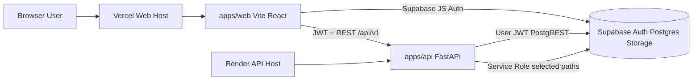
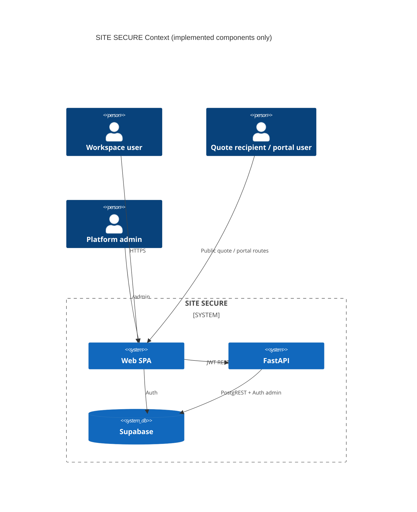
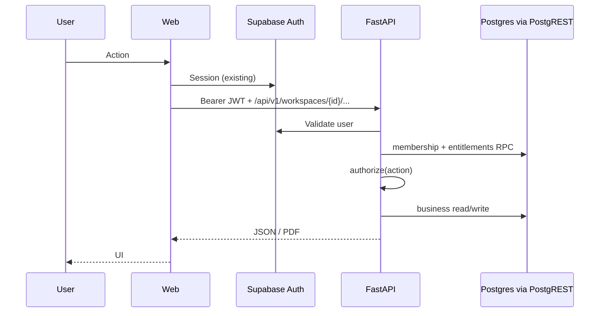
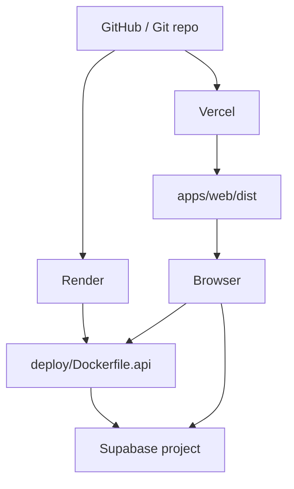

# SYSTEM OVERVIEW — SITE SECURE (CURRENT STATE)

**Sources:** `package.json`, `apps/web/package.json`, `apps/api/pyproject.toml`, `apps/api/app/main.py`, `supabase/`, `packages/authz/catalog.json`, `vercel.json`, `render.yaml`, `.env.example`.  
**As of:** 2026-10-02 · HEAD `23a8121f802ec71b27f100f938b595cb6c1e24e4`

## 1. Purpose

SITE SECURE is a multi-tenant SaaS for security installation/service companies: CRM, catalog/CPQ quotes (including CCTV system design), sites/assets, projects/jobs, service calls, warranties, documents, workspace settings, and platform admin for beta operations.

## 2. High-level architecture (implemented)



**Communication:** Web obtains Supabase session (anon key + Auth), then calls FastAPI with `Authorization: Bearer <access_token>`. API validates user via Supabase Auth (`UserClient`), loads workspace membership + entitlements RPC, enforces `authorize()`, then reads/writes via PostgREST HTTP clients (`http_supabase.py` / `supabase_user.py` / `supabase_service.py`).

**Not present:** `apps/mobile` (env stubs only). No Stripe/payment SDK in application source (static search).

## 3. Monorepo layout

```
SiteSecureV1/
  apps/web/          # SPA
  apps/api/          # FastAPI
  packages/authz/    # RBAC/plan catalog JSON + TS helpers
  packages/api-client/
  packages/ui/
  packages/design-system/
  packages/types/    # database.ts (STALE vs migrations — see DATABASE doc)
  supabase/migrations|seed|tests|functions|config.toml
  Docs/              # historical + this audit pack
  deploy/            # Dockerfile.api
```

Root `package.json` name: `site-secure`; workspaces: `apps/web`, `packages/*`. Scripts: `web:dev|build|test|lint|typecheck`. Engines: Node `>=20`.

## 4. Frontend summary

- **Framework:** React 19, Vite 6, TanStack Router (file routes under `apps/web/src/routes`), TanStack Query, Zod, Tailwind 4.
- **Entry:** Vite `index.html` → app bootstrap; root route `routes/__root.tsx`.
- **App shell guard:** `routes/app/route.tsx` requires session user + `session.has_workspace`; uses `memberships[0]` only (no workspace switcher).
- **i18n:** App chrome primarily hardcoded Hebrew via `i18n/he.ts`. Public marketing has HE/EN (`i18n/public-*.ts`). Full bilingual app UI: **NOT FOUND**.

## 5. Backend summary

- **Entry:** `apps/api/app/main.py` → `create_app()` → `app = create_app()`.
- **Title/version in code:** `"SITE SECURE V2 API"` / `0.7.0`.
- **Middleware:** CORS from settings; in-memory per-IP rate limit (~120 req/min); `X-Request-Id`; Hebrew validation errors.
- **Routers included in `main.py`:** health, auth, workspaces, workspace_settings, feedback, telemetry, admin, team, customers, sites, systems, search, jobs, ops_modules, quotes, quote_cpq, system_designs, catalog, catalog_import, cctv, public_quotes, documents, dashboard.
- **Routers present BUT NOT `include_router`'d:** `ipam.py`, `connections.py`, `customer_portal.py` → HTTP surface for INF-1B/1C and customer portal is **not mounted** despite code + unit tests. See AUDIT-001.

## 6. Database summary

- **Migrations on disk:** 87 SQL files under `supabase/migrations/` (excluding AppleDouble).
- **`CREATE TABLE` names found in migrations:** 76.
- **`packages/types/src/database.ts` Tables:** 51 — **25 tables present in migrations but missing from generated types** (drift). See AUDIT-002.
- **Tenant key:** `workspace_id` on business tables; membership via `workspace_memberships`.
- **Entitlements:** plans/features/overrides + RPC `my_workspace_entitlements` (API fail-closed on RPC failure per `deps.parse_entitlements_rpc`).

## 7. Auth / tenancy (summary)

| Concern | Mechanism | Evidence |
|---------|-----------|----------|
| Authentication | Supabase Auth email/password; web session hydrate | web routes login/register; API `deps.bearer_token` / `current_user` |
| Authorization | Shared catalog + API `authorize()` | `packages/authz/catalog.json`, `apps/api/app/authz/*` |
| Entitlements | RPC + overrides | `deps.load_authz_context`, migrations 0028/0041 |
| Tenant isolation | workspace_id path params + membership check + RLS policies in SQL | routers + migrations |
| Platform admin | `profiles.is_platform_admin` + `/admin` routes | admin router + web `/admin` |

## 8. Business modules (existence)

Implemented with UI+API+DB (static connectivity): Auth/Workspace, Customers/Leads, Catalog/Quotes/CPQ/PDF/Public quote, Sites, Projects/Jobs (ops), Service list, Warranties, Tasks, Knowledge, Documents, Dashboard/Today, Settings, Platform Admin, CCTV recommend + system designs.

Partial / unwired / schema-ahead: Customer portal (API router unwired), IPAM & asset connections (unwired), notifications product UI, inventory/finance/reports features (catalog gates without modules), billing provider, mobile, calendar grid, multi-workspace switcher.

## 9. Environments

| Env | Evidence | Live verification |
|-----|----------|-------------------|
| Local | `.env.example`, Vite/API localhost defaults | NOT VERIFIED runtime |
| Web production/staging | `vercel.json`; Render blueprint references `https://site-secure-umber.vercel.app` | NOT VERIFIED live |
| API staging | `render.yaml` service `site-secure-api-staging` | NOT VERIFIED live |
| Supabase | URL/keys via env (names only) | Schema vs migrations NOT VERIFIED live |

## 10. Diagrams

### System context



### Frontend → Backend request flow



### Deployment



## 11. Limitations of this overview

- Does not claim Production schema equals migration set.
- Does not claim all UI screens are E2E-proven.
- Folder name `SiteSecureV1` vs API title `V2` is naming inconsistency only — same tree.
